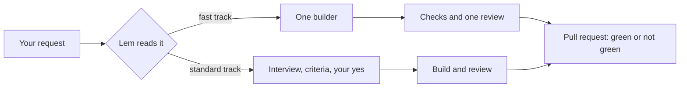

<p align="center">
  <picture>
    <source media="(prefers-color-scheme: dark)" srcset="assets/lem-night.svg">
    
  </picture>
</p>

# Lem

Type a request in plain words, and get a pull request whose first line says green or not green.
Agents plan, build, test and review the change in your repository, and you merge a green one
without a read.

Lem is a plugin for Claude Code that works closely with the [agterm](https://agterm.com) terminal:
agterm shows Lem's pages, its panes and its board. Codex is the second reviewer today, and next it
becomes a full agent of Lem.

<p align="center">
  <picture>
    <source media="(prefers-color-scheme: dark)" srcset="assets/screens/board-dark.png">
    
  </picture>
</p>

*The board of all tasks. The picture shows example tasks.*

## What it looks like

A task takes one of two tracks. The **fast track** is for one plain change with no open question:
one builder makes it, and nothing waits for you. The **standard track** is for every other
request: an interview, acceptance criteria for your yes, a plan, and a larger review.



Two examples. They are illustrations, not the output of a run:

```text
you  /lem the footer says Terms, not Terms and Conditions
lem  docs: "the footer says Terms". Branch docs/footer-says-terms. Fast track: one
     builder, the checks, one read, then the pull request. Nothing waits for you.
     Wrong read? /lem standard-track, /lem be-careful.
lem  The pull request is open. Green.
```

```text
you  /lem the export holds the gift note of an order
lem  feat: "an export holds the gift note". Branch feat/gift-note-in-export.
     Standard track: an interview in a companion now, then acceptance criteria for your yes.
     Wrong read? /lem be-careful.
lem  The interview of gift-note-in-export is open in "gift-note-in-export · interview"
     under this session.
```

The interview runs in a companion session under Lem's session. Lem's own session takes your next
request at once. In the companion:

```text
lem  An order with two notes: both in one cell, with a semicolon? My guess: yes.
you  yes
lem  The acceptance criteria, which two personas read:
     1. Order 1042 with the note "for Ania" has that text in its row.
     2. An order with no note has an empty cell.
you  yes
```

The companion closes after your yes. In Lem's session:

```text
lem  The build of gift-note-in-export started.
lem  The pull request is open. Green.
```

## Install

[Install](docs/install.md) lists the tools that Lem needs, and `/lem init` checks each one.

> [!TIP]
> Codex is optional and highly recommended: with it, a second model family reviews the larger
> changes and answers as an expert.

At the root of your repository:

```bash
claude plugin marketplace add pySilver/lem --scope project
claude plugin install lem@lem --scope project
```

Then start Claude Code in agterm there, and type `/lem init`. Answer three questions, read Lem's
page, and type "land". Then type your first request.

## What you type

| You type | What happens |
| --- | --- |
| `/lem <request>` | Lem opens a task, and tells you its type and track |
| `/lem` | the list of what waits for you, and the board |
| `/lem status <task>` | the board of one task |
| a chord in agterm (`ctrl+cmd+t`) | pick a task, and its board opens |
| `/lem plan <request>` | a standard-track task that stops after its plan. `/lem build` builds it |
| `/lem land <task>` | Lem merges the pull request |
| `/lem be-careful [task]`, `/lem standard-track [task]`, `/lem drop [task]` | you change a task: careful until the merge, the standard track until its pull request, or stopped. With no task named, Lem takes the task that you talk about and names it. If two fit, Lem asks |
| `/lem im-away`, `/lem im-back` | in every repository on this computer, the tasks go on without you, or wait for you again. A night task never waits for you |
| `/lem learn` | Lem puts your correction into the file that owns the step |

Plain words that say the same work too. With your yes at setup, `/lem retro` runs each morning and
`/lem night` each night.

## What you can rely on

- Nothing merges before your tests pass and an agent that did not build the change reviews it.
- After an interview, nothing builds before your yes to the acceptance criteria, unless you are
  away.
- Every reviewer reads a change that can affect what you said must never go wrong, and a person
  merges it.
- A step that nobody can undo always waits for you.
- Lem never pushes over a commit that it did not push.

## Skills you can call

In Lem's session, plain words start a skill too: "let's brainstorm this" starts `interview-me`.

| Example | Use it when |
| --- | --- |
| `/lem interview-me a faster export` | your request is not clear yet |
| `/lem dialectic this table stays below one million rows` | a plan rests on a claim that you doubt |
| `/lem root-cause the import stops at row 5000` | a defect comes back after two fixes |
| `/lem ask-expert` | you want two expert models to answer the open question, or your own |
| `/lem panel docs/backlog/export-drops-custom-columns.md` | you want the personas to read a text |

## Guides

- [How a task goes](docs/flow.md)
- [When Lem needs you](docs/when-lem-needs-you.md)
- [The pull request](docs/pull-request.md)
- [Install, update, remove](docs/install.md)
- [Settings](docs/settings.md)
- [Connect Linear](docs/linear.md)
