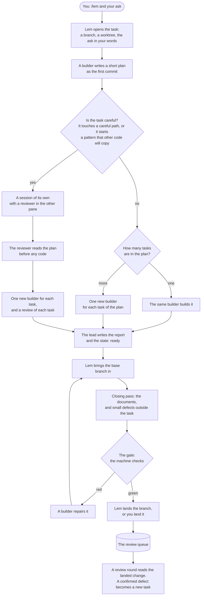
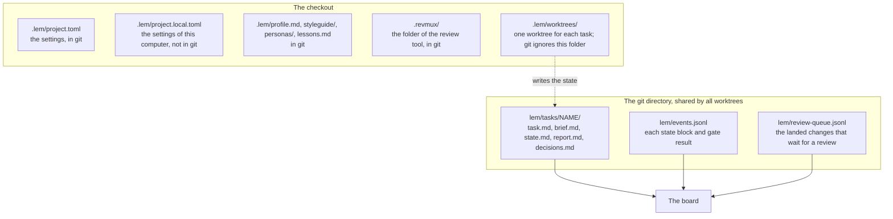

<p align="center">
  <picture>
    <source media="(prefers-color-scheme: dark)" srcset="assets/lem-night.svg">
    
  </picture>
</p>

# Lem

Lem coordinates the agents that write code in one repository. You type `/lem` and your ask. Lem
gives the work to builders, lands the change, and puts the change in a review queue.

The name is from Stanisław Lem. Lem is the one in the middle. It builds nothing. It holds the
line that the other agents work on, and it answers to you for all of them.

> **State: a first version.** Three small tasks went through Lem, in a scratch repository, on
> 2026-11-15. Two of them were careful tasks, and one came from a Linear ticket. No real project
> uses Lem yet. Lem runs in [agterm](https://agterm.com) only. Claude
> Code is the only agent with a checked contract.

## The board

`/lem status` opens the board of all tasks. `/lem status <task>` opens the board of one task.

<p align="center">
  <picture>
    <source media="(prefers-color-scheme: dark)" srcset="assets/screens/board-dark.png">
    
  </picture>
</p>

*The board of all tasks. This picture shows demo data from a fixture. The tasks are examples, and
the page says so at its top.*

<p align="center">
  <picture>
    <source media="(prefers-color-scheme: dark)" srcset="assets/screens/task-dark.png">
    
  </picture>
</p>

*The board of one task, also with demo data.*

<p align="center">
  <picture>
    <source media="(prefers-color-scheme: dark)" srcset="assets/screens/real-task-dark.png">
    
  </picture>
</p>

*The board of the first real task, after its landing. This picture shows real data from the run
in the examples below.*

The board shows these things:

- Each task is in one of four lanes:
  - it waits for you
  - it builds, or it waits to build
  - it is in the landing line
  - it is done
- Each card shows the status of the task, the lead, the newest commit, the gate result and the
  review item.
- The board of one task says who acts next.
- A line that waits for you says where you answer.
- The page reads its data again each two seconds.

## How one task goes



These rules hold for each task:

- **Build first, review after.** Machine checks gate the landing. A review reads the landed change
  from a queue.
- **A careful task keeps the slow flow.** The project names the paths where a defect costs most.
  A plan that touches one is careful. A plan that starts a pattern for other code is careful too.
  A careful plan gets a second opinion, and each of its tasks gets a review.
- **One builder for each task of a plan.** Each builder starts with an empty context. A plain
  plan with one task is the exception: the builder that wrote the plan builds it.
- **One branch lands at a time.** The gate result is about one tip on one base.
- **The review queue is honest.** A high-risk item is due on the day it lands. The queue closes
  a normal item as "not reviewed" after seven days without a review, and the report says so.
- **You are necessary at three points**: the ask, a decision whose options each cost a person
  something, and the report. Lem takes each other decision, logs it, and lists it for you to
  overturn.
- **Only some tasks build at one time.** The limit is the setting `flow.max_tasks`. A task over the
  limit waits in a queue.

## Two levels


There is one Lem for one repository. It is the session where you type `/lem`.

- Lem takes the asks, starts each task, lands the branches, and reports to you.
- Lem holds no details of a task. It reads the ask, the newest state block and the report.
- A lead owns one task from its plan to its report. A lead never asks you a question. It writes
  the question in its report, and Lem asks you.
- When Lem asks you to choose or to approve, it opens a page with the options side by side. You
  do not type a command for that.
- Three questions stay in the terminal: a value that you type, a go-ahead for a step, and a
  small fixed choice.
- The page is a part of Lem. If you prefer a different tool for questions, name it in
  `tools.ask`. The value `terminal` puts each question into the conversation as a numbered list.

## Where things are



- The settings of a project are in its repository. `/lem init` writes them.
- The state of a task is in the git directory. Git does not commit it, and it stays after Lem
  removes the worktree.
- A repository that already has `.claude/rules` or `.personas` can link them first. Then
  `/lem migrate` moves them into `.lem/` as a task.
- The folder of the review tool, `.revmux`, stays where that tool reads it. Lem does not move
  the settings of a different program.

## Examples

The first three examples are real runs. The other two examples are illustrations of the flow:
their names and answers are examples, not results.

### Start from an idea: a real run

This is the first task that went through Lem. It ran in a scratch repository on 2026-11-15. The
times are in UTC, from the event log of the task.

1. The ask: `/lem a range of dates that crosses a month must show both months, like 28 Mar-3 Apr 2026`.
2. 00:24. Lem wrote the ask, the outcome and three "done when" lines. It put one adjacent
   question out of scope: how a range shows two years.
3. Lem made the branch `fix/range-shows-both-months` with its worktree, and started one builder.
4. 00:24. The builder committed a plan with one task.
5. 00:25. The builder changed `shop/dates.py` and `tests/test_dates.py`. It set the state to
   `ready`.
6. 00:26. Lem started the landing. The base branch did not move.
7. A second builder did the closing pass. It stopped git from tracking three compiled files. It
   also proposed one backlog item: a range across a year shows only one year.
8. 00:28. The gate command ended with `OK`. Lem landed three commits on `main`.
9. Lem added review item 1 with the risk `normal`, and removed the worktree and the branch.
10. Lem reported to the owner: the result, how to see it, the decisions that it took, and what
    nobody verified.

One step did not go as the text said at that time. Claude Code refused the builder's write of its
report file. The builder sent the report in its reply, and Lem wrote the file from the reply. The
stage files now say this.

### A careful task: a real run

This is the second task. It ran in the same scratch repository on the same day. The package
`shop/` was a careful path there.

1. The ask: `/lem a range of dates that crosses a year must show both years, like 28 Dec 2026-3 Jan 2027`.
2. 02:08. Lem started one builder.
3. 02:09. The builder committed the plan and stopped, because the plan touched `shop/dates.py`.
4. 02:11. Lem opened a session for the task. Its lead opened the pane of the reviewer.
5. 02:13. The reviewer, Codex, asked for the trust of the folder. Only the owner can give that
   answer. The lead set the state to `held`, and Lem told the owner.
6. 02:17. The owner answered. Codex read the plan, and at 02:18 it agreed.
7. 02:21. A builder built the task. A new Codex read the diff and answered `LGTM`. The lead set
   the state to `ready`.
8. 02:23. The gate command ended with `OK`. Lem landed two commits on `main`.
9. Lem added review item 2 with the risk `high`, and started a review round at once.
10. 02:27. The review round had no finding. Lem closed the item as `clean`.

### A ticket from Linear: a real run

This is the third task, in the same scratch repository. Its ask was a ticket in a real Linear
workspace.

1. The ask: `/lem new MBZ-1`. The ticket said: a range of one day must show one date.
2. 12:05. Lem did a check of the workspace, read the ticket, and opened the task. The branch got
   the name that Linear gives for the ticket.
3. Lem changed the ticket to "In Progress".
4. The task was careful. A session led it, and Codex read the plan and the diff, as in the
   example above.
5. 12:13. The gate command ended with `OK`. At 12:14 Lem landed two commits on `main`.
6. Lem wrote one comment on the ticket: the result, the landed range, the gate result and the
   decisions that it took.
7. Lem changed the ticket to "Done".

Lem wrote the comment through the connection of the owner. Thus Linear shows the owner as its
author, and the last line of the comment says that it is from Lem.

Two paths did not occur in these runs:

- If the ask is not clear to you, type `/lem interview-me`. Lem asks one question at a time.
- If a decision is yours, Lem shows it to you as a page before the work that depends on it.

### Set up a repository

1. You type `/lem init`.
2. Lem does a check of the computer. It tells you which necessary tool is absent, and it stops if
   one is absent.
3. Lem reads the repository: the README, the dependencies, the tests, the CI files, the last
   merges.
4. Lem asks you one question at a time, each with its own guess. Example: "This is a shop back
   end for small merchants. Is that correct?"
5. Lem asks which paths must never break. Its guess comes from the repository, for example
   `app/payments/*` and the migrations.
6. Lem writes `.lem/project.toml` and the drafts: the profile, the personas, the style guide.
7. Lem shows you one page: what the computer has, what Lem wrote, and each assumption with its
   source.
8. Lem commits the drafts on the branch `chore/lem-onboarding`. You read them. That is the review.

### Do an item from the backlog

1. You type `/lem new docs/backlog/export-drops-custom-columns.md`.
2. Lem opens the task `export-keeps-its-columns` and starts a builder.
3. The builder writes a plan with one task and builds it. It runs the tests of the files that it
   changed.
4. The builder writes the report. The report says what you get and gives the proof for each
   "done when" line. It also says what the builder did not verify.
5. Lem brings the base branch in, and a builder does the closing pass.
6. Lem runs the gate. The gate is green.
7. Lem lands the branch and adds a review item with the risk `normal`.
8. Lem reports to you in plain words: what you get, and how to see it.
9. The report also gives the last line of each gate command and the decisions that Lem took
   without you.

A ticket in Linear can be the ask too: `/lem new MBZ-12`. Lem reads the ticket, and it comments
on the ticket when the task lands. [docs/linear.md](docs/linear.md) says how a project connects
Linear.

## Commands

| Command | What it does |
| --- | --- |
| `/lem <your ask>` or `/lem new <what>` | opens a task and starts it |
| `/lem plan <what>` | opens a task and stops after the plan, for you to read |
| `/lem build <task>` | builds a plan that waits: a night draft, or a plan that you read |
| `/lem land` | lands the oldest task that is ready |
| `/lem status`, `/lem status <task>` | opens the board of all tasks, or of one task |
| `/lem review` | does the review queue, the high-risk items first |
| `/lem reviewer <agent> [model [effort [plan_effort]]]` | names the reviewer on this computer for now |
| `/lem reviewer default` | gives the reviewer of the project back |
| `/lem migrate` | moves linked settings into `.lem/` |
| `/lem night` | writes a plan for one backlog item when nobody is there |
| `/lem learn`, `/lem retro` | changes the file that owns a step after a correction |
| `/lem init` | sets up a repository |

Each skill that comes with Lem has the id `lem-<name>` and starts with `/lem <name>`.

The skills that you call:

| Command | Use |
| --- | --- |
| `/lem interview-me` | an ask that is not clear: one question at a time, each with a guess |
| `/lem backlog` | work for later, one file for each item |
| `/lem dialectic` | a claim that two agents argue from the two sides |
| `/lem root-cause` | a defect that nobody can explain after two tries |
| `/lem webrev` | a document that you mark in an agterm overlay |
| `/lem linear check` | a test of the connection to Linear and of the `[tracker]` settings |
| `/lem release`, `/lem last-tag` | a release with notes, and the changes after the last release |
| `/lem pr-review` | a review of a pull request or an issue, with a draft comment |

The skills that Lem uses without a command from you:

| Skill | Use |
| --- | --- |
| `lem-huddle` | each question that asks you to choose or to approve, as a page |
| `lem-gate` | the decision if a question must go to you at all |
| `lem-panel` | the answers of the persons that a decision has an effect on |

## Settings

`.lem/project.toml` holds the rules of the project:

| Setting | Meaning |
| --- | --- |
| `[paths]` | where each of these is: `profile`, `styleguide`, `personas`, `review`, `lessons`, `rulings`, `backlog`, `plans`, `worktrees` |
| `branch.base`, `branch.protected` | the branch that tasks land on, and the branches that nothing lands on |
| `branch.land` | who lands: `owner` or `agent` |
| `branch.history` | what lands: the commits of the branch (`keep`) or one commit (`squash`) |
| `gate.commands`, `gate.ignores` | the machine checks, and the paths that the gate does not read |
| `flow.careful` | the paths that get the careful flow |
| `flow.max_tasks` | how many tasks build or land at one time |
| `[seats.reviewer]` | the reviewer: `agent`, and optionally `model`, `effort` (for a diff) and `plan_effort` (for a plan) |
| `tools.annotate` | the tool with which you mark a plan |
| `tools.ask` | how a question comes to you: `lem-huddle` (the page of Lem, the default), `terminal`, or a skill or a command of yours |
| `corrections.collect` | `true` keeps a queue of your corrections for `/lem retro`; the default is `false` |
| `[tracker]` | optional: `kind` (`linear`), `server`, `workspace`, `team`, and `moves` (`lem` or `tracker`); with `moves = "lem"` also `started` and `landed` |

`.lem/project.local.toml` is for one computer. Git does not track it. It can change the reviewer
and the mark tool only.

## What is necessary

Run this check: `python3 skills/lem/scripts/doctor.py`.

Necessary:

- git, and Python 3.11 or newer
- [agterm](https://agterm.com) and its skill
- `mailbox-chat.py` from the agterm cookbook:
  [two-agent-mailbox-chat](https://github.com/umputun/agterm/tree/master/cookbook/two-agent-mailbox-chat).
  It carries the messages between an agent and the reviewer in the other pane.
- [revmux](https://github.com/umputun/revmux) for the review rounds
- on a computer with Claude Code: the `lem-builder` agent, which the setup links

Optional, each with a fallback that the check names: Codex, cronn, plannotator and the `jev`
command. Lem brings its own `jev`, and the setup links it. `jev` asks the Jev decision model
through OpenRouter, and it uses your `OPENROUTER_API_KEY`.

To mark a plan or a document, use `/lem webrev`. It comes with Lem, and it is the recommended
tool. If you prefer plannotator for that, put its name in `tools.annotate`.

Lem also recommends plannotator-tui with two agterm chords, for your own use. With them you mark
the output of a pane or the newest reply of an agent. Lem does not install it. The guide is
[annotate-in-plannotator-tui](https://github.com/umputun/agterm/tree/master/cookbook/annotate-in-plannotator-tui).

## Setup in Claude Code

Run the setup script from a clone:

```bash
python3 scripts/setup.py           # make the links, then do the check of the computer
python3 scripts/setup.py --check   # change nothing; show the state of each link
python3 scripts/setup.py --remove  # remove the links again
python3 scripts/setup.py --project ~/code/shop   # link Lem into one repository only
python3 scripts/setup.py --corrections on        # optional: add the hook of the correction queue
python3 scripts/setup.py --corrections off       # remove that hook again
```

- The script links each skill into `~/.claude/skills/`, the builder agent into
  `~/.claude/agents/`, and the `huddle` and `jev` commands into `~/.local/bin/`.
- They are links. Thus each change in the clone is active in the next session.
- The script does not replace a file or a folder that is already there. It names the place and
  stops.
- Links in your home directory show Lem to each repository on the computer. For a trial, use
  `--project`. Then only that repository sees Lem, and git does not see the links.
- A project that wants a different builder keeps a file with the same name in its own
  `.claude/agents/`.
- The correction queue is optional. Its hook sends each message that you type to the Jev
  decision model, together with the agent message before it.
- The hook is active only in a repository with `corrections.collect = true`.
- You add the hook yourself, on the day of the setup or later. An agent does not add it for you.
- `--corrections on` adds one command to `~/.claude/settings.json` and keeps all other content.
  With `--project`, it writes `.claude/settings.local.json` of that repository.
- The agent that runs `/lem` coordinates. The reviewer is Codex or a second Claude, as
  `[seats.reviewer]` says.

## Tests

```bash
bash tests/test-lem.sh
bash tests/test-gate-panel.sh
bash tests/test-huddle.sh
shellcheck tests/*.sh
```
