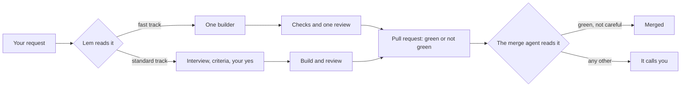
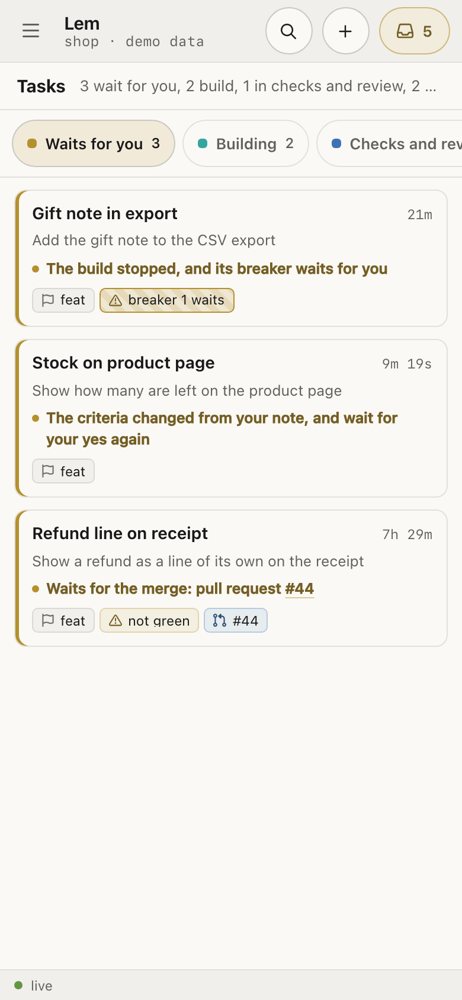

<p align="center">
  <picture>
    <source media="(prefers-color-scheme: dark)" srcset="assets/lem-night.svg">
    
  </picture>
</p>

# Lem

Type a request in plain words, and get a pull request whose first line says green or not green.
Agents plan, build, test and review the change in your repository. A fresh merge agent reads each
pull request, merges a green one that is not careful, and calls you for the rest.

Lem is a plugin for Claude Code that works closely with the [agterm](https://agterm.com) terminal:
each task gets its own agterm session and its own worktree. Many tasks build and land at the same
time. The board shows all of them in agterm, in a browser, and on your phone.

<p align="center">
  <picture>
    <source media="(prefers-color-scheme: dark)" srcset="assets/screens/board-dark.png">
    
  </picture>
</p>

*The board of all tasks. The picture shows example tasks.*

## What it looks like

A task takes one of two tracks. The **fast track** is for one plain change with no open question:
one builder makes it, and nothing waits for you. When another person wrote the ticket, its one
criterion waits for your yes first. The **standard track** is for every other request: an
interview, acceptance criteria for your yes, a plan, and a larger review.



Two examples. They are illustrations, not the output of a run. Each task answers in its own session:

```text
you  /lem the footer says Terms, not Terms and Conditions
lem  docs: "the footer says Terms". Branch docs/footer-says-terms. Fast track: one
     builder, the checks, one read, then the pull request. Nothing waits for you.
     Wrong read? /lem standard-track, /lem be-careful.
lem  The pull request is open. Green. The merge agent found nothing for you, and Lem merged it.
```

```text
you  /lem the export holds the gift note of an order
lem  feat: "an export holds the gift note". Branch feat/gift-note-in-export.
     Standard track: an interview here now, then acceptance criteria for your yes.
     Wrong read? /lem be-careful.
lem  An order with two notes: both in one cell, with a semicolon? My guess: yes.
you  yes
lem  The acceptance criteria, which two personas read:
     1. Order 1042 with the note "for Ania" has that text in its row.
     2. An order with no note has an empty cell.
you  yes
lem  gift-note-in-export goes on in a fresh session for the build.
```

The build asks you nothing, and your first session takes your next request.

## Install

[Install](docs/install.md) lists the tools that Lem needs, and `/lem init` checks each one.

> [!TIP]
> Codex is optional and highly recommended: with it, a second model family reviews the larger
> changes and answers as an expert.

At the root of your repository:

```bash
claude plugin marketplace add pySilver/lem --scope project
claude plugin install lem@lem --scope project
```

Then start Claude Code in agterm there, and type `/lem init`. Answer three questions, read Lem's
page, and type "land". Then type your first request.

## What you type

| You type | What happens |
| --- | --- |
| `/lem <request>`, in any session | Lem opens a task in a session of its own, and the task tells you its type and track |
| `/lem` | the list of what waits for you, and the board |
| `/lem status <task>` | the board of one task |
| a chord in agterm (`ctrl+cmd+t`) | pick a task: you go to its session, or its board opens when no session runs it |
| `/lem serve tailscale` | your phone gets the board, through Tailscale. Lem gives the address |
| `/lem plan <request>` | a standard-track task that stops after its plan. `/lem build` builds it |
| `/lem land <task>` | you merge an open pull request yourself |
| `/lem park [task]`, `/lem resume [task]` | you put a stopped task aside, or go back to it |
| `/lem be-careful [task]`, `/lem standard-track [task]`, `/lem drop [task]` | you change a task: careful until the merge, the standard track until its pull request, or stopped |
| `/lem im-away`, `/lem im-back` | in every repository on this computer, an interview and its criteria go on without you, or wait for you again |
| `/lem learn` | Lem puts your correction into the file that owns the step |

Plain words that say the same work too. With your yes at setup, a scheduled job runs `/lem retro`
each morning and `/lem night` each night.

## What you can rely on

- Nothing merges before your tests pass and an agent that did not build the change reviews it.
- After an interview, nothing builds before your yes to the acceptance criteria, unless you are
  away or the task runs at night.
- Every reviewer reads a change that can affect what you said must never go wrong, and you merge
  it.
- A step that nobody can undo stops the task, and waits for you.
- Lem never pushes over a commit that it did not push.

## The board, also on your phone

The board shows each task, what waits for you, the backlog and the activity, and it updates by
itself. You can approve criteria, merge and park a task there. Add it to the Home Screen of your
phone. Lem then sends a notification each time something starts to wait for you. The boards of two computers can share one address.

<p align="center">
  <picture>
    <source media="(prefers-color-scheme: dark)" srcset="assets/screens/phone-dark.png">
    
  </picture>
</p>

*The board on a phone. The picture shows demo data.*

Type `/lem serve tailscale` one time. [The board](docs/board.md) tells you the steps. The phone needs
[Tailscale](https://tailscale.com) on both devices.

## Skills you can call

After a `/lem` in a session, plain words start a skill too: "let's brainstorm this" starts
`interview-me`.

| Example | Use it when |
| --- | --- |
| `/lem interview-me a faster export` | your request is not clear yet |
| `/lem dialectic this table stays below one million rows` | a plan rests on a claim that you doubt |
| `/lem root-cause the import stops at row 5000` | a defect comes back after two fixes |
| `/lem ask-expert` | you want two expert models to answer the open question, or your own |
| `/lem panel docs/backlog/export-drops-custom-columns.md` | you want the personas to read a text |

## Guides

- [How a task goes](docs/flow.md)
- [When Lem needs you](docs/when-lem-needs-you.md)
- [The board](docs/board.md)
- [The pull request](docs/pull-request.md)
- [Install, update, remove](docs/install.md)
- [Settings](docs/settings.md)
- [Connect Linear](docs/linear.md)
- [Connect GitHub Issues](docs/github-issues.md)
