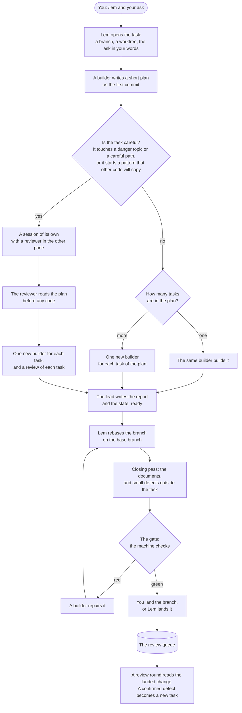
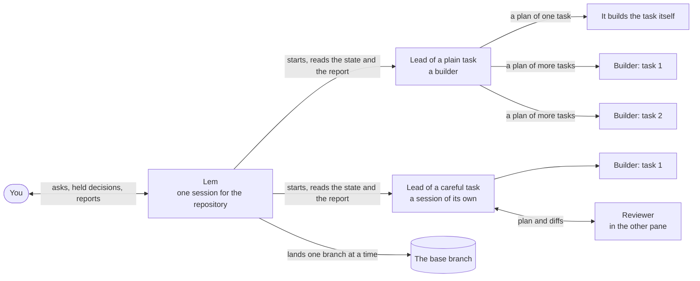
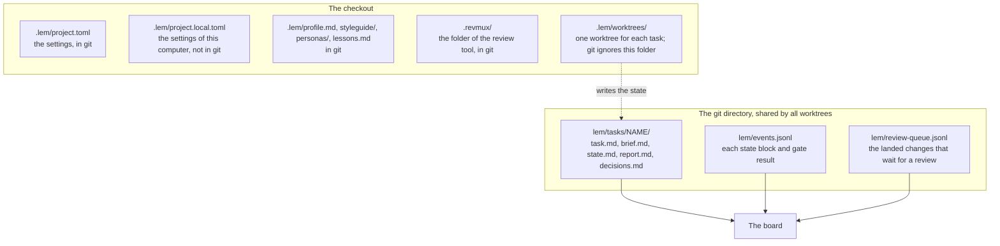

<p align="center">
  <picture>
    <source media="(prefers-color-scheme: dark)" srcset="assets/lem-night.svg">
    
  </picture>
</p>

# Lem

Lem coordinates the agents that write code in one repository. You type `/lem` and your ask. Lem
gives the work to builders, lands the change, and puts the change in a review queue.

The name is from Stanisław Lem. Lem is the one in the middle. It builds nothing. It holds the
line that the other agents work on, and it answers to you for all of them.

> **State: a first version.** Three small tasks went through Lem, in a scratch repository, on
> 2026-11-15. Two of them were careful tasks, and one came from a Linear ticket. Each plan had
> one task. No real project uses Lem yet.
>
> **Where it runs.** Lem runs on macOS, in the [agterm](https://agterm.com) terminal only. Only
> Claude Code can run `/lem`. In Codex, `/lem` stops. Codex can be the reviewer.
>
> **Not run yet.** A plan with more than one task. A reviewer that is a second Claude. A restart
> of agterm while a task is open. The correction hook in a real session.

## Words

- **Task**: one ask, with its own branch and its own worktree.
- **Builder**: a new agent that gets one job. It writes code and it commits.
- **Lead**: the agent that owns one task from its plan to its report.
- **Gate**: the check commands of your project, for example the tests. Each command must pass
  before a branch lands.
- **Land**: put the commits of a task branch on the base branch.
- **Careful task**: a task that a reviewer reads before the build and after each step.
- **Question gate**: a different thing. It decides if a question must go to you. In this
  README, "the gate" is always the check commands.

## The board

`/lem status` opens the board of all tasks. `/lem status <task>` opens the board of one task.

The board is a page in agterm, beside your sessions. It reads files from the git directory of
the repository. It needs no server.

<p align="center">
  <picture>
    <source media="(prefers-color-scheme: dark)" srcset="assets/screens/board-dark.png">
    
  </picture>
</p>

*The board of all tasks. This picture shows demo data from a fixture. The tasks are examples, and
the page says so at its top.*

<p align="center">
  <picture>
    <source media="(prefers-color-scheme: dark)" srcset="assets/screens/task-dark.png">
    
  </picture>
</p>

*The board of one task, also with demo data.*

<p align="center">
  <picture>
    <source media="(prefers-color-scheme: dark)" srcset="assets/screens/real-task-dark.png">
    
  </picture>
</p>

*The board of the first real task, after its landing. This picture shows real data from the run
in the examples below. The board shows local time. The example gives the same run in UTC.*

The board shows these things:

- Each task is in one of four lanes:
  - it waits for you
  - it builds, or it waits to build
  - it is in the landing line
  - it is done
- Each card shows the status of the task, the lead, the newest commit, the gate result and the
  review item.
- The board of one task says who acts next.
- A line that waits for you says where you answer.
- The board reads its files again each two seconds. Thus a change shows after a short time.

## How one task goes



These rules hold for each task:

- **Build first, review after.** The check commands gate the landing. A review reads the landed
  change from a queue. Thus a defect that the checks do not find lands first, and the review
  finds it later.
- **Lem has no pull request step.** A team that reviews each change before a merge has a
  different flow. Lem does not fit that flow now.
- **A careful task keeps the slow flow.** The project names what must not go wrong: as danger
  topics in your words, and as paths. Examples of topics are the price that a customer pays,
  data that nobody can make again, and private data.
- **The lead decides if a task is careful, and it says why.** It reads its plan against each
  topic and each path. It writes its decision into the plan, with one sentence of the reason.
  You see that sentence on the board and in the report.
- **You can overrule that decision.** Tell Lem that a task is careful, at each moment before
  the landing. A match of a path is always careful.
- **A plan that starts a pattern for other code is careful too.** A careful plan gets a second
  opinion, and each of its tasks gets a review.
- **One builder for each task of a plan.** Each builder starts with an empty context. A plain
  plan with one task is the exception: the builder that wrote the plan builds it.
- **One branch lands at a time.** The gate result is about one tip on one base.
- **You land, unless the settings say that Lem lands.** The default of `branch.land` is `owner`.
  Then Lem rebases the task branch, does the closing pass, and runs the gate. It does not change
  the base branch. It tells you that the branch is ready. You put the branch on the base branch,
  and you tell Lem.
- **With `branch.land = "agent"`, Lem lands a green branch.** It pushes the commits to the base
  branch on `origin`. It makes no pull request. In a repository with no remote, it moves the
  base branch forward.
- **After a landing, Lem removes the worktree of the task.** It removes the branch too, if the
  base branch has the last commit of that branch. If you landed one squash commit yourself, the
  branch stays, and you delete it.
- **A project with no gate command lands nothing.**
- **The review queue is honest.** A high-risk item is due on the day it lands. `/lem review`
  closes a normal item as "not reviewed" after seven days without a review, and the report says
  so. No timer does this.
- **The review queue is local.** It is a file in the git directory of one clone. A second person
  with a second clone does not see it. The board is local too.
- **You are necessary at three points**: the ask, a decision whose options each cost a person
  something, and the report. Lem takes each other decision, logs it, and lists it for you to
  overturn.
- **Only some tasks build at one time.** The limit is the setting `flow.max_tasks`. A task over the
  limit waits in a queue.
- **A worktree is a plain git worktree.** It has no `.env` file, no virtual environment and no
  test database. If your tasks need them, name a worktree script in the `AGENTS.md` of the
  project.
- **A builder obeys the `AGENTS.md` of the project.** It runs the formatter, the linter and the
  type checker that this file names.

## Two levels



There is one Lem for one repository. It is the session where you type `/lem`.

- Lem takes the asks, starts each task, lands the branches, and reports to you.
- Lem holds no details of a task. It reads the ask, the newest state block and the report.
- A lead owns one task from its plan to its report. A lead never asks you a question.
- Something that the plan did not see can occur in the build. The lead decides a small matter
  itself. It writes the decision and the reason into the log of the task.
- Some matters have options that each cost a person something. Then the personas answer first,
  and Lem asks you. Work that does not depend on your answer continues.
- The report of each task lists each decision that an agent took without you, with its reason.
  You can overturn each of them.
- When Lem asks you to choose or to approve, it opens a page in agterm with the options side by
  side. You do not type a command for that.
- Three questions stay in the terminal: a value that you type, a go-ahead for a step, and a
  small fixed choice.
- The page is a part of Lem. If you prefer a different tool for questions, name it in
  `tools.ask`. The value `terminal` puts each question into the conversation as a numbered list.

## Where things are



- The settings of a project are in its repository. `/lem init` writes them.
- The state of a task is in the git directory. Git does not commit it, and it stays after Lem
  removes the worktree.
- `profile.md` says what the project is. `styleguide/` holds the rules for the code. `lessons.md`
  holds the corrections that have no better place.
- `personas/` has one file for each person that a decision has an effect on, for example a
  customer. Some decisions of a task have options that each cost a person something. Before
  such a decision goes to you, an agent answers as each person. The questions of `/lem init` go
  to you directly.
- A repository that already has `.claude/rules` keeps that folder. It is the style guide, and
  the settings name it. Lem makes no copy and no symbolic link.
- A rule file can name the files that it applies to. It does this at its top, between two `---`
  lines, with `paths:` and a list of globs:

  ```markdown
  ---
  paths:
    - "app/**/*.py"
    - "tests/**/*.py"
  ---
  ```

- A rule file without `paths:` applies to all files. Lem gives each builder and each reviewer
  the rule files for the files of the change.
- `.revmux` is the folder of the review tool, revmux. `/lem init` puts the starter set of that
  tool there, and a lesson can change a file there.

## What Lem writes, and how you undo it

| Where | What | How you undo it |
| --- | --- | --- |
| Your computer | links in `~/.claude/skills/`, `~/.claude/agents/` and `~/.local/bin/`, from the setup | `setup.py --remove` |
| The repository, or your computer | one hook in `.claude/settings.local.json` of the repository, or in `~/.claude/settings.json`; only if you run `--corrections on` | `setup.py --corrections off`, with the same `--project` |
| Your computer | scheduled jobs in cronn, only after your yes in `/lem init` | remove the job in cronn |
| The repository | `.lem/` and the starter set in `.revmux/`, on the branch `chore/lem-onboarding` | before you answer "land": answer "drop"; after that: the steps below |
| The repository | one branch for each task, and its worktree in `.lem/worktrees/` | Lem removes the worktree after the landing, and the branch if the base branch has its commits |
| The repository | the state of the tasks in the git directory, in `.git/lem/`; git does not commit it | delete that folder |
| The repository | the commits of a task on the base branch, when the task lands | `git revert` |
| The remote | a push to the base branch on `origin`, only with `branch.land = "agent"` | `git revert`, then a push |
| Linear | status changes and one comment on the ticket of a task, only with a `[tracker]` table | change the ticket in Linear |

- The scripts of Lem do not edit your `.gitignore`. They write their own ignore file in `.lem/`
  and in `.lem/worktrees/`.
- A task that you drop keeps its branch, because no other branch has its commits. You delete
  that branch.

To remove Lem from a repository:

1. Land or drop each open task.
2. Remove the scheduled jobs of this repository in cronn, if you accepted them.
3. Run `python3 scripts/setup.py --project DIR --remove`, if you linked Lem into that repository.
4. Run `python3 scripts/setup.py --corrections off --project DIR`, if you added the hook there.
5. Delete the folder `.git/lem/`.
6. Run `git rm -r .lem`.
7. Commit that change.
8. Delete the folder `.lem/`. Git does not track the settings of this computer and the
   worktrees in it, thus `git rm` leaves them.
9. Delete `.revmux/` too, if you do not use the review tool for other work.
10. Delete the branch of each task that you dropped.

## Examples

The first three examples are real runs. The other two examples are illustrations of the flow:
their names and answers are examples, not results.

### Start from an idea: a real run

This is the first task that went through Lem. It ran in a scratch repository on 2026-11-15. The
times are in UTC, from the event log of the task. The board picture above shows the same run in
local time, one hour later. In that repository, `branch.land` was `agent`.

1. The ask: `/lem a range of dates that crosses a month must show both months, like 28 Mar-3 Apr 2026`.
2. 00:24. Lem wrote the ask, the outcome and three "done when" lines. It put one adjacent
   question out of scope: how a range shows two years.
3. Lem made the branch `fix/range-shows-both-months` with its worktree, and started one builder.
4. 00:24. The builder committed a plan with one task.
5. 00:25. The builder changed `shop/dates.py` and `tests/test_dates.py`. It set the state to
   `ready`.
6. 00:26. Lem started the landing. The base branch did not move.
7. A second builder did the closing pass. It removed three compiled files from git. It
   also proposed one backlog item: a range across a year shows only one year.
8. 00:28. The gate command ended with `OK`. Lem landed three commits on `main`.
9. Lem added review item 1 with the risk `normal`, and removed the worktree and the branch.
10. Lem reported to the owner: the result, how to see it, the decisions that it took, and what
    nobody verified.

One step did not go as the text said at that time. Claude Code refused the builder's write of its
report file. The builder sent the report in its reply, and Lem wrote the file from the reply. The
stage files now say this.

### A careful task: a real run

This is the second task. It ran in the same scratch repository on the same day. The package
`shop/` was a careful path there.

1. The ask: `/lem a range of dates that crosses a year must show both years, like 28 Dec 2026-3 Jan 2027`.
2. 02:08. Lem started one builder.
3. 02:09. The builder committed the plan and stopped, because the plan touched `shop/dates.py`.
4. 02:11. Lem opened a session for the task. Its lead opened the pane of the reviewer.
5. 02:13. The reviewer, Codex, asked for the trust of the folder. Only the owner can give that
   answer. The lead set the state to `held`, and Lem told the owner.
6. 02:17. The owner answered. Codex read the plan, and at 02:18 it agreed.
7. 02:21. A builder built the task. A new Codex read the diff and answered `LGTM`. The lead set
   the state to `ready`.
8. 02:23. The gate command ended with `OK`. Lem landed two commits on `main`.
9. Lem added review item 2 with the risk `high`, and started a review round at once.
10. 02:27. The review round had no finding. Lem closed the item as `clean`.

### A ticket from Linear: a real run

This is the third task, in the same scratch repository. Its ask was a ticket in a real Linear
workspace.

1. The ask: `/lem new MBZ-1`. The ticket said: a range of one day must show one date.
2. 12:05. Lem did a check of the workspace, read the ticket, and opened the task. The branch got
   the name that Linear gives for the ticket.
3. Lem changed the ticket to "In Progress".
4. The task was careful. A session led it, and Codex read the plan and the diff, as in the
   example above.
5. 12:13. The gate command ended with `OK`. At 12:14 Lem landed two commits on `main`.
6. Lem wrote one comment on the ticket: the result, the landed range, the gate result and the
   decisions that it took.
7. Lem changed the ticket to "Done".

Lem wrote the comment through the connection of the owner. Thus Linear shows the owner as its
author, and the last line of the comment says that it is from Lem.

Two paths did not occur in these runs:

- If the ask is not clear to you, type `/lem interview-me`. Lem asks one question at a time.
- If a decision is yours, Lem shows it to you as a page before the work that depends on it.

### Set up a repository

1. You type `/lem init`.
2. Lem tells you the path of the repository, and it puts the name of the repository on the
   session.
3. Lem does a check of the computer. It tells you which necessary tool is absent, and it stops if
   one is absent.
4. Lem reads the repository: the README, the dependencies, the tests, the CI files, the last
   merges.
5. Lem asks you one question at a time, each with its own guess. Example: "This is a shop back
   end for small merchants. Is that correct?"
6. Lem proposes what must not go wrong in this project: the danger topics, and the paths where
   the code has them now. Examples are "the price that a customer pays" and `app/payments/*`.
   You correct the two lists.
7. Lem writes `.lem/project.toml` and these drafts: the profile, the personas, a lessons file,
   and the starter set of the review tool in `.revmux/`.
8. Lem writes a style guide only if the repository has no `.claude/rules` folder.
9. Lem commits all of this on the branch `chore/lem-onboarding`, in your checkout.
10. Lem shows you one page. Its first line is the path of the repository. Then it lists what the
    computer has, what Lem wrote, and each assumption with its source.
11. Lem opens the three drafts that you read first, one after the other: the careful paths, the
    gate, the personas. You mark them, and Lem corrects them.
12. You answer with one of three words: "land", "change" or "drop".
13. On "land", Lem puts the branch on the base branch. This is the one landing that does not
    read `branch.land`: your word is the approval.
14. If cronn runs on the computer, Lem can offer scheduled jobs for this repository. It adds a
    job only after your yes.

### Do an item from the backlog

1. You type `/lem new docs/backlog/export-drops-custom-columns.md`.
2. Lem opens the task `export-keeps-its-columns` and starts a builder.
3. The builder writes a plan with one task and builds it. It runs the tests of the files that it
   changed.
4. The builder writes the report. The report says what you get and gives the proof for each
   "done when" line. It also says what the builder did not verify.
5. Lem brings the base branch in, and a builder does the closing pass.
6. Lem runs the gate. The gate is green.
7. Lem lands the branch, because `branch.land` is `agent` in this example. It adds a review item
   with the risk `normal`.
8. Lem reports to you in plain words: what you get, and how to see it.
9. The report also gives the last line of each gate command and the decisions that Lem took
   without you.

A ticket in Linear can be the ask too: `/lem new MBZ-12`. Lem reads the ticket, and it comments
on the ticket when the task lands. [docs/linear.md](docs/linear.md) says how a project connects
Linear.

## Commands

`/lem` is one command. The first word after it says what Lem does.

### Commands that you type

| Command | What it does |
| --- | --- |
| `/lem <your ask>`, or `/lem new <what>` | opens a task and runs it to the gate. It has no interview, and it does not stop for you to read the plan. The task waits if each place is in use. It stops for the reviewer of a careful plan, and for a decision that is yours |
| `/lem plan <what>` | opens a task and stops after the plan. You read the plan. Then `/lem build` continues |
| `/lem build` | lists the plans that wait and asks which one it builds |
| `/lem build <task>`, or `/lem build <plan file>` | builds that plan: a plan that you read, or a draft from the night |
| `/lem land` | runs the gate for the oldest task that is ready; lands it if `branch.land` is `agent` |
| `/lem`, `/lem status`, `/lem status <task>` | opens the board of all tasks, or of one task |
| `/lem review` | shows the review queue, and reviews its first item |
| `/lem review <id>` | reviews the item that you name |
| `/lem ask <question>` | puts a question to you as a page with the options side by side |
| `/lem annotate <file>` | opens a plan or a document for you to mark, with the tool in `tools.annotate` |
| `/lem learn` | you corrected an agent a moment ago: Lem puts the correction into the file that owns that step, and tells you each change |
| `/lem reviewer <agent> [model [effort [plan_effort]]]` | names the reviewer on this computer for now; the agent is `claude` or `codex` |
| `/lem reviewer codex gpt-6.1-sol high` | an example: Codex is the reviewer, with the model `gpt-6.1-sol` and the effort `high` |
| `/lem reviewer default` | gives the reviewer of the project back |
| `/lem init` | sets up a repository |

### Commands that Lem or a scheduled job starts

You can type each of these commands, but usually you do not.

| Command | Who starts it | What it does |
| --- | --- | --- |
| `/lem review` | Lem, when a high-risk task lands; a scheduled job for the normal items, if you accepted that job in `/lem init` | reads one landed change with the review tool; a confirmed defect becomes a new task; closes a normal item after seven days without a review |
| `/lem retro` | a scheduled job, in the morning | reads the landed tasks and the correction queue; finds a correction that you gave more than one time; proposes where it must go |
| `/lem night` | a scheduled job, at night | writes a plan for one backlog item that needs no decision; you read the plan in the morning |

- The scheduled jobs are jobs in cronn. `/lem init` offers them, and it adds a job only after
  your yes.
- [docs/free-hour.md](docs/free-hour.md) is about a different job: a session with no person at
  the terminal that corrects Lem itself. It works on a branch of the clone, and it does not push.

### Skills that you call

Each skill that comes with Lem has the id `lem-<name>`. You start it with `/lem <name>`.

| Command | Use it when | Example |
| --- | --- | --- |
| `/lem interview-me` | your ask is not clear to you yet; Lem asks one question at a time, each with a guess | `/lem interview-me a faster export` |
| `/lem backlog` | you want to see, add or do work for later; each item is one file | `/lem backlog` |
| `/lem dialectic` | a claim decides a plan, and you are not sure that the claim is true; two agents argue the two sides | `/lem dialectic this table stays below one million rows` |
| `/lem root-cause` | a defect is there again after two fixes, and nobody can explain it | `/lem root-cause the import stops at row 5000` |
| `/lem webrev` | you want to mark a document in an agterm overlay; `/lem annotate` uses it by default | `/lem webrev docs/plans/20261115-export.md` |
| `/lem release` | you make a release: Lem finds the next version and writes the notes, and you approve them | `/lem release` |
| `/lem last-tag` | you want to see the commits after the last release | `/lem last-tag` |
| `/lem pr-review` | a pull request or an issue from a different person needs an answer; Lem writes a draft comment | `/lem pr-review 42` |

### Skills that Lem uses without a command from you

| Skill | Use |
| --- | --- |
| `lem-ask` | each question that asks you to choose or to approve, as a page |
| `lem-gate` | the question gate: it decides if a question must go to you at all |
| `lem-panel` | the personas: an agent answers as each person that the decision has an effect on |
| `lem-linear` | the tickets of Linear; Lem tests the connection in `/lem init`, and again when it reads a ticket |

## Settings

`.lem/project.toml` holds the rules of the project:

| Setting | Default | Meaning |
| --- | --- | --- |
| `paths.profile` | `.lem/profile.md` | what the project is |
| `paths.styleguide` | `.lem/styleguide`, or `.claude/rules` if that folder is there | the rule files for the code |
| `paths.personas` | `.lem/personas` | one file for each person that a decision has an effect on |
| `paths.review` | `.revmux` | the folder of the review tool |
| `paths.lessons` | `.lem/lessons.md` | the corrections that have no better place |
| `paths.rulings` | `docs/rulings` | your decisions that hold for later tasks |
| `paths.backlog` | `docs/backlog` | work for later |
| `paths.plans` | `docs/plans` | the plan of each task |
| `paths.worktrees` | `.lem/worktrees` | the worktrees of the tasks |
| `branch.base` | the default branch of `origin` | the branch that tasks land on |
| `branch.protected` | empty | the branches that nothing lands on |
| `branch.land` | `owner` | who lands: `owner` or `agent` |
| `branch.history` | `keep` | what lands: the commits of the branch (`keep`) or one commit (`squash`) |
| `gate.commands` | empty | the check commands; with none, no task lands |
| `gate.ignores` | empty | the paths that the gate does not read |
| `flow.topics` | empty | the danger topics: what must not go wrong, each as one sentence in your words |
| `flow.careful` | empty | the paths that get the careful flow |
| `flow.max_tasks` | `4` | how many tasks build or land at one time |
| `seats.reviewer.agent` | none; `/lem init` asks | the reviewer: `claude` or `codex` |
| `seats.reviewer.model`, `.effort`, `.plan_effort` | the default of the agent | the model of the reviewer, its effort for a diff, and its effort for a plan |
| `tools.annotate` | `lem-webrev` | the tool with which you mark a plan |
| `tools.ask` | `lem-ask` | how a question comes to you: the page of Lem, `terminal`, or a skill or a command of yours |
| `corrections.collect` | `false` | `true` keeps a queue of your corrections for `/lem retro` |
| `[tracker]` | absent | `kind` (`linear`), `server`, `workspace`, `team` and `moves` |

- `tracker.moves` says who changes the status of a ticket: `lem`, or `tracker` for the automation
  of the tracker. With `lem`, the table also names the two statuses, `started` and `landed`.
- `.lem/project.local.toml` is for one computer. Git does not track it. It can change the
  reviewer, the mark tool and the question tool only.

## What is necessary

Lem runs on macOS, because agterm is a terminal for macOS.

Necessary, in the order in which you install them:

1. git, and Python 3.11 or newer as `python3` on your `PATH`. The `python3` that macOS brings
   can be older.
2. Claude Code. It is the agent that runs `/lem`.
3. [agterm](https://agterm.com), and the agterm skill. The Help menu of agterm installs the
   skill.
4. The mailbox chat from the agterm cookbook:
   [two-agent-mailbox-chat](https://github.com/umputun/agterm/tree/master/cookbook/two-agent-mailbox-chat).
   It puts `mailbox-chat.py` on your `PATH` and adds a skill. It carries the messages between an
   agent and the reviewer in the other pane.
5. [revmux](https://github.com/umputun/revmux), and the revmux skill for your agent. revmux does
   the review rounds: it starts some agents that read one change.
6. The `lem-builder` agent. The setup of Lem links it.

Then run the check from the clone of Lem: `python3 skills/lem/scripts/doctor.py`. It prints one
row for each tool, and it says which necessary tool is absent.

Optional, each with a fallback that the check names:

- Codex, as a reviewer from a different model family. For the personas, Codex also needs the
  agent file `~/.codex/agents/persona.toml`.
- cronn, for the scheduled jobs.
- plannotator, as a different mark tool.
- an `OPENROUTER_API_KEY`. Lem brings its own `jev` command, and `jev` asks the Jev decision
  model through OpenRouter. Lem uses it for the correction queue, to sort the backlog, and to
  check a question page. Without a key, these three steps give no result.

To mark a plan or a document, use `/lem webrev`. It comes with Lem, and it is the recommended
tool. If you prefer plannotator for that, put its name in `tools.annotate`.

Lem also recommends plannotator-tui with two agterm chords, for your own use. With them you mark
the output of a pane or the newest reply of an agent. Lem does not install it. The guide is
[annotate-in-plannotator-tui](https://github.com/umputun/agterm/tree/master/cookbook/annotate-in-plannotator-tui).

## Setup in Claude Code

A first run has these steps:

1. Clone Lem: `git clone https://github.com/pySilver/lem`.
2. Go into the clone: `cd lem`.
3. Run `python3 skills/lem/scripts/doctor.py`.
4. Install each necessary tool that the check shows as absent.
5. Run `python3 scripts/setup.py --project ~/code/shop`. The result lists each link.
6. In agterm, go to `~/code/shop`.
7. Start `claude`.
8. Type `/lem init`.
9. Answer the questions.
10. Read the drafts.
11. Answer "land".
12. Type `/lem` and a small ask.

Then Lem makes a branch, and a builder commits a plan and the change. Lem runs the gate. With
the default settings, Lem then stops and tells you that the branch is ready.

All options of the setup script:

```bash
python3 scripts/setup.py           # make the links, then do the check of the computer
python3 scripts/setup.py --check   # change nothing; show the state of each link
python3 scripts/setup.py --remove  # remove the links again
python3 scripts/setup.py --project ~/code/shop   # link Lem into one repository only
python3 scripts/setup.py --corrections on --project ~/code/shop    # optional: add the hook of the correction queue
python3 scripts/setup.py --corrections off --project ~/code/shop   # remove that hook again
```

- The script links each skill into `~/.claude/skills/`, the builder agent into
  `~/.claude/agents/`, and the `lem-ask` and `jev` commands into `~/.local/bin/`.
- They are links. Thus each change in the clone is active in the next session.
- The script does not replace a file or a folder that is already there. It names the place and
  stops.
- Links in your home directory show Lem to each repository on the computer. For a trial, use
  `--project`. Then only that repository sees Lem.
- With `--project`, the links are in `.claude/skills/` and `.claude/agents/` of that repository.
  The script writes one ignore file in each of the two folders. Then git does not see the links.
- A folder that already has a `.gitignore` keeps that file. If that file does not hide the
  links, git sees them, and the result of the script names the folder.
- With `--project`, the script does not link the `lem-ask` and `jev` commands. Lem then starts
  its question page by its path.
- The links point at the clone. A `git pull` in the clone changes Lem in each linked repository
  at once.
- A task session starts in the permission mode that your Claude Code settings give a new
  session. The run from the Linear ticket used the auto mode.
- A project that wants a different builder keeps a file with the same name in its own
  `.claude/agents/`.
- The correction queue is optional. Its hook sends each message that you type to the Jev
  decision model, together with the agent message before it.
- The hook is active only in a repository with `corrections.collect = true`.
- You add the hook yourself, on the day of the setup or later. An agent does not add it for you.
- Add the hook for one repository, with `--project`. The script then adds one command to
  `.claude/settings.local.json` of that repository, and it keeps all other content.
- Without `--project`, the command goes into `~/.claude/settings.json`. Then the hook starts on
  each message in each repository. Use that form only if many of your repositories use Lem.
- The agent that runs `/lem` coordinates. The reviewer is Codex or a second Claude, as
  `[seats.reviewer]` says.

## Tests

```bash
bash tests/test-lem.sh
bash tests/test-gate-panel.sh
bash tests/test-ask.sh
shellcheck tests/*.sh
```
