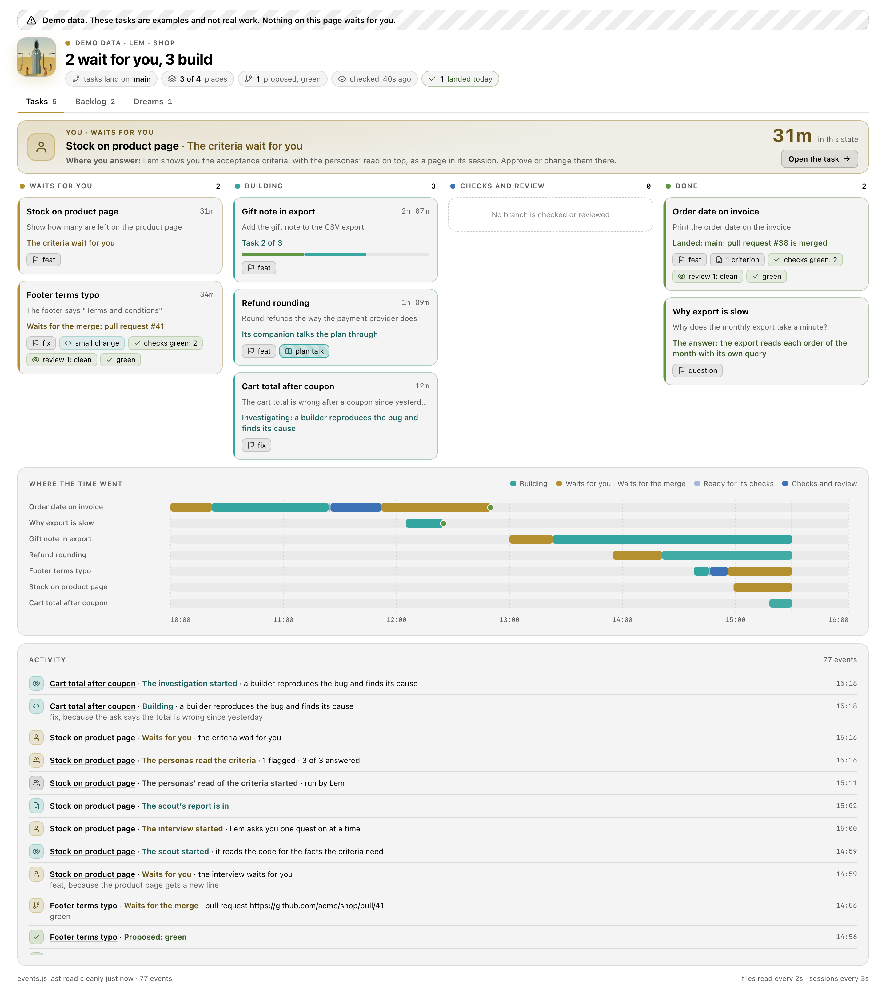
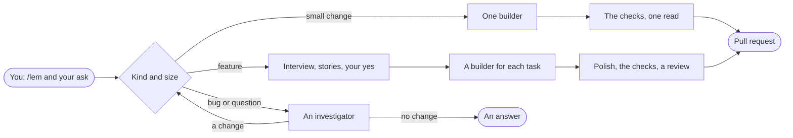

<p align="center">
  <picture>
    <source media="(prefers-color-scheme: dark)" srcset="assets/lem-night.svg">
    
  </picture>
</p>

# Lem

Lem gives your ask to the agents that write code in one repository. You get back a pull request
that says green or not green.

Lem is a first version for macOS, the [agterm](https://agterm.com) terminal and Claude Code. No
real project uses it yet ([what ran](docs/examples.md#what-ran-and-what-did-not)).

<p align="center">
  <picture>
    <source media="(prefers-color-scheme: dark)" srcset="assets/screens/board-dark.png">
    
  </picture>
</p>

*The board of all tasks, with demo data from `board.py --demo`. The page says that the tasks are
examples.*

## What you type, and what happens

These examples are illustrations. The lines of Lem are the ones that `skills/lem/stages/new.md`
gives.

**A small change**: `/lem the date column must never wrap`

> Small change, fix/date-column-nowrap: "the date column never wraps". One builder, the checks,
> one review, then the pull request. Nothing waits for you; say "feature" to give it stories.

You get a pull request, and nothing asks for you.

**A feature**: `/lem let an export hold the gift note`

> Feature, feat/gift-note-in-export: "an export holds the gift note". An interview now, then
> stories for your yes; after that it runs to the pull request without you.

You answer short questions and approve the stories. Then you get a pull request.

**A bug**: `/lem the invoice total skips credit notes`

> Bug, fix/total-skips-credit-notes: "the total skips credit notes". A builder reproduces it and
> finds its cause first, and I tell you what it found.

Then the task continues as a small change or a feature, or it ends with an answer.



A careful change also gets a plan talk, the full review and your merge.
[docs/flow.md](docs/flow.md) gives each step.

## What Lem promises

- Nothing gets to the base branch before the machine checks and a review by a different agent.
- The first line of a pull request says green or not green, and each reason comes next.
- A change near what must never go wrong gets the full review, and you merge it.
- A feature builds after your yes to its stories, or, from a complete ticket, after the personas
  find no doubt.
- A step that nobody can undo waits for your word.

## Install

[Lem needs](docs/install.md#what-lem-needs) macOS, agterm and its skill, Claude Code, git,
Python 3.11 or newer, the mailbox chat and revmux. Codex is optional.

### The plugin

Run these two commands in the root of your repository:

```bash
claude plugin marketplace add pySilver/lem --scope project
claude plugin install lem@lem --scope project
```

The repository `pySilver/lem` is private now, so your GitHub account needs read access to it.

1. Start Claude Code in agterm, in the root of the repository.
2. Type `/lem init`.
3. Answer three questions: what the product is, who a change affects, and what must never go wrong.
4. Read the drafts, and type `land`.
5. Type `/lem` and a small ask.

To update, run `claude plugin marketplace update lem` and `claude plugin update lem@lem`, then
start a new session.

- Proven: on 2026-11-15, Claude Code 2.1.325 loaded the plugin from a folder and from the
  settings of a project.
- A task in the plugin form: not run yet.

### The clone, if you change Lem

Use one way in a repository: the plugin or the links of a clone.

```bash
git clone https://github.com/pySilver/lem
python3 lem/scripts/setup.py --project ~/code/shop
```

The setup links Lem into that repository and checks the computer. Without `--project`, the links
go into your home directory, for each repository. [docs/install.md](docs/install.md) has the
details and the removal steps.

## Every day

| You type | What it does |
| --- | --- |
| `/lem <your ask>` | opens a task, and says its size in one line |
| `/lem plan <your ask>` | stops after the plan, for you to read |
| `/lem build [task or plan file]` | builds a plan that waits |
| `/lem`, `/lem status [task]` | opens the board, and says what waits for you |
| `/lem land <task>` | your word to merge an open pull request or a ready branch |
| `feature`, `careful`, `drop` | changes the path of a task, or stops it |
| `/lem ask <question>` | puts a question to you as a page |
| `/lem annotate <file>` | opens a file for you to mark |
| `/lem learn` | puts your correction into the file that owns the step |
| `/lem reviewer <agent> [model [plan_effort]]` | sets the reviewer of a plan talk on this computer; `default` resets it |
| `/lem init` | sets up a repository |

Lem itself starts `/lem land` when a task is ready. A scheduled job starts `/lem retro` each
morning and `/lem night` each night. You can type them, but usually you do not.

## The words you meet

- **Task**: one ask, with its own branch and worktree.
- **Small change**: one plain change, with one story in your words and no open question.
- **Feature**: each other ask.
- **Story**: one rule of your ask in plain words, with an example. Each story gets a test.
- **Interview**: Lem asks one question at a time, each with its guess.
- **Personas**: the people a change affects. An agent reads the stories as each of them.
- **Topic**: one sentence of what must never go wrong in your project.
- **Careful**: a change near a topic.
- **Polish pass**: a new builder removes what the build left behind.
- **The checks**: your commands, the test of each story, and the bar.
- **The bar**: a new suppression, a skipped or deleted test, or fewer assertions lower it.
- **Review**: an agent that did not build the change reads it.
- **Green**: you can merge without a read.

[docs/inside.md](docs/inside.md) has the words of the inside of Lem.

## The skills Lem ships

A task needs none of them. They help you when you step in.

| You type | Use it when | Example |
| --- | --- | --- |
| `/lem interview-me` | your ask is not clear to you yet | `/lem interview-me a faster export` |
| `/lem backlog` | you see, add or do work for later | `/lem backlog` |
| `/lem dialectic` | a plan rests on a claim that you doubt | `/lem dialectic this table stays below one million rows` |
| `/lem root-cause` | a defect comes back after two fixes | `/lem root-cause the import stops at row 5000` |
| `/lem release` | you make a release | `/lem release` |
| `/lem last-tag` | you want the commits after the last release | `/lem last-tag` |
| `/lem pr-review` | a pull request of a different person needs an answer | `/lem pr-review 42` |
| `/lem ask-expert` | a choice that waits has no answer from the two experts | `/lem ask-expert gift-note 3` |
| `/lem linear` | you want to read one Linear ticket | `/lem linear MBZ-12` |
| `/lem panel` | the personas must read a text | `/lem panel docs/backlog/export-drops-custom-columns.md` |
| `/lem gate` | you want to know if one of your rulings answers a question | `/lem gate is the empty column rule ruled` |

## More

- [How one task goes](docs/flow.md), step by step, for each size.
- [The settings](docs/settings.md), each with its default.
- [Inside Lem](docs/inside.md): the agents, the files and the board.
- [Install and remove](docs/install.md): each form, and what Lem writes.
- [Examples](docs/examples.md): real runs with their dates, and illustrations.
- [Linear](docs/linear.md) and [the free hour](docs/free-hour.md).
