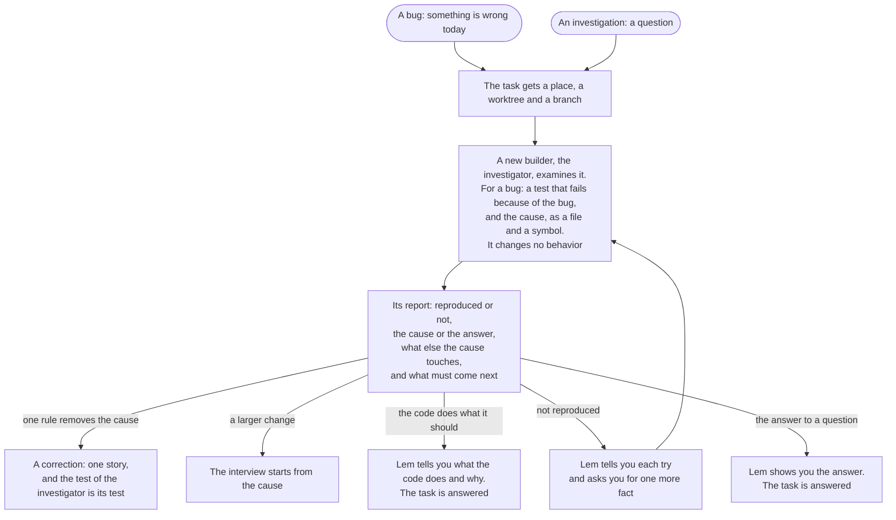
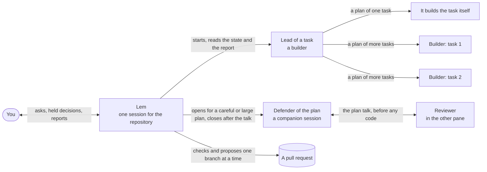
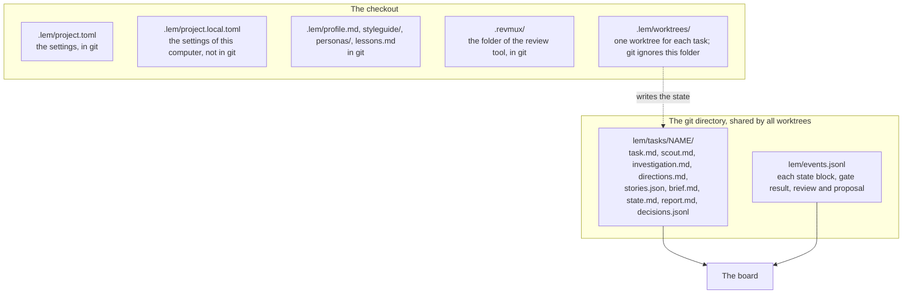

<p align="center">
  <picture>
    <source media="(prefers-color-scheme: dark)" srcset="assets/lem-night.svg">
    
  </picture>
</p>

# Lem

Lem coordinates the agents that write code in one repository. You type `/lem` and your ask. Lem
gives the work to builders. Then the change gets the machine checks and a review. The result is
a pull request, and its first line says green or not green.

The name is from Stanisław Lem. Lem is the one in the middle. It builds nothing. It holds the
line that the other agents work on, and it answers to you for all of them.

> **State: a first version.** Three small tasks went through Lem, in a scratch repository, on
> 2026-11-15. Two of them were careful tasks, and one came from a Linear ticket. Each plan had
> one task. No real project uses Lem yet.
>
> **Where it runs.** Lem runs on macOS, in the [agterm](https://agterm.com) terminal only. Only
> Claude Code can run `/lem`. In Codex, `/lem` stops. Codex can be the reviewer.
>
> **The flow changed on 2026-11-16.** Those three runs used the flow of 2026-11-15: Lem landed
> a branch first, and a review came after. Now a review comes before a pull request. No task
> ran through the new flow yet.
>
> **Not run yet.** A task in the new flow. A pull request on GitHub: only a stand-in for the
> `gh` command ran in the tests. A plan with more than one task. A plan talk, and its companion session. A reviewer that is a second
> Claude. A restart of agterm while a task is open. The correction hook in a real session.
>
> **Not built.** A pull request on GitLab. Lem marks the branch as ready there.

## Words

- **Task**: one ask, with its own branch and its own worktree.
- **Builder**: a new agent that gets one job. It writes code and it commits.
- **Lead**: the agent that owns one task from its plan to its report.
- **Story**: one rule of your ask in plain language, with one example. Each story gets a test.
- **Interview**: Lem asks you about your ask, one question at a time, before it writes the
  stories.
- **Scout**: an agent that reads the code around your ask during the interview. It gives facts
  to Lem, not a plan. It changes nothing.
- **Kind**: the type of your ask: a bug, a feature, a correction, an investigation, a chore or
  docs. Lem takes it from your words.
- **Investigator**: a builder that examines a bug or a question before Lem writes a story. For a
  bug, it writes a test that fails because of the bug, and it finds the cause.
- **Answered**: the end of a task with a report and no change to merge.
- **Direction**: a technology, a library or an approach that you name in the interview. The plan
  obeys it.
- **Gate**: the check commands of your project, for example the tests. Each command must pass
  before Lem proposes a change.
- **Polish pass**: a new builder reads the change after the last task. It removes leftovers and
  corrects false comments and documents. It changes no behavior.
- **Review**: an agent that did not build the change reads it, before Lem proposes it.
- **Green**: the first word of a pull request that you can merge without a read. The checks
  passed, the review found nothing that must change, and no story changed.
- **Land**: put the commits of a task branch on the base branch.
- **Careful task**: a task that touches what must not go wrong. Its plan gets a plan talk, and
  the landing gives it the full review set of the project.
- **Large task**: a task whose plan has more than three tasks. Its plan gets a plan talk too.
- **Plan talk**: two agents argue a careful or large plan before the build. The reviewer gives
  all of its questions in its first turn.
- **Defender**: the agent that holds the plan talk for the plan. It is in a companion session
  that Lem opens for the talk. The reviewer is in the other pane of that session.
- **Question gate**: a different thing. It decides if a question must go to you. In this
  README, "the gate" is always the check commands.

## The board

`/lem status` opens the board of all tasks. `/lem status <task>` opens the board of one task.

The board is a page in agterm, beside your sessions. It reads files from the git directory of
the repository. It needs no server.

<p align="center">
  <picture>
    <source media="(prefers-color-scheme: dark)" srcset="assets/screens/board-dark.png">
    
  </picture>
</p>

*The board of all tasks. This picture shows demo data from a fixture. The tasks are examples, and
the page says so at its top.*

<p align="center">
  <picture>
    <source media="(prefers-color-scheme: dark)" srcset="assets/screens/task-dark.png">
    
  </picture>
</p>

*The board of one task, also with demo data.*

<p align="center">
  <picture>
    <source media="(prefers-color-scheme: dark)" srcset="assets/screens/backlog-dark.png">
    
  </picture>
</p>

*The backlog tab of the board, with demo data.*

<p align="center">
  <picture>
    <source media="(prefers-color-scheme: dark)" srcset="assets/screens/real-task-dark.png">
    
  </picture>
</p>

*The board of the first real task, after its landing. This picture shows real data from the run
in the examples below. The board shows local time. The example gives the same run in UTC.*

The board shows these things:

- Each task is in one of four lanes:
  - it waits for you
  - it builds, or it waits to build
  - it is in the landing line
  - it is done
- Each card shows the status of the task, the lead, the newest commit, the gate result and the
  newest review. A task that Lem proposed shows green or not green.
- The board of one task says who acts next.
- A line that waits for you says where you answer.
- A second tab shows the backlog: the work for later, in groups. A group is "Needs you", "An
  agent can take it", "Waits for something" or "Decided against".
- An item whose place in the code is gone has a mark. You filter the items with words.
- Each item has one action, "Start a task". It types `/lem new` and the item into the session of
  Lem, after you confirm it.
- The board reads its files again each two seconds. Thus a change shows after a short time.

## How one task goes

```mermaid
flowchart TD
    ask([You: /lem and your ask]) --> kind{Lem names the kind of your ask.<br/>If your words do not show it,<br/>Lem asks you}
    kind -- a bug or a question --> inv[An investigator examines it first.<br/>See "The kind of your ask"]
    kind -- a feature, a correction,<br/>a chore or docs --> open[Lem opens the task:<br/>a branch, a worktree, the ask in your words]
    open --> path{Is the whole context<br/>written already?<br/>For example, a ticket<br/>with a defined result}
    path -- no --> interview[The interview: Lem asks you,<br/>one question at a time.<br/>A scout reads the code<br/>at the same time]
    interview --> stories[Lem writes the stories.<br/>The personas read them]
    stories --> approve[You approve the stories,<br/>with the result of the personas on top]
    approve --> plan[A builder writes a short plan<br/>as the first commit.<br/>It copies your stories]
    path -- yes --> rare[A builder writes the stories and the plan.<br/>The personas read the stories.<br/>A doubt stops it for you]
    rare --> careful
    plan --> careful{Is the task careful or large?<br/>Careful: it touches a danger topic or a careful path,<br/>or it starts a pattern that other code will copy.<br/>Large: the plan has more than three tasks}
    careful -- no --> count{How many tasks<br/>are in the plan?}
    count -- one --> same[The same builder builds it]
    count -- two or three --> build[One new builder<br/>for each task of the plan.<br/>If a document must change,<br/>the last task is for documents]
    careful -- yes --> session[Lem opens a companion session:<br/>the defender, with a reviewer<br/>in the other pane]
    session --> talk[The plan talk: the defender and the reviewer<br/>argue a list of questions<br/>that the first turn closes,<br/>before any code]
    talk --> close[Lem closes the companion.<br/>A new builder leads the build]
    close --> buildc[One new builder<br/>for each task of the plan.<br/>If a document must change,<br/>the last task is for documents]
    same --> report[The lead writes the report<br/>and the state: ready]
    build --> report
    buildc --> report
    report --> base[Lem rebases the branch<br/>on the base branch]
    base --> polish[The polish pass: a new builder removes<br/>false comments and leftovers, corrects documents,<br/>and repairs or files the defects outside the task.<br/>A correction does not get it]
    polish --> gate{The machine checks:<br/>the gate, the test of each story,<br/>the bar}
    gate -- red --> repair[A builder repairs it] --> base
    gate -- green --> review{A review, as large<br/>as the change needs}
    review -- a finding that must change --> fix[A builder corrects it] --> gate
    review -- nothing must change,<br/>or two rounds are done --> pr[A pull request:<br/>green or not green in its first line]
    pr --> merge[You merge it.<br/>Lem merges a green one,<br/>if the settings permit that]
```

These rules hold for each task:

- **Usually, Lem interviews you first.** Lem asks one question at a time, and it gives its own
  guess with each question. Thus you react, and you do not write the answer from nothing. You
  can be technical. You can name a technology, a library or an approach.
- **A scout reads the code during the interview.** It is an agent that changes nothing. It gives
  facts to Lem: what exists, what the code does today, and what limits your ask. Lem can use a
  fact in a later question. Thus the scout costs you no wait. In two measured runs it took 26.7
  seconds in a small repository and 116.5 seconds in the repository of Lem (2026-11-16).
- **Lem writes the stories after the interview.** It uses your words, your directions, the
  profile of the project and the report of the scout. Lem writes no code.
- **The personas read the stories before you approve them.** When both model families answer,
  a split between them counts as a doubt. One measured read took 2 minutes and 9 seconds
  (2026-11-16, two personas, two stories).
- **Lem shows the stories in the conversation first.** Each story shows the facts of the scout
  that it comes from. Lem tells you that the personas read them now.
- **You approve the stories on one page, after the read.** The result of the personas is on
  top, for each persona and each model family. A split between the families comes first. A
  story that a persona flagged stays as Lem wrote it, with the answers of the personas next to
  it. You approve the stories, or you change a story, a direction or the set. The build starts
  only after your approval.
- **You can approve in the conversation.** Type your approval before the read ends. If nobody
  is confused, Lem tells you so in one line and opens no page. If a persona has a doubt, Lem
  opens the page for that doubt.
- **A partial read counts.** If a persona agent does not answer, the read continues. The pull
  request says who did not answer, and why. If nobody answers, Lem starts the read again.
- **Approved stories do not change silently.** The plan must hold your stories word for word.
  The lead adds only the tests. If the build must change, add or remove a story, the lead
  records the change with the text before and after. Then the pull request is not green, and it
  shows the change and its reason. The gate stops a plan whose stories are not your stories
  with the recorded changes. If you approve the changed stories later, the pull request still
  shows each change, with "approved by you afterwards", and that change does not make it not
  green. Only you can change the kind of the stories, a feature or a
  correction.
- **A ticket with all of its context gets no interview.** This is the rare path: a ticket, a
  backlog item whose options are settled, or a night plan that you start, each with a defined
  result. Lem tells you in one line that it takes this path, and why. You can say "interview
  me". The lead writes the stories from the code. One model family of personas reads them. If
  nobody is confused, the lead freezes the stories that the personas read, and the build starts.
  It does not wait for you. The board shows "nobody
  confused", and you can stop the task. If a persona has a doubt, the task waits for you.
- **A correction does not wait.** A correction is one story in your own words, and it touches
  nothing careful. Lem shows the story and approves it for you. The personas do not read it.
  You can say "this is a feature".
- **The plan starts with the stories.** A story is one rule of your ask in plain language, with
  one example. You read the stories, and the agents read the plan. Each story gets a test.
- **A check proves each test.** The test of a story must pass on the branch, and it must fail on
  the base commit. The check uses a worktree of its own. The board of a task shows the stories
  and the result of that check.
- **A polish pass comes after the last task.** A new builder reads the change of the task,
  before the machine checks and the review. Thus the review reads the code as it will merge.
- **The polish pass looks for a short, fixed list.** It looks for a comment or a document that
  the change made false, for leftovers, and for code that works but is difficult to read.
- **Leftovers are specific.** They are debug output, dead code, a name that nothing uses, a block
  of code in comments, and a note of a builder to itself.
- **The polish pass changes no behavior.** It must not change the test of a story or the plan.
  After the pass, the test of each story runs again. Lem refuses a pass that breaks one.
- **A builder that repairs a finding of the review gets the same list.** No second polish pass
  comes after it.
- **A correction gets no polish pass.** Its one builder changed one rule, and the review reads
  each line of it. If its report lists a defect outside the task, the pass runs.
- **Defects outside the task go to the backlog.** The interview, the scout and the builders find
  them. The polish pass repairs a small one. It files each other one as a backlog item on the
  task branch.
- **Nobody asks you about a backlog item.** The pull request lists each item that the polish pass
  filed, and how many commits the pass made.
- **A plan can end with a documentation task.** If the change makes a document false, the last
  task of the plan corrects it. The polish pass makes sure that no false document stays.
- **The machine checks come next.** They are the gate commands, the check of each story's
  test, and the bar. They use no model.
- **The bar must not go down.** A new lint or type suppression, a skipped or deleted test, and
  fewer assertions in a test each lower the bar. Lem refuses such a change. It passes only if the
  plan gives a reason for that file, and then the pull request is not green.
- **A review comes before the pull request.** An agent that did not build the change reads the
  diff. It does not get the reasons of the builder.
- **An agent decides how large the review is.** A small change gets one read. Each other change
  gets a round of the review tool with the profiles that fit. That agent reads what each
  profile is for. Thus a change of documents gets no security check.
- **A careful request always gets the full set of the project.** A large request gets a round
  at the least. No agent can go below that.
- **A review can be incomplete.** If one source does not answer, the review counts, and the
  pull request says who answered. If no source answers two times, the pull request says "not
  reviewed".
- **A review has two rounds at most.** A finding that must change goes to a builder. After the
  second round, Lem proposes the change as it is. The pull request is green only if that round
  found nothing that must change.
- **A task ends as a pull request.** With a remote on GitHub, Lem opens it with the `gh`
  command. With a different remote, or with none, Lem marks the branch as ready.
- **A project can work with no pull requests.** Set `branch.propose = "merge"`. Then Lem marks
  the branch as ready also with a remote on GitHub. Lem pushes it to the base branch on
  `origin`, so the tasks in the other worktrees start from it. With no remote, Lem merges into
  the local base branch. The text of the request is in `pr.md` in the folder of the task.
- **The first line says green or not green.** Each reason for "not green" is one line, before
  all other text. Then come your words, the stories with their tests, each check with its
  result, and the notes of Lem.
- **The checks tell you who read the stories.** One line gives how many personas answered of
  the personas asked, the model families, who did not answer, the stories that they flagged,
  and the date of your approval. For a correction, the line says that the personas did not read
  it. If you changed the stories after the read, a second line says so. The checks also name the
  report of the scout.
- **Lem proposes no feature without a read.** Lem also proposes no request whose read found a
  doubt that you did not see. You approve the stories after the read, and then Lem continues.
- **A careful task gets more care.** The project names what must not go wrong: as danger
  topics in your words, and as paths. Examples of topics are the price that a customer pays,
  data that nobody can make again, and private data.
- **The lead decides if a task is careful, and it says why.** It reads its plan against each
  topic and each path. It writes its decision into the plan, with one sentence of the reason.
  You see that sentence on the board and in the report.
- **You can overrule that decision.** Tell Lem that a task is careful, at each moment before
  the landing. A match of a path is always careful.
- **A plan that starts a pattern for other code is careful too.**
- **A careful or large plan gets a plan talk.** The builder that wrote the plan stops. Lem
  opens a companion session for the talk. Its agent, the defender, and the reviewer argue the
  plan in the two panes before any code. They look for an obstacle that the plan did not see,
  and for a better design. You can read the two panes while they talk.
- **The companion closes after the talk.** Lem closes it when the log of the task has the record
  of the talk. Then a new builder leads the build, with one builder for each task of the plan.
- **You choose the models of the talk.** `[seats.planner]` names the model and the effort of the
  defender, and `[seats.reviewer]` names those of the reviewer.
- **The reviewer gives all of its questions first.** It reads the full plan. Its first turn is
  a numbered list of questions, with the most expensive first. The list closes with that turn.
- **Each question gets one repair.** The defender repairs the plan, or it refutes the question
  with a cite. The reviewer answers each question by its number: closed, or it holds.
- **A question that holds two times stops.** It becomes a design choice. The defender does not
  change the plan for it, and Lem asks it as a choice.
- **A repair that adds a mechanism names the decision under it.** A mechanism is, for example, a
  guard, a cache, a flag or a retry. The repair names the decision of the plan that made the
  problem possible, and the source of that decision: a story, a ruling, the code, or only the
  choice of the planner.
- **A layer over a weak decision is not a repair.** The reviewer says "at the cause" or "layer
  over" the decision. A layer stays only if the decision has a source. Otherwise the repair must
  change the decision. If the defender keeps it, the question becomes a design choice. A second
  question about the same decision becomes a design choice too.
- **A changed decision can bring new problems.** Each problem that the reviewer finds in it is
  the same question again, not a new question. Thus the question soon becomes a design choice.
  Your card then shows the two sides: the old decision with its mechanisms, and the new decision
  with the tasks and stories that it changes and each problem that the reviewer found.
- **A late question is not argued.** The plan records it as "raised, not argued". The review
  before the pull request examines it.
- **A scope that the plan puts out of the change is not a question.** The defender answers such
  a question with the line of the plan, and closes it.
- **The talk has a limit.** It has four turns for each question at the most, plus two. This
  limit comes from the rules. Nobody measured it.
- **A disagreement about what a person sees goes to the personas.** A disagreement that stays at
  the end is a decision. If it must go to you, Lem asks you, and the other work continues.
- **A settled position is a claim.** The plan keeps a record of the talk. The review before the
  pull request does not take the agreement of two agents as a fact.
- **The pull request shows the talk.** One line gives the reviewer, the turns, and the positions
  that were settled and left open. Lem proposes no request without a talk if its plan asked for
  one.
- **A task can become careful after its plan.** You can say so, or its diff can touch a careful
  path. Then it gets no talk, because the code exists. It gets the full review set, and you
  merge it. The pull request says why it had no talk.
- **No review after each task.** The tasks of a careful or large plan get builders like all
  others. The review before the pull request reads the whole change.
- **One builder for each task of a plan.** Each builder starts with an empty context. A plain
  plan with one task is the exception: the builder that wrote the plan builds it.
- **One branch is in the checks at a time.** The gate result is about one tip on one base.
- **You merge, unless the settings say that an agent can.** The default of `branch.land` is
  `owner`. With `agent`, Lem merges a pull request only if it is green and the request is not
  careful.
- **Tell Lem "land it" for a branch that is ready.** Lem puts it on the base branch as a
  fast-forward. With a pull request, merge it on GitHub, or tell Lem to merge it.
- **After the merge, Lem removes the worktree and the branch of the task.**
- **A project with no gate command gets no pull request from Lem.**
- **The board is local.** It reads files in the git directory of one clone. A second person
  with a second clone does not see it.
- **You are necessary at three points**: the interview with your approval of the stories, a
  decision whose options each cost a person something, and the pull request. Lem takes each other decision, logs it, and lists it for you to
  overturn.
- **Only some tasks build at one time.** The limit is the setting `flow.max_tasks`. A task over the
  limit waits in a queue.
- **A worktree is a plain git worktree.** It has no `.env` file, no virtual environment and no
  test database. If your tasks need them, name a worktree script in the `AGENTS.md` of the
  project.
- **A builder obeys the `AGENTS.md` of the project.** It runs the formatter, the linter and the
  type checker that this file names.

## The kind of your ask

Lem names the kind of each ask from your words, before an agent reads the code. It tells you the
kind in one line, with the reason. The words in the table are examples for the judgment of Lem.
No code compares your words with them.

| Kind | Use it when | Words that often show it | What Lem does |
| --- | --- | --- | --- |
| bug | something is wrong today | "broken", "shows 0", "since yesterday" | an investigator finds the cause first |
| feature | something is not there | "add", "allow", "let me" | the interview and the stories |
| correction | one rule in your sentence, and the cause is clear | "the button says Save, not Submit" | one story, and no wait |
| investigation | you want an answer, not a change | "why", "find out", "check if" | an investigator writes the answer |
| chore | the work is on the project, and no user sees it | "upgrade", "rename" | the interview and the stories |
| docs | only a document changes | "document" | the interview and the stories |

The kind also gives the type of the branch: `fix` for a bug and a correction, `feat`, `chore` or
`docs` for the others. For an investigation, Lem selects the type and tells you why.

If your words do not show the kind, the first question of the interview asks it, with the guess
of Lem. For example (an illustration, not a recorded run): "Is the 0 wrong today, a bug, or do you
want a new rule for refunds, a feature?"

### A bug and a question



- **A bug gets an investigation first.** You saw a symptom. The cause decides what the change
  must be. Thus Lem starts no story before the cause is known.
- **The investigator changes no behavior.** For a bug, its one commit is the test that fails. For
  a question, it commits nothing, and it removes each temporary file.
- **The report replaces the scout.** Lem reads the report as it reads the report of a scout. The
  interview of a bug starts from the cause.
- **An answered task has nothing to merge.** It goes to the "Done" lane of the board with its
  answer. The branch stays, because it can hold the test of the bug.
- **You can start a task from a report.** Type `/lem new` and the path of the report. The report
  is the written context of the new task.
- **The pull request names the cause.** A correction or a feature that came from a bug shows the
  cause in one line.

## Two levels



There is one Lem for one repository. It is the session where you type `/lem`.

- Lem takes the asks, starts each task, and takes each branch through the checks and the
  review to a pull request.
- Lem holds no details of a task. It reads the ask, the newest state block and the report.
- A lead owns one task from its plan to its report. A lead never asks you a question.
- A builder leads each task. A builder has no pane, thus it cannot hold the plan talk of a
  careful or large plan. It stops after the plan.
- Lem then opens a companion session for the talk. The defender is in its left pane and the
  reviewer in the other. The two argue the plan before any code, through the mailbox.
- The companion closes after the talk. A new builder then leads the build of the plan.
- Something that the plan did not see can occur in the build. The lead decides a small matter
  itself. It writes the decision and the reason into the log of the task.
- Some matters have options that each cost a person something. Then the personas of the
  project answer first, and Lem asks you with their answers. Work that does not depend on your
  answer continues.
- Two experts answer each such choice when Lem asks you. They are agents of two different model
  families. Their two answers are on the page with the question.
- A choice waits 15 minutes for your answer (`flow.decision_wait`). Then the lead takes the
  option that both experts selected. When the experts do not agree, the lead takes the
  recommended option. The pull request is not green for that choice.
- When you are away, Lem does not wait 15 minutes. If the two experts selected the same option,
  Lem takes it at once. The pull request is not green for that choice.
- A step that nobody can reverse later never goes ahead without your answer. Examples are an
  email to a person and a payment. Only that part of the plan waits.
- The report of each task lists each decision that an agent took without you, with its reason.
  You can overturn each of them.
- When Lem asks you to choose or to approve, it opens a page in agterm with the options side by
  side. You do not type a command for that.
- Three questions stay in the terminal: a value that you type, a go-ahead for a step, and a
  small fixed choice.
- The page is a part of Lem. If you prefer a different tool for questions, name it in
  `tools.ask`. The value `terminal` puts each question into the conversation as a numbered list.

## Where things are



- The settings of a project are in its repository. `/lem init` writes them.
- The state of a task is in the git directory. Git does not commit it, and it stays after Lem
  removes the worktree.
- `profile.md` says what the project is. `styleguide/` holds the rules for the code. `lessons.md`
  holds the corrections that have no better place.
- `personas/` has one file for each person that a decision has an effect on, for example a
  customer. Each project of Lem has two personas or more. `/lem init` writes them from your
  answers.
- Some decisions of a task have options that each cost a person something. Before such a
  decision goes to you, an agent answers as each person. The questions of `/lem init` go to you
  directly.
- A repository that already has `.claude/rules` keeps that folder. It is the style guide, and
  the settings name it. Lem makes no copy and no symbolic link.
- A rule file can name the files that it applies to. It does this at its top, between two `---`
  lines, with `paths:` and a list of globs:

  ```markdown
  ---
  paths:
    - "app/**/*.py"
    - "tests/**/*.py"
  ---
  ```

- A rule file without `paths:` applies to all files. Lem gives each builder and each reviewer
  the rule files for the files of the change.
- `.revmux` is the folder of the review tool, revmux. `/lem init` puts the starter set of that
  tool there, and a lesson can change a file there.

## What Lem writes, and how you undo it

| Where | What | How you undo it |
| --- | --- | --- |
| Your computer | links in `~/.claude/skills/`, `~/.claude/agents/` and `~/.local/bin/`, from the setup | `setup.py --remove` |
| The repository, or your computer | one hook in `.claude/settings.local.json` of the repository, or in `~/.claude/settings.json`; only if you run `--corrections on` | `setup.py --corrections off`, with the same `--project` |
| Your computer | scheduled jobs in cronn, only after your yes in `/lem init` | remove the job in cronn |
| The repository | `.lem/` and the starter set in `.revmux/`, on the branch `chore/lem-onboarding` | before you answer "land": answer "drop"; after that: the steps below |
| The repository | one branch for each task, and its worktree in `.lem/worktrees/` | Lem removes the worktree and the branch after the merge |
| The repository | the state of the tasks in the git directory, in `.git/lem/`; git does not commit it | delete that folder |
| The repository | the commits of a task on the base branch, when the task lands | `git revert` |
| The remote | the branch of each task that Lem proposes, and its pull request, on GitHub | close the pull request, and delete the branch |
| The remote | a merge of a pull request, or a push to the base branch on `origin` for a branch with no pull request. Lem does this on your word, or with `branch.land = "agent"` | `git revert`, then a push |
| Linear | status changes and one comment on the ticket of a task, only with a `[tracker]` table | change the ticket in Linear |

- The scripts of Lem do not edit your `.gitignore`. They write their own ignore file in `.lem/`
  and in `.lem/worktrees/`.
- A task that you drop keeps its branch, because no other branch has its commits. You delete
  that branch.

To remove Lem from a repository:

1. Land or drop each open task.
2. Remove the scheduled jobs of this repository in cronn, if you accepted them.
3. Run `python3 scripts/setup.py --project DIR --remove`, if you linked Lem into that repository.
4. Run `python3 scripts/setup.py --corrections off --project DIR`, if you added the hook there.
5. Delete the folder `.git/lem/`.
6. Run `git rm -r .lem`.
7. Commit that change.
8. Delete the folder `.lem/`. Git does not track the settings of this computer and the
   worktrees in it, thus `git rm` leaves them.
9. Delete `.revmux/` too, if you do not use the review tool for other work.
10. Delete the branch of each task that you dropped, and of each task that Lem answered.

## Examples

The first three examples are real runs of 2026-11-15. They show the flow of that day: Lem
landed a branch first, and a review item came after. That flow is gone. The other two examples
are illustrations: their names and answers are examples, not results.

### Start from an idea: a real run

This is the first task that went through Lem. It ran in a scratch repository on 2026-11-15. The
times are in UTC, from the event log of the task. The board picture above shows the same run in
local time, one hour later. In that repository, `branch.land` was `agent`.

1. The ask: `/lem a range of dates that crosses a month must show both months, like 28 Mar-3 Apr 2026`.
2. 00:24. Lem wrote the ask, the outcome and three "done when" lines. It put one adjacent
   question out of scope: how a range shows two years.
3. Lem made the branch `fix/range-shows-both-months` with its worktree, and started one builder.
4. 00:24. The builder committed a plan with one task.
5. 00:25. The builder changed `shop/dates.py` and `tests/test_dates.py`. It set the state to
   `ready`.
6. 00:26. Lem started the landing. The base branch did not move.
7. A second builder did the closing pass. It removed three compiled files from git. It
   also proposed one backlog item: a range across a year shows only one year.
8. 00:28. The gate command ended with `OK`. Lem landed three commits on `main`.
9. Lem added review item 1 with the risk `normal`, and removed the worktree and the branch.
10. Lem reported to the owner: the result, how to see it, the decisions that it took, and what
    nobody verified.

One step did not go as the text said at that time. Claude Code refused the builder's write of its
report file. The builder sent the report in its reply, and Lem wrote the file from the reply. The
stage files now say this.

### A careful task: a real run

This is the second task. It ran in the same scratch repository on the same day. The package
`shop/` was a careful path there.

1. The ask: `/lem a range of dates that crosses a year must show both years, like 28 Dec 2026-3 Jan 2027`.
2. 02:08. Lem started one builder.
3. 02:09. The builder committed the plan and stopped, because the plan touched `shop/dates.py`.
4. 02:11. Lem opened a session for the task. Its lead opened the pane of the reviewer.
5. 02:13. The reviewer, Codex, asked for the trust of the folder. Only the owner can give that
   answer. The lead set the state to `held`, and Lem told the owner.
6. 02:17. The owner answered. Codex read the plan, and at 02:18 it agreed.
7. 02:21. A builder built the task. A new Codex read the diff and answered `LGTM`. The lead set
   the state to `ready`.
8. 02:23. The gate command ended with `OK`. Lem landed two commits on `main`.
9. Lem added review item 2 with the risk `high`, and started a review round at once.
10. 02:27. The review round had no finding. Lem closed the item as `clean`.

### A ticket from Linear: a real run

This is the third task, in the same scratch repository. Its ask was a ticket in a real Linear
workspace.

1. The ask: `/lem new MBZ-1`. The ticket said: a range of one day must show one date.
2. 12:05. Lem did a check of the workspace, read the ticket, and opened the task. The branch got
   the name that Linear gives for the ticket.
3. Lem changed the ticket to "In Progress".
4. The task was careful. A session led it, and Codex read the plan and the diff, as in the
   example above.
5. 12:13. The gate command ended with `OK`. At 12:14 Lem landed two commits on `main`.
6. Lem wrote one comment on the ticket: the result, the landed range, the gate result and the
   decisions that it took.
7. Lem changed the ticket to "Done".

Lem wrote the comment through the connection of the owner. Thus Linear shows the owner as its
author, and the last line of the comment says that it is from Lem.

Three paths did not occur in these runs:

- The interview, the scout and your approval of the stories. These came after the runs.
- If the ask is not clear to you yet, before a task, type `/lem interview-me`. Lem asks one
  question at a time.
- If a decision is yours, Lem shows it to you as a page before the work that depends on it.

### Set up a repository

1. You type `/lem init`.
2. Lem tells you the path of the repository, and it puts the name of the repository on the
   session.
3. Lem does a check of the computer. It tells you which necessary tool is absent, and it stops if
   one is absent.
4. Lem reads the repository: the README, the dependencies, the tests, the CI files, the last
   merges.
5. Lem asks you one question at a time, each with its own guess. Example: "This is a shop back
   end for small merchants. Is that correct?"
6. Lem proposes what must not go wrong in this project: the danger topics, and the paths where
   the code has them now. Examples are "the price that a customer pays" and `app/payments/*`.
   You correct the two lists.
7. Lem writes `.lem/project.toml` and these drafts: the profile, two personas or more, a lessons
   file, and the starter set of the review tool in `.revmux/`.
8. Lem writes a style guide only if the repository has no `.claude/rules` folder.
9. Lem commits all of this on the branch `chore/lem-onboarding`, in your checkout.
10. Lem shows you one page. Its first line is the path of the repository. Then it lists what the
    computer has, what Lem wrote, and each assumption with its source.
11. Lem opens the three drafts that you read first, one after the other: the careful paths, the
    gate, the personas. You mark them, and Lem corrects them. Lem tells you which persona is a
    weak guess.
12. You answer with one of three words: "land", "change" or "drop".
13. On "land", Lem puts the branch on the base branch. This is the one landing that does not
    read `branch.land`: your word is the approval.
14. If cronn runs on the computer, Lem can offer scheduled jobs for this repository. It adds a
    job only after your yes.

### Do an item from the backlog

1. You type `/lem new docs/backlog/export-drops-custom-columns.md`.
2. Lem opens the task `export-keeps-its-columns` and starts a builder.
3. The builder writes a plan with one task and builds it. It runs the tests of the files that it
   changed.
4. The builder writes the report. The report says what you get and gives the proof for each
   "done when" line. It also says what the builder did not verify.
5. Lem brings the base branch in. A new builder does the polish pass. It removes one debug
   line.
6. Lem runs the machine checks. They are green.
7. A new agent reads the diff. It chooses one read, because the change is small. It finds
   nothing that must change.
8. Lem opens a pull request. Its first line is "Green."
9. Lem gives you the address of the pull request, and the word green.
10. You merge it. In this example `branch.land` is `owner`.
11. Lem removes the worktree and the branch.

A ticket in Linear can be the ask too: `/lem new MBZ-12`. Lem reads the ticket, and it comments
on the ticket when the task lands. [docs/linear.md](docs/linear.md) says how a project connects
Linear.

## Commands

`/lem` is one command. The first word after it says what Lem does.

### Commands that you type

| Command | What it does |
| --- | --- |
| `/lem <your ask>`, or `/lem new <what>` | opens a task, interviews you, and shows you the stories with the result of the personas. After your approval it runs the task to the gate. A ticket with all of its context gets no interview, and a correction does not wait. It does not stop for you to read the plan. The task waits if each place is in use. A careful or large plan gets a companion session for the plan talk, which closes after the talk. It stops for a decision that is yours |
| `/lem plan <what>` | opens a task and stops after the plan. You read the plan. Then `/lem build` continues |
| `/lem build` | lists the plans that wait and asks which one it builds |
| `/lem build <task>`, or `/lem build <plan file>` | builds that plan: a plan that you read, or a draft from the night |
| `/lem land` | takes the oldest task that is ready through the machine checks and the review, and opens its pull request |
| `/lem land <task>` | your word to merge a pull request that is open, or to land a branch that is ready |
| `/lem`, `/lem status`, `/lem status <task>` | opens the board of all tasks, or of one task |
| `/lem ask <question>` | puts a question to you as a page with the options side by side |
| `/lem annotate <file>` | opens a plan or a document for you to mark, with the tool in `tools.annotate` |
| `/lem learn` | you corrected an agent a moment ago: Lem puts the correction into the file that owns that step, and tells you each change |
| `/lem reviewer <agent> [model [effort [plan_effort]]]` | names the reviewer on this computer for now; the agent is `claude` or `codex` |
| `/lem reviewer codex gpt-6.1-sol high` | an example: Codex is the reviewer, with the model `gpt-6.1-sol` and the effort `high` |
| `/lem reviewer default` | gives the reviewer of the project back |
| `/lem init` | sets up a repository |

### Commands that Lem or a scheduled job starts

You can type each of these commands, but usually you do not.

| Command | Who starts it | What it does |
| --- | --- | --- |
| `/lem retro` | a scheduled job, in the morning | reads the landed tasks and the correction queue; finds a correction that you gave more than one time; proposes where it must go |
| `/lem night` | a scheduled job, at night | writes a plan for one backlog item that needs no decision; you read the plan in the morning |

- The scheduled jobs are jobs in cronn. `/lem init` offers them, and it adds a job only after
  your yes.
- [docs/free-hour.md](docs/free-hour.md) is about a different job: a session with no person at
  the terminal that corrects Lem itself. It works on a branch of the clone, and it does not push.

### Skills that you call

Each skill that comes with Lem has the id `lem-<name>`. You start it with `/lem <name>`.

| Command | Use it when | Example |
| --- | --- | --- |
| `/lem interview-me` | your ask is not clear to you yet; Lem asks one question at a time, each with a guess | `/lem interview-me a faster export` |
| `/lem backlog` | you want to see, add or do work for later; each item is one file | `/lem backlog` |
| `/lem dialectic` | a claim decides a plan, and you are not sure that the claim is true; two agents argue the two sides | `/lem dialectic this table stays below one million rows` |
| `/lem root-cause` | a defect is there again after two fixes, and nobody can explain it | `/lem root-cause the import stops at row 5000` |
| `/lem release` | you make a release: Lem finds the next version and writes the notes, and you approve them | `/lem release` |
| `/lem last-tag` | you want to see the commits after the last release | `/lem last-tag` |
| `/lem pr-review` | a pull request or an issue from a different person needs an answer; Lem writes a draft comment | `/lem pr-review 42` |
| `/lem ask-expert` | a choice of a task waits for you, and you want the two experts to answer it; Lem gives it to them by itself, so you need this only for a choice that has no answer from them | `/lem ask-expert gift-note 3` |

### Skills that Lem uses without a command from you

| Skill | Use |
| --- | --- |
| `lem-ask` | each question that asks you to choose or to approve, as a page |
| `lem-gate` | the question gate: it decides if a question must go to you at all |
| `lem-ask-expert` | each choice of a build that waits for you: two experts answer it at the same time, and they change no file |
| `lem-panel` | the personas of the project: an agent answers as each person that the decision has an effect on |
| `lem-linear` | the tickets of Linear; Lem tests the connection in `/lem init`, and again when it reads a ticket |

## Settings

`.lem/project.toml` holds the rules of the project:

| Setting | Default | Meaning |
| --- | --- | --- |
| `paths.profile` | `.lem/profile.md` | what the project is |
| `paths.styleguide` | `.lem/styleguide`, or `.claude/rules` if that folder is there | the rule files for the code |
| `paths.personas` | `.lem/personas` | one file for each person that a decision has an effect on |
| `paths.review` | `.revmux` | the folder of the review tool |
| `paths.lessons` | `.lem/lessons.md` | the corrections that have no better place |
| `paths.rulings` | `docs/rulings` | your decisions that hold for later tasks |
| `paths.backlog` | `docs/backlog` | work for later |
| `paths.plans` | `docs/plans` | the plan of each task |
| `paths.worktrees` | `.lem/worktrees` | the worktrees of the tasks |
| `branch.base` | the default branch of `origin` | the branch that tasks land on |
| `branch.protected` | empty | the branches that nothing lands on |
| `branch.land` | `owner` | who merges: `owner`, or `agent` for a pull request that is green and not careful |
| `branch.history` | `keep` | what lands: the commits of the branch (`keep`) or one commit (`squash`) |
| `branch.propose` | `pull-request` | how a task ends with a remote on GitHub: a pull request (`pull-request`), or a merge into the base branch with no pull request (`merge`) |
| `gate.commands` | empty | the check commands; with none, Lem proposes no change |
| `gate.ignores` | empty | the paths that the gate does not read |
| `gate.setup` | empty | the commands that a new worktree needs before its tests can start, for example an install of the packages |
| `gate.bar` | empty | more regular expressions for a mark that lowers the bar, for a language that Lem has no marks for |
| `flow.topics` | empty | the danger topics: what must not go wrong, each as one sentence in your words |
| `flow.careful` | empty | the paths that get the careful flow |
| `flow.max_tasks` | `4` | how many tasks build or land at one time |
| `flow.decision_wait` | `15` | how many minutes a choice in the build waits for your answer. Then the lead takes the option of the two experts, or the recommended option when they do not agree. The pull request is not green for it |
| `seats.reviewer.agent` | none; `/lem init` asks | the reviewer: `claude` or `codex` |
| `seats.reviewer.model`, `.effort`, `.plan_effort` | the default of the agent | the model of the reviewer, its effort for a diff, and its effort for a plan talk |
| `seats.planner.agent` | none: Claude Code | the defender of a plan talk: only `claude` |
| `seats.planner.model`, `.effort` | the default of the agent | the model and the effort of the defender |
| `tools.annotate` | `webrev` | the tool with which you mark a plan; webrev is a recommended tool that you install |
| `tools.ask` | `lem-ask` | how a question comes to you: the page of Lem, `terminal`, or a skill or a command of yours |
| `corrections.collect` | `false` | `true` keeps a queue of corrections for `/lem retro`, for each person who works in the repository with the hook |
| `[tracker]` | absent | `kind` (`linear`), `server`, `workspace`, `team` and `moves` |

- `tracker.moves` says who changes the status of a ticket: `lem`, or `tracker` for the automation
  of the tracker. With `lem`, the table also names the two statuses, `started` and `landed`.
- `.lem/project.local.toml` is for one computer. Git does not track it. It can change the
  reviewer, the defender, the mark tool and the question tool. You write the defender there
  yourself, under `[seats.planner]`.
- That file can also have `[corrections]` with `collect = false`. Then the hook sends no message
  from this computer. The file cannot set `collect = true`.

## What is necessary

Lem runs on macOS, because agterm is a terminal for macOS.

Necessary, in the order in which you install them:

1. git, and Python 3.11 or newer as `python3` on your `PATH`. The `python3` that macOS brings
   can be older.
2. Claude Code. It is the agent that runs `/lem`.
3. [agterm](https://agterm.com), and the agterm skill. The Help menu of agterm installs the
   skill.
4. The mailbox chat from the agterm cookbook:
   [two-agent-mailbox-chat](https://github.com/umputun/agterm/tree/master/cookbook/two-agent-mailbox-chat).
   It puts `mailbox-chat.py` on your `PATH` and adds a skill. It carries the messages between an
   agent and the reviewer in the other pane.
5. [revmux](https://github.com/umputun/revmux), and the revmux skill for your agent. revmux does
   the review rounds: it starts some agents that read one change.
6. The `lem-builder` agent. The setup of Lem links it.

Then run the check from the clone of Lem: `python3 skills/lem/scripts/doctor.py`. It prints one
row for each tool, and it says which necessary tool is absent.

Optional, each with a fallback that the check names:

- Codex, as a reviewer from a different model family. For the personas, Codex also needs the
  agent file `~/.codex/agents/persona.toml`.
- cronn, for the scheduled jobs.
- plannotator, as a different mark tool. Put its name in `tools.annotate`.
- an `OPENROUTER_API_KEY`. Lem brings its own `jev` command, and `jev` asks the Jev decision
  model through OpenRouter. Lem uses it for the correction queue, to sort the backlog, and to
  check a question page. Without a key, these three steps give no result.

### Recommended tools

Lem works without these tools, and it does not bring them. Each is a recipe from the agterm
cookbook, with a guide that you follow. `/lem init` can install one for you, but only after your
yes.

| Tool | What it gives you | Without it |
| --- | --- | --- |
| [webrev](https://github.com/umputun/agterm/tree/master/cookbook/annotate-document) | you mark a plan or a document as a page, and the agent gets your notes; `/lem annotate` uses it by default | you read the file as it is, and you give your notes in the conversation |
| [agdoc](https://github.com/umputun/agterm/tree/master/cookbook/html-doc-overlay) | a page about the issue, the plan or the change that the session works on | you read the same in the conversation |
| [plannotator-tui](https://github.com/umputun/agterm/tree/master/cookbook/annotate-in-plannotator-tui) | you mark the output of a pane, or the newest reply of an agent, with two agterm chords | no step of Lem changes |

## Setup in Claude Code

A first run has these steps:

1. Clone Lem: `git clone https://github.com/pySilver/lem`.
2. Go into the clone: `cd lem`.
3. Run `python3 skills/lem/scripts/doctor.py`.
4. Install each necessary tool that the check shows as absent.
5. Run `python3 scripts/setup.py --project ~/code/shop`. The result lists each link.
6. In agterm, go to `~/code/shop`.
7. Start `claude`.
8. Type `/lem init`.
9. Answer the questions.
10. Read the drafts.
11. Answer "land".
12. Type `/lem` and a small ask.

Then Lem makes a branch, and a builder commits a plan and the change. Lem runs the gate. With
the default settings, Lem then stops and tells you that the branch is ready.

All options of the setup script:

```bash
python3 scripts/setup.py           # make the links, then do the check of the computer
python3 scripts/setup.py --check   # change nothing; show the state of each link
python3 scripts/setup.py --remove  # remove the links again
python3 scripts/setup.py --project ~/code/shop   # link Lem into one repository only
python3 scripts/setup.py --corrections on --project ~/code/shop    # optional: add the hook of the correction queue
python3 scripts/setup.py --corrections off --project ~/code/shop   # remove that hook again
```

- The script links each skill into `~/.claude/skills/`, the builder agent into
  `~/.claude/agents/`, and the `lem-ask` and `jev` commands into `~/.local/bin/`.
- They are links. Thus each change in the clone is active in the next session.
- The script does not replace a file or a folder that is already there. It names the place and
  stops.
- Links in your home directory show Lem to each repository on the computer. For a trial, use
  `--project`. Then only that repository sees Lem.
- With `--project`, the links are in `.claude/skills/` and `.claude/agents/` of that repository.
  The script writes one ignore file in each of the two folders. Then git does not see the links.
- A folder that already has a `.gitignore` keeps that file. If that file does not hide the
  links, git sees them, and the result of the script names the folder.
- With `--project`, the script does not link the `lem-ask` and `jev` commands. Lem then starts
  its question page by its path.
- The links point at the clone. A `git pull` in the clone changes Lem in each linked repository
  at once.
- The companion session of a plan talk starts in the permission mode that your Claude Code
  settings give a new session. The run from the Linear ticket used the auto mode.
- A project that wants a different builder keeps a file with the same name in its own
  `.claude/agents/`.
- The correction queue is optional. Its hook sends the messages that you type to the Jev
  decision model, each with the agent message before it. It does not send a command that starts
  with `/`.
- The hook is active only in a repository with `corrections.collect = true`.
- You add the hook yourself, on the day of the setup or later. An agent does not add it for you.
- Add the hook for one repository, with `--project`. The script then adds one command to
  `.claude/settings.local.json` of that repository, and it keeps all other content.
- Without `--project`, the command goes into `~/.claude/settings.json`. Then the hook starts on
  each message in each repository. Use that form only if many of your repositories use Lem.
- The agent that runs `/lem` coordinates. The reviewer is Codex or a second Claude, as
  `[seats.reviewer]` says.

### Lem as a Claude Code plugin

This is a second way to get Lem into one repository. It has no links and no clone. A test on
2026-11-15 loaded Lem in this form. No task ran through it yet, thus the links are the
recommended way for now.

```bash
claude plugin marketplace add pySilver/lem --scope project
claude plugin install lem@lem --scope project
```

- Run the two commands in the repository. They write two keys into `.claude/settings.json`.
- With `--scope local`, they write `.claude/settings.local.json`, which git does not track.
- Start Claude Code in the root of the repository. A session that starts in a subfolder does
  not get the plugin.
- `/lem` is the same command. The skill list shows the skills as `lem:lem`, `lem:lem-ask` and
  so on, and the builder as `lem:lem-builder`.
- The `lem-ask` and `jev` commands are on the `PATH` of the agent, in that repository only.
- An update comes only after `claude plugin marketplace update lem` and
  `claude plugin update lem@lem`, and a new session.
- Use one way in a repository: the links or the plugin.

The correction hook comes with the plugin. Read this before you commit
`corrections.collect = true`:

- That line is in `.lem/project.toml`, which is in git. It is a yes for each person who works
  in the repository with the plugin.
- Then the messages that such a person types there go to the Jev decision model through
  OpenRouter, each with the agent message before it. The hook does not send a command that
  starts with `/`.
- The request uses the `OPENROUTER_API_KEY` of that person. A person without a key sends
  nothing.
- A person who does not want this puts `collect = false` under `[corrections]` into
  `.lem/project.local.toml`.
- With `corrections.collect = false`, which is the default, the hook sends nothing.

The test did not use GitHub as the source of the plugin, and it did not use a session with a
person. Thus nobody ran the two install commands above in that exact form.

## Tests

```bash
bash tests/test-lem.sh
bash tests/test-gate-panel.sh
bash tests/test-ask.sh
bash tests/test-ask-expert.sh
shellcheck tests/*.sh
```
