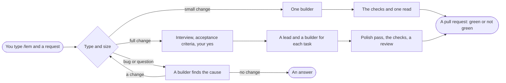

<p align="center">
  <picture>
    <source media="(prefers-color-scheme: dark)" srcset="assets/lem-night.svg">
    
  </picture>
</p>

# Lem

Lem turns a request into a pull request. You type what you want in plain words. Coding agents plan
the change, build it, test it and review it in your repository. The first line of each pull
request says green or not green, and you can merge a green one without a read.

Lem is for experienced developers who work with coding agents every day. It is a plugin for Claude
Code on macOS, and it runs in the [agterm](https://agterm.com) terminal.

<p align="center">
  <picture>
    <source media="(prefers-color-scheme: dark)" srcset="assets/screens/board-dark.png">
    
  </picture>
</p>

*The board: one page that shows all tasks. This picture shows demo data, and the page says that
the tasks are examples.*

## What you type, and what happens

Here are three examples. Each one shows the first line of Lem's answer.
[The words you meet](#the-words-you-meet) explains the terms.

**A small change.** You type `/lem the date column must never wrap`.

> fix, small: "the date column never wraps". Branch fix/date-column-nowrap. One builder, the
> checks, one read, then the pull request. Nothing waits for you; say "full" to give it acceptance
> criteria.

**A full change.** You type `/lem let an export hold the gift note`.

> feat, full: "an export holds the gift note". Branch feat/gift-note-in-export. An interview now,
> then acceptance criteria for your yes; after that it runs to the pull request without you.

**A bug.** You type `/lem the invoice total skips credit notes`.

> fix: "the total skips credit notes". Branch fix/total-skips-credit-notes. A builder finds the
> cause first, and I tell you what it found: then it is a small fix, a full fix, or no bug.



A change that can affect what must never go wrong in your project is careful. It gets the full
review, and a person merges it. [docs/flow.md](docs/flow.md) describes each step.

## What Lem promises

- Nothing merges before the checks and a review by an agent that did not build the change.
- The first line of each pull request says green or not green. Each reason comes on the next lines.
- A green pull request needs no read from you.
- A full change builds only after you say yes to its acceptance criteria. The one exception is a
  complete request that you wrote yourself, for example a ticket: it builds when no persona has a
  doubt.
- A step that nobody can undo waits for your approval.
- After a merge, Lem rebases each open pull request that has a conflict with the new base.
- Lem never overwrites a commit that it did not push.

## Install

Lem needs macOS, agterm, Claude Code, git, Python 3.11 or newer, the mailbox chat and revmux.
Codex is optional. [docs/install.md](docs/install.md#what-lem-needs) has a link to each tool.

Run these two commands at the root of your repository:

```bash
claude plugin marketplace add pySilver/lem --scope project
claude plugin install lem@lem --scope project
```

Then set up the repository:

1. Start Claude Code in agterm, at the root of the repository.
2. Type `/lem init`.
3. Answer three questions: what the product is, who a change affects, and what must never go wrong.
4. Read the page that Lem shows. To correct an assumption, type `change` and the correction.
5. Type `land`. That word puts the settings on your base branch, and the setup is done.

Now type `/lem` and a small request.

To update Lem, run `claude plugin marketplace update lem` and `claude plugin update lem@lem --scope
project`. Then start a new session. To remove Lem, follow
[these steps](docs/install.md#remove-lem-from-a-repository).

## Every day

| You type | What it does |
| --- | --- |
| `/lem <request>` | opens a task, and tells you its type and size |
| `/lem plan <request>` | stops after the plan, so that you can read it. `/lem <request>` does not stop there: you approve the acceptance criteria, which say what to build, and the plan only says how |
| `/lem build [task or plan file]` | builds a plan that waits. With no argument, it lists the plans that wait |
| `/lem`, `/lem status` | lists what waits for you, always in one order: choices, criteria for your yes, other held tasks, pull requests, night plans, retro proposals. Say "open them" to answer each plan and proposal with approve, reject or later |
| `/lem status <task>` | opens the board of one task |
| `/lem land <task>` | tells Lem to merge an open pull request |
| `full`, `careful`, `drop` | makes a small change a full change, marks a task careful, or stops it |
| `/lem ask [question]` | shows a question to you as a page. With no question, it takes the agent's last question |
| `/lem annotate <file>` | opens a file for you to mark up |
| `/lem learn` | puts your correction into the file that owns the step |
| `/lem reviewer codex/gpt-6.1-sol:high` | sets the reviewer of the plan talk on this computer: agent, model, effort. `default` resets it |
| `/lem nap` | starts a [nap](#the-words-you-meet): an agent reads the recent tasks, writes a dream, and leaves a note for the retro |
| `/lem init` | sets up a repository |

Lem starts `/lem land` when a task is ready. Scheduled jobs can start `/lem retro` each morning and
`/lem night` each night.

## The words you meet

- **Task**: one request, with its own branch and worktree.
- **Type**: a Conventional Commits type, `feat`, `fix`, `docs`, `refactor`, `perf`, `test` or
  `chore`; or `question`, which ends with an answer and commits nothing.
- **Acceptance criterion**: one rule of your request in plain words, with one real example. Each
  criterion gets a test.
- **Topic**: one sentence about what must never go wrong in your project.
- **Small change**: one plain change with one acceptance criterion. It affects no topic and has no
  open question. One builder makes it.
- **Full change**: any other request. It gets an interview, acceptance criteria, a plan and a
  lead.
- **Builder**: an agent that Lem starts in a new context for one job. A **lead** plans a full
  change and gives each task of the plan to a new builder.
- **Interview**: Lem asks you one question at a time, each with its guess.
- **Personas**: the people that a change affects. Agents read the criteria from the point of view
  of each person.
- **Careful**: the mark of a change that can affect a topic.
- **Plan talk**: two agents argue the plan of a careful or large change before a builder writes
  code.
- **Polish pass**: after the build of a full change, a new builder removes what the build left
  behind.
- **The checks**: your test commands, the test of each criterion, and the check of the bar.
- **The bar**: how strict your tests and linters are. Each of these lowers it: a new suppression,
  a skipped or deleted test, fewer assertions, or a weaker test setting.
- **Review**: an agent that did not build the change reads it. "One read" is the smallest
  review: one agent reads the change one time.
- **Green**: a pull request that you can merge without a read.
- **Nap**: an optional short run in the background. An agent reads the recent tasks, writes a
  dream, and leaves a note for the retro.
- **Retro**: a job that reads the landed tasks, the correction queue and the notes of the naps. It
  proposes where a repeated correction of yours goes.

## The skills Lem ships

A task needs none of these. They help you when you take part in the work yourself. No skill
starts by itself because of what you write. You type its `/lem` name, or a stage of Lem loads it.

| You type | Use it when | Example |
| --- | --- | --- |
| `/lem interview-me` | your request is not clear to you yet | `/lem interview-me a faster export` |
| `/lem backlog` | you want to see, add or do work for later | `/lem backlog` |
| `/lem dialectic` | a plan rests on a claim that you doubt | `/lem dialectic this table stays below one million rows` |
| `/lem root-cause` | a defect comes back after two fixes | `/lem root-cause the import stops at row 5000` |
| `/lem ask-expert` | you want two other models to answer a question | `/lem ask-expert which of the two queue designs fails better under load?` |
| `/lem linear` | you want to read one Linear ticket | `/lem linear MBZ-12` |
| `/lem panel` | you want the personas to read a text | `/lem panel docs/backlog/export-drops-custom-columns.md` |
| `/lem gate` | you want to know if a recorded ruling answers a question | `/lem gate do we still ship the CSV export with no header row?` |

`/lem ask-expert` with no question takes the open question of the conversation. If it cannot find
the question, it asks you.

## More

- [How one task goes](docs/flow.md)
- [The settings](docs/settings.md)
- [Inside Lem](docs/inside.md)
- [Install and remove](docs/install.md)
- [Lem beside your own setup](docs/compatibility.md)
- [Examples](docs/examples.md)
- [Linear](docs/linear.md)
