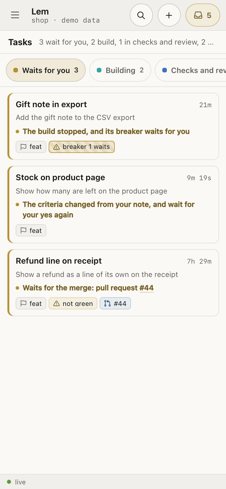

# The board

The board shows every task of a repository, and it updates by itself. One server on your
computer draws it for agterm, a browser and your phone.

## Open it

- Type `/lem`. Lem opens the board in agterm, beside your sessions.
- Type `/lem status <task>` to open one task.
- In a browser on the same computer, open `http://127.0.0.1:4536/`.

The first page lists the repositories that use Lem, each with what waits for you. The address
`/laptop/shop/tasks/gift-note` names the computer, the repository and the task.

## The views

| View | Key | It answers |
| --- | --- | --- |
| **Tasks** | `T` | Who acts next? One column for each actor. |
| **Waits for you** | `W` | What must I do? [What waits for you](when-lem-needs-you.md#what-waits-for-you): one row for each task, and one stack for a task with two or more things. |
| **Backlog** | `B` | What waits for later? The [reviewer's items](#the-reviewers-items), then the backlog in groups by worth. |
| **Activity** | `A` | Where did the time go? A chart of each task, and every event. |

Press each key alone, with no Shift. `Cmd-K` (`Ctrl-K` off a Mac), or the **Search** button, finds
any task or backlog item by its title.

An item of the backlog says who added it and on which day, from the commit that added its file:
"added by AUTHOR on DAY, in task SLUG". When that commit names no task, the item names its pull
request, if the commit names one. An item that git does not have yet says "not committed yet". An
item of the [reviewer](#the-reviewers-items) says the day that the reviewer added it.

On **Tasks**, `J`, `K`, `↑` and `↓` move a mark in a column, and `H`, `L`, `←` and `→` to the next
column. On **Waits for you**, `J`, `K`, `↑` and `↓` move it. `Enter` opens the marked task, or the
session in agterm where you answer its row. On a marked stack, `Enter` opens or closes the stack.

A task opens in a panel, or as a page on a phone. The keys `1` to `5` open its tabs, and `Escape`
closes the panel:

1. **Overview**: what the task builds, its next step, and green or not green with each reason.
2. **Criteria and decisions**: your criteria, and who took each decision.
3. **Checks and review**: each test command, and what each reviewer found.
4. **Timeline**: who held the work, and for how long.
5. **Artifacts**: the plan, the reports and the pictures.

## Act from the board

Buttons on "Waits for you" and the task pages do what Lem does on your words:

- **New task** (`+`, or the key `N`): type a request, and Lem opens the session of the new task.
  A backlog item has **Start a task**, and the item leaves the backlog when that task merges.
- **Approve the criteria**: your yes to the criteria.
- **Merge**: a page shows green or not green, the pull request and the commit first. You cannot
  undo a merge. On a phone, the page opens over the task, and its button becomes active when you
  read to the end.
- **Open a session**: starts a new agent for a task that has no session, or whose session stopped.

You also answer the questions of a task on the board. Each question has one field for a note:

- **A card**: the question page that the session of a task shows in agterm. **Answer the card**
  opens the same page, with the same options, pictures and note field.
- **A plan** that waits for you to read it: **Build** or **Drop**.
- **A breaker**: **Help**, **Park** or **Drop**. Help sends your note to the lead as your part of
  the talk, so Help needs a note.
- **Skip the persona read?** of an interview: **Yes** or **No**.
- **Approve this criterion?** of a small change that another person asked for: **Yes** or **No**.
  No needs a note: what the criterion must say.

**Park** and **Drop** ask you to confirm first. Park, and Yes to a criterion, take effect at once.
The session of the task takes each other answer as your typed word.

The board takes an answer with a note, never a conversation. A note with no option, or
a request to talk on a card, records nothing, and the row stays: ask in the session at the Mac.
Only the first answer counts. When a question does not wait any more, the board says which answer
took effect.

On a phone, **Approve the criteria**, **Park**, **Drop** and a card open over the task in the same
way. The page then shows the result, or why Lem refused.

## The reviewer's items

The night and the retro write what they find as proposals. Each morning, after the retro, a
reviewer agent reads them and refutes the weak ones. It puts the proposals that pass into backlog
items, one item for each area. It puts each proposal that it refutes into an item with
`worth: no` and its reason, so that an agent that proposes the same change again finds it
decided.
These items are in `.lem/state/backlog/`, which git ignores. **Backlog** shows the items that
passed in a group of their own, before the other items, and the refuted items in the group
"Decided against", with no **Drop**.

- An item that passed and that no task builds is "undecided". The **Backlog** key shows the
  number of undecided items. It never counts an item with `worth: no`.
- **Start a task** opens a task for the item. The item then shows the name of that task. The item
  leaves the backlog when the task merges, and it is undecided again when you drop the task.
- **Drop** removes the item at once. The record of the proposals keeps the drop, so no later
  reviewer passes that proposal again. While a task builds the item, Lem refuses the drop and gives
  the name of the task.

## The board on your phone

Your phone opens the board through [Tailscale](https://tailscale.com), a private network of your
devices. Only your Tailscale login gets access.

1. Install Tailscale on the computer and on the phone.
2. Sign in to both with the same account.
3. In the Tailscale admin console, turn on MagicDNS and HTTPS.
4. Type `/lem serve tailscale` in Claude Code one time.
5. On the phone, open the `tailscale` address that Lem gives.
6. In the browser's share menu, select "Add to Home Screen".
7. Open Lem from the Home Screen, and open "Waits for you".
8. Tap "Turn on", and allow notifications.

The phone then gets a notification when something starts to wait for you. When the computer
sleeps, the phone cannot open the board.

While you are [away](when-lem-needs-you.md#answer-from-the-inbox), the page of a task that waits
for you says: "Answer in the task's session on the Mac, or in the Inbox". "Inbox" opens the
thread of the task through the Tailscale address of the Inbox. When the Inbox does not run, or has
no Tailscale address, the page says why it has no link.

<p align="center">
  <picture>
    <source media="(prefers-color-scheme: dark)" srcset="../assets/screens/phone-dark.png">
    
  </picture>
</p>

*The board on a phone, with demo data.*

## Two computers, one address

1. On each computer, type `/lem serve tailscale` one time.
2. On the computer whose address you open, type `/lem serve join HOST`. HOST is the Tailscale name
   of the other computer.

That address then lists the repositories of both computers.
A computer that does not answer shows "not reachable".

## The server

A new Claude Code session in a repository that uses Lem starts the server, and so does the first
`lem` command of any session. The first session after an update replaces it.

The server merges a pull request when the merge agent gives the verdict merge. Each hour it removes
the old files and events, as [`state.keep_days`](settings.md#state) tells. While you are away, it
sends what waits for you to the Inbox. It never types into a session.

The server also monitors each task that builds or lands. When its session does no work for 45
minutes, the server asks the session for its status. After 10 more minutes with no work, the server
opens a fresh session one time. When that session also stops, the task waits for you as "stopped".

When the server cannot read the work of a session, it uses only the events of the task. After 45
minutes with no event, it asks the session for its status. After 10 more minutes with no event, the
task waits for you as "stopped", and the row says that Lem cannot read its session. The server does
not open a fresh session for it. "Open a session" opens one.

## Commands

Type these in Claude Code:

- `/lem serve`: starts the server if necessary, and gives the board's address.
- `/lem serve tailscale`, `/lem serve tailscale off`: lets your phone in, or closes the door.
- `/lem serve join HOST`, `/lem serve leave HOST`: adds or removes a second computer.
- `/lem serve stop`: stops the server.

After a remote login with no Claude Code, use the path that `lem doctor` gives:

```bash
~/.claude/plugins/marketplaces/lem/bin/lem serve --ensure
```
