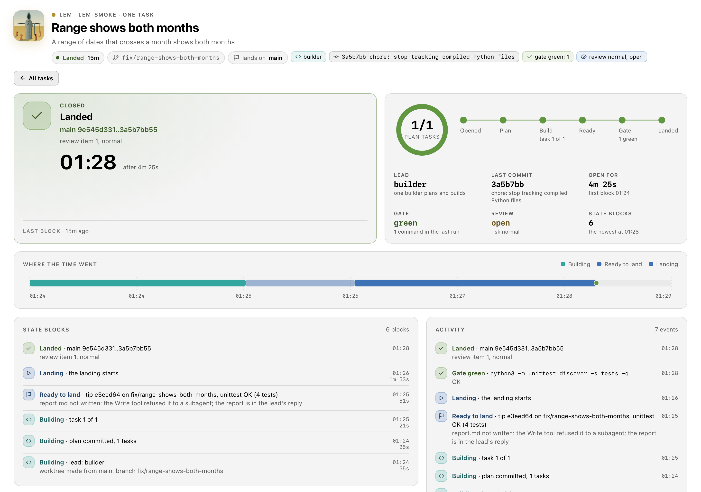

# Examples

This page gives the real runs of Lem, each with its date, and illustrations of the flow of today.
An illustration is not a run: its names and answers are examples.

## What ran, and what did not

This list is as of 2026-11-17.

- On 2026-11-15, three small tasks went through Lem, in a scratch repository. Two of them were
  careful tasks, and one came from a Linear ticket. Each plan had one task. They used the flow of
  that day, which is gone.
- On 2026-11-16, the steps of the landing ran against GitHub in a scratch repository. They opened
  pull request 1 with the `gh` command, and changed its text with a second proposal. Then they
  merged it, and removed its branch in the clone and on GitHub.
- On 2026-11-15, Claude Code loaded Lem as a plugin from a folder and from the settings of a
  project.

Not run yet:

- a task in the flow of 2026-11-16 or later, also a small change;
- a plan with more than one task;
- a plan talk, and its companion session;
- a reviewer that is a second Claude;
- a restart of agterm while a task is open;
- the correction hook in a real session;
- an install of the plugin from GitHub, and a task in the plugin form.

Not built: a pull request on GitLab. Lem marks the branch as ready there.

## Real runs of 2026-11-15

These three runs used the flow of 2026-11-15: Lem landed a branch first, and a review item came
after. That flow is gone. Now a review comes before a pull request.

  <picture>
    <source media="(prefers-color-scheme: dark)" srcset="../assets/screens/real-task-dark.png">
    
  </picture>

*The board of the first real task, after its landing, on 2026-11-15. This picture shows real data
from the first run below, on the board of that day. The board shows local time, and the example
gives the same run in UTC.*

### Start from an idea

This is the first task that went through Lem. The times are in UTC, from the event log of the
task. In that repository, `branch.land` was `agent`.

1. The ask: `/lem a range of dates that crosses a month must show both months, like 28 Mar-3 Apr 2026`.
2. 00:24. Lem wrote the ask, the outcome and three "done when" lines. It put one adjacent
   question out of scope: how a range shows two years.
3. Lem made the branch `fix/range-shows-both-months` with its worktree, and started one builder.
4. 00:24. The builder committed a plan with one task.
5. 00:25. The builder changed `shop/dates.py` and `tests/test_dates.py`. It set the state to
   `ready`.
6. 00:26. Lem started the landing. The base branch did not move.
7. A second builder did the pass at the end, which that flow had. It removed three compiled files from git. It also
   proposed one backlog item: a range across a year shows only one year.
8. 00:28. The gate command ended with `OK`. Lem landed three commits on `main`.
9. Lem added review item 1 with the risk `normal`, and removed the worktree and the branch.
10. Lem reported to the owner: the result, how to see it, the decisions that it took, and what
    nobody verified.

One step did not go as the text said at that time. Claude Code refused the builder's write of its
report file. The builder sent the report in its reply, and Lem wrote the file from the reply. The
stage files now say this.

### A careful task

This is the second task, in the same scratch repository on the same day. At that time, a project
named careful paths, and the package `shop/` was one. Lem now reads a change against topics, not
paths.

1. The ask: `/lem a range of dates that crosses a year must show both years, like 28 Dec 2026-3 Jan 2027`.
2. 02:08. Lem started one builder.
3. 02:09. The builder committed the plan and stopped, because the plan touched `shop/dates.py`.
4. 02:11. Lem opened a session for the task. Its lead opened the pane of the reviewer.
5. 02:13. The reviewer, Codex, asked for the trust of the folder. Only the owner can give that
   answer. The lead set the state to `held`, and Lem told the owner.
6. 02:17. The owner answered. Codex read the plan, and at 02:18 it agreed.
7. 02:21. A builder built the task. A new Codex read the diff and answered `LGTM`. The lead set
   the state to `ready`.
8. 02:23. The gate command ended with `OK`. Lem landed two commits on `main`.
9. Lem added review item 2 with the risk `high`, and started a review round at once.
10. 02:27. The review round had no finding. Lem closed the item as `clean`.

### A ticket from Linear

This is the third task, in the same scratch repository. Its ask was a ticket in a real Linear
workspace.

1. The ask: `/lem new MBZ-1`. The ticket said: a range of one day must show one date.
2. 12:05. Lem did a check of the workspace, read the ticket, and opened the task. The branch got
   the name that Linear gives for the ticket.
3. Lem changed the ticket to "In Progress".
4. The task was careful. A session led it, and Codex read the plan and the diff, as in the
   example above.
5. 12:13. The gate command ended with `OK`. At 12:14 Lem landed two commits on `main`.
6. Lem wrote one comment on the ticket: the result, the landed range, the gate result and the
   decisions that it took.
7. Lem changed the ticket to "Done".

Lem wrote the comment through the connection of the owner. Thus Linear shows the owner as its
author, and the last line of the comment says that it is from Lem.

## Illustrations of the flow of today

### Set up a repository

1. You type `/lem init`.
2. Lem tells you the path of the repository, and it puts the name of the repository on the
   session.
3. Lem does a check of the computer. If a required tool is absent, Lem names it and stops.
4. Lem reads the repository: the README, the dependencies, the tests, the CI files and the last
   merges.
5. Lem asks you three questions, one at a time, each with its own proposal:
   - "This is a shop back end for small merchants. Is that correct?"
   - "A change here affects a merchant and the engineer on call. Who else?"
   - "What must never go wrong here? I propose: a customer is charged the wrong price. What is
     wrong or missing?"
6. Lem writes `.lem/project.toml`, the profile, two personas or more, a lessons file, and the
   starter set of the review tool in `.revmux/`. It writes a style guide only if the repository
   has no `.claude/rules` folder.
7. Lem commits all of this on the branch `chore/lem-onboarding`, in your checkout.
8. Lem shows you one page. Its first line is the path of the repository. Then it lists what the
   computer has, and what Lem wrote. Each assumption has its source and the words that change it,
   for example "change land agent".
9. Three drafts come first: what must never go wrong, the gate, and the personas. Lem names each
   persona that is a weak guess, and it can open each draft for you to mark.
10. At the end, the page lists the offers: the correction queue, the recommended tools, cronn and
    the scheduled jobs. You take one by its name.
11. You answer with one of three words: "land", "change" or "drop".
12. On "land", Lem puts the branch on the base branch. Your word is the approval, whatever
    `branch.land` says.

### A small change

1. You type `/lem the README says "recieve"`.
2. Lem says: `Small change, docs/readme-typo: "the README spells receive right". One builder, the
   checks, one review, then the pull request. Nothing waits for you; say "feature" to give it
   stories.`
3. One builder corrects the word. The change keeps behavior, so the story gets `no test`, and the
   builder runs all the gate commands. It commits.
4. Lem runs the machine checks. The review agent reads the diff itself, one read.
5. Lem opens a pull request. Its first line is "Green."
6. You merge it.

### Do an item from the backlog

1. You type `/lem new docs/backlog/export-drops-custom-columns.md`.
2. The options of the item are settled. Thus Lem takes the rare path, and it tells you so in one
   line.
3. Lem opens the task `export-keeps-its-columns` and starts a builder as the lead.
4. The lead reads the code and writes the stories. One model family of personas reads them.
   Nobody is confused, so the lead freezes the stories, and the build starts without a wait.
5. The lead writes a plan with one task, and it gives that task to a new builder.
6. The lead writes the report: what you get, the proof for each "done when" line, and what it did
   not verify.
7. Lem rebases the branch. A new builder does the polish pass, and it removes one debug line.
8. Lem runs the machine checks. They are green.
9. A new agent reads the diff. It calls the change not careful, and it chooses one read, because
   the change is small. It finds nothing that must change.
10. Lem opens a pull request. Its first line is "Green."
11. You merge it. In this example `branch.land` is `owner`.
12. Lem removes the worktree and the branch.

### A ticket from Linear

A ticket can be the ask: `/lem new MBZ-12`. Lem reads the ticket and opens the task. A ticket
that says what you want and how to see that it is done takes the rare path. Lem moves the ticket
when the work starts, and it comments on the ticket when the task lands.
[linear.md](linear.md) says how a project connects Linear.
