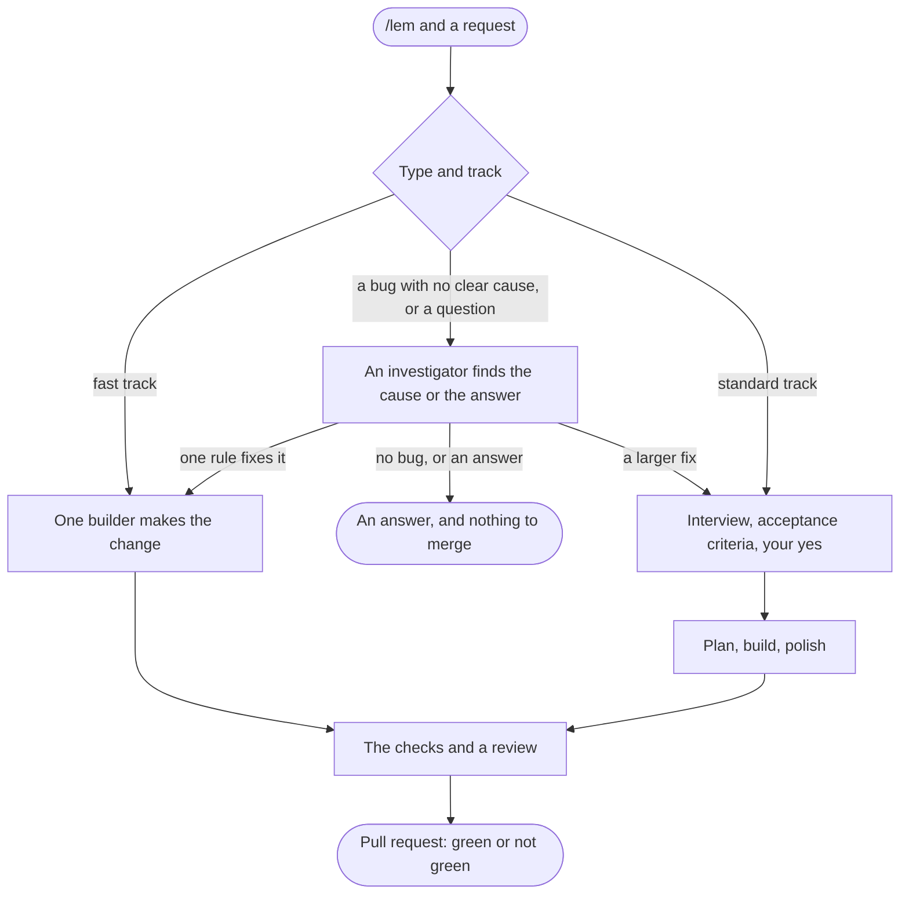

# How a task goes

## The first line

Lem answers each request with one line: the type, the track, what happens, and what you must do.
In doubt, it first asks one question, with its guess. `/lem standard-track` and
`/lem be-careful` correct the line.

- **Type**: a Conventional Commits type such as `feat` or `fix`, or `question`, which commits
  nothing.
- **Careful** comes first when the request can affect what must never go wrong:
  `Careful: this changes how a customer is charged. feat: ...`

## The fast track

The fast track is for one rule in your words, with no open question and nothing careful. Examples:
a typo, a rename across many files, a version bump, the fix of one rule.

1. Lem writes the rule as one acceptance criterion, and approves it for you.
2. One builder makes the change. A change of behavior gets a test that fails on the old code.
3. The checks run your tests, and an agent that did not build the change reads it once.
4. Lem opens the pull request.

If the builder finds that the fast track does not fit, it stops, and the interview of the
standard track starts. `/lem standard-track` does the same before the pull request.

## The standard track

1. **Interview.** Lem asks one question at a time, each with its guess. If you name a library or
   an approach, the plan uses it.
2. **Acceptance criteria.** Each one is a rule in plain words with one real example, and each gets
   a test.
3. **The personas read them.** A persona is a person that a change affects, as your setup
   describes them. Agents read the criteria as each person, and a doubt shows next to its criterion.
4. **Your yes.** Nothing builds before it, unless you are
   [away](when-lem-needs-you.md#away).
5. **The plan.** An agent commits a short plan to `docs/plans/`, and a new builder makes each part.
6. **The polish pass.** A new builder removes leftovers, such as a comment that is now false. It
   fixes a small defect outside the task, and files a larger one in `docs/backlog/`.

A ticket or a backlog item that already says what you want skips the interview. If you wrote it
and no persona has a doubt, the build starts at once. Say "interview me" to get the interview.

## A bug or a question

When your words do not show the cause of a bug, an agent called the investigator looks first. It
writes a test that fails, and finds the cause with Lem's `root-cause` skill: it asks why
until the answer is a file and a symbol. It changes no behavior. Then:

- one rule removes the cause: the fast track, with that test;
- the fix needs more: the standard track, with an interview that starts from the cause;
- no bug: Lem tells you what the code does and why;
- no way to reproduce it: Lem tells you each try, and asks for one more fact.

A question gets the same work.

## Careful

Your settings list what must never go wrong as topics, one sentence each: "a customer is charged
the wrong amount". Lem reads each request, plan and diff against them. When it is not sure, the
change is careful. `/lem be-careful` marks a task, also an open one: every reviewer reads it again.

Every reviewer reads a careful change, and a person merges it. When its plan is careful, or has
more than three parts, two agents argue the plan before any code, and you can watch.

## The checks and the review

The checks run your test commands, and no model judges them. The test of each criterion must pass
on the branch and fail on the old code. The bar, how strict your tests are, must not go down: no
new suppression, no skipped or deleted test, no fewer assertions.

The review is as large as the change: one read on the fast track, more reviewers for a larger
change. A careful change gets all of them. A builder fixes each must-fix, in two rounds at most. Then
Lem opens [the pull request](pull-request.md).
