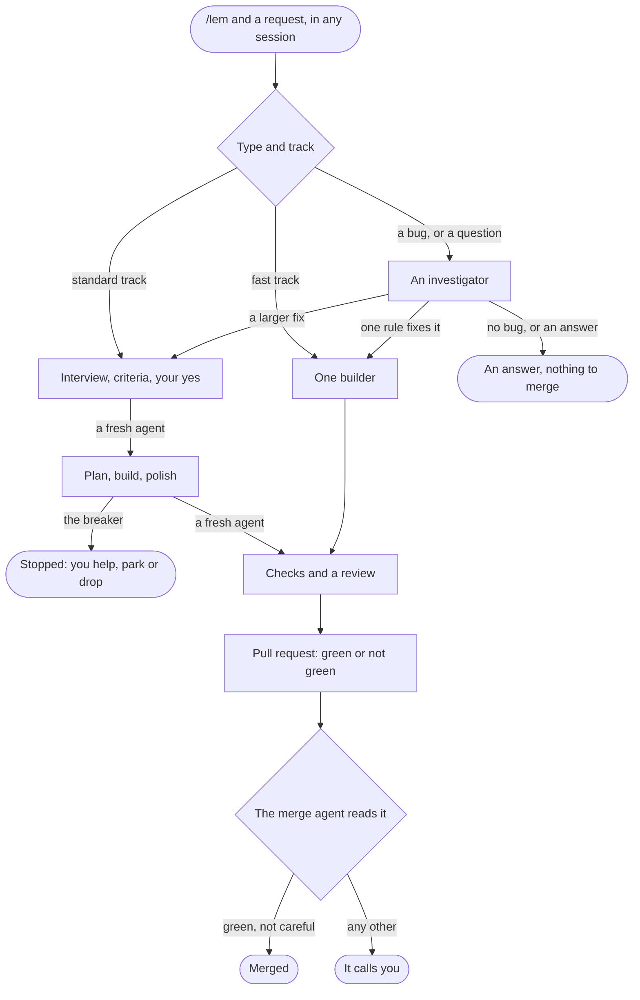

# How a task goes

## One session for each task

`/lem` and a request opens the task in an agterm session of its own, which carries it to its
merge. On the standard track, a fresh agent takes over at each change of phase: the shape with
you, the build, the landing. The agent that leaves writes `handoff.md`. Say "hand off" for a fresh
agent at any time. The fast track is one session.

Inside a phase, Claude Code compacts the session when its context passes 600,000 tokens. `lem
project handoff --tokens N` sets another number for all your repositories.

## The first line

The task's session first says the type, the track, and what you must do. The session where you
typed the request says the same line, with the name of the task. The type is a
Conventional Commits type such as `feat`, or `question`, which commits nothing. In doubt, Lem asks
one question, with its guess. `/lem standard-track` and `/lem be-careful` correct the line.

## The fast track

The fast track is for one rule in your words, with no open question and nothing careful: a typo,
a rename, a version bump.

1. Lem writes the rule as one acceptance criterion, and approves it for you. When another person
   wrote the ticket, the criterion waits for your yes. While you are away, or in a night task, Lem
   approves it without you, and the pull request is not green.
2. One builder makes the change, with a test when the behavior changes.
3. The checks run, and one agent that did not build the change reads it.
4. Lem opens the pull request.

When it does not fit, the builder stops, and the standard track starts.

## The standard track

1. **Interview.** You answer one question at a time, each with its guess. The plan uses a library
   or an approach that you name.
2. **Acceptance criteria.** Each is a rule in plain words with one real example, and gets a test.
3. **The personas read them.** Agents read the criteria as each person that the change affects.
4. **Your yes.** Nothing builds before it, unless you are [away](when-lem-needs-you.md#away).
5. **The plan.** A short plan goes to `docs/plans/`, and a new builder makes each part. The
   [ladder](when-lem-needs-you.md#a-decision-in-doubt) decides each choice, and asks you nothing.
6. **The polish pass.** A new builder removes leftovers, fixes a small defect outside the task,
   and files a larger one in `docs/backlog/`.

A ticket or a backlog item that already says what you want skips the interview. Say "interview
me" to get it.

## A bug or a question

An investigator looks first at a question, and at a bug whose cause your words do not show. It
writes a test that fails, and finds the cause. Then:

- one rule removes the cause: the fast track;
- the fix needs more: the standard track, with an interview that starts from the cause;
- no bug: Lem explains what the code does;
- no way to reproduce it: Lem asks for one more fact;
- a question: an answer, and nothing merges.

## Careful

Your settings list what must never go wrong as topics, such as "a customer is charged the wrong
amount". A change that can affect one is careful, also in doubt. Every reviewer reads a careful
change, and you merge it. A careful plan, or a plan of more than three parts, gets two agents that
argue it before any code.

## The checks and the review

The checks run your test commands. The test of each criterion must pass on the branch and fail
on the old code. Your tests must not get less strict.

The review is as large as the change: one read on the fast track, more reviewers for a larger
change. A builder fixes each must-fix, in two rounds at most. Then Lem opens
[the pull request](pull-request.md).

## Many tasks at once

Many tasks build and land at the same time. With `lem project load --start N`, the checks start
only while the load of your computer is below N.
Lem merges one task at a time. A request waits for a task whose result it needs, or that you put
before it. It starts when that task merges or gets its answer. When that task is dropped, Lem asks
you to start the request or to drop it.
