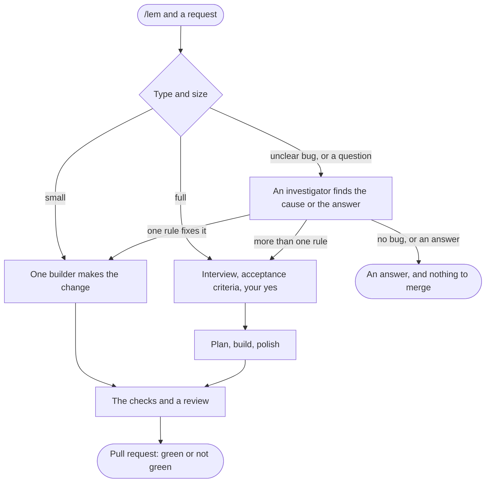

# How a task goes

After this page, you know what Lem does with a request, and where it stops for you.

## The first line

Lem answers each request with one line before any agent starts. The line says what happens, and
what you must do.

- **Type**: a Conventional Commits type such as `feat` or `fix`, or `question`, which commits
  nothing. Only you can change it.
- **Size**: small or full. When Lem is not sure, it starts small.
- **Careful** comes first when the request can affect what must never go wrong:
  `Careful: this changes how a customer is charged. feat, full: ...`

Each task runs in its own worktree, beside the other tasks.

## A small change

One rule in your words, with no open question and nothing careful: a typo, a rename, a version
bump, the fix of one rule.

1. Lem writes the rule as one acceptance criterion, and approves it for you.
2. One builder makes the change. A change of behavior gets a test that fails on the old code.
3. The checks run, and an agent that did not build the change reads it once.
4. Lem opens the pull request.

If the builder finds that the change is not small, it stops, and the interview of a full change
starts. Say "full" at any time for the same result.

## A full change

1. **Interview.** Lem asks one question at a time, each with its guess. If you name a library or
   an approach, the plan uses it.
2. **Acceptance criteria.** Each one is a rule in plain words with one real example, and each gets
   a test.
3. **The personas read them.** Personas are the people that a change affects, as `/lem init`
   wrote them. Agents read the criteria as each person, and a doubt shows next to its criterion.
4. **Your yes.** Nothing builds before it, unless you
   [let the task go on without you](when-lem-needs-you.md#go-alone).
5. **The plan.** An agent commits a short plan to `docs/plans/`, and a new builder makes each part.
6. **The polish pass.** A new builder removes leftovers, such as a comment that is now false. It
   fixes a small defect outside the task, and files a larger one in `docs/backlog/`.

A ticket or a backlog item that already says what you want skips the interview. If you wrote it
and no persona has a doubt, the build starts at once. Say "interview me" to get the interview.

## A bug or a question

When your words do not show the cause of a bug, an investigator looks first. This agent writes a
test that fails, finds the cause, and changes no behavior. Then:

- one rule removes the cause: a small change, with that test;
- the fix needs more: a full change, with an interview that starts from the cause;
- no bug: Lem tells you what the code does and why;
- no way to reproduce it: Lem tells you each try, and asks for one more fact.

A question gets the same work, and ends with its answer.

## Careful

Your settings list what must never go wrong as topics, one sentence each: "a customer is charged
the wrong amount". Lem reads each request, plan and diff against them. When it is not sure, the
change is careful. Say "careful" to mark a task yourself.

A careful change gets the full review and a merge by a person. When its plan is careful, or has
more than three parts, two agents argue the plan before any code. This plan talk runs in a session
that you can watch.

## The checks and the review

The checks run your test commands, with no model in them. The test of each criterion must pass on
the branch and fail on the old code. The bar must not go down: no new suppression, no skipped or
deleted test, no fewer assertions.

The review is as large as the change: one read for a small change, more review profiles for a
larger or careful one. A builder fixes each must-fix, in two rounds at most. Then Lem opens
[the pull request](pull-request.md).
