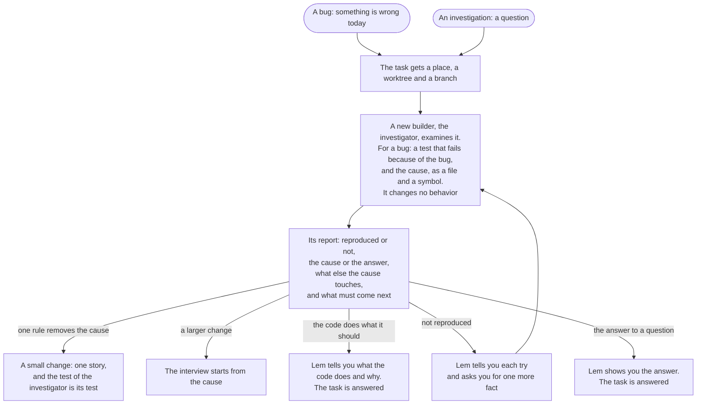

# How one task goes

This page gives the flow of Lem, as the stage files give it on 2026-11-17. The full rules are in
`skills/lem/SKILL.md` and `skills/lem/stages/`. The words of a day are in the
[README](../README.md#the-words-you-meet), and the words of the inside are in
[inside.md](inside.md).

```mermaid
flowchart TD
    ask([You: /lem and your ask]) --> look{Lem names the kind and the size.<br/>It reads your words against each topic}
    look -- a bug or a question --> inv[An investigator examines it first.<br/>See "A bug and a question"]
    look -- a small change --> small[One builder makes the change.<br/>No lead, no plan, no wait for you]
    look -- a feature --> path{Is all of the context<br/>written already?<br/>For example, a complete ticket}
    path -- no --> interview[The interview, one question at a time.<br/>A scout reads the code at the same time]
    interview --> stories[Lem writes the stories.<br/>The personas read them]
    stories --> approve[You approve the stories]
    path -- yes --> rare[A builder writes the stories.<br/>The personas read them.<br/>A doubt stops it for you]
    approve --> plan[A builder writes a short plan<br/>as its first commit]
    rare --> plan
    plan --> careful{Is the plan careful or large?}
    careful -- no --> build[One new builder<br/>for each task of the plan]
    careful -- yes --> talk[The plan talk in a companion session:<br/>the defender and the reviewer]
    talk --> build
    build --> polish[The polish pass]
    small --> gate
    polish --> gate{The machine checks}
    gate -- red --> repair[A builder repairs it] --> gate
    gate -- green --> review{A review, as large<br/>as the change needs}
    review -- a finding that must change --> fix[A builder corrects it] --> gate
    review -- nothing must change,<br/>or two rounds are done --> pr[A pull request:<br/>green or not green in its first line]
    pr --> merge[You merge it.<br/>Lem merges a green one that is not careful,<br/>if the settings permit that]
```

## The first look

Lem reads the words of your ask before an agent reads the code. It names three things.

**The kind** tells what your ask is, and it gives the type of the branch. The words in the table
are examples for the judgment of Lem. No code compares your words with them.

| Kind | Use it when | Words that often show it | Branch type |
| --- | --- | --- | --- |
| bug | something is wrong today | "broken", "shows 0", "since yesterday" | `fix` |
| feature | something is not there | "add", "allow", "let me" | `feat` |
| correction | one rule in your sentence, with a clear cause | "the button says Save, not Submit" | `fix` |
| investigation | you want an answer, not a change | "why", "find out", "check if" | Lem selects it, and says why |
| chore | the work is on the project, and no user sees it | "upgrade", "rename" | `chore` |
| docs | only a document changes | "document" | `docs` |

A symptom with no clear cause is a bug, also when the fix can be one line. If your words do not
show if your ask is a bug or a feature, the first question asks it, with the guess of Lem. For
example (an illustration): "Is the 0 wrong today, a bug, or do you want a new rule for refunds, a
feature?"

**The size** selects the path. A small change is one plain change: one story in your own
sentence, no topic in reach, and no open question. A typo, a rename, a version bump, one rule
and one line of a document are examples. Each other ask is a feature, of each kind. If Lem cannot
tell the size, it takes the small change, and the builder checks the size again.

**The topics** are the sentences of what must never go wrong in your project. Lem reads your ask
against each topic. A topic in reach comes first in the line, for example "Careful: this changes
how a customer is charged. Feature, ...". An ask in reach of a topic is never a small change.

Lem tells you the three things in one line, before an agent starts. Nothing repeats that line.
The next thing that you see is a question of the interview, the stories, or the pull request.

## A small change

1. Lem writes the story to `stories.md` in the task directory, and it approves the story in your
   name. The personas do not read it, and the pull request says so.
2. One new builder makes the change, from `skills/lem/prompts/small.md`. There is no lead, and
   no plan file goes into the repository.
3. For a change of behavior, the builder writes a test that fails on the base branch. For a
   change that keeps behavior, the story gets the line `no test: the change keeps behavior; the
   suite holds it`, and the builder runs all the gate commands.
4. The builder runs the formatter, the linter and the type checker that the `AGENTS.md` of the
   project names.
5. Before it commits, the builder reads its change against each topic. It stops if the change can
   get near a topic, needs a second rule or a decision, lowers the bar, or became larger.
6. If it stops, Lem tells you in one line that the ask is a feature, and why. The feature path
   continues from the interview, and the report of the builder takes the place of the scout.
7. If it does not stop, the builder commits, and the landing starts.
8. The builder can see a defect outside the change. It does not repair the defect. It writes one
   backlog item for each defect, in a commit of its own after the change. Nobody asks you about
   it.

- You can say "feature" at each moment. Then the task takes the feature path, and the commits
  stay on the branch.
- The landing has five steps: `start`, `base`, `gate`, one read by the review agent, and
  `propose`. A small change has no polish pass.
- The pull request is short: green or not green, the story, the checks, the backlog items of the
  builder and the read.
- A small change that the review calls careful is not green, and a person merges it.
- A small change that lowers the bar is refused at the gate. It becomes a feature.
- A small change starts two agents: the builder and the review agent. A bug with a clear cause
  adds the investigator before them. This count is from the stage text (2026-11-17). Nobody
  measured the time yet.

## A feature

### The interview and the stories

This is the usual path. You are there for it, and it ends with stories that you approved.

- **The task shows at once.** Its first state is "the interview waits for the owner".
- **A scout reads the code during the interview.** It changes nothing. It gives facts to Lem:
  what exists, what the code does today, and what limits your ask. In two measured runs it took
  26.7 seconds in a small repository and 116.5 seconds in the repository of Lem (2026-11-16).
- **Lem asks one question at a time**, and it gives its guess with each question. A question
  that you answer with a yes or a typed value is one line in the conversation. A question with
  two or more options goes on the question page, with the options that are ready on one page.
- **You can be technical.** A technology, a library or an approach that you name is a direction.
  The plan obeys it.
- **A defect outside your ask is not lost.** Lem writes it down. The polish pass repairs a small
  one, and it files each other one in the backlog. Nobody asks you about it.
- **Lem writes the stories after the scout reports.** It uses your words, your directions, the
  profile of the project and the facts of the scout. A story is one rule in plain words, with one
  example with real names and values.
- **Lem shows the stories in the conversation**, each with the facts of the scout that it comes
  from. At the same time, the personas read them.
- **The personas read with two model families.** A split between the two families counts as a
  doubt. One measured read took 2 minutes and 9 seconds (2026-11-16, two personas, two stories).
- **A partial read counts.** The pull request says who did not answer, and why. If nobody
  answers, the read starts again. If nobody answers two times, the work continues, and the pull
  request is not green, with "the stories were not read" first.
- **You can stop the read when the stories name only you.** Then Lem asks one question in the
  terminal: "The stories name only you. Skip the persona read? (y/n)". Lem never stops the read
  by its own decision. On your yes, the pull request stays green and says that you stopped the
  read.
- **You approve the stories once.** If you type your yes before the read ends and nobody is
  confused, Lem tells you so in one line and opens no page. Otherwise one page shows the result
  of the personas on top, and each story with its facts. A story that a persona flagged stays as
  Lem wrote it, with the answers next to it.
- **The build starts only after your yes.** If you go away first, the task waits with the line
  "the stories wait for the owner".
- **Approved stories do not change silently.** The plan holds them word for word. A change of a
  story has a record with the text before and after, and the pull request is then not green. If
  you approve the changed stories later, that change does not make it not green. The pull
  request still shows it, with "approved by the owner afterwards": your teammates read it too.
- **Only you can change the kind** of the stories, a feature or a correction.

### The rare path

Some asks have all of their context. Then there is no interview. These asks are:

- a ticket whose text says what you want, and how to see that it is done;
- a backlog item with settled options;
- a night plan that you start;
- an investigation report that settles what you want.

- Lem tells you in one line that it takes this path, and why. You can say "interview me".
- The lead writes the stories from the code. One model family of personas reads them.
- If nobody is confused, the lead freezes the stories, and the build starts without a wait. The
  board shows "nobody confused", and you can stop the task.
- If a persona has a doubt, or a rule needs a guess, the task waits for you.

### The plan and the build

- **A builder leads the task.** It writes a short plan, `docs/plans/YYYYMMDD-<slug>.md`, as its
  first commit. After a bug, the test of the investigator comes before it.
- **The plan starts with the stories**, word for word. The lead adds only the test lines. A story
  that keeps behavior gets `no test: the change keeps behavior; the suite holds it`.
- **A plan has one to seven tasks.** A plan with more than three tasks is large. An outcome that
  needs more than seven tasks is two asks.
- **A plan can end with a documentation task.** If the change makes a document false, the last
  task corrects it.
- **A plan can name a lowered bar.** Under `## The bar`, one line for each file gives the reason.
  The pull request is then not green.
- **The lead decides if the plan is careful**, and it writes one line with the reason under the
  title of the plan. See "Careful" below.
- **A careful or large plan stops for the plan talk.** See "The plan talk" below.
- **One new builder makes each task of the plan**, also for a plan with one task. The lead writes
  no code.
- **A builder obeys the `AGENTS.md` of the project.** It runs the formatter, the linter and the
  type checker that this file names.
- **A worktree is a plain git worktree.** It has no `.env` file, no virtual environment and no
  test database. If your tasks need them, name a worktree script in the `AGENTS.md` of the
  project.
- **No review comes after each task.** The review before the pull request reads the whole
  change.
- **Only some tasks build at one time.** The limit is `flow.max_tasks`. A task over the limit
  waits in a queue, and it starts when a place is free. Two asks that name the same thing run one
  after the other.
- **A failure that nobody can explain after two tries** goes to the `lem-root-cause` method. An
  approach that failed two times gets a new approach, not a third patch.
- **The lead writes a report**, and the state becomes `ready`. Then the landing starts.

## Careful

Your project names what must never go wrong as topics: sentences in your words, in `flow.topics`.
Examples are "a customer is charged the wrong amount" and "data that cannot be rebuilt is lost".
No list of paths decides it. A list goes old when the code moves, it does not see new code, and a
branch can change the list that guards it. Thus Lem refuses the old setting `flow.careful`.

Three agents read a change against the topics. In doubt, each one says careful.

1. Lem reads your ask and the facts of the scout.
2. The lead reads its plan. A plan is also careful when it starts product code that other code
   will copy, for example a first service layer. A new kind of test does not make a plan careful.
3. A new agent reads the diff before the pull request. It did not build the change. Its record
   holds the call and the reason.

A request is careful when one of these says so:

- your word, at each moment before the landing;
- the line `careful: yes` of the plan, which a later commit cannot take back;
- the newest review;
- a diff that changes the `[flow]` or `[gate]` table of `.lem/project.toml`.

A careful request gets these things:

- a plan talk before the code, if the plan was careful;
- the full review set of the project;
- a person's merge, whatever `branch.land` says;
- a line after green or not green that says careful, with each reason;
- a note that says if the change holds a migration, and how to revert it.

A task that becomes careful after its plan gets no talk, because the code exists. It gets the
full review set and a person's merge, and its pull request says why it had no talk. Lem reads the
`[flow]` table from the main checkout, also in the worktree of a task. Thus a branch cannot
change the topics that guard it.

If you call a task careful because the lead read a topic wrong, that is a lesson for
`/lem learn`. Only your yes adds a new topic to the settings.

## The plan talk

A careful or large plan gets a plan talk before any code. The builder that wrote the plan stops.
Lem opens a companion session. Its agent, the defender, and the reviewer in the other pane argue
the plan through the mailbox. You can read the two panes. These are the rules of
`skills/lem/stages/talk.md`:

- **The reviewer gives all of its questions first.** Its first turn is a numbered list, with the
  most expensive question first. The list closes with that turn.
- **Each question gets one repair.** The defender repairs the plan, or it refutes the question
  with a cite. The reviewer answers each question by its number: `closed`, or `holds`.
- **A question that holds two times stops.** It becomes a design choice, and Lem asks it.
- **A repair that adds a mechanism names the decision under it.** A mechanism is, for example, a
  guard, a cache, a flag or a retry. The reviewer says "at the cause" or "layer over" that
  decision.
- **A layer over a decision with no source is not a repair.** The repair must change the
  decision. If the defender keeps it, the question becomes a design choice. A second question
  about the same decision becomes a design choice too.
- **A changed decision can bring new problems.** Each problem in it is the same question again.
  Your card then shows the old decision with its mechanisms, and the new decision with the tasks
  and stories that it changes.
- **An addition names four things, or the other side refuses it**: the failure that it prevents,
  the input that causes the failure, if that input is realistic, and what breaks without it.
- **A late question is not argued.** The plan records it as "raised, not argued". The review
  before the pull request examines it.
- **A scope that the plan puts out of the change is not a question.**
- **A question about what a person sees goes to the personas.** A question with no clear answer
  stays open and becomes a decision.
- **The talk has a limit** of four turns for each question, plus two. This limit comes from the
  rules. Nobody measured it. A talk over the limit is recorded as it occurred, and the pull
  request and the board show it.
- **A settled position is a claim.** The review before the pull request does not take the
  agreement of two agents as a fact.
- **The companion closes after the talk.** Then a new builder leads the build.
- **You choose the models.** `[seats.planner]` names the defender and `[seats.reviewer]` names
  the reviewer ([settings.md](settings.md)).

The pull request shows one line for the talk: the reviewer, the turns, and the positions that
were settled and left open. Lem proposes no request without a talk if its plan asked for one.

## The landing

One task is in the landing at a time, because the checks are about one tip on one base. A
landing that stopped runs again from where it stopped.

1. **`start`.** A project with no gate command gets no pull request from Lem. The one exception
   is the task that sets up the checks, because its branch adds the gate commands. Its pull
   request is not green, so that you read the checks one time.
2. **`base`.** Lem rebases the branch on the base branch. A builder repairs a conflict.
3. **`polish`.** A new builder reads the change of a feature, before the checks and the review.
   Thus the review reads the code as it will merge. A small change never gets a pass. Its
   builder writes the backlog items for the defects outside the change.
4. **`gate`.** These are the machine checks, with no model in them.
5. **The review.** An agent that did not build the change reads the diff.
6. **`propose`.** Lem opens the pull request, or marks the branch as ready. Lem does not ask
   you before it pushes the branch of the task. You approved that at onboarding.
7. **The merge.** You merge, or Lem merges if the settings permit it.
8. **`clean`.** Lem removes the worktree and the branch of the task.

### The polish pass

The pass looks for a short, fixed list, and nothing else:

- a comment or a document that the change made false;
- a leftover: debug output, dead code, a name that nothing uses, a block of code in comments, a
  note of a builder to itself;
- code that works and is difficult to read;
- the defects outside the task. It repairs a small one, and it files each other one as a backlog
  item on the task branch.

The pass changes no behavior. It must not change the test of a story or the plan. After the
pass, the test of each story runs again, and Lem refuses a pass that breaks one. A builder that
repairs a finding later gets the same list. No second pass comes after it.

### The machine checks

- Each command of `gate.commands` runs in the worktree of the task.
- A command can write files that git does not track or ignore, for example `__pycache__` in a
  repository with no ignore rule for it. Lem removes these files after the run and names them.
  They do not stop the gate. A command that changes a tracked file or makes a commit stops the
  gate.
- The test of each story must pass on the branch and fail on the base commit. The check uses a
  worktree of its own. The board of a task shows the result.
- The bar must not go down. A new lint or type suppression, a skipped or deleted test, and fewer
  assertions in a test lower the bar. Lem refuses such a change, unless the plan gives a reason
  for that file. Then the pull request is not green.
- A red check goes to a builder. If the base branch already fails the same command, Lem opens a
  task for that command, and this task waits until that task lands. After two builders on one
  failure, the task stops for you.

### The review

- **An agent decides how large the review is.** It reads what each profile of the review tool
  is for. A small and simple change gets one read. Each other change gets a round with the
  profiles that fit. Thus a change of documents gets no security check.
- **No agent goes below the floor.** A careful request gets the full set. A large request, and a
  change after a finding that must change, get a round at the least.
- **A review can be partial.** If one source does not answer, the review counts, and the pull
  request says who answered. If nobody answers two times, the request goes on as not reviewed.
- **A review has two rounds at most.** A finding that must change goes to a builder, and the fix
  gets the checks and a second round. After that round, Lem proposes the change as it is.
- **A finding of "should" stays open.** The notes list it.
- **A defect that the base branch already has becomes a backlog item** on the task branch.

### The pull request

The first line says green or not green. Each reason for "not green" is one line, before all other
text. A careful request says so in the next line, with each reason. Then come these parts:

- your words, and the stories with their tests;
- each check with its result;
- each decision, with who took it and why;
- the notes of Lem.

The text is also in `pr.md` in the task directory.

The checks of the pull request tell you who read the stories. One line gives how many personas
answered, the model families, who did not answer, the stories that they flagged, and the date of
your approval. For a small change, the line says that the personas did not read it. If you
stopped the read, the line gives the date of your word. If you changed the stories after the
read, a second line says so. The checks also name the report of the scout.

Lem proposes no feature whose stories nobody read, unless you stopped the read. It also proposes
no request whose read found a doubt that you did not see.

A pull request is green when all of these are true:

- the checks passed, and the bar did not go down;
- a review with one source or more found nothing that must change;
- no story changed during the build, or you approved each change afterwards;
- no choice was taken by the timeout or by the experts;
- the gate was the gate of the main checkout;
- the read of the stories did not stay unanswered two times;
- it is not a small change that the review called careful.

A green pull request needs no read from you. Not green tells you what to read.

With a remote on GitHub, Lem pushes the branch and opens the pull request. It does not ask you
first: `branch.propose = "pull-request"` is your approval of this push, and you gave it when you
approved the settings at onboarding. Other steps that leave the machine wait for your word: a
push to another branch, a merge by `land --by owner`, and a message to a person. With a different
remote, or with none, Lem marks the branch as ready. A pull request on GitLab is not built yet.
With `branch.propose = "merge"`, Lem marks the branch as ready also with a remote on GitHub.

### The merge

- **A person merges by default** (`branch.land = "owner"`).
- **With `branch.land = "agent"`**, Lem merges a request only if it is green and its newest
  review said not careful.
- **Tell Lem "land it"**, or type `/lem land <task>`, for a branch that is ready. Lem puts it on
  the base branch as a fast-forward and pushes it to `origin`. With no remote, Lem merges into the
  local base branch.
- **You can merge on GitHub.** Lem sees the merge at the next status, or at its next turn.
- **If the base branch moved after the checks**, the checks run again before the merge.
- **After the merge, Lem removes the worktree and the branch.** A task from a ticket gets a
  comment, and the ticket moves as the settings say.

## A bug and a question



- **A bug gets an investigation first.** You saw a symptom, and the cause decides the change.
  Thus Lem writes no story before the cause is known.
- **The investigator changes no behavior.** For a bug, its one commit is the test that fails. For
  a question, it commits nothing.
- **The report replaces the scout.** The interview of a bug starts from the cause.
- **A cause near a topic is not a small change**, also when one rule removes it.
- **An answered task has nothing to merge.** It goes to the "Done" lane of the board with its
  answer. The branch stays, because it can hold the test of the bug.
- **You can start a task from a report.** Type `/lem new` and the path of the report.
- **The pull request names the cause** in one line.

## Decisions

- **You are necessary at three points**: the interview with your yes to the stories, a decision
  whose options each cost a person something, and the pull request. A small change needs you at
  its pull request only.
- **Lem takes the small decisions.** It logs each one with its reason, and the report lists them
  for you to overturn.
- **A decision is yours** when its options each cost a person something, and no ruling, test or
  probe answers it.
- **The personas answer first.** A clear answer of theirs is taken and logged. A story that it
  changes makes the pull request not green.
- **An unclear answer comes to you as a card.** The card starts with one example that ends
  badly, in numbered steps, and one line on why the problem can occur.
- **The lead tells Lem at once** when a choice waits. If that message gets lost, Lem finds the
  choice at its next turn, and then less of the wait stays for you.
- **Two experts of two model families answer the same choice.** Their answers are on your card.
- **The choice waits 15 minutes for you** (`flow.decision_wait`). The other work continues. Then
  the lead takes the option of the two experts, or the recommended option when they do not agree.
  The pull request is not green for it.
- **When you are away, Lem does not wait.** If the two experts selected the same option, Lem takes
  it at once. You are away only when you said so, or when a question of this turn went to your
  away channel.
- **A step that nobody can undo later waits for your word.** Such a step destroys data, writes
  to an outside system, sends something to a person, or spends money. Only that part waits.
- **A night plan asks you nothing.** At night nobody can answer. Thus a plan that meets a
  decision of yours stops, and the night report gives you the question.
- **Lem asks on a page** in agterm, with the options side by side. A value that you type, a
  go-ahead for a step, and a small fixed choice stay in the terminal. `tools.ask` can name a
  different tool, or `terminal`.

## What you can say at any time

- "feature": a small change takes the feature path.
- "careful": the task gets the careful flow.
- "interview me": the rare path takes the interview.
- "drop": the task stops. Its branch stays, because no other branch has its commits.
- "land it": your word to merge a request that is open.

## All commands

`/lem` is one command. The first word after it says what Lem does.

| Command | Who starts it | What it does |
| --- | --- | --- |
| `/lem <your ask>`, `/lem new <what>` | you | opens a task. `<what>` can be your words, a ticket id or URL, a backlog item, or a report |
| `/lem plan <what>` | you | as `new`, and the lead stops after the plan for you to read it |
| `/lem build` | you | lists the plans that wait, and asks which one it builds |
| `/lem build <task>`, `/lem build <plan file>` | you | builds that plan: a plan that you read, or a draft from the night |
| `/lem`, `/lem status`, `/lem status <task>` | you | opens the board of all tasks or of one task, and tells you what waits for you |
| `/lem land` | Lem, when a task is ready | takes the oldest ready task through the landing |
| `/lem land <task>` | you | your word to merge an open pull request, or to land a ready branch |
| `/lem ask <question>` | you | puts a question to you as a page |
| `/lem annotate <file>` | you | opens a file for you to mark, with the tool in `tools.annotate` |
| `/lem learn` | you | puts a correction that you gave into the file that owns the step, and tells you each change |
| `/lem reviewer <agent> [model [plan_effort]]` | you | names the reviewer of a plan talk on this computer; the agent is `claude` or `codex` |
| `/lem reviewer codex gpt-6.1-sol high` | you | an example: Codex reviews, with the model `gpt-6.1-sol` and the effort `high` for a plan talk |
| `/lem reviewer default` | you | gives the reviewer of the project back |
| `/lem init` | you | sets up a repository |
| `/lem retro` | a scheduled job, each morning | reads the landed tasks and the correction queue; finds a correction that you gave two times or more; proposes where it goes |
| `/lem night` | a scheduled job, each night | writes a plan for one backlog item that needs no decision, for you to read in the morning |

The scheduled jobs are jobs in cronn. `/lem init` offers them, and it adds a job only after your
yes. [free-hour.md](free-hour.md) is about a different job, a session that changes Lem itself.

Before a status, Lem asks the forge which pull requests you merged. A merge on GitHub then shows
on the board, and a task that waits for it can start.
