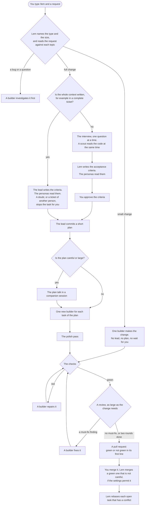
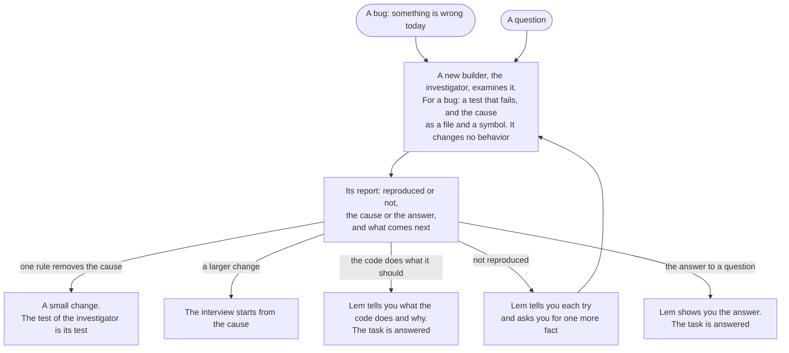

# How one task goes

This page describes each step of a task, from your request to the merge. The
[README](../README.md#the-words-you-meet) defines the words that you meet every day, and
[inside.md](inside.md) describes the parts inside Lem.

## The first look

Lem reads your request before any agent reads the code. In one line, it names the type, the size
and the topics that the request can affect. Lem writes this line before an agent starts, and no
later step repeats it.

**The type** is a Conventional Commits type, and it gives the branch its name, `<type>/<slug>`.
If the remote already has a branch with that name, Lem picks another slug. Lem fetches first, and
the worktree of a new task starts from the base branch of the remote. The words in the table are
only hints for Lem's judgment. No code matches your words against them.

| Type | Use it when | Words that often show it |
| --- | --- | --- |
| `fix` | something is wrong today | "broken", "shows 0", "since yesterday" |
| `feat` | something is not there | "add", "allow", "let me" |
| `refactor` | the code changes, and the behavior does not | "rename", "move", "split" |
| `perf` | the result stays the same, and comes faster or with less | "slow", "faster" |
| `test` | only tests change | "cover", "a test for" |
| `docs` | only a document changes | "document", a typo in the README |
| `chore` | no user of the product sees the work | "upgrade", "bump", "the CI" |
| `question` | you want an answer, not a change | "why", "find out", "check if" |

When your words do not show if the request is a fix or a feat, the first question of the interview
asks you. Lem gives its guess with the question. Only you can change the type of a task.

**The size** decides the path. A small change is one plain change: one acceptance criterion in
your own words, no topic that it can affect, and no open question. A typo, a rename, a version bump
and a fix of one rule are examples. Any other request is a full change. If Lem cannot tell, it
chooses a small change, and the builder checks the size again. `/lem plan` always makes a full
change.

**The topics** are sentences that say what must never go wrong in your project. A topic that the
request can affect comes first in the line, for example "Careful: this changes how a customer is
charged. feat, full: ...". A request that can affect a topic is never a small change.

## A small change

1. Lem writes the one criterion into `criteria.md` in the task directory, and approves it in your
   name. The personas do not read it, and the pull request says so.
2. One new builder makes the change. There is no lead and no plan file.
3. A change of behavior gets a test that fails on the base branch. A change that keeps behavior
   gets the line `no test: the change keeps behavior; the suite holds it`.
4. The builder runs the tests of the files that it changed. It also runs the formatter, the linter
   and the type checker that the project's `AGENTS.md` names.
5. Before it commits, the builder reads its change against each topic. It stops if the change can
   affect a topic, needs a second rule or a decision, lowers the bar, or is more than one plain
   change. Lem then tells you
   in one line that the request is a full change, and why. Then the interview starts, and the
   commits stay on the branch.
6. A defect that the builder saw outside the change becomes one backlog item, in a commit of its
   own. Nobody asks you about it.
7. The landing has five steps: `start`, `base`, the checks, one read by the review agent, and
   `propose`. There is no polish pass.

- Say "full" at any time to make the task a full change.
- A small change can be careful after all: the review can call it careful, and an edit of
  `.lem/project.toml` makes it careful. Such a change is not green, and a person merges it.
- The checks refuse a small change that lowers the bar, and the task becomes a full change.
- A small change starts two agents: the builder and the review agent.

## A full change

### The interview and the acceptance criteria

This part needs you. It ends when you approve the criteria.

- **The task appears at once**, with the state "the interview waits for the owner".
- **A scout reads the code during the interview.** It changes nothing. It gives facts: what is
  there, what the code does today, and what limits your request.
- **Lem asks one question at a time**, with its guess. A question that needs only a yes or a typed
  value is one line in the conversation. A question with two or more options goes on the question
  page.
- **You can be technical.** If you name a technology, a library or an approach, the plan follows
  it.
- **A defect outside your request is not lost.** The polish pass repairs a small one, and it files
  any other one in the backlog.
- **Lem writes the criteria after the scout reports.** It shows them in the conversation, each
  with the facts behind it. At the same time, the personas read them. Each persona reads them with
  models from two families, and a split between the two families counts as a doubt.
- **A partial read counts.** The pull request says who did not answer. If nobody answers, the read
  starts again. If nobody answers two times, the work continues, and the pull request is not
  green, with "the criteria were not read" first.
- **You can skip the read when the criteria name only you.** Lem then asks: "The acceptance
  criteria name only you. Skip the persona read? (y/n)". Lem never skips it by its own decision.
- **You approve the criteria once.** If you say yes before the read ends and nobody is confused,
  Lem tells you so in one line. If not, one page shows what the personas said, then each
  criterion. A criterion that a persona flagged stays as Lem wrote it, with the answers next to
  it.
- **The build starts only after your yes.** If you go away first, the task waits with the line
  "the criteria wait for the owner".
- **Approved criteria do not change silently.** Each change to a criterion gets a record with the
  old and the new text. The pull request is not green until you approve the change.

### A complete request

A complete request already holds all of its context, so it gets no interview. These requests are
complete:

- a ticket that says what you want, and how to see that it is done;
- a backlog item with settled options;
- a night plan that you start;
- an investigation report that settles what you want.

Lem tells you this in one line, and you can still say "interview me". The lead writes the criteria
from the code, and the personas read them. If you wrote the request yourself and nobody is
confused, the build starts at once. The task waits for your yes in three cases:

- a persona has a doubt;
- the ticket does not say a rule that the lead needs, so the lead must guess it;
- another person wrote the ticket or the backlog item. Then one page shows you what Lem will
  build, before it builds it.

**No secret goes into a file.** No agent writes a secret, a key or a value from an `.env` file
into a file or a commit.

### The plan and the build

- **A builder leads the task.** Its first commit is a short plan in
  `docs/plans/YYYY-MM-DD-<slug>.md`. The setting `paths.plan_file` changes the pattern of the name.
- **The plan starts with the acceptance criteria**, word for word. The lead adds only the test
  lines.
- **A plan has one to seven tasks**, and a plan with more than three tasks is large. Its last task
  can correct the documents that the change made false.
- **A plan can lower the bar** if it gives a reason for each file under `## The bar`. The pull
  request is then not green.
- **The lead decides if the plan is careful**, and writes the reason under the title of the plan.
  A careful or large plan stops for the plan talk.
- **One new builder makes each task of the plan.** The lead writes no code. There is no review
  after each task: the review before the pull request reads the whole change.
- **A builder follows the project's `AGENTS.md`.** A worktree is a plain git worktree, with no
  `.env` file and no test database. If your tasks need them, name a script in `AGENTS.md` that
  prepares a worktree.
- **A task can need the result of another task.** If the lead finds this when it plans, and the
  other task has not landed, the task waits in the queue behind the other task.
- **An approach that failed two times gets a new approach**, not a third patch.
- **The lead writes a report**, and the state becomes `ready`.

## Careful

Your project lists what must never go wrong as topics in `flow.topics`, for example "a customer is
charged the wrong amount". No list of paths decides if a change is careful. Three agents check a
change against the topics. If an agent is not sure, it calls the change careful:

1. Lem reads your request and the scout's facts.
2. The lead reads its plan. A plan is also careful when it adds a pattern: product code that other
   code will copy.
3. A new agent that did not build the change reads the diff before the pull request.

Each of these makes a task careful:

- you say "careful";
- the line `careful: yes` in the plan;
- the newest review, when it calls the change careful;
- a diff that changes `.lem/project.toml`.

A careful task gets:

- a plan talk before the code, if the plan was careful;
- the full review set of the project;
- a merge by a person, whatever `branch.land` says;
- a line after green or not green that says careful, with each reason;
- a note that says if the change holds a migration, and how to revert it.

Lem reads `flow.topics` from the main checkout, so a task's branch cannot change the topics that
guard it. Only your yes adds a topic.

## The plan talk

The builder that wrote the plan stops, and Lem opens a companion session in agterm. Its agent, the
defender, argues the plan with the reviewer in the other pane, through the mailbox chat. You can
read both panes.

- **The reviewer gives all of its questions in its first turn.** The first one is the one that
  costs the most if nobody answers it.
- **Each question gets one repair of the plan**, or a reply that disproves the question with a
  source. The reviewer answers each question by its number: `closed` or `holds`.
- **A question that holds two times becomes a design choice**, and Lem asks it as a decision.
- **A repair that adds a mechanism**, for example a guard, a cache, a flag or a retry, names the
  decision that it rests on. The reviewer then says if the repair is "at the cause" or a "layer
  over" that decision. A layer over a decision that has no source does not count as a repair.
- **An addition must name four things, or the other side refuses it**:
  - the failure that it prevents;
  - the input that causes that failure;
  - if that input is realistic;
  - what breaks without the addition.
- **Nobody argues a late question**, which is a question after the first turn. The plan records
  it as "raised, not argued", and the review before the pull request examines it.
- **The talk has a limit** of four turns for each question, plus two. If a talk goes over the
  limit, Lem records it as it happened, and the pull request shows it.
- **The review before the pull request treats a settled position as a claim**, not as a fact.
- **The companion closes after the talk.** Then a new builder leads the build.

`[seats]` names the reviewer and the defender ([settings.md](settings.md#seats)).

## Which tests run when

- **A builder runs the tests of the files that it changed**, and of their direct callers. No
  builder runs the whole suite.
- **The checks run the whole suite one time**, before the pull request: each command of
  `checks.commands`.
- **A command under `checks.alone` must run alone on the computer**, for example an end-to-end
  suite with fixed ports, one database or a browser. Lem runs these commands under one lock for the
  repository, after `checks.commands` pass. A builder that needs one such test for its criterion
  runs it under the same lock.
- **The test of each criterion runs one time on the branch and one time on the base commit**,
  during the checks.
- **With git hooks, the checks hold only tests.** At `/lem init`, Lem looks for pre-commit, husky
  or lefthook. If it finds hooks, it proposes only test commands, because the hooks run the linter
  and the type checker at each commit. If it finds no hooks, it also proposes the linter and the
  type checker that it finds.

## The landing

Only one task lands at a time. A landing that stopped continues from the step where it stopped.

1. **`start`.** A project with no command in `checks.commands` gets no pull request. The one
   exception is the task that adds the checks, and its pull request is not green.
2. **`base`.** Lem first looks at the branch on GitHub. A commit there that Lem did not push, for
   example a suggestion from a teammate, stops the landing. Lem names the commit and the command
   that brings it into the worktree. The commit then gets the checks and a read. Lem rebases the
   branch on the base branch, and a builder resolves any conflict.
3. **`polish`.** For a full change, a new builder makes the polish pass.
4. **The checks.** No model takes part in them.
5. **The review.** An agent that did not build the change reads the diff.
6. **`propose`.** Lem pushes the branch and opens the pull request, or marks the branch as ready.
   The push replaces only the commit that Lem pushed last, so it never removes a teammate's
   commit. Lem does not take control of a pull request that it did not open.
7. **The merge.** You merge, or Lem merges if the settings permit it.
8. **`clean`.** Lem removes the worktree and the branch of the task.

**The polish pass** looks only for the items of a short, fixed list:

- a comment or a document that the change made false;
- a leftover, for example debug output or dead code;
- code that works but is hard to read;
- the defects outside the task: it repairs a small one, and files any other one.

The pass changes no behavior, no test of a criterion and no plan.

**The checks** run each command of `checks.commands` at the root of the worktree, then each
command of `checks.alone` under the lock. Lem removes the untracked files that a command leaves,
and names them. The test of each criterion must pass on the branch and fail on the base commit.
A builder repairs a red check. If the base branch already fails the same command, Lem opens a task
for that command, and this task waits for it.

**The bar** must not go down. The one exception is a file for which the plan gives a reason. Each
of these lowers the bar:

- a new suppression of a linter or a type checker;
- a skipped, focused or deleted test, or fewer assertions;
- a setting of the test runner that excludes a test, or runs a test again until it passes;
- a lower coverage floor.

The pull request lists each test, snapshot and test setting that was there before and that the
change edits. When Lem finds no mark of a lowered bar, the pull request says "the bar: no mark of a
lowered bar found".

**The review** is as large as the change needs. An agent reads the diff and the purpose of each
profile of the review tool. A small and simple change gets one read. Any other change gets a round
with the profiles that fit it. For example, a change to documents gets no security check. A
careful task gets the full set. A must-fix finding goes to a builder, and the fix gets the checks
and a second round. After two rounds, Lem proposes the change as it is. If one reviewer does not
answer, the review still counts, and the pull request says who answered.

## The pull request

The first line says green or not green. Each reason for "not green" is one line, before all other
text. Then come:

- your request, in your words;
- the acceptance criteria with their tests;
- each check;
- each decision, with who took it and why;
- Lem's notes.

A pull request is green when all of these are true:

- the checks passed, and the bar did not go down;
- a review read the change as it is now, was at least as large as Lem's minimum for the change,
  and found no must-fix;
- no acceptance criterion changed during the build, or you approved each change;
- the timeout and the experts decided no choice;
- the change did not bring its own checks into a project that had none;
- the read of the criteria did not stay unanswered two times;
- it is not a small change that is careful.

With a remote on GitHub, Lem pushes the branch and opens the pull request, and it does not ask you
first: `branch.propose = "pull-request"` is your approval, and you gave it at onboarding. With
`merge`, with another remote or with no remote, Lem marks the branch as ready. Any other step that
leaves the computer waits for your approval.

**The merge.** A person merges by default (`branch.land = "owner"`). With `branch.land = "agent"`,
Lem merges a pull request only if it is green and its newest review said not careful. To merge an
open pull request or a ready branch, type `/lem land <task>`, or say "land it". If the base branch
moved after the checks, the checks run again first.

## After a merge

- **Lem watches its open pull requests.** One watch runs in the background while any task is
  open. It asks GitHub every `flow.watch_seconds` seconds, with one call for all the pull requests.
  It needs the GitHub CLI `gh`, and you must be signed in. Each time you type `/lem`, Lem also asks
  GitHub first.
- **A merged pull request ends its task.** Lem marks the task `landed`, removes its worktree and
  branch, and moves its ticket. A task that waited for it can start.
- **A pull request that somebody closes with no merge drops its task.** The branch keeps its
  commits, and Lem tells you how to delete it. If you open the pull request again, the task does
  not come back. To do the work, make a new request.
- **Lem rebases an open task that has a conflict.** When GitHub shows a conflict in an open pull
  request, the watch ends, and Lem tells you why in one line. Lem rebases the branch, a builder
  resolves the conflict, the checks run again, and one read checks the resolution. Then Lem
  updates the pull request and tells you in one line: "rebased on main after the forge called it
  conflicting; one conflict in shop/dates.py, resolved by a builder; the checks passed again".
  `/lem` and `/lem status` also ask GitHub. If a pull request has a conflict, Lem says so beside
  its checks ("#4 is green by its checks, and conflicts with main") and rebases it at once.
- **Lem leaves every other open task as it is.** GitHub can merge it as it is. When you type
  `/lem land <task>` and the base moved, Lem rebases it and runs the checks again first. After a
  rebase with no conflict, the review stays valid.
- **The board shows when Lem last checked the pull requests.** When no watch runs, it says
  "nobody watches the pull request". Type `/lem` to look again.

## The queue

- **`flow.max_tasks` limits how many tasks build or land at one time.** A task over the limit
  waits, and it starts when a place is free.
- **A task waits for another task only when it needs its result.** Its state is `queued`, with the
  line `after:` and the name of that task.
- **Two requests that only mention the same file both start at once.** The landing resolves any
  overlap.

## A bug and a question

- **When your words do not show the cause of a bug, the bug gets an investigation first.** The
  cause decides the change, so Lem writes no criterion before it knows the cause.
- **The investigator's report takes the place of the scout's facts.** A cause that can affect a
  topic never leads to a small change.
- **An answered task has nothing to merge.** Lem removes its worktree. A branch with the test of
  the bug stays, and Lem tells you how to delete it.
- **You can start a task from a report**: type `/lem new` and the path of the report.

## Decisions

- **Lem needs you at three points**: your yes to the criteria, a decision whose options each cost
  a person something, and the pull request. A small change needs you only at the pull request.
- **Lem takes the small decisions.** It logs each one with its reason, and the pull request lists
  them so that you can reverse them.
- **The personas answer your decisions first.** When their answer is clear, it becomes the
  decision, and the log records it.
- **An unclear answer comes to you as a card** that starts with one example that ends badly.
  Two experts from two model families answer the same choice, and their answers are on the card.
- **The choice waits `flow.decision_wait` minutes**, 15 by default, while the other work
  continues. If you do not answer, the lead then takes the option that both experts chose, or else
  the recommended option. The pull request is not green because of it. If you said that you are
  away, Lem makes this choice at once.
- **A step that nobody can undo waits for your approval**: a step that destroys data, writes to an
  outside system, sends something to a person, or spends money.
- **A night plan asks you nothing.** If a night plan comes to a decision of yours, it stops, and
  the night report gives you the question.

## What waits for you

Type `/lem` with nothing after it, or `/lem status`. Lem first asks GitHub what merged. Then it
lists what waits for you, always in this order:

1. the choices of a task, each with the minutes that are left;
2. the tasks whose acceptance criteria wait for your yes;
3. the other tasks that wait for you: a step that is yours, or one more fact;
4. the open pull requests, each with green, or the reasons for not green;
5. the plans that `/lem night` wrote;
6. the proposals of a retro.

If nothing waits, Lem says "nothing waits for you". Then it says which tasks build, and what
landed or was answered today. Say "open them", and one page shows each night plan and each retro
proposal. You answer each one with approve, reject or later. A night plan that you approve builds,
and one that you reject is dropped. A retro proposal that you approve becomes an edit. Later keeps
the item in the list.

`/lem status <task>` opens the board of one task.

## What you can say at any time

- "full": a small change becomes a full change.
- "careful": the task gets the careful flow.
- "interview me": a complete request gets the interview.
- "drop": the task stops. A branch with commits stays.
- "land it": Lem merges a pull request that is open.

A task that ended (landed, answered or dropped) does not start again. New work on it is a new
request.

## What Lem and the jobs start

The README lists the commands that you type. These commands start without you:

- **`/lem land`**: Lem starts it when a task is ready.
- **A nap**: Lem starts one in the background when naps are on. `/lem nap` starts one by hand.
- **`/lem retro`**: a scheduled job, each morning. It reads the landed tasks, the correction queue
  and the notes of the naps, and proposes where a repeated correction goes. When nobody is there,
  it records its proposals, and `/lem` lists them for you.
- **`/lem night`**: a scheduled job, each night. It writes a plan for one backlog item that needs
  no decision. An item that is one plain change gets no plan: the night report names it as ready
  to start as a small change.

The scheduled jobs run in cronn. `/lem init` offers them, and adds a job only after your yes.
