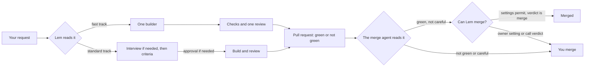

# Lem

<p class="lem-lead">Type a request in plain words, and get a pull request whose first line says green or not green.</p>
<p class="lem-for">For a developer who works alone, and for a team on Linear or GitHub Issues.</p>
<p class="lem-sub">Agents plan, build, test and review the change in your repository. Lem is a plugin for Claude Code that works closely with agterm.</p>

```bash
brew install pySilver/tap/lem
claude plugin marketplace add pySilver/lem --scope project
claude plugin install lem@lem --scope project
```

Lem needs [agterm](https://agterm.com). Run the first line one time on your computer, and the
next two in your repository. Then type `/lem init`. [Install](install.md) tells you more.

<picture>
  <source media="(prefers-color-scheme: dark)" srcset="assets/screens/board-dark.png">
  
</picture>

*The board on a computer. The picture shows demo data.*

## How a task goes

Each request opens a task in an agterm session of its own, with its own worktree. Many tasks
build and land at the same time. A task takes one of two tracks:

- The **fast track** is for one plain change with no open question: a typo, a rename, the fix of
  one rule. One builder makes it, and nothing waits for you. When another person wrote the
  ticket, its one criterion waits for your yes first.
- The **standard track** is for every other request. It has acceptance criteria, a plan and a
  larger review. [How a task goes](flow.md#the-standard-track) tells when Lem asks for your yes.



A task needs you three times at most: for its interview and criteria, at a circuit breaker, and
for a pull request with a call. The build asks you nothing.

Two examples. They are illustrations, not the output of a run. The first uses
`branch.land = "agent"`.

```text
you  /lem the footer says Terms, not Terms and Conditions
lem  docs: "the footer says Terms". Fast track: one builder, the checks, one read,
     then the pull request. Nothing waits for you.
lem  The pull request is open. Green. The merge agent found nothing for you, and Lem merged it.
```

```text
you  /lem the export holds the gift note of an order
lem  feat: "an export holds the gift note". Standard track: an interview here now,
     then acceptance criteria for your yes.
lem  An order with two notes: both in one cell, with a semicolon? My guess: yes.
you  yes
lem  The acceptance criteria, which two personas read:
     1. Order 1042 with the note "for Ania" has that text in its row.
     2. An order with no note has an empty cell.
you  yes
```

## What you can rely on

- Nothing merges before your tests pass and an agent that did not build the change reviews it.
- After an interview, nothing builds before your yes to the acceptance criteria, unless you are
  away or the task runs at night.
- Every reviewer reads a change that can affect what you said must never go wrong, and you merge
  it. Such a change is **careful**.
- A step that nobody can undo stops the task, and waits for you.
- Lem never pushes over a commit that it did not push.

The first line of each pull request says green or not green. [The pull request](pull-request.md)
lists the reasons for "not green". Green usually lets you merge without your own read.
A careful change or a call from the merge agent still needs your read.

## The board, also on your phone

The board shows each task in a column by who acts next, what waits for you, the backlog and the
activity. It updates by itself. There you answer the questions of a task, approve criteria, park
or drop a task, and merge.

<picture>
  <source media="(prefers-color-scheme: dark)" srcset="assets/screens/phone-dark.png">
  
</picture>

*The board on a phone. The picture shows demo data.*

Add the board to the Home Screen of your phone, through [Tailscale](https://tailscale.com). Lem then
sends a notification each time something starts to wait for you.
[The board on your phone](phone.md) gives the steps.

## Start from a ticket

Connect [Linear](linear.md) or [GitHub Issues](github-issues.md). Then a ticket is the request of a
task: type `/lem new ABC-12` for Linear, or `/lem new 42` for GitHub Issues. A team shares the
settings in git, the tickets and the pull requests. Each developer has their own board, with the
tasks on their own computer.

## Lem learns your repository

Lem keeps what it learns in files of your repository's git:

- `.lem/profile.md`: the product;
- `.lem/personas/`: the people that a change affects;
- `.lem/lessons.md`: your corrections of how an agent does a step here;
- `docs/rulings.md`: your decisions about what the product does, which no agent reopens without
  asking you.

Codex is optional and highly recommended. With it, a second model family reviews the larger
changes and answers as a second expert.

## What you type

| You type | What happens |
| --- | --- |
| `/lem <request>`, in any session | Lem opens a task in a session of its own, and the task tells you its type and track |
| `/lem` | the list of what waits for you, and the board |
| `/lem status <task>` | the board of one task |
| a chord in agterm (`ctrl+cmd+t`) | pick a task: you go to its session, or its board opens when no session runs it |
| `/lem plan <request>` | a standard-track task that stops after its plan. `/lem build` builds it |
| `/lem land <task>` | you merge an open pull request yourself |
| `/lem park [task]`, `/lem resume [task]` | you put a stopped task aside, or go back to it |
| `/lem be-careful [task]`, `/lem standard-track [task]`, `/lem drop [task]` | you change a task: careful until the merge, the standard track until its pull request, or stopped |
| `/lem im-away`, `/lem im-back` | an interview and its criteria go on without you, or wait for you again |
| `/lem serve tailscale` | your phone gets the board |
| `/lem learn` | Lem puts your correction into the file that owns the step |

Plain words that say the same work too. After a `/lem` in a session, plain words also start a
skill. "Let's brainstorm this" starts `interview-me`. "Argue both sides" starts `dialectic`.

| You type | When you use it |
| --- | --- |
| `/lem root-cause the import stops at row 5000` | a defect comes back after two fixes |
| `/lem ask-expert` | you want expert models to answer a question |
| `/lem panel docs/backlog/export-drops-custom-columns.md` | you want the personas to read a text |

Lem needs your yes at setup to schedule `/lem retro` or `/lem night`.

Lem has the [MIT License](https://github.com/pySilver/lem/blob/main/LICENSE).
