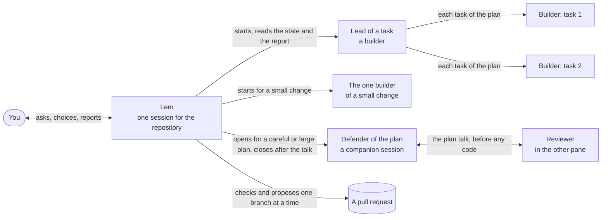
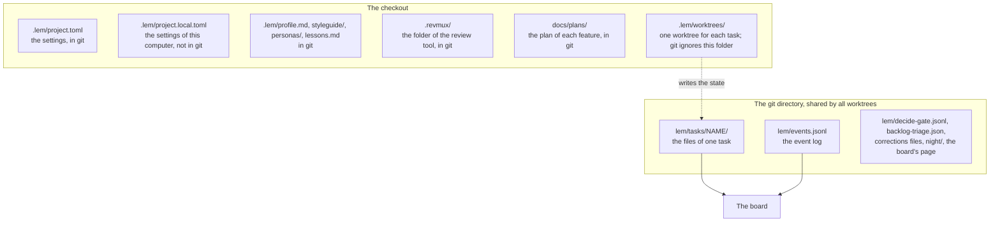
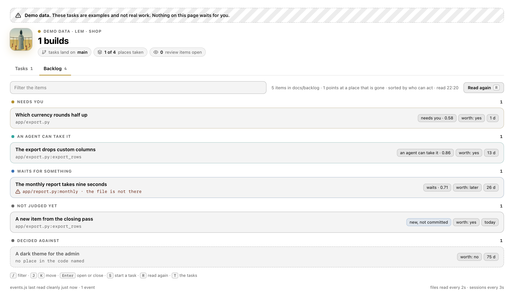

# Inside Lem

This page gives the parts of Lem that a day of work does not need. They are the agents, their
briefs, the files of a task, the event log and the board. `skills/lem/SKILL.md` holds the full
rules.

The name is from Stanisław Lem. In the logo, Lem is the tall figure in the middle. It builds
nothing. It holds the line that the other agents work on, and it answers to you for all of them.

## Two levels

There is one Lem for one repository. It is the session where you type `/lem`.

- **Lem** takes the asks, opens each task, and takes each branch through the checks and the
  review to a pull request. It writes no code.
- **Lem holds no details of a task.** It reads the ask, the newest state block, the report, and
  the facts of the scout or the investigator. It does not read the plan, the diff or the output
  of a builder. Lem is the one context that knows each task. If it fills with the code of one
  task, it loses the others.
- **A lead** is a builder that owns one feature from its plan to its report. It gives each task of
  its plan to a new builder, also when the plan has one task. A lead never asks you a question.
- **A small change has no lead.** Lem starts its one builder directly.
- **A builder has no pane.** Thus it cannot hold the plan talk of a careful or large plan, and it
  stops after the plan.
- **The defender** is the agent of a companion session that Lem opens for the plan talk. The
  reviewer is in the other pane. The two argue the plan through the mailbox. Lem closes the
  companion after the talk, and a new builder leads the build.
- **A lead or a defender tells Lem at once** when a choice waits for you. Lem also runs
  `decisions.py pending` at each of its turns, because a message can get lost.

## The agents and their briefs

Each agent gets a short brief that names a fixed text in `skills/lem/prompts/`. The builder
agent is `agents/lem-builder.md`, on Opus at high effort. Its body holds the rules of each
builder. A project can replace it with its own `.claude/agents/lem-builder.md`.

| Agent | Brief | What it does |
| --- | --- | --- |
| the scout | `scout.md` | reads the code around an ask during the interview, and gives facts, not a plan. It changes nothing |
| the investigator | `investigator.md` | reproduces a bug as a test that fails, and finds its cause, or answers a question |
| the builder of a small change | `small.md` | makes the one change, holds its story, and checks the topics before it commits |
| a lead | `lead.md` | writes the plan and starts a builder for each task |
| the defender | `defender.md` | holds the plan talk for the plan, with the reviewer |
| the reviewer | `reviewer.md` | the other side of the plan talk, in the other pane |
| a builder of the landing | `landing.md` | the polish pass, the repair of a conflict or of a failed check, or the fix of a review's findings |
| the review agent | `review.md` | makes the careful call on the diff, selects the size of the review, runs it, and writes its record |

The stage files tell each role what to do: `skills/lem/stages/new.md`, `plan.md`, `build.md`,
`talk.md`, `land.md`, `init.md`, `learn.md` and `night.md`. A lead reads `plan.md` and
`build.md`. Only the defender reads `talk.md`.

`skills/lem/harness/README.md` is the contract between the stages and an agent. A stage names a
capability, for example `spawn-builder` or `ask-owner`. `skills/lem/harness/claude-code.md` says
what each capability is in Claude Code.

## Where things are

- The settings of a project are in its repository. `/lem init` writes them.
- The state of a task is in the git directory, in `.git/lem/`. Git does not commit it, and it
  stays after Lem removes the worktree.
- `profile.md` says what the project is. `styleguide/` holds the rules for the code. `lessons.md`
  holds the corrections that have no better place.
- `personas/` has one file for each person that a change affects, for example a customer. Each
  project of Lem has two personas or more. `/lem init` writes them from your answers.
- A repository that already has `.claude/rules` keeps that folder. It is the style guide, and the
  settings name it. Lem makes no copy and no link. If `.lem/styleguide` also holds rule files, Lem
  reads the two folders.
- `.revmux` is the folder of the review tool. `/lem init` puts the starter set of that tool there.
  A lesson can change a file there, and Lem tells you each change and why.

## The files of a task

`python3 skills/lem/scripts/project.py task-dir SLUG` makes the folder of a task in
`.git/lem/tasks/`, and prints it.

| File | What it holds | Who writes it |
| --- | --- | --- |
| `ask.txt` | your words as you gave them | Lem |
| `task.md` | the ask, its kind, the outcome, "done when" lines, and what is out of scope | Lem |
| `ticket.txt`, `ticket-steps.txt` | the id of the ticket, and what Lem did to it | Lem |
| `scout.md` | the facts of the scout | Lem, from the reply of the scout |
| `investigation.md` | the report of the investigator | the investigator, or Lem from its reply |
| `directions.md` | what you named in the interview, one line each | Lem |
| `outside.md` | the defects outside the ask that the interview found | Lem |
| `stories.md` | the stories as Lem writes them for your yes; for a small change, the one story and its test line | Lem, and the builder of a small change |
| `stories.json` | the approved stories, word for word, with a digest, who approved them and when | `stories.py approve` only |
| `brief.md` | the brief of the lead, or of the builder of a small change | Lem |
| `state.md` | the state blocks, newest first | Lem and the lead, through `project.py state` only |
| `report.md` | what the lead did, and what it leaves to Lem | the lead that stops |
| `decisions.jsonl` | each decision, each choice and its answer, and each change of a story | `decisions.py` only |
| `experts/` | the brief and the two answers of the experts for each choice | the `lem-ask-expert` skill |
| `reports/` | one file for each builder of a plan | each builder |
| `landing.json`, `polish.json`, `gate/`, `read.json`, `reviews/` | the record of the landing, the input of the polish pass, the output of each check, and each review | `land.py` and the review agent |
| `notes.md`, `pr.md` | the notes of Lem, and the text of the pull request | Lem, and `land.py propose` |

A file that a later step needs goes into the task folder too, never into `/tmp`.

## The states of a task

| State | Means | Who acts |
| --- | --- | --- |
| `queued` | no lead runs, because the limit of tasks was reached | Lem, when a place is free |
| `building` | a lead plans or builds, or a builder examines a bug or a question | the lead, or the investigator |
| `planned` | the plan is committed, and nothing builds it | Lem opens the plan talk, or you read the plan |
| `held` | it waits for you: the stories, one more fact, a step that is yours, or a step that nobody can undo | you, through Lem |
| `blocked` | the lead stopped on something that it could not settle | Lem |
| `ready` | the report is written, and the branch waits for its checks | Lem |
| `landing` | the checks and the review run, or a builder repairs what they showed | Lem |
| `open` | a pull request is open, or the branch is ready to land | you merge; Lem, if the project lets an agent merge |
| `landed` | it is on the base branch | nobody |
| `drafted` | a plan of the night waits for your word | you |
| `dropped` | nobody will build it | nobody |
| `answered` | it ended with a report and nothing to merge | nobody |

A decision of yours never puts a task in `held`. It waits its time while the other work
continues.

`landed`, `dropped` and `answered` are the end. A task in one of them takes no new state and no
new lead. New work on it is a new ask.

## The event log

Each state block is also an event in `.git/lem/events.jsonl`, with the newest commit of the
worktree. The checks, the reviews, the decisions and the proposals are events too. The board
draws this log, so nobody runs a second command for it.

The start of each stage is an event, so that the time card of the board has a start and an end
for each span:

| Start | End | Who logs it |
| --- | --- | --- |
| `interview.start` | the first `stories.read.start` or `stories.approved` | Lem |
| `scout.start` | `scout` | Lem |
| `stories.read.start` | `stories.read` | Lem, or the lead on the rare path |
| `investigation.start` | `investigation` | Lem |
| `builder.start` | the next state block or step of the landing | the agent that starts the builder |
| `plan.talk.start` | `plan.talk` | the defender |
| `polish.start` | `polish` | `land.py` |
| `gate.start` | the last `gate` or `task.red` of that run | `land.py` |
| `review.start` | `review` | `land.py` |

`project.py log` checks the form of each start.

## The skills that Lem uses by itself

Each skill that comes with Lem has the id `lem-<name>`, and `/lem <name>` starts it. Lem uses
these skills without a command from you:

| Skill | Use |
| --- | --- |
| `lem-ask` | each question that asks you to choose or to approve, as a page |
| `lem-gate` | the question gate: it decides if a question must go to you at all. It starts in shadow mode: it logs its verdict beside your answer, and decides nothing |
| `lem-panel` | the personas of the project: an agent answers as each person that a decision affects |
| `lem-ask-expert` | each choice that waits for you: two experts answer it at the same time, and they change no file |
| `lem-linear` | the tickets of Linear. Lem checks the connection in `/lem init`, and again when it reads a ticket |
| `lem-interview-me` | the method of the interview |
| `lem-root-cause` | the method of the investigator, and of a builder after two failed tries |
| `lem-dialectic` | a claim that a plan rests on, before the plan takes it |
| `lem-backlog` | the format of a backlog item, and the sort of the backlog for the board |

## The board

`skills/lem/scripts/board.py` opens the board as a page in agterm, under the session of Lem. The
page is `skills/lem/assets/board.html`, and `skills/lem/assets/lem.css` gives the look of each
page of Lem.

- The board reads files in the git directory, and it needs no server. It reads the event log
  again each two seconds.
- At each open, `board.py` copies the page into `.git/lem/`. It writes the data files beside it:
  the events, the facts of the repository, and the backlog.
- Each task is in a lane of who acts next. A card shows the status, the lead, the newest commit,
  the gate result and the newest review. A task that Lem proposed shows green or not green.
- The board of one task adds its stories with the result of their tests, and its state blocks.
  It also shows each gate command, each review with who answered, and where the time went.
- A line that waits for you says where you answer.

  <picture>
    <source media="(prefers-color-scheme: dark)" srcset="../assets/screens/task-dark.png">
    
  </picture>

*The board of one task, with demo data from `board.py --demo`. The task is an example.*

- The second tab is the backlog. Its groups are "Needs you", "An agent can take it", "Waits for
  something" and "Decided against". An item whose place in the code is gone has a mark. You
  filter the items with words.
- Each backlog item has one action, "Start a task". After you confirm, it types `/lem new` and
  the path of the item into the session of Lem.

  <picture>
    <source media="(prefers-color-scheme: dark)" srcset="../assets/screens/backlog-dark.png">
    
  </picture>

*The backlog tab of the board, with demo data from `board.py --demo`. The items are examples.*

- `board.py --no-open` writes the files again and opens nothing.
- The board is local. A second person with a second clone does not see it.
- `board.py --demo` marks the tasks of the state folder as examples, and the page then says so.
