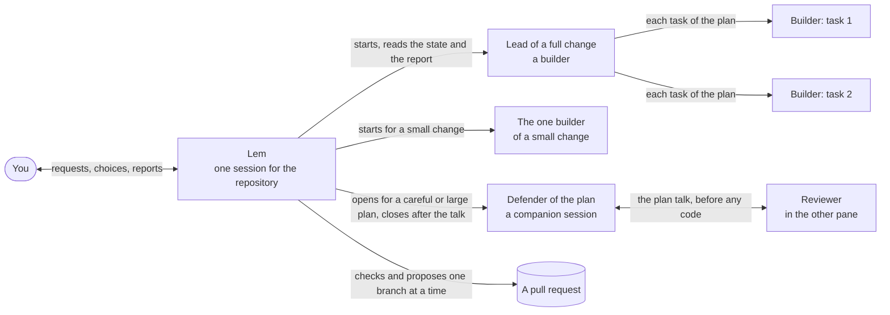
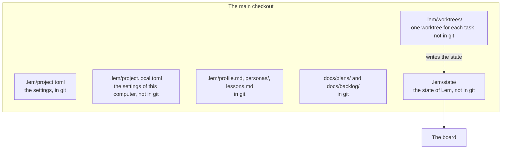
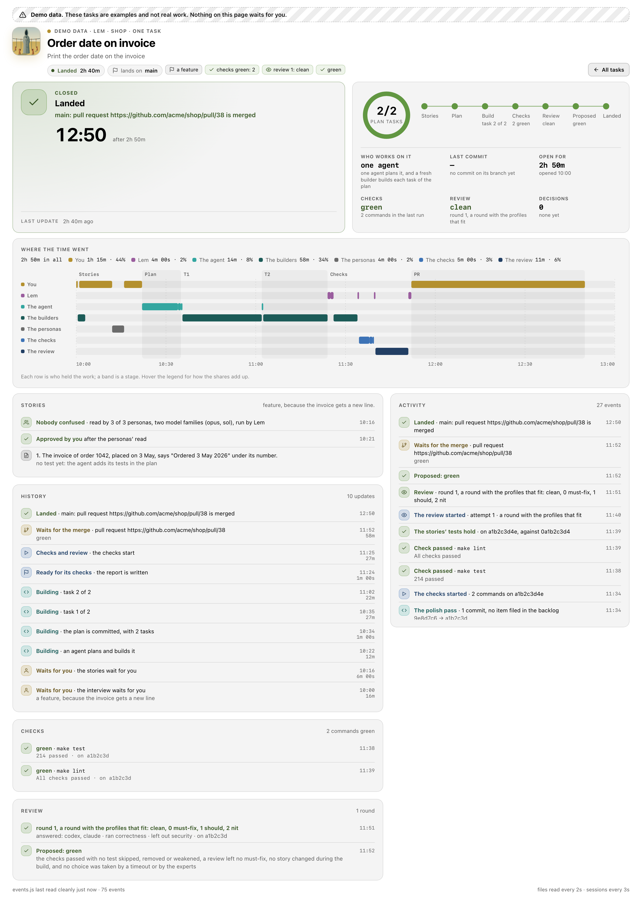
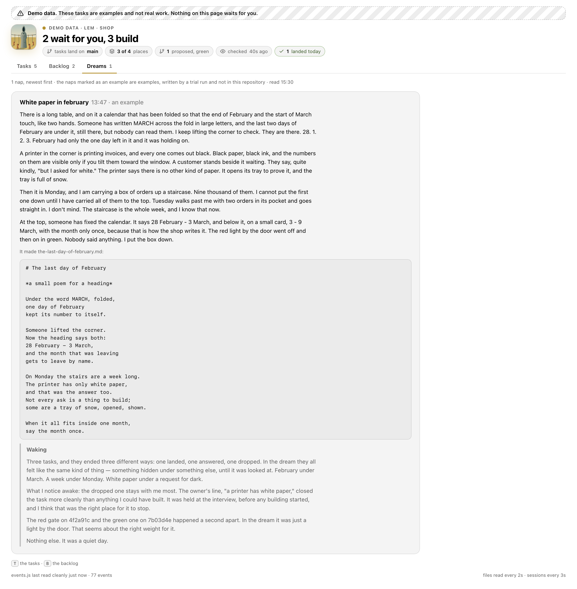

# Inside Lem

This page describes the parts of Lem that you do not need for daily work: the agents and their
briefs, the files of a task, the state folder, the event log, the board and the naps.
`skills/lem/SKILL.md` holds the full rules.

The name is from Stanisław Lem. In the logo, Lem is the tall figure in the middle. It builds
nothing. It holds the line that the other agents work on, and it is responsible to you for all of
them.

## Two levels

Each repository has one Lem: the session where you type `/lem`.

- **Lem** takes the requests, opens each task, and takes each branch through the checks and the
  review to a pull request. It writes no code.
- **Lem holds no details of a task.** It reads the request, the newest state block, the report,
  and the facts of the scout or the investigator. It does not read the plan, the diff or the
  output of a builder. Lem is the only context that knows every task. If it fills with the code of
  one task, it loses the others.
- **A lead** is a builder that owns one full change from its plan to its report. It gives each
  task of its plan to a new builder, even when the plan has only one task. A lead never asks you a
  question.
- **A small change has no lead.** Lem starts its one builder directly.
- **The defender** is the agent of a companion session that Lem opens for the plan talk. The
  reviewer is in the other pane. The two argue the plan through the mailbox. Lem closes the
  companion after the talk, and a new builder leads the build.
- **A lead or a defender tells Lem at once** when a choice waits for you. Lem also looks for such
  choices at each of its turns, because a message can get lost.

## The agents and their briefs

Each agent gets a short brief that names a fixed text in `skills/lem/prompts/`. The builder agent
is `lem:lem-builder`, from `agents/lem-builder.md` of the plugin, on Opus at high effort. Its body
holds the rules that every builder follows. A project can replace it with its own
`.claude/agents/lem-builder.md`.

| Agent | Brief | What it does |
| --- | --- | --- |
| the scout | `scout.md` | reads the code around a request during the interview, and gives facts, not a plan. It changes nothing |
| the investigator | `investigator.md` | reproduces a bug as a test that fails and finds its cause, or answers a question |
| the builder of a small change | `small.md` | makes the one change, holds its criterion, and checks the topics before it commits |
| a lead | `lead.md` | writes the plan and starts a builder for each task |
| the defender | `defender.md` | defends the plan in the plan talk, against the reviewer |
| the reviewer | `reviewer.md` | argues the other side of the plan talk, from the other pane |
| a builder of the landing | `landing.md` | makes the polish pass, repairs a conflict or a failed check, or fixes the findings of a review |
| the review agent | `review.md` | makes the careful call on the diff, selects the size of the review, runs it, and writes its record |

The stage files tell each role what to do: `skills/lem/stages/new.md`, `plan.md`, `build.md`,
`talk.md`, `land.md`, `init.md`, `learn.md` and `night.md`. A lead reads `plan.md` and
`build.md`. Only the defender reads `talk.md`. A part that only one path of Lem's reads is a file
of its own, and Lem reads it only on that path:

- `interview.md`: the interview and the acceptance criteria of a full change.
- `investigate.md`: the investigation of a bug or a question.
- `start.md`: the start of a lead or a builder, `/lem build`, and the queue.
- `stopped.md`: what Lem does when a lead stops.
- `choice.md`: a choice that waits for the owner.
- `polish.md`: the polish pass of a full change, step 3 of `land.md`. A small change has no polish
  pass, so Lem does not read this file for it.

`skills/lem/harness/README.md` is the contract between the stages and an agent. A stage names a
capability, for example `spawn-builder` or `ask-owner`. `skills/lem/harness/claude-code.md` says
how Claude Code provides each capability.

## The command `lem`

Lem's scripts share one command, `lem`, which the plugin puts on the `PATH` of the agent. The
agents run it, and you do not type it. Because it is one command, the permission rule
`Bash(lem *)` covers all scripts, even after an update of the plugin.

- `lem NAME ARGS...` runs one script, for example `lem land start SLUG` or `lem project show`.
- `lem NAME --help` gives the help of that script.
- `lem help` lists the names: `project`, `land`, `criteria`, `decisions`, `board`, `doctor`,
  `corrections`, `experts`, `cast`, `gate-log`, `triage`, `release-platform`, `release-version`
  and `release-notes`.
- `lem version` prints the folder of the plugin, and its commit when that folder is a git clone.

Two other commands stand alone: `lem-ask`, the question page, and `lem-jev`, the client of the
Jev decision model.

## Where things are

- The settings of a project are in its repository. `/lem init` writes them.
- `profile.md` says what the project is. `lessons.md` holds the corrections that have no better
  place. A correction about a stage of Lem goes there too, as a line that starts with the name of
  the stage. Lem reads the file before each command.
- `personas/` has one file for each person that a change affects, for example a customer. Every
  project that uses Lem has two or more personas. `/lem init` writes them from your answers.
- A repository that already has `.claude/rules` keeps that folder. It is the style guide, and the
  settings name it. Lem makes no copy and no link.
- `.revmux/` is the folder of the review tool. `/lem init` puts the starter set of that tool
  there. A lesson can change a file there, and Lem tells you each change and why.

## The state folder

Lem keeps its state in `.lem/state/` in the main checkout, which is the first worktree that git
lists. Each worktree writes there. Git does not track the folder, and the folder stays after Lem
removes a worktree.
`lem project state-dir` prints its path.

- `tasks/`: one folder for each task;
- `events.jsonl` and `events.js`: the event log, and the same log for the board;
- `watch.js`: the result of the last look of the watch at the open pull requests;
- `landing.lock`: the lock of the one task in the landing;
- `alone.lock`: the lock of the commands under `checks.alone`;
- `decide-gate.jsonl`: the log of the question gate;
- `backlog-triage.json` and `backlog.js`: the triage of the backlog, and the backlog for the board;
- `corrections.jsonl`, `corrections-reviews.jsonl`, `corrections.log` and `corrections-claims/`:
  the correction queue;
- `night/`: the night reports;
- `retros/`: the proposals of a retro that ran with nobody there;
- `experts/`: one folder for each question that you gave to the experts with `/lem ask-expert`;
- `personas-cast/` and `personas-profile/`: the copies of the personas and of the profile that a
  persona panel read;
- `naps/`: one folder for each nap;
- the page of the board and its data files.

## The files of a task

`lem project task-dir SLUG` makes the folder of a task in `.lem/state/tasks/`, and prints its
path.

| File | What it holds | Who writes it |
| --- | --- | --- |
| `ask.txt` | your words as you gave them | Lem |
| `task.md` | the request, its type, the result, the "done when" lines, and what is out of scope | Lem |
| `ticket.txt`, `ticket-steps.txt` | the id of the ticket, and what Lem did with it | Lem |
| `scout.md` | the scout's facts | Lem, from the scout's reply |
| `investigation.md` | the report of the investigator | the investigator, or Lem from its reply |
| `directions.md` | what you named in the interview, one line each | Lem |
| `outside.md` | the defects outside the request that the interview found | Lem |
| `criteria.md` | the acceptance criteria as Lem writes them for your yes; for a small change, the one criterion and its test line | Lem, and the builder of a small change |
| `criteria.json` | the approved criteria, word for word, with a digest, who approved them and when | `lem criteria approve` only |
| `brief.md` | the brief of the lead, or of the builder of a small change | Lem |
| `state.md` | the state blocks, newest first | Lem and the lead, through `lem project state` only |
| `report.md` | what the lead did, and what it leaves to Lem | the lead, when it stops |
| `decisions.jsonl` | each decision, each choice and its answer, and each change of a criterion | `lem decisions` only |
| `experts/` | the brief and the two answers of the experts for each choice | the `lem-ask-expert` skill |
| `reports/` | one file for each builder of a plan | each builder |
| `landing.json`, `polish.json`, `gate/`, `read.json`, `reviews/` | the record of the landing, the input of the polish pass, the output of each check, and each review | `lem land` and the review agent |
| `notes.md`, `pr.md` | Lem's notes, and the text of the pull request | Lem, and `lem land propose` |

A file that a later step needs goes into the task folder too, never into `/tmp`.

## The states of a task

| State | What it means | Who acts |
| --- | --- | --- |
| `queued` | no lead runs: the limit of tasks was reached, or the task needs the result of the task that its `after:` line names | Lem, when a place is free or that task ends |
| `building` | a lead plans or builds, or a builder examines a bug or a question | the lead, or the investigator |
| `planned` | the plan is committed, and nothing builds it yet | Lem opens the plan talk, or you read the plan |
| `held` | it waits for you: the criteria, one more fact, a step that is yours, or a step that nobody can undo | you, through Lem |
| `blocked` | the lead stopped at a problem that it could not solve | Lem |
| `ready` | the report is written, and the branch waits for its checks | Lem |
| `landing` | the checks and the review run, or a builder repairs what they showed | Lem |
| `open` | a pull request is open, or the branch is ready to land | you merge; Lem, if the project lets an agent merge |
| `landed` | it is on the base branch | nobody |
| `drafted` | a night plan waits for your approval | you |
| `dropped` | nobody will build it, or its pull request was closed with no merge | nobody |
| `answered` | it ended with a report and nothing to merge | nobody |

A decision of yours never puts a task in `held`. The decision waits until its time ends, while the
other work continues. `landed`, `dropped` and `answered` are final states. A task in one of them
gets no new state and no new lead.

## The event log

Each state block is also an event in `.lem/state/events.jsonl`, with the newest commit of the
worktree. The checks, the reviews, the decisions and the proposals are events too. The board
draws from this log, so no other command has to run for it.

Each stage also logs its start as an event. So the time card of the board, which shows where the
time went, has a start and an end for each span:

| Start | End | Who logs it |
| --- | --- | --- |
| `interview.start` | the first `criteria.read.start` or `criteria.approved` | Lem |
| `scout.start` | `scout` | Lem |
| `criteria.read.start` | `criteria.read` | Lem, or the lead for a complete request |
| `investigation.start` | `investigation` | Lem |
| `builder.start` | the next state block or step of the landing | the agent that starts the builder |
| `plan.talk.start` | `plan.talk` | the defender |
| `polish.start` | `polish` | `lem land` |
| `gate.start` | the last `gate` or `task.red` of that run | `lem land` |
| `review.start` | `review` | `lem land` |

## The board

`lem board` opens the board as a page in agterm, next to Lem's session. The page is
`skills/lem/assets/board.html`, and `skills/lem/assets/lem.css` gives the look of each page of
Lem.

- The board reads files in the state folder, and it needs no server. It reads the event log again
  every two seconds.
- The board puts each task in a lane by who acts next. A card shows the status, the lead, the
  newest commit, the result of the checks and the newest review. A task that Lem proposed shows
  green or not green.
- The board says when Lem last checked the open pull requests, for example "checked 40s ago".
  When the last look is older than three watch intervals, or the watch ended, it says
  "nobody watches the pull request" (or "the 2 pull requests") and tells you to type `/lem`. A page cannot ask GitHub
  itself.
- The board of one task adds its acceptance criteria with the result of their tests, and its state
  blocks. It also shows each check, each review with who answered, and where the time went.
- Each line that waits for you says where you answer it.

  <picture>
    <source media="(prefers-color-scheme: dark)" srcset="../assets/screens/task-dark.png">
    
  </picture>

*The board of one task, with demo data. The task is an example.*

- The second tab is the backlog. Its groups are "Needs you", "An agent can take it", "Waits for
  something" and "Decided against". An item whose place in the code is gone has a mark. You can
  filter the items by words.
- Each backlog item has one action, "Start a task". After you confirm, the board types `/lem new`
  and the path of the item into Lem's session.

  <picture>
    <source media="(prefers-color-scheme: dark)" srcset="../assets/screens/backlog-dark.png">
    
  </picture>

*The backlog tab of the board, with demo data. The items are examples.*

- `lem board --no-open` writes the files again and opens nothing.
- The board is local. Another person with another clone does not see it.
- `lem board --demo` marks the tasks of the state folder as examples, and the page then says so.

## Naps

Naps are an optional part of Lem. `naps.on = true` turns them on ([settings.md](settings.md#naps)).
A nap costs one short agent session, and no measurement shows that naps help.

- Lem takes a nap when a task ended or when only your approval is left, if the last nap is
  `naps.gap_hours` old. Nothing waits for the nap.
- `/lem nap` starts a nap when you ask, even when naps are off.
- A nap is a new agent in the background. It reads the records of the recent tasks, dreams, makes
  one thing, and writes a waking note.
- The nap runs no command. It reads and writes only in the state folder, and it changes nothing in
  the repository.
- Each nap has a folder `.lem/state/naps/TIME-WORDS/` with `dream.md`, the thing it made, and
  `waking.md`. Lem removes a folder that is older than `naps.keep_days`.
- The board gets a third tab, Dreams, when a nap exists. It shows the newest naps.
- The retro reads the waking notes since the last retro. A note is only a candidate for a lesson.

  <picture>
    <source media="(prefers-color-scheme: dark)" srcset="../assets/screens/dreams-dark.png">
    
  </picture>

*The Dreams tab of the board, with demo data. The nap is an example.*

## The skills that Lem uses by itself

Each skill that comes with Lem has the id `lem-<name>`, and `/lem <name>` starts it. No skill
starts by itself because of what you write. Lem uses these skills without a command from you:

| Skill | What Lem uses it for |
| --- | --- |
| `lem-ask` | each question that asks you to choose or to approve, as a page |
| `lem-gate` | the question gate: it decides if a question must go to you at all. It starts in shadow mode: it logs its verdict next to your answer, and decides nothing |
| `lem-panel` | the personas of the project: an agent answers as each person that a decision affects |
| `lem-ask-expert` | each choice that waits for you: two experts answer it at the same time, and they change no file |
| `lem-linear` | the tickets of Linear. Lem checks the connection in `/lem init`, and again when it reads a ticket |
| `lem-interview-me` | the method of the interview |
| `lem-root-cause` | the method of the investigator, and of a builder after two failed tries |
| `lem-dialectic` | a claim that a plan rests on, before the plan accepts it |
| `lem-backlog` | the format of a backlog item, and the triage of the backlog for the board |
