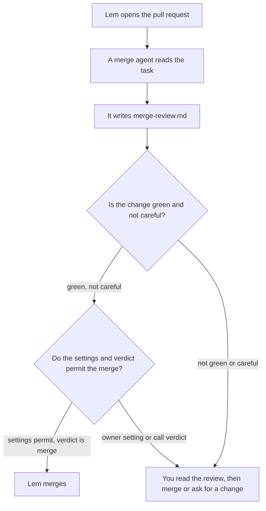

# The merge

## The merge review

A fresh merge agent reads each [pull request](pull-request.md), the task files, the reviews and
the diff. It writes `merge-review.md` and makes no edits to the change. The verdict is merge or
call. Then it gives the work and its purpose, the results, decisions Lem took without you, time
and tokens.
For a safe small change, it gives the verdict and three sentences. A visual change gets the
builders' before and after pictures, or a line that explains their absence. When the review
calls you for a visual change, its last line tells you how to try the branch.

When the merge agent calls you, "Waits for you" on the board shows one stack for the task:
"Read the merge review" and "2 things". The review and the merge are its two rows. The review is
also the first card of the task.

The board server merges a green change that is not careful when the verdict is merge and
[`branch.land`](settings.md#branch) is `"agent"`. Until the verdict, the task stays in "Checks
and review", with no row in "Waits for you" and no notification.

With `branch.land = "owner"`, the merge agent still writes its review. You merge the pull request.

## Merge it

There is one merge: the merge of the pull request. You start it with the Merge button on GitHub,
with **Merge…** and then **Approve** on the [board](board.md#act-from-the-board), or with
`/lem land <task>`. While you are
[away](away.md#answer-from-the-inbox), you can also answer in the Inbox. Lem merges only the
commit that the question names.

- A merge goes through GitHub, under the rules of your base branch. When GitHub refuses it,
  "Waits for you" shows the line that GitHub gave. Lem refuses a merge when the pull request on
  GitHub has another base branch than yours, and names the fix.
- After a rebase or conflict, approval stands while a review covers the change and while the
  reasons for "not green" stay the same. The approved criteria must also stay the same. Before
  Lem merges an approved task on a moved base, it rebases the task and runs the checks again.
  If your approval ends, the pull request says why. Approve the pull request again if your
  approval ends.
- A task that is red on its rebase leaves the line. Its session sends a builder, and the task
  comes back after the fix. It calls you only when the fix needs a criterion to change, or a
  breaker applies.
- Lem merges one task at a time. A task whose checks ran on the current base merges first.
- For several tasks in one `/lem land` request, Lem merges them in the order you give. If you give
  no order, Lem starts with the oldest proposal.

Do not merge the branch of a task by hand: Lem knows only a merge through the pull request. After
a merge, the session of the task removes the worktree, the branch and its copy on GitHub, and
updates the ticket of the task. A branch with a change that GitHub did not merge stays, and Lem
tells you what changed and how to delete it.

On GitHub's button, you select the merge method. `branch.history` is for Lem's merge. With
`branch.history = "squash"`, the body of Lem's commit names each fix on the way, and its last line
is `Lem task: <task>`. The board reads that line to show which task added a backlog item.

The board server sees a merge or a close on GitHub within a few minutes.

## A conflict

When a merge makes another open pull request conflict, the board server wakes the session of its
task. That session rebases the branch, and a builder resolves the conflict. The checks run again,
and one read checks the resolution. Lem leaves every other open pull request as it is.

The merge review stays only if the merge agent gave a verdict before the conflict. A fresh merge
agent reads the pull request when:

- the merge agent did not give a verdict before the conflict;
- the read found a must-fix, a should or a nit, or did not answer two times;
- the change is careful;
- a commit came after the resolution;
- the review before the conflict left a must-fix.

The pull request says when the merge review carries.

## A commit of a teammate

Lem never pushes over a commit that it did not push. Such a commit stops Lem before its next push,
and Lem names the `git pull --rebase` that brings it in. Then the commit gets the checks and a read.

## Stop a task

Type `/lem drop <task>`, or close the pull request on GitHub with no merge. Lem removes the
worktree. A branch with commits of its own stays, and Lem tells you how to delete it. For new work,
make a new request.
