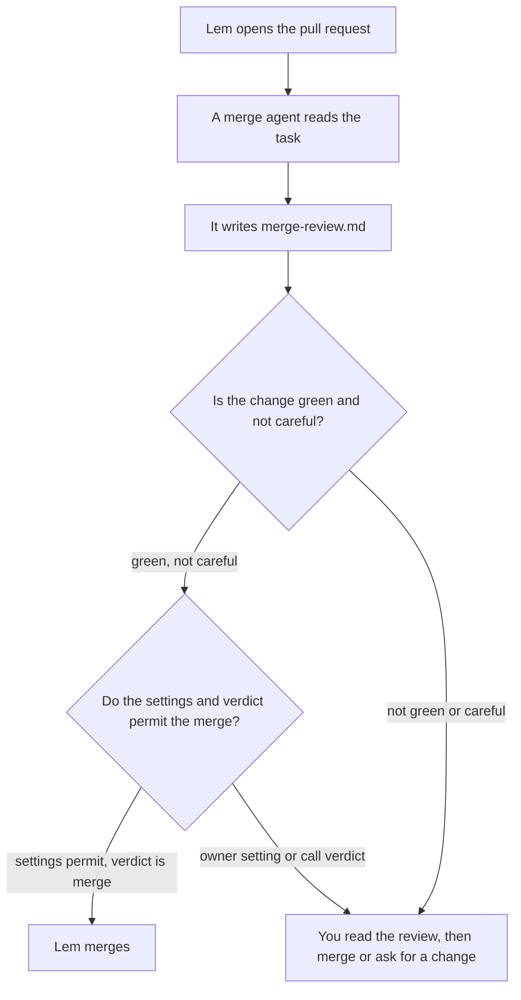

# The merge

## The merge review

A fresh merge agent reads the [pull request](pull-request.md), task files, reviews and diff.
It writes `merge-review.md` and leaves the change as it is. The verdict is merge or call.
The review gives the work, purpose, results, decisions Lem took without you, time and tokens.

A small, plain change gets the verdict and three sentences. A visual change gets before and after
pictures, or a line that says why they are missing. If the verdict is call, the last line tells
you how to try a visual change.

Lem merges a **safe** change itself: it is green and not careful, the verdict is merge, and
[`branch.land`](settings.md#branch) is `"agent"`, the default. With `branch.land = "owner"`, the
merge agent still writes its review, and you merge every pull request. Until the verdict, the task
stays in "Checks and review", with no row in "Waits for you" and no notification.

When the merge agent calls you, "Waits for you" shows "Read the merge review" and "2 things".
The stack has a row for the review and one for the merge. The review is also first on the
Overview of the task.

## Merge it

Use **Merge** on GitHub, **Merge…** then **Approve** on the [board](board.md#act-from-the-board),
or `/lem land <task>`. Lem records your approval for the commit you see.

If the base moved, Lem reads the change, and rebases when necessary. Lem always rebases an
approved task on a moved base, and runs the checks again before the merge.

After a rebase or conflict, approval stands if a review covers the change and while the reasons
for "not green" stay the same. The approved criteria must also stay the same. If your approval
ends, the pull request says why. Approve the pull request again if your approval ends.

## One merge at a time

- Lem merges one task at a time. A task whose checks ran on the current base merges first.
- If the checks fail after a rebase, the task leaves the queue of merges until a builder fixes
  it. It calls
  you only when the fix needs a criterion to change or a breaker applies.
- For several tasks in one `/lem land` request, Lem merges them in the order you give. If you give
  no order, Lem starts with the oldest pull request.
- GitHub applies the rules of your base branch. "Waits for you" shows a refusal from GitHub.

After the merge, the task removes its worktree and both copies of its branch, and updates its
ticket. Lem keeps a branch with an unmerged change, and tells you what changed and how to delete
it. The board server sees a merge or a close on GitHub within a few minutes.

On GitHub's button, you select the merge method. `branch.history` is for Lem's merge. With
`branch.history = "squash"`, the body of Lem's commit lists the task's decisions. It also gives
the note about a moved base when there is one. The last line is `Lem task: <task>`. The board
reads that line to show which task added a backlog item. See
[Fixed on the way](pull-request.md#what-lem-saw-outside-the-task) for the fixes.

## A conflict

The board server wakes each task whose pull request now conflicts. The task rebases the branch.
A builder resolves the conflict. The checks run again and one review reads the resolution.
Lem leaves every other open pull request as it is. The pull request says when the merge review
carries.

## A commit of a teammate

Lem never pushes over a commit that it did not push. Such a commit stops Lem before its next push,
and Lem names the `git pull --rebase` that brings it in. Then the commit gets the checks and a read.

## Stop a task

Type `/lem drop <task>`, or close the pull request on GitHub with no merge. Lem removes the
worktree. A branch with commits of its own stays, and Lem tells you how to delete it. For new work,
make a new request.
