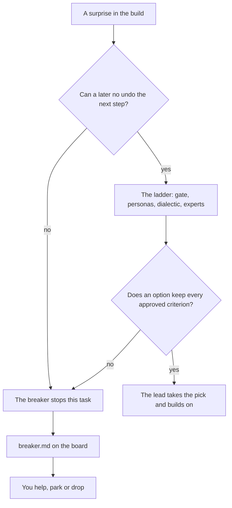

# Task 2. Execution asks nothing

## The outcome

**In the build no choice waits for you: the ladder always decides, and only a circuit breaker stops a task, with a document to read.**

Today (demo task `gift-note-in-export` of `tests/board-showcase.py`; an illustration):
1. The lead meets a choice: where the gift note goes when the export has a notes column already.
2. The ladder goes past the personas; you are not away, so it asks you.
3. `gift-note-in-export · choice 1` opens and waits with no time limit.
4. You are in another interview; no pull request opens meanwhile.

After:
1. The dialectic finds no break of "A: a column of its own". The lead logs it and builds A.
2. Nothing reaches you. The pull request says not green for it; the merge agent reads it (task 3).

Read in: `stages/build.md` step 2 of "A choice in the build"; `decisions.py` `cmd_ask`; `companion.py` `cmd_open`; `stages/land.md` step 6; `land.py` `not_green`.

## How it works

A surprise ends as the ladder's pick or the breaker's document.

## The acceptance criteria

1. No build choice waits for the owner, there or away: choice 1 goes past the personas with no away mark; the lead builds the pick; "Waits for you" shows nothing. *His word:* Q7 "yes"; P3 "Everything that is not hard to reverse ... should not interrupt work".
2. A pick past the personas makes the pull request not green, one line each: "decision 1 was taken without the owner ... by the dialectic". *His word:* Q7.
3. The breaker has two causes and no others:
   1. The next step cannot be reversed (data, system, person, money).
   2. Every option of the ladder breaks an approved criterion.
   3. A task at 3 h where 1 h was expected meets neither, and goes on.
   *His word:* Inbox, "An overrun stops nothing", on this proposal.
4. The breaker stops its task only: `gift-note-in-export` commits, writes `handoff.md` and `breaker.md`, and is `held`; `coupon-has-a-slug` builds on. *His word:* P3 "Hard circut breaker should stop execution".
5. What reaches him is a document: `breaker.md` holds Today and After, the case that broke with its chart, the root cause, the options, a recommendation, the assumptions. *His word:* P2.
6. He answers one of three ways:
   1. Help: he talks with the lead; his decision is logged `--by owner`; the build goes on.
   2. `/lem park gift-note-in-export`: state `parked`; the worktree, the branch and the files stay.
   3. `/lem drop gift-note-in-export`: state `dropped`; the worktree goes, and the branch, `handoff.md` and `breaker.md` stay.
   A return to the discussion is one command after either answer (criterion 7).
   *His word:* P3 "abandon / return the task and keep the context or help"; state and words: **the session's proposal**.
7. A parked or a dropped task starts again from its files: `/lem resume gift-note-in-export` a week later opens the discussion with a fresh agent that has read `handoff.md` and `breaker.md`. A parked task goes on in its own worktree. A dropped task stays ended, and the command opens a new task that starts from its handoff and its branch's commits. *His word:* Q10 "yes"; P2 "without loosing what was already being discovered".
8. A pick past the personas keeps its story (`--case`, `--cause`, a chart file on `lem decisions log`). *His word:* P3 "beautiful reasoning document ... at the merge time".
9. A build never waits for his answer to a question, away or there. `gift-note-in-export` meets a question at 02:00 while he is away: the personas, the dialectic and the experts answer it, the lead takes their pick and logs it with its story, and the build goes on. He reads the pick at the pull request and asks for a fix when it was wrong. So `/lem im-away` has nothing to change in a build. *His word:* Q7, it "matters only for an interview"; his review of this shape: "I'd rather review the PR and request a fix then find a work blocked on some question that automated anwers could answer right." 

## What goes

`stages/choice.md` (becomes `stages/breaker.md`); `decisions.py` `cmd_wait`, `cmd_away`, `take`, `cmd_advise`, the `timeout` lines; `project.py` `take_away`; `land.py` `waited`; the card steps of `build.md`, `plan.md`, `ladder.md`, `away.md`, `prompts/lead.md`; the board's "Answer choice N".

## His rulings that this changes

New fact for each: Q7 and P3.

- "He says whether he is there" (2026-11-18): "a choice of his waits ... with no time limit".
- "Two experts answer a choice that waits for him" (2026-11-16): nothing waits; they stay level 4.
- "Lem asks through its question page" (2026-11-15): the build asks nothing (P2).

## What the board and the server give it

- Built (`d2d948f`): "Waits for you" and the artifacts reach his phone; a breaker is one more row.
- Planned (`board-plan.md`): charts in markdown (R), a push when it trips (S5), park and drop buttons running the same `lem` command (S7). The card page goes.

## Open questions for the owner

None. He answered both in his review of this shape (2026-11-20):

1. May the ladder change an approved criterion? An example yes, as today; a rule never: it trips the breaker. His note: "agree".
2. The HTML form of `breaker.md`: the board's render, with no agdoc page. His note: "I mentioend agdoc just as exaple of “landing page quality level” of layout". So the bar is the quality of the layout, a landing page's, and not the tool: the board's render of the document must reach it.

**Decided here** (his note on this list: "I agree")**:**
- The whole task stops (P3, "stop execution").
- `parked` is a state, so it leaves "Waits for you".
- A trust prompt stays a `held` line: no decision.
- Until task 4 a breaker opens in today's choice companion.

## Size and order

- About 400 script lines out, 200 in (unmeasured estimate).
- A small task: unchanged, two agents, one touch. The standard track loses a touch per choice past the personas.
- First of the three (Q9). Task 3 reads its decisions; task 4 removes the companion it still uses.
