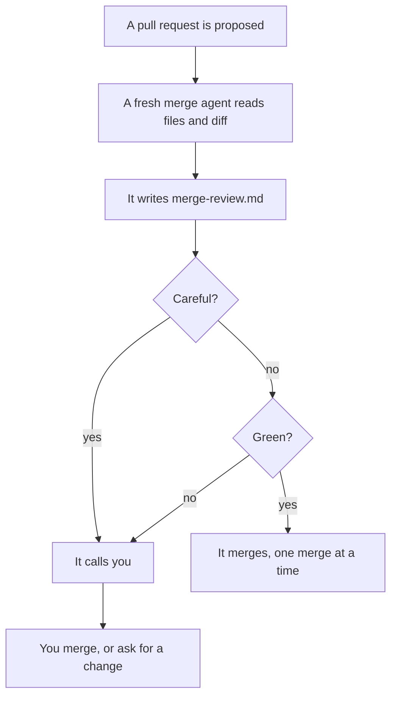

# Task 3. The merge agent

## The outcome

**A fresh agent reads each proposed task, writes its review, and merges it or calls you; GitHub pull requests are the one way to land.**

That is the default. A developer who wants to read each change before its merge sets `branch.land = "owner"`: the agent then writes the same review and never merges.

Today:
1. `headings-need-four-digit-years` is proposed green, lem-scratch pull request 10.
2. `branch.land` is "owner": it waits as `open` for your word.
3. You type "land both"; Lem merges 10, then 11.

After:
1. A fresh merge agent reads 10's files and diff, writes `merge-review.md`, and finds nothing for you.
2. It merges 10. The board shows it landed; you typed nothing.
3. `away-for-the-whole-machine` (pull request 7) is careful: the agent finds it correct and calls you.

Read in: lem-scratch `events.jsonl` (10 proposed green, 16:38Z); `project.py` `TEMPLATE`; `land.py` `may_merge`; `handoff.md` ("land both"); Lem's `events.jsonl` (7 careful, green).

## How it works

Each proposed task gets one fresh read.

## The acceptance criteria

1. A fresh agent reads each proposed task's files, reviews and diff, and changes nothing. Its seat is `seats.merger`, and no model's name is in Lem's code: the repository's settings name it, or else the developer's own file for all his repositories (`[seats] merger = "claude/opus:high"` in `~/.config/lem/machine.toml`), or else the agent's own default model. *His word:* P6 "additional Agent with fresh context", "settings configurable model"; his review of this shape: "this should be set on most generic level, not in code (`~/.config/lem` ?)".
2. It writes `merge-review.md`: the verdict first; what was built and why, as a story; the results; each decision taken without him, with why; the task's time. A 3 h task where 1 h was expected may be its reason to call. The review is always shorter than the documents it read, and it grows only with what he must read: for `footer-terms-typo`, which is safe to merge, it is the verdict and three sentences. *His word:* P6 "beutiful and clear review document"; the Inbox, "An overrun stops nothing"; his review of this shape: "The goal here is to use second pair of eyes and also to avoid excessive read by human brain, especially when branch is safe to merge." 
3. It decides one of two:
   1. Merge: `lem land merge gift-note --by merger`, under the merge lock, the base read first. The step's name is `merge`: `lem land land` goes.
   2. Call: "Waits for you" shows "Read the merge review" before the merge.
   *His word:* P6 "merge right away or call me to read his summary and reasoning".
4. A careful change always calls him: `away-for-the-whole-machine` is correct, and still `--by merger` refuses it. So does every change of a repository whose settings say `branch.land = "owner"`: the review is written, "Waits for you" shows it, and only his merge lands it. *His word:* the Inbox, "It calls you"; his review of this shape: "developer can configure `lem` the say he always needs to review before merge. Merge review still applies." 
5. The agent merges only a green request. Each request that is not green calls him, whatever its reason: `gift-note` (pull request 41) is not green for one pick of the experts, the agent finds the pick sound, and it still calls him with its review; he gets the notification. *His word:* his answer of 2026-11-20 on the question page, "Each not-green pull request calls you".
   - Each task reads the same way, the fast track too: `footer-terms-typo` (pull request 42, green, not careful) gets a review of one paragraph, and then the agent merges it. *His word:* the same page, "The merge agent reads each task, the fast track too".
6. It merges a task that ran without him too (`may_merge` refuses today). *His word:* P4, P6.
7. GitHub pull requests only: `lem project init` where origin is not GitHub refuses with the fix; a settings file with `branch.propose` is refused. *His word:* GitHub notes, "we can assume that we fully use Github".
8. One merge route: his merge (board or `/lem land`) and the agent's are one `lem land merge`; a merge GitHub refuses calls him with GitHub's line. **The session's proposal.**

## What goes

- `branch.propose` and `"merge"`: `PROPOSE`, `task.merges`, the push and the `arrived` path of `land_locked`, the landing with no remote, and their checks in `tests/lem-land-local.sh`.
- `branch.land` stays, with the default `"agent"` (the merge agent merges) beside `"owner"` (he always merges); its `/lem init` assumption says the default. `may_merge`'s refusal by `mode` goes.
- The step name `land` of `lem land` (`lem land land`): it is `merge`.
- `stages/pages.md`, `templates/page-brief.md`, the agdoc `page.html`: the merge review replaces them.

## His rulings that this changes

- "A project may land with no pull request" (2026-11-16), "One way to merge in each project" (2026-11-17), "Every way to merge stays" (2026-11-18): his GitHub notes.
- "A green pull request he merges without a read" (2026-11-16); "the merge wait for him in either mode" (2026-11-18); "he reads it before he merges" (2026-11-16): P6, the agent decides.
- The end page "done by agdoc" (2026-11-18): see task 2, question 2.

## What the board and the server give it

- Built (`d2d948f`): the merge row of "Waits for you"; `merge-review.md` among the artifacts, on his phone.
- Planned (`board-plan.md`): the board's merge (S7) runs the same `lem land land --by owner`; a push when the agent calls (S5); the server runs `lem land merged` after a GitHub merge (R, 12), so no session must.

## Open questions for the owner

None. He answered both on the question page of 2026-11-20, against the session's two recommendations. To his "Well prove I did wrong!" the session counted the real records (both event logs, 2026-11-20) and could not:

1. May the merge agent merge a request that is not green? "Each not-green pull request calls you". Of the 21 tasks proposed so far (11 in Lem's repository, 10 in lem-scratch), 7 were not green. Under his rule all 7 call him. Under the session's rule 5 would: only `status-boards-steady-look` and `landing-in-the-background` were not green for picks of the ladder alone. So his rule costs 2 more reads in 21 tasks, and the session's sentence "you read most pull requests again" was wrong.
2. Does the fast track get the merge agent? "The merge agent reads each task, the fast track too". 11 fast-track tasks were proposed, and 10 were green. The one read of a fast-track change took a median of 83 s (lem-scratch, 8 reads) and 124 s (Lem, 6 reads); a merge agent's read of the same change costs about that again (an unmeasured estimate) and no touch of his.

What follows for task 2: in those records one choice was ever asked of him (`landing-in-the-background`), against 155 decisions that were taken without a question. So "the build asks nothing" adds few requests that are not green.

**Decided here:**
- `branch.land` stays as the one switch of who merges (his review of this shape); `branch.propose` goes: "avoid support for multiple ways of doing same thing".
- The seat takes `claude` or `codex`, read-only, started as an expert (`ask-experts`).
- Its reply is the review and a verdict; Lem writes the file (`spawn-builder`: a subagent may not write a report).
- Tokens show from task 4, where each task has a transcript of its own.

## Size and order

- `land.py` about 300 lines out, 80 in; `project.py` 60 out, 30 in; a new `prompts/merge.md`; `land.md` steps 6 and 7 (unmeasured estimates).
- A small task: one touch less (no merge of his), one agent more (the merge agent), on his word. The standard track swaps the agdoc agent for this one.
- After task 2, whose decisions it reads; Lem's session starts it until task 4 makes it the task session's merge phase. Task 1's merge lock serves it.
