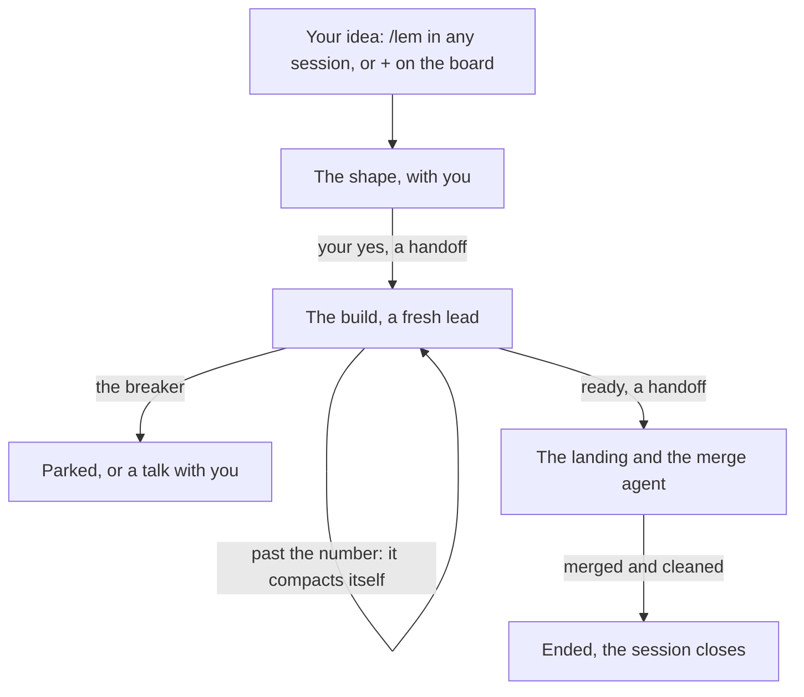

# Task 4. A session for each task

## The outcome

**Each task lives in its own session, from the shape to the merge, a fresh agent taking over from `handoff.md`; no Lem session.**

Today:
1. You type an ask in Lem's session; it opens `one-lem-parallel-landings · interview` under itself.
2. After your yes, Lem starts the lead as a subagent of its own session.
3. Every lead, landing and watch lives there: on 2026-11-19 it grew to 695,177 tokens, 158.1M of the day's 574.1M.
4. Two Lem sessions ran; `away-for-the-whole-machine` waited `ready` 7 h 40 min.

After:
1. You type `/lem add the gift note to the CSV export` in any session. `gift-note-in-export` opens, and the shape starts there.
2. After your yes to the acceptance criteria, which ends the interview, it writes `handoff.md`. A fresh lead then takes its place in a new session of the same task, and the old session closes.
3. A change of phase is the handoff: a fresh session takes over. Inside a phase, a session whose context passes 600,000 tokens compacts itself, with the handoff's form as its summary. You set that number for all your repositories.

Read in: `companion-interview.md`; `harness/claude-code.md` "spawn-builder"; `directions.md` line 7; `task.md`.

## How it works

One session carries one task; each phase starts a fresh agent.

## The acceptance criteria

1. A new idea opens the task's own session: `/lem add the gift note to the CSV export`, typed in `refund-rounding`, opens `gift-note-in-export` in the same agterm workspace; `refund-rounding` copies the talk and goes on. *His word:* Q11, "Yes to all points".
2. "+" on the board and a backlog item's "start a task" open it through the same `lem session open`. *His word:* Q11.
3. The shape runs in that session with him and ends with his yes, `directions.md` and `handoff.md`; no companion opens. *His word:* Q11.
4. Each change of phase starts a fresh agent from the task's state and `handoff.md`, in that order, since a session that died leaves an old handoff: his yes starts the lead; `ready` starts the landing and the merge agent (task 3). The fresh agent is a new session of the task that takes the old one's place, and the old one closes; it is replaced only while no builder and no check of it runs. *His word:* Q10. The replacement in place of a restart of the pane, the order of reading and the wait: Fable's second opinion (`fable-on-task-4.md`), which he asked for.
5. Inside a phase a session does not restart: past his number it compacts itself, as Claude Code does by itself, only earlier and with the handoff's form:
   - The number is his, for all his repositories: `[handoff] tokens` in `~/.config/lem/machine.toml`. With no value it is 600,000, and `lem doctor` shows it. The value 0 turns Lem's number off: Lem then sets nothing, and Claude Code compacts at its own trigger (about 967,000 on a 1M window). A negative value and a value under 100,000 are refused, as Claude Code refuses a window under 100,000.
   - Lem gives the number to each session it opens (`CLAUDE_CODE_AUTO_COMPACT_WINDOW`).
   - A `PreCompact` hook gives the summary its form: what is settled, what is open, the next step, what failed, and each changed file by its path.
   - A `SessionStart` hook puts the task's state and `handoff.md` back after the compaction.
   - A builder or a check that runs in the background runs on through it.
   - His words "hand off" start a fresh session in any phase.
   *His word:* Q10; his review of this shape: "Globally configurable value please"; of the mix: "I agree with proposal, but lets keep the limit at 600K for now (default settings)" (2026-11-21). The mix is the session's proposal from the two scouts' reports (`research-compaction.md`): Anthropic's guide for the current models recommends "a brand new context window rather than using compaction" at a clear break, and its Claude Code documents give the setting and the two hooks; twelve of sixteen practitioners' sources still manage the context by hand, most with this mix.
6. The agent that leaves writes `handoff.md`: what is settled, what is open, the next step, what failed, and the files it changed, each by its path with its status. It links a plan, a record or a commit by its path or its id, and copies no text of them. *His word:* Q10. The changed files and the links: the practitioners' reports (`research-compaction.md`, part 2), where the trail of changed files is the weakest part of every summary that was measured.
7. After the merge, the task's session removes its worktree and its branch and moves the ticket. It keeps no watch: the board's server notices the merge (it already does) and wakes the session with a pane message. *His word:* Q11.
8. A task whose session died shows "no session" on the board, as a row of "Waits for you", so that his phone gets a notification; one click opens a fresh one. That holds for a task that did not end, and for a merged one whose worktree is not removed yet. The board knows it from the agterm session in the task's record and from the program that runs in its pane, since a dead agent leaves a shell behind. `lem session open gift-note-in-export` run twice opens one session. *His word:* Q11. The row, the merged case, the program in the pane and the one session: Fable's second opinion.
9. Nothing needs a Lem session: no `coordinator:` line, no `lem companion`; bare `/lem` in any session shows what waits and opens the board. *His word:* Q11; bare `/lem`: **the session's proposal**.
10. What reaches across tasks belongs to the board's server, which holds no context and runs for the whole machine:
    - `coupon-has-a-slug` is queued `after:` `gift-note-in-export`. When that one is merged, the server opens the session of `coupon-has-a-slug`, and its lead starts.
    - Pull request 42 becomes conflicting after the merge of 41. The server wakes the session of its task, or opens one, for the repair.
    - When the server does not run, the board says so, and the first `lem` command of any session starts it.
    **The session's proposal**, from Fable's condition for this shape: "something that is not a session must own the cross-task duties".
11. A task on the fast track is one session from its request to its merge, with no fresh agent at a phase: a fresh session starts at about 84,000 tokens (Fable's measurement, a median of 10 sessions), which a typo fix must not pay three times. **The session's proposal**, from the same opinion.

## What goes

- `companion.py` but `talk` (to `lem session`); `prompts/companion.md`; `stages/open-interview.md`; `stages/stopped.md`'s wake-ups; `tests/lem-companion.sh`.
- `coordinator:` and `socket:` lines, `tell-coordinator`, `stages/start.md` step 3.
- `SKILL.md` "Two levels"; Lem's duties at each turn (`lem companion due`, `lem land merged`, two watches).
- `serve.py`'s typing into Lem's session, and `agterm.json`.

## His rulings that this changes

New fact for each: Q11.

- "One Lem session for each repository" (2026-11-19, "Ok (B)"); "One Lem for one repository" (2026-11-14).
- "A companion opens only when something waits for him", "A companion tells Lem with an agterm pane message" (2026-11-19).
- "His away status is one mark" (2026-11-19): a waiting shape session keeps its watch.
- "The plan talk is a pair in a companion" (2026-11-16): under the task's session.

## What the board and the server give it

- Built (`d2d948f`): the board of every workspace, the single entry point, on his phone too; its agterm `select` already jumps to a task's session. "+", "start a task" and "no session" become one act running `lem session open`.
- Planned (`board-plan.md`, R 12): the server runs `lem land merged`, so no session keeps `lem land watch`; a pane message wakes the task's session for the rest (**the session's proposal**).

## Open questions for the owner

None: Q10 and Q11 answer each point. He asked Fable to confirm this shape; its verdict is "build it, with six changes", and the six are in criteria 4, 5, 7 and 8 above (`fable-on-task-4.md`).

**Decided here:**
- The copy of the talk stays, against design.md's list: his pick "A fresh agent, with the talk copied in" (2026-11-19).
- A task session sits at the top of the agterm workspace, takes the focus only when the shape needs him, and closes itself as its last act when its task ends, never while he has it selected.
- A session that waits for him sets agterm's attention mark (P, notes on agterm).
- The night opens each item's session, one after another.
- No hook reads the transcript for the context's size, and no pane is restarted: Claude Code's own compaction at his number is the backstop (criterion 5). A change of phase opens a new session and closes the old one; `agtermctl session restart` works only in agterm's "Live sessions" mode, and this machine runs the other one (Fable ran `agtermctl restore mode`: `rerun`).
- "No session" shows for each task that did not end and is not parked, and for a merged one that is not cleaned.
- One trial comes before the build relies on it: a pane message from the server must wake an idle task session (only a companion's line to Lem was seen to do that, agterm 0.41.1). If it fails, the server opens a fresh session for the task in its place.

## Size and order

- About 700 script lines out, 300 in, 2,000 words of texts out (unmeasured estimates; `companion.py` alone is 737 lines).
- A small task: one more session start, no focus, no touch. Lem's long session goes.
- Last of the three: it moves task 2's breaker out of the choice companion, and task 3's merge agent becomes its merge phase.
