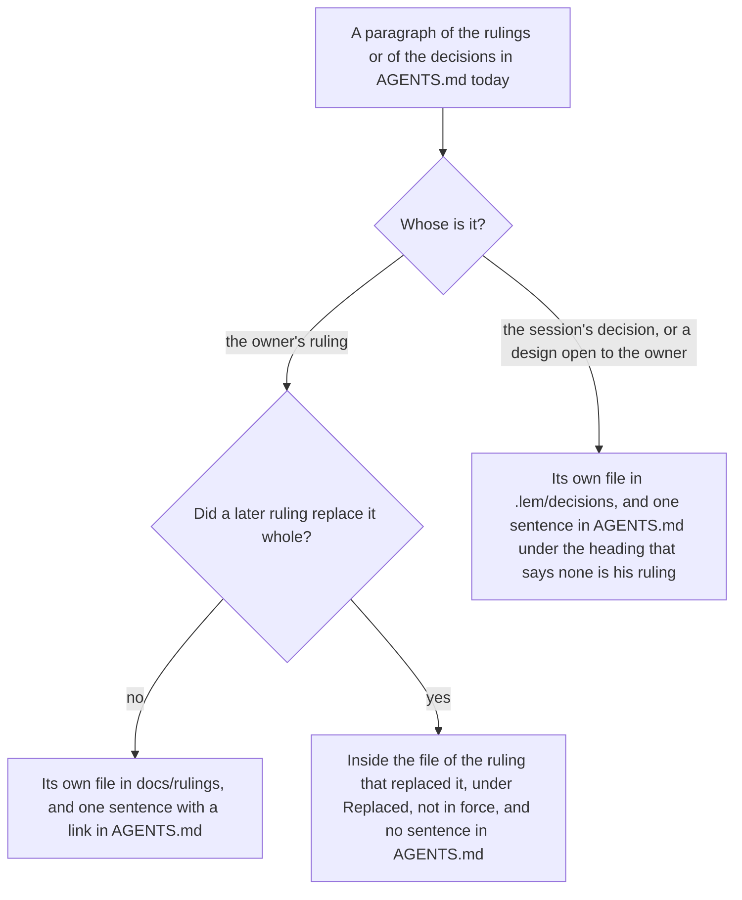

# AGENTS.md read on demand

careful: yes, because the topic "A change bends a ruling of the owner: a ruling in AGENTS.md is reopened only by asking him." is in reach: task 1 judges which rulings a later ruling replaced whole and writes the sentence of each ruling that was changed in part, and task 2 moves the words of every ruling, so a wrong judgment or a lost word takes a ruling in force out of the file every agent reads; and "A decision that is the owner's is taken without him" is near, since the question gate reads each file of `docs/rulings/` as his ruling.

## Acceptance criteria

Size: full, because every ruling of `AGENTS.md` moves into a file of its own and two new folders hold them.

1. `AGENTS.md` is 8,000 words or fewer by `wc -w` (21,801 on 2026-11-21). The 8,000 is the
   session's estimate with room, not a measured size: about 6,700 words counted from today's file,
   which is 181 bold sentences at about 20 words and the 3,089 words of the parts that stay. "Rules
   for a change here", "Checks", "Layout" and "The shipped skills are copies, not yet under the
   rules above" stay in it, and "Layout" names the two new folders. "The owner's rulings" and
   "Decisions the maintaining session took" keep their headings and hold one sentence for each
   ruling or decision in force, and nothing after the sentence but its link: no quote of his words,
   no date of the ruling and no reason. A bold sentence of today that holds a date or quoted words
   of its own stays word for word, as criterion 4 has it: "Two things a real run showed on
   2026-11-18" keeps its date. No sentence of it is stale: each says the rule as it stands today
   (criterion 4), and a later change of a ruling changes its sentence and its file together
   (criterion 8).
2. A ruling of the owner that is in force keeps one sentence in `AGENTS.md`, the rule an agent
   follows, with a link to one file of `docs/rulings/`, and that file holds the ruling whole:
   1. Today "GitHub pull requests are the one way to land" (2026-11-20) is a paragraph of
      `AGENTS.md` with his quote, the form the session built and the rulings it replaces.
   2. After, `AGENTS.md` holds that sentence and a link to its file in `docs/rulings/`. The file is
      named from the words of its sentence, in lower case with hyphens
      (`github-pull-requests-are-the-one-way-to-land.md`), in the folder `lem project ruling-file`
      names.
   3. The file starts with the lines `ruled: 2026-11-20` and `area:` with the name of the group its
      sentence stands in (criterion 7), in the same words, then the paragraph as it is today.
   4. `lem project show` says that the rulings folder exists.
3. A ruling that a later ruling replaced whole has no sentence in `AGENTS.md` and no file of its
   own. Its text is inside the file of the ruling that replaced it, under a heading that says
   "Replaced, not in force", with its date, and the pull request lists each such ruling with the
   ruling that replaced it:
   1. On 2026-11-17 he ruled "Codex in each role is wanted".
   2. On 2026-11-20 he ruled "Claude Code and agterm first, and Codex for reviews", which replaces it.
   3. `AGENTS.md` holds the sentence of 2026-11-20 only.
   4. Its file holds the ruling of 2026-11-20 first, and under "Replaced, not in force" the ruling
      of 2026-11-17.
   5. A search for "Codex in each role" in `docs/rulings/` finds that one file and no other.
   6. The pull request's list has the line: "Codex in each role is wanted" (2026-11-17), replaced by
      "Claude Code and agterm first, and Codex for reviews" (2026-11-20).
4. A sentence of the short `AGENTS.md` is today's bold sentence word for word, unless a later
   ruling changed a part of that ruling: then the sentence says the rule as it stands today, its
   file says which part changed, when and by which ruling, for each such ruling, and the pull
   request lists it. For "The plan talk is a pair in a companion that closes after it"
   (2026-11-16) the list has one line: today's sentence, the sentence of the short file, and each
   ruling that changed a part of it: the rulings of 2026-11-19 on where he answers Lem, "The build
   asks him nothing, and the ladder always decides" (2026-11-20) and "Each task lives in a session
   of its own" (2026-11-21). A pull request with no such sentence says that its list is empty.
5. A decision of the maintaining session, and a design that is open to the owner, has its file in
   `.lem/decisions/`, a folder of Lem's own in this repository beside `.lem/lessons.md`, and never
   in `docs/`, and its sentence in `AGENTS.md` stands under a heading whose first line says that
   none of these is his ruling. "Lem is a companion, not a gate" (the session's, 2026-11-17) is a
   file of `.lem/decisions/`, and a search of `docs/rulings/` for it finds no file. What the
   session built from a ruling of his ("The form is the session's: ...") stays in that ruling's
   file, marked as the session's as it is today. "His notes of 2026-11-16 on the page of the new
   flow" are his rulings, in `docs/rulings/`. "Designs taken on 2026-11-14 and 2026-11-15 after a
   question of the owner's", "The session's answers to his notes that asked a question" and the
   paragraph "A lowered bar" are open to him, in `.lem/decisions/`. The rulings stay in
   `docs/rulings/`, the place the settings name.
6. No word is lost. Each paragraph of "The owner's rulings" and "Decisions the maintaining session
   took", as `AGENTS.md` has them on the base commit, is found word for word in a file of
   `docs/rulings/` or `.lem/decisions/`. A file may add lines of its own (`ruled:`, `area:`, a
   heading, a link); it changes no word of a paragraph. The paragraph that starts "The logo is the
   owner's pick" is whole in one file of `docs/rulings/`, with "The Line in the Field" in it. The
   pull request says how this was checked: the command that compared each paragraph of the base
   commit's two sections with the new files, and its count of the paragraphs compared and found.
7. An agent finds the ruling its change reaches from the short `AGENTS.md` alone. It reads every
   sentence, since the file is short. The sentences stand in groups by what they are about, each
   group under a heading, so that the ones near a change stand together, and a sentence stands in
   one group, the one its file's `area:` names. "Rules for a change here" has one rule: before a
   change that reaches what a sentence names, read that sentence's file, in whatever group it
   stands. No builder's brief names a ruling:
   1. A builder gets a task that changes who may run `lem land merge`.
   2. Claude Code gives it the short `AGENTS.md`, and it reads the sentences.
   3. It opens the file of "GitHub pull requests are the one way to land" in the group of the
      merge, and the file of "The board's server runs the merge agent's merge, and the agent only
      writes its review" among the session's decisions, since its change reaches both.
   4. It opens no file of a sentence that its change does not reach.
8. "Rules for a change here" says where a new ruling goes: a file of `docs/rulings/` and one
   sentence with its link in `AGENTS.md`. A ruling that replaces another takes that ruling's text
   into its own file under "Replaced, not in force", and the replaced sentence leaves `AGENTS.md`.
   A ruling that changes a part of another changes that ruling's sentence, so that it says the rule
   as it stands, and that ruling's file says which part changed, when and by which ruling. The file
   and the sentence change in the same commit. A new decision of the maintaining session is a file
   of `.lem/decisions/`, named as a ruling's file is, and one sentence under the decisions'
   heading. A session that records a ruling on the naps that changes no other ruling writes the
   file `lem project ruling-file` names and one sentence in the group of the naps, and `AGENTS.md`
   grows by that sentence only.
9. A text of the repository that sends a reader to a section of `AGENTS.md`, or to a ruling by its
   title, still finds it. `docs/free-hour.md` names "Opinionated and small", "The owner's rulings",
   "Rules for a change here" and "Checks", and each is a heading or a sentence of the short
   `AGENTS.md`. `.lem/profile.md` and `.revmux/profile.md`, which say that the owner's rulings are
   in `AGENTS.md`, say that their sentences are there and their full text in `docs/rulings/`.

## How it works

Where each paragraph of today's two sections goes (criteria 2, 3 and 5):

## What the file holds today

Read at the base commit `7971845`:

- `AGENTS.md` has 1,496 lines and 21,801 words (`wc -w`). "The owner's rulings" is lines 47 to
  1000, and "Decisions the maintaining session took" lines 1001 to 1301.
- The two sections hold 170 list items that open with a bold sentence: 145 in the first and 25 in
  the second (`grep -c -E '^- \*\*'` over each range). The 181 of criterion 1 counts the 11 of
  "Rules for a change here" too. The first bold spans of the 170 are 1,667 words together, with
  each list mark counted as a word (`grep -o -E '^- \*\*[^*]+\*\*' | wc -w`). The parts that stay
  are 3,089 words (`scout.md` of the task). So the short file comes to about 4,800 words before
  its new rules and headings.
- Nineteen paragraphs have no bold sentence. Fifteen open a group and say when and how its rulings
  were given (lines 49, 318, 423, 574, 666, 718, 763, 798, 842, 847, 895, 935, 973, 1003, 1130);
  the one at 1003 says that no decision of the session is his ruling. Three are decisions or
  designs of the session in running text (lines 415, 759, 838). One is a note of what three
  rulings replace together (lines 924 to 933).
- Two paragraphs hold two bold spans: line 443 ("agterm, the mailbox chat and revmux stay
  required", "and agdoc is required too") and line 617 with line 620 ("No setting counts the
  tasks that run", "A night works its items one after another").
- A later ruling says what it replaces in its own paragraph ("This replaces ...", lines 325, 506,
  602, 656, 851, 862, 872, 888, 924, 939, 943, 969), and a ruling that was changed in part often
  says so itself ("Since his rulings of 2026-11-19 (below) ...", lines 82, 149, 168, 194, 238,
  289, 301, 389, 504, 916). Neither list is complete: the builder of task 1 reads every paragraph.
- No script and no test reads the text of `AGENTS.md`, and `tests/pick.py` maps it, `docs/*` and
  `.lem/*` to no suite. `docs/rulings/` and `.lem/decisions/` do not exist.

## Tasks

1. **The map: one judgment for each paragraph.** Criteria 2, 3, 4, 5 and 7.
2. **The move: the files, the short sections and their checks.** Criteria 1, 2, 3, 4, 5 and 6.
3. **The rules, the layout and the texts that point at the rulings.** Criteria 1, 7, 8 and 9. This
   is the documentation task.

The tasks run one after the other: each reads what the one before committed.

### Task 1: the map

It writes `docs/plans/2026-11-21-agents-md-read-on-demand/map.json` and commits it. The map has
one entry for each paragraph of the two sections of the base commit's `AGENTS.md`, in the order of
the file, and leaves none out. A paragraph is one list item, or one block of running text.

Each entry says:

- **where**: its first line at the base commit, and its first words;
- **whose**: the owner's (a ruling), or the session's (a decision of the maintaining session, a
  design or an answer that is open to him). The section a paragraph stands in today does not settle
  this: criterion 5 names where the four mixed groups go. What the session built from a ruling of
  his ("The form is the session's: ...") stays a part of that ruling;
- **what it is**: a ruling or a decision; an opening of a group; or a note that belongs to the
  rulings beside it, with the entries it goes with;
- for a ruling or a decision:
  - **its state**: in force, changed in part, or replaced whole. A paragraph with two bold spans
    has a state for each span, and the entry's state is the strongest change of the two: when a
    later ruling changed or replaced one span, the entry is changed in part, and its part names that
    span by its words;
  - **its day**: the date its paragraph gives, else the date of its group's opening. Where the
    opening gives more than one day ("His interview of 2026-11-17 and 2026-11-18"), the day is
    those days as the opening writes them (`2026-11-17 and 2026-11-18`), never one of them picked;
  - **its sentence**: for one in force, today's bold sentence word for word, with both bold spans
    as one line where a paragraph has two; for one changed in part, the rule as it stands today,
    with today's bold sentence beside it and each later ruling that changed a part: its day, its
    sentence, and the part;
  - **what replaced it**, for one replaced whole: the one entry whose file takes its text, which is
    the entry in force at the end of the chain. A ruling replaced by one that a third replaced goes
    to the third, after the second, in the order of their days;
  - **what it holds that its sentence does not name**, for a ruling whose paragraph rules more than
    its sentence says (a list of what Lem leaves out, a named tool, command or key, a number): one
    line of what. "Opinionated and small" holds the out-of-scope list (base lines 83 to 86);
  - **its group**, one of "The groups" of this plan;
  - **its slug**: the words of its sentence in lower case with hyphens, which matches `SLUG` of
    `skills/lem/scripts/project.py` and is the slug of no other entry.

How it judges:

- The evidence is the words of `AGENTS.md`: a later paragraph that names the ruling, or the
  ruling's own paragraph. The builder reads code only to settle a doubt between two states. With
  no such words a sentence stays word for word, also when the builder thinks that it is stale; its
  report names that sentence, and nothing changes it.
- A ruling is replaced whole only when nothing of its rule holds today. In doubt it is changed in
  part: a sentence too many is one line that an agent reads, and a sentence too few is a ruling
  that left the file every agent reads.
- A ruling that two later rulings replaced goes to the later of the two.
- A sentence the builder writes (for a ruling changed in part, or for a paragraph with no bold
  sentence) uses the words of the rulings and adds no rule.
- It starts from "The groups" of this plan, changes the list where a sentence fits none, and says
  so in its report. A ruling that says what Lem leaves out, or what Lem must not hold, stands in
  "What Lem is, and who it is for".

Its report gives the count of entries of each kind, each ruling replaced whole with what replaced
it, each sentence that is not today's bold sentence, and each entry that holds what its sentence
does not name, with what.

Files: `docs/plans/2026-11-21-agents-md-read-on-demand/map.json`.

### Task 2: the move

A script writes every file and both short sections from the map and from `git show
7971845:AGENTS.md`. Nobody types a ruling's words: a paragraph reaches its file as the base commit
has it. The script is a working file of the task directory and is not committed.

- **A file of a ruling**, in `docs/rulings/`, named `<slug>.md`: a front matter block with
  `ruled:` and `area:`; the sentence as its `#` title, which is the rule as it stands; for a ruling
  changed in part, `## Changed in part` next, before any word of the paragraph, opening with the
  line "The title is the rule as it stands. Where the paragraph below says otherwise, the line here
  holds." and then one line for each later ruling: its day, its sentence as a link, and the part it
  changed; each opening under which the paragraph stood at the base commit, word for word; then the
  paragraph, word for word, without its list mark and its indent. Last, where the map says so,
  `## Replaced, not in force` holds each ruling this one replaced: its sentence, its day, its
  openings and its paragraph, word for word. So a reader of the file, the question gate's judge
  among them, meets what changed before the words it changed.
- **A file of a decision or of a design that is open to him**, in `.lem/decisions/`: the same
  form, with `decided:` where a ruling has `ruled:`.
- **A decision of the session that was replaced whole** keeps a file of its own in
  `.lem/decisions/`, whose first line under the title says "Replaced, not in force", with the day
  and the link of what replaced it. It has no sentence in `AGENTS.md`, and the file of what
  replaced it links it.
- **The two sections of `AGENTS.md`** keep their headings. Under each stand the groups, each a
  `###` heading, and under a group one line for each sentence: the sentence as the text of a link
  to its file, and nothing else. A link is a markdown link, never an `@` path, which Claude Code
  would load. The task changes nothing else of `AGENTS.md`.
- **`docs/plans/2026-11-21-agents-md-read-on-demand/moved.py`**, committed: the check of criterion
  6. `python3 docs/plans/2026-11-21-agents-md-read-on-demand/moved.py --base 7971845` takes each
  paragraph of the two sections of that commit's `AGENTS.md`, looks for it in the files of the two
  folders with each run of spaces as one, prints the count compared, the count found and each
  paragraph it did not find, as JSON, and exits 1 when one is missing.
- **`tests/unit/test_agents_md.py`**, the checks that hold after this task: each link of the two
  sections, and each link in a file of the two folders, names a file that exists; each file of the two folders is linked by one sentence, or by
  the file of what replaced it; a sentence is the `#` title of its file; a file's `area:` is the
  heading of its sentence's group; a file of `docs/rulings/` has `ruled:` and one of
  `.lem/decisions/` has `decided:`; `AGENTS.md` has 8,000 words or fewer, and the failure names the
  number's source (criterion 1 of this plan, the session's estimate, 2026-11-21). It also holds the
  examples the criteria name: "Codex in each role" in one file of `docs/rulings/`, "Lem is a
  companion, not a gate" in `.lem/decisions/` only, and the logo's paragraph whole in one file.
  Each of its cases fails on the base commit.
- **`tests/pick.py`** maps `AGENTS.md`, `docs/rulings/*` and `.lem/decisions/*` to the suite
  `unit`, and `python3 tests/pick.py --check` passes.
- **`pr-lists.md`** in the task directory, from the map: each ruling replaced whole with its day
  and what replaced it (criterion 3); each sentence that is not today's bold sentence, with
  today's sentence, the new one and each ruling that changed a part (criterion 4); the command of
  `moved.py` with its counts (criterion 6); and the count of entries of each kind.

Files: `AGENTS.md`, `docs/rulings/*.md`, `.lem/decisions/*.md`,
`docs/plans/2026-11-21-agents-md-read-on-demand/moved.py`, `tests/unit/test_agents_md.py`,
`tests/pick.py`.

### Task 3: the rules, the layout and the texts that point

- **"Rules for a change here"** gets the rule of criterion 7: before a change that reaches what a
  sentence names, read that sentence's file, in whatever group it stands. Its second sentence says
  what "reaches" holds beyond a sentence's words: a sentence names its ruling, and the sentences of
  "What Lem is, and who it is for" name what Lem holds and leaves out, so a change that adds a part
  to Lem (a skill, a hook, a command, a key of the settings, a tool it needs) reaches each of them.
  It gets the rules of criterion 8: where a new ruling goes, what a ruling that replaces another
  does, what a ruling that changes a part of another does, that the file and the sentence change in
  one commit, and where a new decision of the session goes. A ruling that replaces another takes
  that ruling's file whole, with its own `## Replaced, not in force` and `## Changed in part`, and
  each link to the removed file, in `AGENTS.md` and in the two folders, names the new file in the
  same commit. A decision changes as a ruling does: that closes the gap an expert named, a decision
  of the session that changes a part of another decision.
- **The first lines under the two headings**: under "The owner's rulings", that each sentence is a
  rule in force, that its file holds his words, the day and what it replaced, and that a ruling is
  reopened only by asking him; under "Decisions the maintaining session took", first, that none of
  these is his ruling and each is open to him.
- **"Layout"** names `docs/rulings/` and `.lem/decisions/`, each with what it holds.
- **`.lem/profile.md`** (lines 21 and 44) and **`.revmux/profile.md`** (line 16) say that the
  rulings' sentences are in `AGENTS.md` and their full text in `docs/rulings/`.
- **`docs/free-hour.md`**: each name it cites is a heading or a sentence of the short file
  ("Opinionated and small", "The owner's rulings", "Rules for a change here", "Checks"), and "the
  designs `AGENTS.md` lists as open to the owner" are still under the decisions' heading. A case of
  `tests/unit/test_agents_md.py` holds the four names. The page changes only where a cite no
  longer finds its target.
- **Every other text that cites `AGENTS.md`**, found by a search of the tracked files for
  `AGENTS.md` and for the first words of each opening the map lists. A cite of a heading or a
  sentence that the short file keeps stays. A cite of an opening, which the short file does not
  keep, names `docs/rulings/` in place of `AGENTS.md`, since each file of that group opens with it:
  today `docs/plans/2026-11-18-core-and-two-modes.md` (lines 3 and 4) and
  `docs/plans/2026-11-18-core-and-two-modes/mode-and-ladder.md` (line 12) cite "His interview of
  2026-11-17 and 2026-11-18". Only the words of the cite change. The report lists each cite it
  found and what it did with it.
- **`docs/backlog/agents-md-read-on-demand.md`** is removed: the item is built.
- `.lem/project.toml` is not changed (decision 11 of the task's record).
- Last, `wc -w AGENTS.md`, the unit level and `python3 tests/pick.py --check`.

Files: `AGENTS.md`, `.lem/profile.md`, `.revmux/profile.md`, `docs/free-hour.md`,
`docs/plans/2026-11-18-core-and-two-modes.md`,
`docs/plans/2026-11-18-core-and-two-modes/mode-and-ladder.md`, and any other text the search
finds, `tests/unit/test_agents_md.py`, `docs/backlog/agents-md-read-on-demand.md`.

## Plan talk

Who argued the plan: the reviewer, Codex, with GPT 6.2 Sol at high effort as its pane's status line
showed them (context 7% used at its start); the defender, Claude Code, with Opus 5.5 at high effort,
as the `defender:` line of the task's state gives. Two families. Seven turns, under the bound of 30
for its 7 questions. Agreement carries no authority: the review before the pull request
reads each settled position as a claim.

The list, numbered as the reviewer gave it in its first turn:

1. **Which sentence the question gate can take as current.** A file of a ruling changed in part
   holds the old paragraph, and the judge searches by keyword before it reads a file
   (`skills/lem-gate/references/judge.md`, lines 12 to 26): a search for "a choice of his waits"
   finds base line 505, which "The build asks him nothing" (base 858 to 867) changed. Repaired once:
   `## Changed in part` comes right under the title, before the paragraph, with the line that the
   title is the rule as it stands. Held: a keyword match returns the old sentence without the note,
   and the move puts it in the judge's first source, where the base had it in the fifth. Refuted
   once: the judge's `decided` must cite the heading (judge.md, lines 25 and 26), and the headings
   above the old paragraph are the title and `## Changed in part`; at the base the same line stands
   in `AGENTS.md` with no change mark. Held a second time: the cite of the heading does not make the
   judge read the note, and the old paragraph has no heading of its own. **A design choice**, which
   "Decisions of the talk" below takes up the ladder.
2. **How the short index tells a builder which file to read.** "Opinionated and small" holds the
   out-of-scope list (base 83 to 86), which its sentence does not name, so a builder that adds a
   skill-activation hook reads the index and skips the file. Repaired: the map's field "what it
   holds that its sentence does not name", such rulings in "What Lem is, and who it is for", and a
   second sentence of the rule of criterion 7: a change that adds a part to Lem reaches each
   sentence of that group. Closed, a layer over plan decision 3 and criteria 1 and 4: settled by the
   two, not checked by the review.
3. **What lets `docs/rulings/` hold the history.** "No history and no reasons in a text for a
   reader" (base 336 to 339) names `docs/`. Refuted: the base "Layout" keeps dated history in
   `docs/plans/` (base 1449 to 1451), the ruling's own reason is the agents that read the records,
   and `docs/rulings` is the folder the settings name (`skills/lem/scripts/project.py`, `PATHS`, line
   317; `.lem/project.toml`). Closed: settled by the two, not checked by the review.
4. **How the map gives each ruling its own state and day.** A paragraph with two bold spans (base
   443) has one entry, of which one span changed ("agdoc is required too", by base 891), and an
   opening of two days gives no one day. Repaired once: a state for each span, and the opening's
   days as written. Held: the GitHub ruling's paragraph (base 885 to 893) names only the days of the
   rulings it replaces, its opening (base 842) names "2026-11-20 and 2026-11-21", and criterion 2
   wants `ruled: 2026-11-20`. Not refuted: the defender agreed. **A design choice**, which
   "Decisions of the talk" below takes up the ladder. The part of the repair on the two spans
   closed.
5. **What happens when a replacement is itself replaced.** The chain at base 71 to 78 and 885 to
   893. Repaired: the entry in force at the end of the chain takes the text, a replacing ruling takes
   the replaced file whole, each link to it moves in the same commit, and the unit test checks the
   links in the two folders. Closed, at the cause for the move rule; the link test is a layer over
   the replacement rule of criterion 8. Settled by the two, not checked by the review.
6. **Where a cite of an opening goes.** `docs/plans/2026-11-18-core-and-two-modes.md` (lines 3 and
   4) cites "His interview ... on what stays in Lem" in `AGENTS.md`, which the short file does not
   keep. Repaired: Task 3 searches every tracked text for `AGENTS.md` and for each opening's first
   words, and a cite of an opening names `docs/rulings/`. Closed: settled by the two, not checked by
   the review.
7. **How the lists reach the pull request whole.** Under "Decisions" the landing writes one line
   each (`skills/lem/stages/land.md`, step 6). Repaired: the lists go under the notes' `## Migration`,
   which `cmd_propose` of `skills/lem/scripts/land.py` (line 3194) asks of a careful request, from a
   heading of their own in `report.md`. Closed: settled by the two, not checked by the review.

Each mechanism a repair added, with the decision it sits on and the reviewer's word:

- the second sentence of the rule of criterion 7 and the map's field (question 2): a layer over plan
  decision 3 and criteria 1 and 4, which are approved;
- the move of a replaced file whole, with its links, in one commit (question 5): at the cause;
- the unit test of the links in the two folders (question 5): a layer over the replacement rule of
  criterion 8, which is approved.

No question was raised after the first turn. No addition was refused as unpriced.

What changed in the plan, by question and by task (commit `b1a162f`):

- Task 1: a state for each bold span and the opening's days as written (question 4); the end of the
  chain (question 5); the field of what a sentence does not name, its group, and a line of the report
  (question 2).
- Task 2: `## Changed in part` before the paragraph (question 1); the unit test of the links in the
  two folders (question 5).
- Task 3: the second sentence of the rule of criterion 7 (question 2); the move of a replaced file
  whole with its links (question 5); the search of every text that cites `AGENTS.md`, with the two
  cites of an opening, and their files (question 6).
- "Left to the landing": the lists under `## Migration` (question 7).

## The groups

Each is a `###` heading of the short file and the `area:` of its files, in the same words under
both sections:

- What Lem is, and who it is for
- What Lem needs on the machine
- A request: its type, its track and its commands
- The interview, the criteria and the personas
- The plan, the build and the tests
- A decision without him: the ladder, the experts and the breaker
- The review, the pull request and the merge
- A task's session, and whether he is there
- The board and the pages for him
- The settings, the seats and the tracker
- The README, the guides and the logo
- The lessons, the correction queue, the naps, the night and the free hour

## Decisions of the plan

Each is the lead's, with what it rests on. The task's record holds them after the plan talk.

1. **The groups are the twelve of "The groups", with the same names under both sections.** An agent that
   changes the merge finds the rulings and the session's decisions about it under one name, and the
   folder says whose each is. Rests on criterion 7 and on decision 4 of the record.
2. **A file's first lines are a front matter block**, between two `---` lines, as the ruling files
   the question gate's judge was written against have it (`scout.md`, the last line of its part 1).
   A decision's file says `decided:`, since `ruled:` would name the owner. Criterion 2 says "The
   file starts with the lines `ruled:` ... and `area:`"; the plan reads the block as those lines.
3. **A sentence in the short file is the text of its link**, with no bold mark and no second
   naming of the path: a path costs tokens in every agent's context, and `wc -w` does not count
   them.
4. **An opening of a group is copied into each file of its group.** A file read alone then says
   when its ruling was given and whose words its quotes are. No file of its own holds an opening:
   the gate reads each file of `docs/rulings/` as a ruling.
5. **A replaced decision of the session keeps its own file**, marked, in `.lem/decisions/`.
   Criterion 3 speaks of a ruling, and criterion 5 keeps every word of the session out of `docs/`,
   so its text cannot go into the file of a ruling that replaced it.
6. **The map and `moved.py` are committed in the plan's folder; the script that wrote the files is
   not.** The map is the record of each judgment, which a reviewer reads against the lists of the
   pull request, and `moved.py` is the command the pull request names. The other script has no use
   after the move: a new ruling is written by hand, as criterion 8 says.
7. **The 8,000 words become a unit case.** Without it the file grows back with no signal: it grew
   by 2,978 words from 2026-11-20 to 2026-11-21 (18,823 and 21,801, `docs/backlog/agents-md-read-on-demand.md`
   and `wc -w`). The number is the session's estimate, and the case says so.
8. **The pull request's lists carry the counts of each kind.** The map gives them at no cost. The
   record's decision 14 left them out of criterion 4, and no criterion changes.

## Left to the landing

- The lists of `pr-lists.md` go into the pull request whole, under the notes' `## Migration`,
  which a careful request's notes must have (`stages/land.md`, step 6; `land.py`, `cmd_propose`):
  this change is a migration of the rulings, and that heading says how to revert it. The lead puts
  them in `report.md` under its own heading, `## For the pull request's Migration`, with the line
  "copy whole into the notes' `## Migration`", never under "Decisions", whose notes are one line
  each.
- The pull request says that the comment of `.lem/project.toml` on the rulings ("Lem's own rulings
  are in AGENTS.md") is half true after this change, and that the task did not edit that file.
- The pull request is not green: the criteria were approved without the owner, and decisions 7 to
  15 of the record went past the personas.

## Not verified

- Whether each sentence of a ruling changed in part says what the code does today. The judgment
  rests on the words of `AGENTS.md`; the builder reads code only in a doubt.
- The saving in tokens. The plan counts words, and a link's path costs tokens that `wc -w` does
  not count.
- How Codex follows a link of `AGENTS.md`. It reads the file by its path as any other; no run
  showed it.
