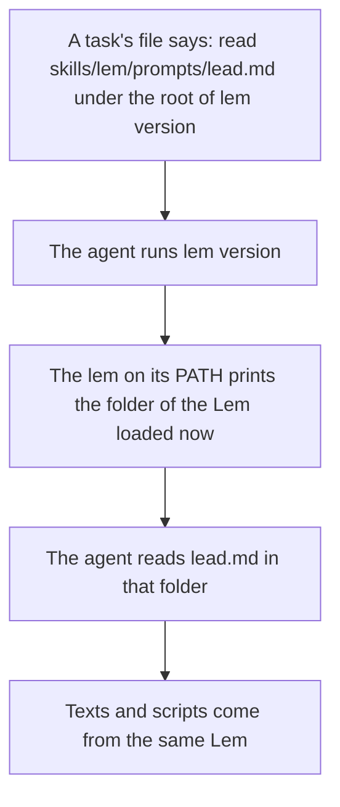

# A brief and a task's session.md read the installed Lem

careful: no, because the change is the first line of the files a task keeps for its next agent; it touches no push, merge, record, criterion, setting or hook of the topics, and an agent that cannot run `lem` stops as it does today.

## Acceptance criteria

Size: full, because two scripts and six stage texts change the first line of every brief, and the lead chose how an agent finds the installed Lem.

1. A task's `session.md` sends its session to the texts of the Lem that is installed when the session starts, never to the folder of the Lem that wrote it:
   1. Lem in the folder `.../lem/0.2.0` opens the task `gift-note`, and writes its `session.md`.
   2. The plugin updates, and its folder is `.../lem/0.2.1` now.
   3. No line of that `session.md` holds `.../lem/0.2.0`: its first line tells the session to read `skills/lem/prompts/session.md` in the folder that `lem version` prints as `root`, which is `.../lem/0.2.1`.
2. The merge agent's brief, `merge-brief.md`, names no folder of a Lem version: the merge agent of `gift-note` reads `skills/lem/prompts/merge.md` in the folder that `lem version` prints as `root`.
3. Every brief that a stage tells a session to write or to send (the lead's `brief.md`, the fast track's `brief.md`, the plan talk's `talk-brief.md`, and the briefs of the scout, the investigator, the review and a builder of the landing) names its standing text the same way: `skills/lem/prompts/NAME.md` in the folder that `lem version` prints as `root`, and no absolute path of a Lem folder.

## How it works

The first line of each file names a text of Lem by its place inside the plugin, and the agent asks the `lem` on its own `PATH` where the plugin is. Claude Code puts the `bin/` of the plugin it loaded on that `PATH`, so the texts the agent reads and the scripts it runs come from one folder.

## Tasks

1. **The first line of every brief names a Lem text by its place in the plugin, found through `lem version`.** Serves criteria 1, 2 and 3.
   - `skills/lem/scripts/session.py`: `brief_text` writes the first line in the new form, and no longer needs `SKILL` for it (keep `SKILL` only where something else reads it). The module docstring says what `session.md` holds, if it names the first line.
   - `skills/lem/scripts/land.py`: the first line of `merge-brief.md` (`merge_review`, about line 3751) in the new form. The prompt of the merge agent in `harness/claude-code/ask-merger.md` reads that file and needs no change; check it.
   - The stage texts that give a brief's first line: `stages/new.md` (the lead's brief, step 6 of "The request"; the fast track's brief, step 2 of "The fast track"), `stages/plan.md` (the talk's brief, step 4), `stages/interview.md` (the scout), `stages/investigate.md` (the investigator), `stages/land.md` (the review at step 5, and the brief of a builder of the landing at the end). One form for all: ``Read `skills/lem/prompts/NAME.md` in the folder that `lem version` prints as `root`, and follow it; when `lem version` fails, stop and say that `lem` is not on the PATH, with `lem doctor` as the check.`` (the landing's keeps "and do the job named here"; the builder may shorten the stop's words, never drop the stop: the newcomer's read asked for a clear stop and never a guessed folder). Where the stage text explains the brief, one sentence says why: the folder of the plugin changes with each update, and `lem` on the agent's `PATH` is the Lem loaded now.
   - `project.py` reads a brief for `prompts/small.md` and `prompts/lead.md` (`task_line`, about lines 2618 and 2620): the new form still holds those words; keep it so, and keep its tests green.
   - Tests: `tests/unit/test_session.py` holds criterion 1 (the text `brief_text` writes for a Lem in a folder named for a version holds no part of that folder, and names `lem version`); `tests/lem-session.sh` line 58 checks the old first line and changes with it; `tests/lem-land-shop.sh` line 133 or a unit test of `land.py` holds criterion 2 (no line of `merge-brief.md` holds the folder of the scripts that wrote it). Fixtures that write a brief by hand (`tests/unit/test_task.py`, `tests/lem-settings.sh`, `tests/lem-session.sh`, `tests/lem-land-small.sh`) take the new form, so that the tests show what Lem writes. Criterion 3 gets a unit test that reads every file under `skills/` (the stage texts, the prompts, the harness files, the agent definition in `agents/`, and the scripts) and fails on any brief line that names a Lem text through an absolute path or through `SKILL_DIR/prompts/` as a brief's first line, so that a brief added later in the old form fails it too (the developer's read asked for this). Find the brief lines by their shape (`Read ... and follow it` or `... and do the job named here`), and leave alone a sentence that only tells the reader of a stage to read a prompt (`Read SKILL_DIR/prompts/writing.md first`): that reader already runs from the installed Lem.
   - Files: `skills/lem/scripts/session.py`, `skills/lem/scripts/land.py`, `skills/lem/stages/new.md`, `skills/lem/stages/plan.md`, `skills/lem/stages/interview.md`, `skills/lem/stages/investigate.md`, `skills/lem/stages/land.md`, and the tests named.

No documentation task: no guide, no README line and no part of `AGENTS.md` describes the first line of a brief (`grep -rn "follow it\|SKILL_DIR\|plugins/cache" docs README.md AGENTS.md skills/lem/harness/README.md` found nothing, 2026-11-22).

## Decisions of the plan

- **How an agent finds the installed Lem: `lem version`, which exists.** It prints `root`, the folder of the plugin whose `bin/lem` runs (`bin/lem`, `version()`), and Claude Code puts that `bin/` on the agent's `PATH` (`harness/claude-code.md`, "lem"). So the texts and the scripts come from one folder by construction, and the change adds no command, no setting and no file. The other ways weighed: a new `lem` command that prints a prompt's path (one more name for the same fact), and a link to the newest version folder (Lem writes nothing outside its folders: "Lem is a plugin, and nothing else").
- **The briefs that a session sends at once (the scout, the investigator, the review, a builder of the landing) take the same form.** No update can reach them between the write and the read in most runs, but one form is one rule for a reader of the stage texts, and the scripts those agents run are the installed Lem's in every case.
- **The files of tasks that are open now stay in the old form** (`decisions.jsonl` of the task, decision 1): Lem is not released, and the maintaining session corrects them by hand.

## What it will not verify

- That every agent a stage starts runs `lem version` before it reads the brief's text: that is the agent's reading of one sentence, which a real task shows. The next task started after this lands is that test.
- That an agent with no `lem` on its `PATH` stops as the brief's line tells it: no brief can name a path to fall back to without naming a version again, so the line asks for the stop, and no test runs an agent.
