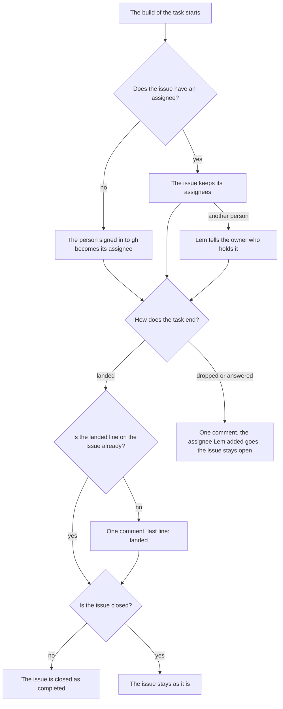

# GitHub Issues as a second tracker

careful: yes, because the topic "Lem changes a developer's repository without his word: a push, a merge, a removed worktree or branch, a protected branch touched." is in reach: task 2 gives Lem writes to the issues of the developer's GitHub repository (an assignee, a comment, a closed issue), and a wrong step writes to the wrong issue or twice; and "Lem reads a project's settings wrong" is near, since task 1 adds a value of `tracker.kind` and task 3 has `/lem init` propose it.

## Acceptance criteria

Size: full, because a new tracker reaches the settings, the id of a ticket, a new skill with its script, the onboarding and four documents.

1. A project whose `.lem/project.toml` has `[tracker]` with `kind = "github"` and no other key is
   taken: `lem project show` gives the tracker as `github`. `kind = "jira"` is refused, and the
   message names `linear` and `github`.
2. In a project whose tracker is GitHub, the id of an issue is its number after `#`:
   1. `lem project task-dir export-keeps-gift-note --ticket 42` keeps `#42` as the task's ticket,
      and `--ticket "#42"` keeps the same.
   2. A second task with `--ticket 42` is refused while the first one is not dropped or answered.
   3. `--ticket MBZ-12` is refused in that project, and `--ticket 42` is refused in a project whose
      tracker is Linear.
   4. A task that landed keeps issue 42, as for Linear. A new task for 42 after the issue is
      reopened is refused, and the message names the landed task and says to start the new task
      from the owner's own words.
3. `/lem read 42`, or the issue's address `https://github.com/OWNER/REPO/issues/42`, shows issue 42
   of the repository that origin names: its title, its text as written, open or closed, its labels
   and its address, and the comments under it apart from its text. Only the text is the request. It
   writes nothing to the issue. The address of an issue of another repository, such as the
   upstream of a fork, is refused, and the message names origin's repository and says that Lem
   reads the issues of origin.
4. When the build of a task from issue 42 starts, issue 42 gets the person signed in to `gh` as its
   assignee. An issue that has an assignee already keeps its assignees, Lem adds nobody, and when
   that assignee is another person, Lem tells the owner who it is in one line and builds on. When
   `gh` cannot assign, Lem tells the owner why in one line. A second start writes nothing to the
   issue.
5. When the task from issue 42 lands, issue 42 gets one comment and is closed as completed:
   1. The pull request of `export-keeps-gift-note` has the line `Issue: #42` in its text, so that
      GitHub links the issue and the pull request both ways.
   2. The pull request merges.
   3. Issue 42 gets a comment with what changed, the pull request's address, and whether the pull
      request was green or not green. Its last line is `lem: export-keeps-gift-note landed`.
   4. Issue 42 is closed as completed. An issue that is closed already stays as it is.
   5. A session that was cut off after the comment posts no second comment: the next session finds
      that last line on the issue, and goes on to the close.
6. When the task from issue 42 is dropped, issue 42 gets one comment that says why in one line, and
   its last line is `lem: export-keeps-gift-note dropped`. When the task ends with an answer, the
   comment holds the answer, and its last line is `lem: export-keeps-gift-note answered`. Either
   way the assignee that Lem added at the start is removed, any other assignee stays, the issue
   stays open, and Lem tells the owner that it is open.
7. The GitHub tracker's check runs in `/lem init` and when the owner asks for it. It says the
   repository that origin names and that its issues are on, or names what is missing, each with
   its fix: `gh` that is not installed, `gh` that is not signed in (`gh auth login`), issues that
   are off in the repository's settings, or an origin that is not on GitHub. It writes nothing, to
   the issues or to the settings.
8. `/lem init` proposes `kind = "github"` for a repository on GitHub whose issues are on and hold
   at least one issue, when the repository shows no Linear ticket keys (such as `ABC-12`) in its
   branch names or commit subjects. When it shows them it proposes `linear`, and otherwise no
   tracker: for a repository on GitHub with no issues, the onboarding's page says so, and says how
   to add the table later. A check that fails leaves the table out, and the page says why.
9. A guide, "Connect GitHub Issues", opens with what Lem writes to an issue (the assignee, the
   comment and the close, which are public in the repository), then says how to fill `[tracker]`
   for GitHub and how to start a task from an issue. The README, the site and `docs/settings.md`
   link it. `docs/linear.md` no longer says that Lem supports no other tracker.

## How it works

What Lem writes to an issue, from the task's start to its end.

## Tasks

1. **The settings, the id of an issue and the pull request's line** (criteria 1, 2, and step 1 of
   criterion 5). `TRACKERS` in `skills/lem/scripts/project.py` takes `github`; `cmd_task_dir`
   reads the project's tracker and takes the id form of its kind (`TICKET` stays the Linear form, a
   new rule takes `42`, `#42` and `#042` and keeps `#42`: the number as an integer, so one issue has
   one saved form, and 0 is refused). For a GitHub ticket, `cmd_task_dir` also keeps the
   repository of the issue that was read, `OWNER/REPO` from the address `lem issue read` gave,
   which it takes as `--ticket-repo OWNER/REPO` (required with a GitHub ticket), in
   `ticket-repo.txt` beside `ticket.txt` (which keeps `#42`, criterion 2); `lem project tasks`
   gives it as `ticket_repo`, and `RESUMED_FILES` copies it with `ticket.txt` (decision 10). A project with no `[tracker]` refuses `--ticket`, with the fix
   (the table and its `kind`): a ticket that no tracker can act on is a record nobody pays
   (`ticket_owed` gives nothing with no tracker). The claim of a ticket is one function that
   `cmd_task_dir` and `cmd_resume` both call, so a resumed task that would take an issue another
   live task holds is refused like a new one (`cmd_resume` copies `ticket.txt` through
   `RESUMED_FILES` today with no check). The claim cannot race (decision 17): before its scan, a
   task takes a mark for the ticket in Lem's state folder by an atomic link, as `ask.txt` is
   written (a file per ticket that names the slug; a retry of the same slug passes), and keeps it
   while it holds the ticket: while it runs, for good once it landed, and after a drop or an answer
   until it owes the ticket nothing, when the mark goes. `cmd_resume` moves the mark to the new
   slug; a mark whose task folder is gone is named in the refusal with the fix; `prune` leaves the
   marks alone. The claim gives a ticket back only when its dropped or
   answered task owes it nothing: an earlier task whose `ticket_owed` is not empty holds it still,
   and the refusal names that task, its owed steps and the step that pays them by the tracker's
   kind: the line `lem issue STEP SLUG` for `github`, the `lem-linear` skill's step of that name,
   run from a session, for `linear` (decision 12). Its
   refusal of a ticket a landed task holds names that task and says to start the new task from the
   owner's own words. `TICKET_STEPS` gains `assigned` (Lem added the assignee at the start) and
   `unassigned` (it removed it, or the add failed). `ticket-step SLUG assigned --login LOGIN` keeps
   the login with the step, as the line `assigned LOGIN` of `ticket-steps.txt`; `lem project tasks`
   gives the step names in `ticket_steps` as now, and the login in `ticket_assignee` (null without
   one). `ticket_owed` has a dropped or answered task whose steps hold `assigned` owe
   `unassigned`. The commented `[tracker]` of the settings template names both kinds; the row of
   `tracker.kind` in `docs/settings.md` names both (`tests/lem-settings.sh` holds the table one to
   one). In `skills/lem/scripts/land.py`, the text of the pull request of a task whose ticket is a
   GitHub issue, in a project whose tracker is GitHub, holds the line `Issue: #42`, with no word
   that closes it, on both tracks (`pr_text` and `small_text`). Tests: the rules at the unit level
   (`tests/unit/test_settings.py`, `tests/unit/test_task.py` and `tests/unit/test_land_text.py`,
   where those rules are now), and the task-dir and resume journeys with a GitHub tracker in the
   ticket checks of `tests/lem-settings.sh`, whose fixture writes `[tracker] kind = "linear"` before
   its first `--ticket MBZ-12` (today it writes the table only later, for the steps owed).
   Files: `skills/lem/scripts/project.py`, `skills/lem/scripts/land.py`, `docs/settings.md`, the
   tests named.
2. **The skill `lem-github` and its command `lem issue`** (criteria 3 to 7). A new skill,
   `skills/lem-github/SKILL.md`, in the shape of `skills/lem-linear/SKILL.md` (the same six steps,
   `disable-model-invocation: true`, the same "What this skill never does"), whose steps run one
   script, `skills/lem-github/scripts/issues.py`, which `bin/lem` names `issue`: `check`, `read
   ID|URL`, `start SLUG`, `land SLUG`, `drop SLUG`, `answer SLUG`.
   - `read` gives the title, the text as written, open or closed, the labels, the address, the
     author's login, and the comments apart from the text. The skill's "read" says that the ask
     is the text, the title only when the text is empty, and never the comments, as
     `lem-linear`'s "read" says of a ticket (decision 15), and that the author is the issue's creator for
     the rule of `request by: someone else` (`stages/new.md`, "Which path").
   - Each write first reads the task in `lem project tasks` and refuses a status the step does not
     belong to: `start` an ended or parked task, `land` any status but `landed`, `drop` any but
     `dropped`, `answer` any but `answered`. It refuses too when origin names another repository
     than the task's `ticket_repo`, and names both and the fix: origin set back, or the owner
     writes to the issue by hand. Then it looks at `ticket_steps`.
   - `start`, with `started` not written: it reads the issue's assignees. With none, it writes
     `assigned LOGIN` (the gh login) down first and then adds that login; when `gh` refuses the
     add, it writes `unassigned` at once and tells the owner why in one line. With `assigned`
     written from a start that was cut off, it adds the login only when the issue still has no
     assignee. With an assignee who is another person, it names that person in one line and adds
     nobody. Then it writes `started`. A start with `started` written writes nothing.
   - `drop` and `answer`, with `assigned` written and `unassigned` not: they read the assignees and
     remove the login that `assigned` names when it is there, whoever is signed in to `gh` now,
     then write `unassigned`. Every other assignee stays.
   - The three comments take their words from the task's record, never from the caller: `land`
     the outcome of `task.md` (`outcome_of`), the pull request's address and green or not green
     from `proposal` in `lem project tasks` (`landing.json`, which `cmd_propose` keeps after the
     forge took the proposal, `land.py` line 3426, while `pr.md` is written before it); `drop` the
     first line of the newest `dropped` block; `answer` the newest investigation's `line` and
     `where`, and that the report is in the task directory. So any session, or the owner, can run
     a step a task still owes with the slug alone.
   - `check` names each missing thing with its fix (criterion 7), and gives the stage the facts
     the onboarding needs: whether the repository's issues are on, and whether it holds at least
     one issue of any state (`--state all`: `gh issue list` gives open issues only by default).
   Each write is `gh` against origin's repository, writes the step down through `lem project
   ticket-step` after `gh` took it (the assignee's step before it, as above), and for a comment
   reads the issue's comments for the last line `lem: SLUG STEP` before it posts. The script adds
   that last line itself. Standard library, JSON out, exit 1 with the fix, "the owner" in every
   string for a person. Tests: a unit file
   `tests/unit/test_issues.py` over a stand-in `gh` on `PATH`, written in the manner of the one
   `tests/lib.sh` keeps, for each step and each refusal; the map of `tests/pick.py`. The tracker's
   harness part, `skills/lem/harness/claude-code/tracker.md`, says that the skill is `lem-KIND`
   and that the GitHub tracker needs `gh`, no MCP server; `skills/lem/harness/README.md` lists
   the skill; `NOTICE` says that `lem-github` was written for Lem.
   Files: the two new files, `bin/lem`, the test file, `tests/pick.py`, the harness files, `NOTICE`.
3. **The onboarding proposes GitHub, and the stages call the tracker where it is owed** (criteria
   3, 6 and 8).
   - `skills/lem/stages/init.md`: the look at "where the work is kept" takes the facts of
     criterion 8 and no other: Linear ticket keys in branch names or commit subjects, and the
     facts the tracker's check gives (issues on, at least one issue of any state). A link to
     `linear.app` in a document is no longer evidence for a proposal. `[tracker]` proposes
     `github` when no Linear key shows, with the check of task 2 before the table is written, in
     the same words as for Linear. The onboarding's page pattern, when it names the tracker, too.
   - `skills/lem/stages/new.md`, step 1 of "Open the task": the ask of a ticket is what the
     tracker's "read" gives as the ask (today "its title is the ask", which drops the text that
     `lem-linear`'s "read" itself names as the ask). So `ask.txt`, which the investigator reads
     (`stages/investigate.md`, step 2), holds the issue's text. Step 3 there passes, for a GitHub
     ticket, `--ticket-repo` with the repository of the address the read gave (decision 10).
   - `skills/lem/stages/correct.md` ("drop") and `skills/lem/stages/investigate.md` (step 4,
     "answer"): the tracker's step comes before the worktree's removal, so a worktree that `lem
     land clean` refuses does not stop the comment.
   - `skills/lem/prompts/session.md` ("A wake-up"): a task the wake finds `dropped` (a pull
     request closed on GitHub, which `lem land merged` writes) or `answered` takes the tracker's
     missing steps of `ticket_owed`, as `stages/land.md` already says for its land phase, before
     the session's end.
   - `skills/lem/stages/status.md`: a task whose `ticket_owed` is not empty names the tracker's
     step that pays it, which for GitHub is one line, `lem issue STEP SLUG`, that any session or
     the owner runs.
   Files: `skills/lem/stages/init.md`, `skills/lem/stages/new.md`, `skills/lem/stages/correct.md`,
   `skills/lem/stages/investigate.md`, `skills/lem/prompts/session.md`,
   `skills/lem/stages/status.md`, and `skills/lem/harness/claude-code/onboarding.md` only if it
   names the tracker.
4. **The documents** (criterion 9, and what the change makes false). A new guide
   `docs/github-issues.md`, "Connect GitHub Issues", in STE, under 800 words, in the shape of
   `docs/linear.md`; `docs/linear.md` loses "Lem supports no other tracker";
   `skills/lem-linear/SKILL.md` loses "It is the only tracker Lem has" (the next sentence, another
   tracker is another skill of this shape, stays true); the helper row of `skills/lem/SKILL.md`
   names the tracker's skill as the one `tracker.kind` names, not `linear` alone; `README.md` and
   `site/index.html` link the guide beside "Connect Linear"; `docs/settings.md` links it under
   `[tracker]`; `docs/pull-request.md` says "the ticket", not "the Linear ticket"; `AGENTS.md`
   names the skill in "Layout" (the shipped skills, the guides, `lem issue` among the commands);
   the ruling "Linear and GitHub Issues, and the local backlog stays local" in
   `docs/rulings/rulings.md` points at a backlog item that this change ends: its words change only
   where they name that file, to say that `kind` is `linear` or `github`, and its rule stays word for
   word; `docs/backlog/github-issues-as-a-second-tracker.md` is removed with `git rm`.
   Files: the documents named.

## Decisions of the plan

- The GitHub tracker is a script over `gh`, not skill text over a server (decision 3): `gh` is a
  command a script can call, as `land.py` does, and the steps then hold in tests.
- An issue is started by an assignee (decision 4), finished by one comment and a close (decision
  5), and its id is `#42` (decision 6). The owner's page of 2026-11-22 added: the assignee Lem
  added goes at a drop or an answer, the pull request names the issue with `Issue: #42`, and the
  comment says green or not green instead of each check's last line.
- Out of scope: the status columns of GitHub Projects boards (decision 1) and a tracker on another
  forge (decision 2). The pull request's text gets no `Closes #42`: Lem closes the issue itself.
- The issue is origin's, at every step: the ask says "the repository is origin's", criterion 3
  reads "the repository that origin names", and `land.py` reads origin at each step for the push
  and the pull request (`Task.__init__`, `remote.origin.url`). The task keeps `#42` and the
  repository of the issue its read returned, and no write goes to an issue of another repository:
  a task can be dropped before any push, so the landing does not catch a moved origin first, and
  the repository comes from the read itself, so a move between the read and `task-dir` is caught
  too (decision 10, the gate).
- The assignee's step is written down before `gh` adds the login, with the login, and every other
  step after `gh` took it: a removal reads the assignees first, so a step written for an add that
  never happened removes nothing, while a step written after the add would be lost by a cut-off
  between the two and leave Lem's assignee on a dropped issue (criterion 6).
- A ticket goes back to a new task only when its old task owes it nothing (`ticket_owed`), so an
  old task's late drop never writes to an issue a new task holds.
- The tracker's steps take the slug alone and read their words from the task's record, so a step
  a task still owes is one line any session can run.
- Overlapping calls of one step for one task are not guarded: only a task's own session runs its
  steps, one at a time, as `lem-linear`'s steps are run today (decision 14, the gate).
- Two opens of one ticket in the same moment are refused by a mark only one task can take
  (decision 17, the dialectic, after both personas chose it).

## What it will not verify

- No step writes to a real GitHub issue in the build: the tests run on a stand-in `gh`. Which
  fields `gh issue view --json` gives, and their names, are read from `gh issue view --help` on
  this machine and named with the version in the script. The first real task from an issue is
  the test of the skill's text.
- The onboarding's proposal (criterion 8) is a step of a stage file, which no test holds: a real
  onboarding of a repository with issues shows it.

## Plan talk

Who argued the plan: the reviewer, Codex, `GPT 6.2 Sol` at `high`, as its pane's status line
showed them; the defender, Claude Code, Opus 5.5 at high, as the `defender:` line of the task's
state gives them. Two families. 6 turns (the list, two answers of each side, the close), within
the bound of 4 × 12 + 2 = 50. The repairs are commits 25e83d0 and 39b016c.

The reviewer's list, numbered as it came, and how each question ended:

1. **Which repository owns the task's issue after origin changes?** (Tasks 1 and 2; `cmd_task_dir`.)
   Refuted first: the issue is origin's, as the landing's push and pull request are (`land.py`,
   `Task.__init__`). Held: a drop before any push writes to a moved origin's issue. Repaired
   (39b016c): the task keeps origin's `OWNER/REPO` in `ticket-repo.txt`, and each write refuses
   another repository; a layer over "the issue is origin's" (cite: the ask, criterion 3). Held
   again: origin can move between the read of the issue (`new.md`, "Open the task", step 1) and
   `task-dir` (step 3), so the saved repository is already the other one. A design choice:
   the kept layer against a repository read from the issue itself; the ladder takes it.
2. **What proves Lem added a particular assignee?** (Task 2, `start`; `cmd_ticket_step`.)
   Repaired (25e83d0), at the cause: the assignee's step is written before `gh` adds the login,
   with the login, and a removal removes that login only when it is on the issue. Held: a
   cut-off between the record and the add, then the same login assigned by hand, is removed at
   the drop though Lem never added it. Refuted: three rare steps in a row, and the login is the
   one Lem set out to add. Held again. A design choice: the record before the add against the
   record after it; the ladder takes it.
3. **When does an ended task release responsibility for its assignee?** (Task 1, the claim;
   `RETURNED`.) Repaired (25e83d0), a layer over `RETURNED` (existing code): a ticket goes back only
   when its old task owes nothing. Held: the refusal names `lem issue` as the way to pay, which a
   Linear task cannot use. Not refuted. A design choice; the ladder takes it.
4. **Where does criterion 2's one-task rule hold across entry points?** (Task 1; `cmd_task_dir`,
   `cmd_resume`, `taken_on_remote`.) Repaired (25e83d0), at the cause: one claim for `task-dir` and
   `resume`, and the number read as an integer. The race of two opens was not covered. Held: a
   stall of `ls-remote` lets two opens of one issue both pass. Refuted: two sessions given the
   same issue within one remote call, and the Linear claim has the same window. Held again. A
   design choice: no lock against a claim that cannot race; the ladder takes it.
5. **What local state permits each issue write?** (Task 2.) Repaired (25e83d0), at the cause: each
   write refuses a status it does not belong to. Held: `start` admits a `queued` or `held` task,
   and a drop that runs between a start's record and its add removes nothing, so the add lands
   after it. Refuted: `start.md` step 3 is the one caller, after `building`. Held again. A design
   choice; the ladder takes it.
6. **Who runs the missing ticket steps after the task ends?** (Task 3; `session.md`, `phase_of`,
   `session_need`.) Repaired (25e83d0), at the cause: the tracker's step before the worktree's
   removal, the wake of a dropped task runs the owed steps, and the status names the line. Held: a
   pull request closed on GitHub while no session lives gets no session, so no first call. Not
   refuted. A design choice; the ladder takes it.
7. **What makes the comment a one-time write when calls overlap?** (Task 2; `cmd_ticket_step`.)
   Refuted: only a task's own session runs its steps. Held: task 3 offers the owed line to any
   session while the first may still wait on GitHub. Refuted: the window is seconds inside the
   owner's own drop. Held again. A design choice: no lock against a lock; the ladder takes it.
8. **How does the issue body reach the task's own session?** (Task 2, `read`; `new.md`,
   `investigate.md`.) Repaired (25e83d0), at the cause: `read` gives the author, and the ask is
   the title and the text. Held: criterion 3 says "Only the text is the request", so the title is
   no part of it. Refuted: the owner's outcome in `task.md` says the title is the ask, and
   criterion 3's "only" sets the text against the comments. Held again. A design choice; the
   ladder takes it, as a question of what the approved criterion says.
9. **Which record supplies the landed comment?** (Task 2, `land`; `cmd_propose`, `outcome_of`.)
   Repaired (25e83d0), at the cause: the comment's words come from the record (`proposal`,
   `outcome_of`), never from the caller. Held: a cut-off in `cmd_propose` leaves the verdict
   behind the pull request, and `outcome_of` names the outcome of the shape, which a narrower
   recorded criterion no longer matches. Refuted: a rare gap, and the comment links the pull
   request. Held again. A design choice; the ladder takes it.
10. **What facts make onboarding choose GitHub?** (Task 3, `init.md`.) Repaired (25e83d0): the
    check counts issues of any state, and only Linear keys are Linear's evidence. Closed. Settled by
    the two, not checked by the review.
11. **What does the existing ticket test prove after the change?** (Task 1, `tests/lem-settings.sh`.)
    Repaired (25e83d0), at the cause: no `[tracker]` refuses `--ticket`, and the fixture writes its
    tracker first. Closed, at the cause. Settled by the two, not checked by the review.
12. **Which shipped instructions describe both trackers?** (Task 4.) Repaired (25e83d0): the two
    shipped texts that name one tracker change. Closed. Settled by the two, not checked by the
    review.

The mechanisms the repairs added, with the decision each sits on and the reviewer's word:

- `ticket-repo.txt` and the refusal of another repository (question 1): a layer over "the issue
  is origin's", cited by the ask and criterion 3.
- The assignee's step written before the add, with its login (question 2): at the cause, the
  order of record and write that `lem-linear` gives.
- The claim that waits for what an old task owes (question 3): a layer over `RETURNED`, existing
  code.
- One claim for `task-dir` and `resume` (question 4): at the cause.
- The status guard of each write (question 5): at the cause, on decision 3.
- The tracker's step before the worktree's removal, and the wake of a dropped task (question 6):
  at the cause.

No question was raised after the first turn. No addition was refused as unpriced in the
reviewer's turns; the defender priced and declined two of its own: a stored repository beside
`#42` in the first answer to question 1 (repaired later), and a lock against two opens or two
calls (questions 4 and 7), which the ladder now weighs.

What changed in the plan, by task:

- Task 1: the issue number as an integer, the repository kept with the issue, no `--ticket`
  without a tracker, one claim for `task-dir` and `resume` that waits for what an old task owes,
  `assigned LOGIN` and `ticket_assignee`, `Issue: #42` on both tracks, the fixture's tracker first.
- Task 2: `read` gives the author and the ask; each write checks the status and the repository;
  the assignee's order; `land`, `drop` and `answer` take the slug alone and their words from the
  record; `check` gives the onboarding's facts.
- Task 3: now also the stages that call the tracker: `new.md`, `correct.md`, `investigate.md`,
  `session.md` and `status.md`, beside `init.md`, which takes criterion 8's facts only.
- Task 4: `skills/lem-linear/SKILL.md` and the helper row of `skills/lem/SKILL.md`.
- "Decisions of the plan": five decisions the repairs took.

Agreement carries no authority: the review before the pull request reads each settled position
as a claim.

