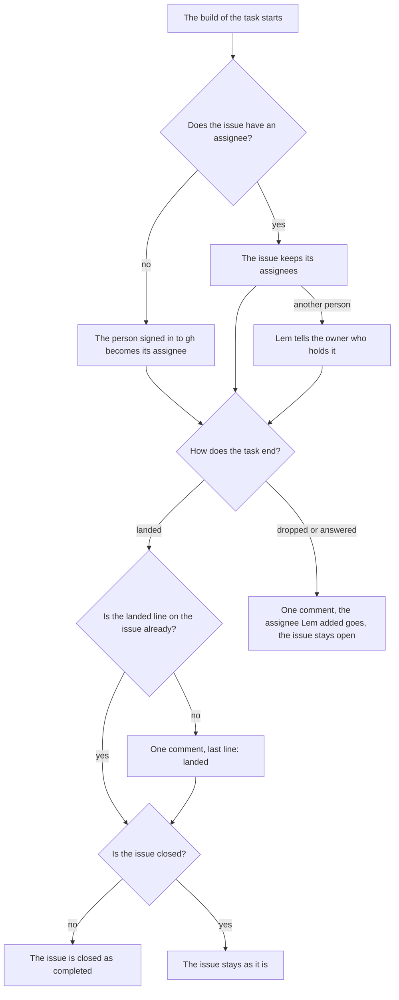

# GitHub Issues as a second tracker

careful: yes, because the topic "Lem changes a developer's repository without his word: a push, a merge, a removed worktree or branch, a protected branch touched." is in reach: task 2 gives Lem writes to the issues of the developer's GitHub repository (an assignee, a comment, a closed issue), and a wrong step writes to the wrong issue or twice; and "Lem reads a project's settings wrong" is near, since task 1 adds a value of `tracker.kind` and task 3 has `/lem init` propose it.

## Acceptance criteria

Size: full, because a new tracker reaches the settings, the id of a ticket, a new skill with its script, the onboarding and four documents.

1. A project whose `.lem/project.toml` has `[tracker]` with `kind = "github"` and no other key is
   taken: `lem project show` gives the tracker as `github`. `kind = "jira"` is refused, and the
   message names `linear` and `github`.
2. In a project whose tracker is GitHub, the id of an issue is its number after `#`:
   1. `lem project task-dir export-keeps-gift-note --ticket 42` keeps `#42` as the task's ticket,
      and `--ticket "#42"` keeps the same.
   2. A second task with `--ticket 42` is refused while the first one is not dropped or answered.
   3. `--ticket MBZ-12` is refused in that project, and `--ticket 42` is refused in a project whose
      tracker is Linear.
   4. A task that landed keeps issue 42, as for Linear. A new task for 42 after the issue is
      reopened is refused, and the message names the landed task and says to start the new task
      from the owner's own words.
3. `/lem read 42`, or the issue's address `https://github.com/OWNER/REPO/issues/42`, shows issue 42
   of the repository that origin names: its title, its text as written, open or closed, its labels
   and its address, and the comments under it apart from its text. Only the text is the request. It
   writes nothing to the issue. The address of an issue of another repository, such as the
   upstream of a fork, is refused, and the message names origin's repository and says that Lem
   reads the issues of origin.
4. When the build of a task from issue 42 starts, issue 42 gets the person signed in to `gh` as its
   assignee. An issue that has an assignee already keeps its assignees, Lem adds nobody, and when
   that assignee is another person, Lem tells the owner who it is in one line and builds on. When
   `gh` cannot assign, Lem tells the owner why in one line. A second start writes nothing to the
   issue.
5. When the task from issue 42 lands, issue 42 gets one comment and is closed as completed:
   1. The pull request of `export-keeps-gift-note` has the line `Issue: #42` in its text, so that
      GitHub links the issue and the pull request both ways.
   2. The pull request merges.
   3. Issue 42 gets a comment with what changed, the pull request's address, and whether the pull
      request was green or not green. Its last line is `lem: export-keeps-gift-note landed`.
   4. Issue 42 is closed as completed. An issue that is closed already stays as it is.
   5. A session that was cut off after the comment posts no second comment: the next session finds
      that last line on the issue, and goes on to the close.
6. When the task from issue 42 is dropped, issue 42 gets one comment that says why in one line, and
   its last line is `lem: export-keeps-gift-note dropped`. When the task ends with an answer, the
   comment holds the answer, and its last line is `lem: export-keeps-gift-note answered`. Either
   way the assignee that Lem added at the start is removed, any other assignee stays, the issue
   stays open, and Lem tells the owner that it is open.
7. The GitHub tracker's check runs in `/lem init` and when the owner asks for it. It says the
   repository that origin names and that its issues are on, or names what is missing, each with
   its fix: `gh` that is not installed, `gh` that is not signed in (`gh auth login`), issues that
   are off in the repository's settings, or an origin that is not on GitHub. It writes nothing, to
   the issues or to the settings.
8. `/lem init` proposes `kind = "github"` for a repository on GitHub whose issues are on and hold
   at least one issue, when the repository shows no Linear ticket keys (such as `ABC-12`) in its
   branch names or commit subjects. When it shows them it proposes `linear`, and otherwise no
   tracker: for a repository on GitHub with no issues, the onboarding's page says so, and says how
   to add the table later. A check that fails leaves the table out, and the page says why.
9. A guide, "Connect GitHub Issues", opens with what Lem writes to an issue (the assignee, the
   comment and the close, which are public in the repository), then says how to fill `[tracker]`
   for GitHub and how to start a task from an issue. The README, the site and `docs/settings.md`
   link it. `docs/linear.md` no longer says that Lem supports no other tracker.

## How it works

What Lem writes to an issue, from the task's start to its end.

## Tasks

1. **The settings, the id of an issue and the pull request's line** (criteria 1, 2, and step 1 of
   criterion 5). `TRACKERS` in `skills/lem/scripts/project.py` takes `github`; `cmd_task_dir`
   reads the project's tracker and takes the id form of its kind (`TICKET` stays the Linear form, a
   new rule takes `42` and `#42` and keeps `#42`), and its refusal of a ticket a landed task holds
   names that task and says to start the new task from the owner's own words; `TICKET_STEPS` gains
   `assigned` (Lem added the assignee at the start) and `unassigned` (it removed it), and
   `ticket_owed` has a dropped or answered task whose steps hold `assigned` owe `unassigned`; the
   commented `[tracker]` of the settings template names both kinds; the row of `tracker.kind` in
   `docs/settings.md` names both (`tests/lem-settings.sh` holds the table one to one). In
   `skills/lem/scripts/land.py`, the text of the pull request of a task whose ticket is a GitHub
   issue, in a project whose tracker is GitHub, holds the line `Issue: #42`, with no word that
   closes it. Tests: the rules at the unit level (`tests/unit/test_settings.py`,
   `tests/unit/test_task.py` and `tests/unit/test_land_text.py`, where those rules are now), and the
   task-dir journey with a GitHub tracker in the ticket checks of `tests/lem-settings.sh`.
   Files: `skills/lem/scripts/project.py`, `skills/lem/scripts/land.py`, `docs/settings.md`, the
   tests named.
2. **The skill `lem-github` and its command `lem issue`** (criteria 3 to 7). A new skill,
   `skills/lem-github/SKILL.md`, in the shape of `skills/lem-linear/SKILL.md` (the same six steps,
   `disable-model-invocation: true`, the same "What this skill never does"), whose steps run one
   script, `skills/lem-github/scripts/issues.py`, which `bin/lem` names `issue`: `check`, `read
   ID|URL`, `start SLUG`, `land SLUG --body-file FILE`, `drop SLUG --why TEXT`, `answer SLUG
   --body-file FILE`. `read` gives the comments apart from the text; `start` writes `assigned` when
   it added the gh login and says who holds an issue another person is assigned to; `drop` and
   `answer` remove the assignee only when `assigned` is written down; `check` names each missing
   thing with its fix (criterion 7). Each write is `gh` against origin's repository, looks at
   `lem project tasks`' `ticket_steps` first, writes the step down through `lem project
   ticket-step` after `gh` took it, and for a comment reads the issue's comments for the last
   line `lem: SLUG STEP` before it posts. The script adds that last line itself. Standard library,
   JSON out, exit 1 with the fix, "the owner" in every string for a person. Tests: a unit file
   `tests/unit/test_issues.py` over a stand-in `gh` on `PATH`, written in the manner of the one
   `tests/lib.sh` keeps, for each step and each refusal; the map of `tests/pick.py`. The tracker's
   harness part, `skills/lem/harness/claude-code/tracker.md`, says that the skill is `lem-KIND`
   and that the GitHub tracker needs `gh`, no MCP server; `skills/lem/harness/README.md` lists
   the skill; `NOTICE` says that `lem-github` was written for Lem.
   Files: the two new files, `bin/lem`, the test file, `tests/pick.py`, the harness files, `NOTICE`.
3. **The onboarding proposes GitHub** (criterion 8). `skills/lem/stages/init.md`: the look at
   "where the work is kept" adds GitHub's issues (on, and at least one issue, through `gh`), and
   `[tracker]` proposes `github` when no Linear key shows, with the check of task 2 before the
   table is written, in the same words as for Linear. The onboarding's page pattern, when it names
   the tracker, too.
   Files: `skills/lem/stages/init.md`, and `skills/lem/harness/claude-code/onboarding.md` only if
   it names the tracker.
4. **The documents** (criterion 9, and what the change makes false). A new guide
   `docs/github-issues.md`, "Connect GitHub Issues", in STE, under 800 words, in the shape of
   `docs/linear.md`; `docs/linear.md` loses "Lem supports no other tracker"; `README.md` and
   `site/index.html` link the guide beside "Connect Linear"; `docs/settings.md` links it under
   `[tracker]`; `docs/pull-request.md` says "the ticket", not "the Linear ticket"; `AGENTS.md`
   names the skill in "Layout" (the shipped skills, the guides, `lem issue` among the commands);
   the ruling "Linear and GitHub Issues, and the local backlog stays local" in
   `docs/rulings/rulings.md` points at a backlog item that this change ends: its words change only
   where they name that file, to say that `kind` is `linear` or `github`, and its rule stays word for
   word; `docs/backlog/github-issues-as-a-second-tracker.md` is removed with `git rm`.
   Files: the documents named.

## Decisions of the plan

- The GitHub tracker is a script over `gh`, not skill text over a server (decision 3): `gh` is a
  command a script can call, as `land.py` does, and the steps then hold in tests.
- An issue is started by an assignee (decision 4), finished by one comment and a close (decision
  5), and its id is `#42` (decision 6). The owner's page of 2026-11-22 added: the assignee Lem
  added goes at a drop or an answer, the pull request names the issue with `Issue: #42`, and the
  comment says green or not green instead of each check's last line.
- Out of scope: the status columns of GitHub Projects boards (decision 1) and a tracker on another
  forge (decision 2). The pull request's text gets no `Closes #42`: Lem closes the issue itself.

## What it will not verify

- No step writes to a real GitHub issue in the build: the tests run on a stand-in `gh`. Which
  fields `gh issue view --json` gives, and their names, are read from `gh issue view --help` on
  this machine and named with the version in the script. The first real task from an issue is
  the test of the skill's text.
- The onboarding's proposal (criterion 8) is a step of a stage file, which no test holds: a real
  onboarding of a repository with issues shows it.
