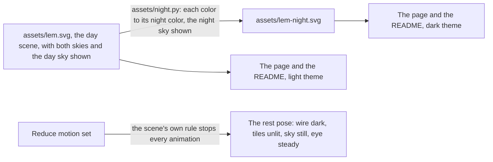

# The hero of Lem's page: the logo scene as a full-width animated background

careful: yes, because "A change bends a ruling of the owner" is in reach: task 1 redraws the logo, which the ruling "The logo is the owner's pick" lets change only on his word, and a drawing that drifts from the samples he chose, or a night color he never saw, would change his pick without it.

## Acceptance criteria

Size: full, because the hero of the page, the logo files, the README and the site's checks all change, and the scene is a new drawing with three animations.

1. The scene fills the hero from edge to edge, and the hero text stands on top of it: a visitor with a page area of 1280 x 800 sees the scene reach the left and the right edge of the window, with the headline, the lead, both install lines with their Copy buttons and the agterm note on top of it, all inside the first 800 px, the install lines keep their solid box, and no boxed picture shows above the headline.
2. On a phone the scene keeps its center in view: at 390 px wide the hooded figure and the word "Lem" both show, and the scene is cut at its sides, not squeezed.
3. A pulse of light runs along the wire, in both themes:
   1. The pulse enters at the left edge and travels to the right edge.
   2. The clip where each string hangs flashes once as the pulse passes it.
   3. Each letter of "Lem" lights up, tile by tile, as the pulse passes over it, then fades.
   4. The cycle takes about 8 seconds, with a short rest, and repeats.
4. The sky moves at the same time as the wire: in the dark theme about a hundred stars blink, each on its own timing, and pale aurora bands drift slowly across the sky; in the light theme a warm haze and soft rays drift over a low sun, with a faint heat shimmer on the horizon.
5. The hooded figure has one small red eye:
   1. It glows softly inside the black hood all the time.
   2. Once every 5 to 7 seconds it blinks: a quick dim and back.
   3. When the pulse on the wire passes the figure, the eye flares brighter.
   4. The red is the same in the light theme and the dark theme.
6. The theme picks the palette: a visitor whose system is set to dark sees the night colors of the scene, and one set to light sees the day colors; in both, every text of the hero (the headline, the lead, the install lines, the Copy buttons and the agterm note) keeps a contrast of at least 4.5 to 1 against what is behind it, at every moment of the motion.
7. With "reduce motion" set in the system, the scene stands still in one complete pose, on the page and in the README: the wire dark, the tiles unlit, the stars and the sky still, and the eye glowing steady. The pull request shows that pose as a still picture.
8. The README shows the same animated scene in place of today's still logo, at the same width as today (720 px): on github.com/pySilver/lem a visitor in the light theme sees the day scene move, and one in the dark theme the night scene; where a viewer does not animate it, the still scene shows. Only Lem's own README and page change, nothing in a repository that uses Lem, and the pull request shows a still picture of each theme.
9. The motion costs the page nothing new: the page runs no script but the Copy buttons, loads nothing from another host, the scene is a file in `assets/` that the Pages step publishes, and each scene file stays under 50 KB.

## How it works

The day file is drawn by hand, and the night file is written from it, as today. The page and the README show the two files through the same `<picture>` they use now.

## Tasks

1. **The scene.** `assets/lem.svg` becomes the animated day scene, and `assets/lem-night.svg` is written from it by `assets/night.py`. Serves criteria 3, 4, 5, 7, 8 and 9 (the files' side).
   - The drawing starts from the samples the owner chose (`wire-day.svg`, `wire-night.svg`, `sky-day.svg`, `sky-night.svg` in the task directory's `samples/`): the wire, its clips and the tiles of "Lem" from the wire samples, the skies from the sky samples, at their 1600 x 640 frame, with CSS keyframes inside the file and no script. The samples' bottom shade and the text drawn into their pictures stay out of the file: the page draws its own shade (task 2), and the README shows the scene with no text.
   - The red eye is new: one small red eye in the black hood, a soft glow, a blink once every 5 to 7 seconds, a flare as the pulse passes the figure, the same red in both files.
   - Each element's own style, with no animation, is the rest pose of criterion 7; the animations only add light. One rule in the file, `@media (prefers-reduced-motion: reduce)`, stops every animation.
   - Every color is a six-digit lowercase hex. The colors of today's `NIGHT` map keep their night colors; a new color outside the night sky takes its night color from the night sample the owner saw.
   - The night sky stands in the day file in its night colors, as the night sample has them, inside one marked group that the day file hides. Its colors never go through `NIGHT`: the night sample's aurora uses `#b5c5c0` and `#c7a95a`, which `NIGHT` turns into `#0e1a21` and `#4b4226` for the mark and the field, so one map cannot serve both (the talk's question 1).
   - `night.py` writes the night file as today (each color outside the night sky's group through `NIGHT`, the ids renamed), leaves the colors inside that group as written, hides the day sky's group and shows the night sky's. It still writes `assets/lem-mark-night.svg` byte for byte as it is now, since the mark has no sky group. It exits with a message that names the fix for a color it cannot map: a short hex, an uppercase hex, a named or functional color, also inside the night sky's group, and for a file with one sky mark and not the other.
   - Each file stays under 50 KB.
   - The two still pictures of criteria 7 and 8 (the rest pose, day and night, 1600 x 640) go into `docs/plans/2026-11-21-hero-logo-animated-background/` as `still-day.png` and `still-night.png`.
   - `tests/pick.py` runs `test-site` for a change of the two scene files, since its checks now read them: a row of its own for `assets/lem.svg` and `assets/lem-night.svg` names `lem-settings` and `test-site`, and `CHROME_OWN["test-site"]` lists both files, as the map's own check asks (the talk's question 5).
   - Files: `assets/lem.svg`, `assets/lem-night.svg`, `assets/night.py`, the check of the night files in `tests/lem-settings.sh` where it needs a case, the static checks of the scene files in `tests/test-site.sh`, `tests/pick.py`, the two pictures.
2. **The hero.** The page lays the scene behind the hero text from edge to edge. Serves criteria 1, 2, 6 and 9 (the page's side).
   - `site/index.html` keeps the `<picture>` with `assets/lem.svg` and its night source in the first section, so the checks "first" and "theme" of `tests/test-site.sh` still hold; its `width` and `height` take the scene's frame, and its alt text says what the scene shows.
   - `site/style.css` breaks the scene out of `main`'s 1080 px to the window's width as a layer behind the hero text, from the top of the page to the end of the agterm note, never behind the board pictures of `.showcase` in the same section, and draws a shade from the scene to `var(--bg)` under the text, so the text keeps 4.5 to 1 against the scene's worst color at that place. The boxed frame, the rounded corners and the ochre shadow go. The install lines keep their solid box.
   - The layer's height sets how much of the frame's width shows, since the scene is cut at its sides and never squeezed: at a width W and a height H a window shows W × 640 / H units of the 1600-unit frame, around its center. So at 390 px wide the layer is at most 390 × 640 / S px high, S being the span of the frame from the hood's left edge to the word's right edge in the final drawing (x 405 to about 1138 in `wire-day.svg`, the hood's path and the last tile under its `translate(224 40) scale(1.6)`, so about 340 px), and the hero text below that height stands on the page's background, reached through the shade (the talk's question 2).
   - `tests/test-site.sh` gains drawn checks: the scene reaches both edges at 1280 x 800 with the first screen as today; the probe of the first screen records the lead (`.sub`) too, beside the headline and the agterm note (the talk's question 6); at 390 px the figure and the word are inside the window, and the scene's ratio is kept; each hero text's contrast against the worst color behind it, in each theme.
   - Files: `site/index.html`, `site/style.css`, `tests/test-site.sh`, and `README.md` only for the alt text, so the README and the page say the same.
3. **The documents.** Corrects what the change makes false:
   - `AGENTS.md`, "Layout", the line of `assets/`: the logo is the animated scene, and `night.py` writes the night file with its colors and its sky.
   - `docs/rulings/rulings.md`, the bullet "The logo is the owner's pick": its words say that the pick is the animated scene he chose on 2026-11-21, with the current on the wire, the living sky and the red eye, in the README and the page, and its day list gains 2026-11-21. This records his word of decision 2; it is no new rule.
   - `assets/night.py`'s docstring, when task 1 left it false.
   - Serves no criterion.

## Plan talk

Argued by the reviewer, Codex `gpt-6.2-sol` at high effort as its pane's status line showed them
("GPT 6.2 Sol high"), and the defender, Claude Opus 5.5 at high effort (the `defender:` line of
the task's state). Seven turns: the request, the reviewer's list of six questions, one answer of
each side on each question, a second answer of each side on questions 2 and 3, and the close.

1. **The night aurora's colors through one `NIGHT` map.** The night sample's aurora (`h-aur`,
   `samples/sky-night.svg:22`) uses `#b5c5c0` and `#c7a95a`, which `NIGHT` turns into
   `#0e1a21` and `#4b4226` for the mark (`assets/night.py`, `NIGHT` and `main()`;
   `assets/lem-mark.svg:5-6`). Settled: the night sky's group keeps its colors through
   `night.py`, and the byte check of `tests/lem-settings.sh` covers both outputs. Settled by the
   two, not checked by the review.
2. **The center crop at 390 px.** At a 400 px high hero the 1600 x 640 frame shows x 488 to
   1112, which cuts the hood (x 405 to 459) and the word (to about 1138), and the first section
   also holds `.showcase`. Repaired: the scene is a layer behind the hero text only, and its
   height at 390 px is capped. The repair's formula, 390 x 640 / S with S the span from the hood
   to the word, gave about 340 px; with the crop fixed at x 800 the window must reach 395 units
   to each side, so the cap is about 316 px. The defender conceded the number and refuted the
   failure: Task 2's drawn check at 390 px catches a cut hood. The reviewer held: the plan's
   prose still gives 340 px. A design choice, decided after the talk (`stages/plan.md`, step 5).
3. **The contrast bound under moving, overlapping light.** Overlapping bands, a star and a
   varying shade, the reviewer said, are not bounded by one glow and one shade value. Repaired:
   one bound color for each theme from the largest (night) or smallest (day) red, green and blue
   of every color in the file, the shade at its weakest across each text's box, and a static
   check that refuses what can paint outside that range. The defender refuted the luminance
   example (the equal mix of `#2f4541` and `#5d3a22` is 0.0508, the bound color `#2f3a22` is
   0.0375) and the reviewer agreed. Held twice, as a layer over "Contrast is checked against the
   worst color": the refusal list rejects `feColorMatrix`, which both day shimmer filters of
   the owner's sample use (`samples/sky-day.svg:30-36`, red, green and blue set to
   `1 .95 .8`, alpha from the noise), and lets `feTurbulence` paint colors outside the file's
   hex values. A design choice, decided after the talk (`stages/plan.md`, step 5).
4. **The stills in the pull request's text.** `pr_text()` in `skills/lem/scripts/land.py` takes
   the landing's own lines and `notes.md`, and reads nothing from the plan's folder. Settled:
   `report.md` and `notes.md` carry an image line for each still at the pushed commit; `MEDIA`
   leaves that address alone and `cmd_propose()` pushes the commit before it sends the text. That
   the forge draws it is untested. Settled by the two, not checked by the review.
5. **The suite map for the scene files.** `tests/pick.py` gave only `lem-settings` for the two
   scene files, though `test-site` reads them. Settled: a row of their own names `lem-settings`
   and `test-site`, and `CHROME_OWN["test-site"]` lists them; the reviewer ran the map with the
   change in memory and got both suites. Settled by the two, not checked by the review.
6. **The lead in the probe of the first screen.** The `screen` probe of `tests/test-site.sh`
   records `.lead` and `.needs` but not `.sub`. Settled: the probe records `.sub`, and `DRAWN`
   fails any part below 800 px. Settled by the two, not checked by the review.

Mechanisms a repair added:

- The night sky's group, whose colors `night.py` leaves as written (question 1): a layer over
  "One day file holds both skies; `night.py` writes the night file", whose cite is existing code,
  `assets/night.py` and the byte check in `tests/lem-settings.sh`. Closed by the reviewer as that
  layer; it stays.
- The static refusal of colors outside the bound (question 3): a layer over "Contrast is checked
  against the worst color", whose cite is criterion 6. It held, and goes to step 5.

No question was raised after the first turn. No addition was refused as unpriced.

What changed in the plan, by question and by task: task 1 keeps the night sky's colors in a group
of their own through `night.py` (question 1) and adds `tests/pick.py` to its files (question 5);
task 2 makes the scene a layer behind the hero text only, with a height cap at 390 px
(question 2), and records `.sub` in the probe (question 6); the decision on both skies names the
night sky's group (question 1); the decision on contrast builds one bound color and refuses what
paints outside it (question 3); the decision on the stills carries them into the pull request by
link (question 4).

## Decisions of the plan

- **The scene replaces `assets/lem.svg` and `assets/lem-night.svg` in place.** The README, the page, the Pages step and the check "copied" already name these two files, so the README shows the scene with no edit of its `<picture>` and the Pages step is unchanged. Rests on the owner's answer "The README shows the animated scene too" (decision 2) and the scout's list of every file that names them.
- **One day file holds both skies; `night.py` writes the night file.** The byte-equal check of the night files stays, and so does the rule that the drawing changes in the day file only. A night file drawn by hand would need a second check of its own. Rests on `assets/night.py` and `tests/lem-settings.sh`. If both skies do not fit in 50 KB, the builder keeps the size and says how. The night sky's group keeps its own colors through `night.py` (task 1), because its colors share hex values with the day colors that `NIGHT` maps for the mark.
- **The shade under the text is the page's, not the scene's.** The README shows the scene with no text on it, so a shade inside the file would darken the README's lower half for nothing. Rests on criterion 8 and the samples' `h-shade` gradient.
- **Contrast is checked against the worst color, not against moments.** The check builds, for each theme, one bound color from every color the scene file holds: at night the largest red, green and blue of any of them, by day the smallest. It lays the page's shade over it at its weakest across each hero text's box, and asks for 4.5 to 1. This holds "at every moment" by construction, overlaps included: source-over compositing, opacity, blur and a mask each give a weighted mix of the colors under them, never a color lighter than the lightest or darker than the darkest (the talk's question 3). So the static check of the scene files also refuses what can leave that range: a `mix-blend-mode`, `plus-lighter`, `feBlend`, `feComposite` with `arithmetic`, `feColorMatrix`, `feComponentTransfer` and a `brightness()` or `contrast()` filter. Pictures at a few moments would miss the one between them.
- **The stills of criteria 7 and 8 are files in the plan's folder, and the pull request shows them by link.** The landing turns a link to the task's `media/` folder into its caption, since the forge has no such file (`MEDIA` in `skills/lem/scripts/land.py`), so a picture the pull request shows has to be on the branch. The pull request's text is the landing's own lines and `notes.md` (`pr_text()` in `land.py`), and nothing reads the plan's folder into it (the talk's question 4). So the lead's `report.md` names both stills under "What the owner gets" with one image line each, and the landing's `notes.md` carries them under `## Worth a look`, each as ``, TIP being the branch's commit that `propose` pushes. That the forge draws such a link in a pull request's text is untested.

## What it will not verify

- That GitHub's README view animates the scene and keeps it still under "reduce motion": GitHub shows the file through its own image proxy, which no check here can reach. The checks hold the file's side: the same files, the keyframes, the one rule for reduce motion, no script.
- The motion's look (the 8 second cycle, the timing of the flashes): the checks read the keyframes and their durations; the eye reads the motion, at the merge.
