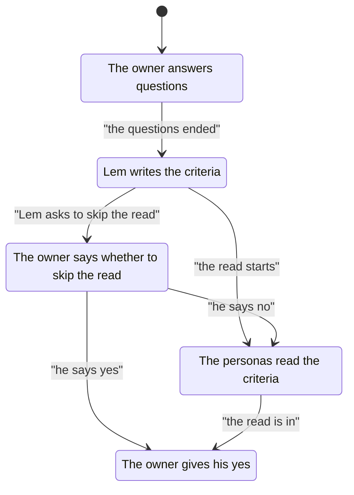

# The board says an interview waits for the owner only while a question of his is open

careful: no, because the change moves rows of the board's "Waits for you" and of `lem project waiting`, the time card's interview span and two new event forms, and reaches no topic: no push or merge, no record that the landing or the pull request reads (the landing's interview check reads `interview.start` and the approvals, which stay), and no decision of the owner's.

## Acceptance criteria

Size: full, because the board's model, two event forms, the time card and the interview's stage text change together.

1. After the owner answers the last question of an interview, the task leaves "Waits for you" and `lem project waiting` while the scout still reads and Lem writes the criteria, and its card says that Lem writes the criteria:
   1. The owner answers the last question of the interview of `report-dates-stay-whole`.
   2. Lem writes `task.md` again and logs that the questions ended.
   3. The scout still reads the code; then Lem writes the criteria.
   4. "Waits for you" has no row for `report-dates-stay-whole`, and its card says that Lem writes the criteria and nothing waits for him.
2. When Lem asks "Skip the persona read? (y/n)", the task is in "Waits for you" again until he answers:
   1. Lem wrote the criteria of `report-dates-stay-whole`, and each names only the developer.
   2. Lem asks "Skip the persona read? (y/n)" in the task's session.
   3. "Waits for you" lists `report-dates-stay-whole` as his.
   4. He answers "n": the personas' read starts, and the row leaves until the read is in.
   5. Had he answered "y", the row stays, since his yes to the criteria is what is missing.
3. While the owner is away, an interview, criteria that wait for his yes, or a request that waits for one answer is not in "Waits for you", since Lem goes on without him; an order that waits for him and a breaker stay his:
   1. The owner types `/lem im-away` while the interview of `report-dates-stay-whole` waits for his answer.
   2. "Waits for you" has no row for `report-dates-stay-whole`, and its card says that Lem goes on without him.
   3. Task `export-notes-in-order` waits for his answer on its order: its row stays.
   4. He types `/lem im-back` while the criteria of `report-dates-stay-whole` still wait for a yes: its row comes back.
4. The time card's span "The interview" ends when the questions ended, not when the personas' read starts: an interview whose questions ended at 10:05 and whose read started at 10:12 shows a span to 10:05.

## How it works

Who acts on a held interview, from the events after its newest state block:

While the owner is away, no state of this chart is his: Lem goes on with its guesses (`stages/away.md`).

## Tasks

1. **The board's model and the two events.** Serves criteria 1, 2, 3 and 4.
   - Two new event forms in `STARTS` of `skills/lem/scripts/project.py`, each taking nothing: `interview.end` (the questions to the owner ended) and `read.skip.asked` (Lem asked "Skip the persona read? (y/n)"). `lem project log` refuses each with a field, as it refuses `interview.start by=lem`. Add both to `RESUMED_EVENTS` beside `interview.start` when the reason that list gives holds for them (read its comment), and fix the comments that name the interview's end (the comment above `STARTS`, the module docstring near line 127).
   - In `skills/lem/scripts/lem_board_model.py`, extend what `reading_of` and `settle` do for a held task into one rule of who acts, folded over the events after the newest block, as the chart above shows: after `interview.end` with nothing after it, Lem acts ("Lem writes the criteria", with the card's line that nothing waits for him until the criteria are written, in the words and the form the read already uses); after `read.skip.asked`, the owner; after `criteria.read.start`, the personas, as today; after `criteria.read` or his skip decision, the owner. A held task not his leaves `waits_of`, `m.for_owner` and the lane "you", as the read does today.
   - While the task runs without the owner now (the machine's mark says away, `m.away`, or the task's own mark of a night, `task.mode`, as `runs_without_owner` in `project.py` reads it), a held task whose need is the interview, the criteria, or the request's one answer (`the request waits for one answer`) is not his, and its card says that Lem goes on without him. A held block of an order (`the order waits for the owner`), of an investigation that waits for a fact, and a breaker stay his.
   - The time card (`time_of`): the span "The interview" ends at `interview.end`. The timeline (`describe`'s table beside `interview.start`) gets a line for each new event.
   - Unit cases in `tests/unit/test_board_model.py`, class `InterviewRead` and beside it, one for each criterion, and the case of `test_the_scouts_read_keeps_the_row_since_the_interview_may_still_ask_him` kept true for a log with no `interview.end`. A unit case of the two forms in `tests/unit/test_project.py` (or the block of `tests/lem-settings.sh` that checks the forms of `STARTS` today, near line 839, where its count must change).
2. **The stage text, the skill and the backlog item.** Serves criteria 1 and 2.
   - `skills/lem/stages/interview.md`: step 3 logs `lem project log SLUG interview.end` once `task.md` is written again after the last question, also when the questions ended with Lem's guesses while he is away; step 5 logs `lem project log SLUG read.skip.asked` as it asks the skip question, and stops calling the read's record "the end of the interview".
   - `skills/lem/SKILL.md`, the paragraph of the stages' start events (near line 354): `interview.start` ends at `interview.end`, and `read.skip.asked` is named with its place.
   - `skills/lem/stages/away.md` only when the stage text has to say something new there (the logged end of the questions is in `interview.md`).
   - `docs/board.md` and `docs/when-lem-needs-you.md`, where they say when an interview waits for the owner: what the change makes false, in their STE.
   - `git rm docs/backlog/interview-state-says-who-waits.md`.

## Decisions of the plan

- **Two events, not a state block, for the end of the questions and the skip question.** A held block written again would reset what `reading_of` and the approvals read after the newest block, and would put two more lines into the state the landing reads. Rests on `settle` in `lem_board_model.py`, which reads the read and the approvals after the newest block.
- **The skip question has its own event, and does not move before the end of the questions.** It needs the written criteria (it asks whether every criterion names only the developer), and the criteria need the scout's report, so moving it would keep the owner's row through the scout's read and the writing, the moment criterion 1 removes. Without its event, the board would hide a question that waits for him, a worse error than the one this task fixes.
- **The away moment reads the owner's mark and adds no event.** His status is the machine's and every task's session in the shape acts on it through its watch (`stages/away.md`, "The watch", a look every 5 seconds, a guess); `lem project tasks` already gives each task's `mode` from the same mark. A session that is gone is its own row ("no session"). An event for the session's take-up would guard only a live session whose watch does not run, which no run has shown.
- **The interview's span ends at `interview.end` only.** Lem is not released, so no older form is read (`AGENTS.md`); a log with no `interview.end` shows the span's start with no end, as the card does for any stage whose end is missing.

## What it will not verify

- The board's pages in headless Chrome: the change is in the model's rows and words, which the unit cases read; `tests/lem-serve.sh` runs at the landing's checks.
- A real interview: the stage text's two new log lines are tried by the next interview in a real task.
