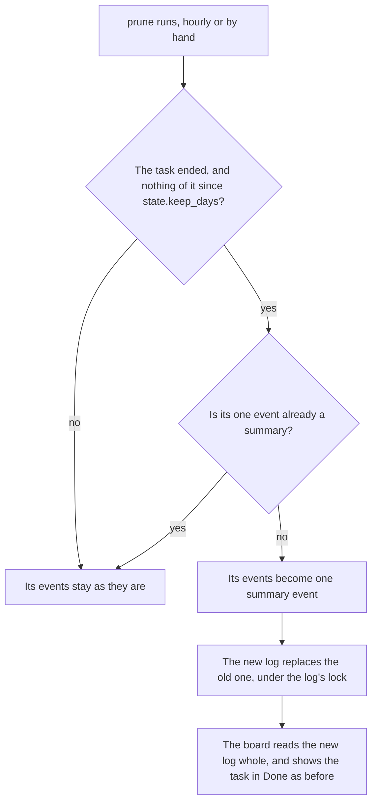

# An old ended task's events become one summary event

careful: yes, because task 1 rewrites `.lem/state/events.jsonl`, the record of every task, and reaches the owner's topic "A task's record is lost or wrong: its state, its decisions and its approved criteria, which nothing rebuilds and the pull request reads": a defect there drops an event of a task that still runs, or the board and `prune` read an ended task wrong.

## Acceptance criteria

Size: full, because `prune` rewrites the event log that five scripts read and two write, the board and `lem project resume` learn a new event, and the change is careful.

1. Past `state.keep_days`, `lem project prune` replaces all the events of an ended task with one summary event, and leaves every other event of the log as it was:
   1. `state.keep_days` is 30. The task `report-dates` landed on 2026-10-01 with pull request 12, and has 60 events in the log. The task `invoice-fix` landed on 2026-11-01. The task `gift-note` is building.
   2. On 2026-11-05 `lem project prune` runs.
   3. The log holds one summary event of `report-dates` in place of its 60 events. It keeps the task's status, its end, its first day, its last line, its type, green or not green, its pull request, and the time of its newest event.
   4. Every event of `invoice-fix` and of `gift-note` is in the log as it was, in the same order.
   5. A second `lem project prune` leaves the log as it is.
   6. The task `old-idea`, parked on 2026-09-01, keeps all its events: a parked task, and every task that has not ended, stays whole however old it is. The log is in Lem's state folder, which git never sees: no file in git and no branch changes.
   - test: `python3 -B -m unittest tests.unit.test_task.Summarized.test_an_old_ended_task_becomes_one_summary_and_every_other_line_stays_as_it_was` in `tests/unit/test_task.py`
   - test: `python3 -B -m unittest tests.unit.test_task.Summarized.test_a_second_prune_leaves_the_log_as_it_is` in `tests/unit/test_task.py`
   - test: `bash tests/lem-state.sh` in `tests/lem-state.sh`, `tests/lib.sh`, `tests/checks.sh`
2. The board and `lem project tasks` show an old ended task the same before its summary and after it:
   1. Before the prune of criterion 1, the card of `report-dates` in Done shows "landed", the time of its end, its last line, its type, "green" and the pull request 12.
   2. After the prune, its card shows the same six things, and its board says the same status, end and pull request.
   3. `lem project tasks` gives `report-dates` the same status, the same `since` and the same pull request as before.
   - test: `python3 -B -m unittest tests.unit.test_board_model.Summary.test_an_old_ended_tasks_card_and_its_followers_read_the_same_after_its_events_became_one_summary` in `tests/unit/test_board_model.py`
   - test: `python3 -B -m unittest tests.unit.test_board_model.SummarizedBoard.test_the_header_says_the_same_status_end_pull_request_and_track` in `tests/unit/test_board_model.py`
   - test: `python3 -B -m unittest tests.unit.test_task.Summarized.test_tasks_read_the_same_night_and_times_from_the_summary` in `tests/unit/test_task.py`
3. A task that waits for an old task still starts, and a new task cannot take an old task's name:
   1. After the prune of criterion 1, the task `report-dates-in-export` is queued with the line `after: report-dates`.
   2. `lem project may-start report-dates-in-export` lets it start, as it did before the prune.
   3. `lem project task-dir report-dates --ask "..."` refuses the name, as it did before the prune.
   - test: `bash tests/lem-state.sh` in `tests/lem-state.sh`, `tests/lib.sh`, `tests/checks.sh`
4. No event is lost and none is read twice while `prune` writes the log:
   1. The board is open, and has read the 60 events of `report-dates` and the events of `gift-note`.
   2. `prune` writes the new log. At the same moment, the session of `gift-note` writes the state `ready`, and its Claude Code session logs its transcript.
   3. The new log holds both events of `gift-note`, after its older ones.
   4. At its next look, the open board shows `gift-note` as `ready`, `report-dates` once in Done, and no event twice.
   - test: `python3 -B -m unittest tests.unit.test_task.Summarized.test_a_state_and_a_transcript_written_from_other_processes_while_prune_writes_are_in_the_new_log` in `tests/unit/test_task.py`
   - test: `python3 -B -m unittest tests.unit.test_board_model.Summary.test_the_reader_reads_a_log_that_prune_replaced_once_and_whole` in `tests/unit/test_board_model.py`
   - test: `python3 -B -m unittest tests.unit.test_serve.LogLook.test_three_old_events_that_become_one_while_two_new_ones_come_are_a_change` in `tests/unit/test_serve.py`
5. `lem project prune --dry-run` names each ended task whose events it would replace with a summary, with the count of its events, and changes no file: after it, the log of criterion 1 still holds the 60 events of `report-dates`.
   - test: `python3 -B -m unittest tests.unit.test_task.Summarized.test_a_dry_run_names_the_task_with_the_count_of_its_events_and_changes_no_file` in `tests/unit/test_task.py`
6. A dropped task whose events became a summary is not resumed, and Lem says why and what to do instead:
   1. The task `card-foot` was dropped on 2026-10-01. On 2026-11-05 `prune` replaced its events with a summary.
   2. `lem project resume card-foot` refuses. Its message says that the events of `card-foot` (its approved criteria, the personas' read, its decisions' events) became one summary event past `state.keep_days`, so a resumed task would start with none of them, and that a new task with its ask is the way on. It ends with the line to type, `/lem` followed by the text of `ask.txt` of the dropped task.
   3. A dropped task whose events are whole resumes as before.
   - test: `python3 -B -m unittest tests.unit.test_task.ResumeSummarized.test_a_dropped_task_whose_events_became_a_summary_is_refused_with_its_ask` in `tests/unit/test_task.py`

## How it works

## Tasks

1. **The summary in `prune`, under one lock of the log.** Serves criteria 1, 3, 4, 5 and 6.
   - `skills/lem/scripts/project.py`: one lock of the event log, a file `events.lock` beside it in the state folder, taken with `fcntl.flock` by `append_event` for its append, and by `prune` from its read of the log through the `os.replace` of the new one. The new log is written whole to a temporary file in the state folder and put in place with `os.replace`, so it has a new inode, which the board's readers see as a new log (task 2). Prune keeps the old log open across the replace and, still under the lock, appends to the new log the bytes the old file holds past the size it read: an append of a writer that takes no lock (a task's session of an older Lem, or a repository not yet updated, where the board server runs this prune with its own scripts, `serve.py` `lem_run`) lands in the old file and is carried over (the talk's question 1). A dry run takes no lock and opens no lock file: it reads the log as `log_events` does and writes nothing (the talk's question 7).
   - `skills/lem/scripts/session_hook.py`: `keep_transcript` appends under the same lock. It is the one other writer of the log (every other event goes through `append_event`; a sweep for `open("a"` over `skills/*/scripts/*.py` on 2026-11-21 found no third).
   - `cmd_prune`: for each task that `task_calls` calls `old`, the task's events become one `task.summary` event (its form under "The decisions"), in the place of the task's newest event; every other line of the log stays byte for byte, in its order. A task whose events are already its one summary is left alone, so a second prune writes nothing (no rewrite at all when no task changes). The answer names each task it summarized with the count of its events, in its JSON, and gives the totals in `said`; `--dry-run` names the same and writes nothing. `serve.py`'s `prune_line` names the events when there were any.
   - `task_calls`: reads a `task.summary` as the task's stated status and its `ts` as the task's newest event, so an old task stays `old` and its dating does not move.
   - `read_tasks`: the first and newest state of a task, and its night's mark, read from its summary when the task has one, so `lem project tasks` gives the same status, `since` and pull request as before (criterion 2.3). The summary carries no spans without the owner: after it, an old ended task's row shows `mode` `with-owner` and no `without_owner`, which no reader reads of an ended task (the talk's question 4, decision 4).
   - `cmd_resume`: reads the log once, at its start, and takes from that one read the summary check, the old branch and the events it carries over, so a prune that summarizes the task while `git` runs changes nothing it copies (the talk's question 2). It refuses a dropped task whose read holds its `task.summary`, with the message of criterion 6, which ends with `/lem` and the text of the dropped task's `ask.txt`, before it makes any folder or branch.
   - `cmd_log`: refuses `task.summary` as it refuses `task.state`: only `prune` writes it (the talk's question 6).
   - Tests: unit cases in `tests/unit/test_task.py` for the summary of one task among others, a second prune, the dry run, `task_calls` on a summary, the resume refusal and a resume of a whole task; the lock and the race of criterion 4 as a case that holds the lock and shows that an append waits for it, and one that appends from a second process while `prune` writes; a case that appends to the old file with no lock between prune's read and its replace and finds the line in the new log; a resume whose log is summarized after its read; `cmd_log` refusing `task.summary`; a dry run that leaves no `events.lock`; one check in `tests/lem-state.sh` that runs `lem project prune` on a throwaway state folder and then `lem project may-start` and `lem project task-dir` (criterion 3).
2. **The board reads a summary.** Serves criteria 2 and 4.
   - `skills/lem/scripts/lem_board_model.py`: `fold` takes a `task.summary` as the task's whole past: its newest block, its `since`, `first` and `last`, its pull request (`pr`), its type, its lead, its careful call and its proposal, so that `settle`, the card, `pr_of`, `after_ended` and `after_dropped` read the task as before. The summary's facts are the ones the model's own fold gives for the task's events, so task 1 computes them with this module's `fold` and `settle` and cannot disagree with it.
   - `Reader.read_log` in `lem_board_model.py` and `Look.count` in `serve.py` open the log first and take its inode and size from `os.fstat` of the open file, so a replace between the two never puts an old offset on the new file. `Look.changes` tells a change when the log's inode changed as well as its count of lines. The stream's `id:` names the log's version with its count (its inode and its count of lines, in one id), `tools/board-kit/controllers/stream.js` keeps that id whole and sends it back as `?since=`, and `Handler.refreshes` sends a refresh at once when the id it gets is not the log's id now, so every page that reconnects after a rewrite is told (the talk's question 3, decision 3); `vendor/board-app.js` is built again with `tools/board-kit`.
   - `skills/lem/scripts/lem_board_task.py`: the board of a task whose events became a summary says in one line at its top that its events became one summary past `state.keep_days`, shows what the summary holds and the files that stay ("Artifacts"), and each other tab says that its detail went with the events, never an empty section that reads as nothing on record (the talk's question 9, decision 2).
   - Tests: a case in `tests/unit/test_board_model.py` that builds the model of a log with the 60 events of an ended task, summarizes the log as task 1 does, and compares the card's facts of criterion 2 before and after; a case of the `Reader` that reads a log, sees it replaced by a summarized one, and has each event once (criterion 4); a case of `Look.changes` where three old events become one while two new ones come, and a change is told; a stream request whose `?since=` is the id from before such a rewrite gets a refresh at once; the board of a summarized task with its one line and no empty section.
3. **The documents.** Serves no criterion.
   - `docs/settings.md`: the row of `keep_days` says that past that number of days an ended task's events become one summary event as well as its working files going, and that a dropped task past it is not resumed.
   - `skills/lem/scripts/project.py`: the module docstring's lines on `prune` (near "`state.keep_days` days") and on the event log (near "`events.jsonl` in the state folder is the record") say the same.
   - `AGENTS.md`: the `.lem/` line of "Layout" ("`lem project prune` removes from it what is older than `state.keep_days`") names the summary of the events.
   - `skills/lem/stages/learn.md`: where the retro reads the events "since the last retro", one sentence that past `state.keep_days` an ended task's events are its summary, so a retro reads only the newer ones.
   - `skills/lem/stages/park.md`, "resume", and `docs/when-lem-needs-you.md`, where a dropped task is resumed: a dropped task whose events became a summary past `state.keep_days` is not resumed, and a new ask is the way on. `docs/board.md`, where the board of one task names its checks, its review and its timeline: a task whose events became a summary shows what the summary holds (the talk's question 9; what the board of such a task shows a person is open, and step 5 of `stages/plan.md` takes it).
   - `docs/backlog/an-ended-task-s-events-and-records-stay-on-the-machine-for-ever.md`: rewritten to what is left, the records of option (b), with its title, its `where:` and its options to match; the events part leaves it.

## Plan talk

Argued on 2026-11-21 by the reviewer, Codex with GPT 6.2 Sol at high effort (its pane's status line), and the defender, Claude Code with Opus 5.5 at high effort (the `defender:` line of the task's state). Seven turns: the request, the list of nine questions, the answers, the reviewer's word, the answers to what held, the reviewer's word, and the close. The repairs are commit `20f2e2d`. Agreement carries no authority: the review before the pull request reads each settled position as a claim.

1. **Which writers share the lock on the first prune after an update?** The board server runs its own `prune` in every repository (`serve.py` `lem_run`), so a repository with an older Lem, or a session started before the update, appends with no lock, and the replace loses that append. A design choice. The plan's side: the lock, with prune's carry-over of the bytes the old file holds past the size it read (task 1, decision "One lock of the log"), a layer over the plan's choice to replace the log with a new file, which rests on the backlog item's recommendation that a reader that tails the log sees the new file whole. The reviewer's side: the carry-over still loses a write whose writer opened the old file before the replace and wrote after prune's last read (no bound on that pause), and it can put an old `building` after a new `ready`, which `settle` reads as the newest block; the smallest option is the lock alone, with the loss for writers of an older Lem stated. Step 5 of `stages/plan.md` took it: decision 6, by the personas (the developer and the teammate, both leaning, one model family), kept the lock with the carry-over.
2. **Which copy of the log does a resume use?** Settled: `cmd_resume` reads the log once at its start, for the summary check, the old branch and the events it carries over (task 1). Settled by the two, not checked by the review.
3. **What makes the open board see one complete version and refresh?** A design choice. The repair, at the cause (task 1's "need no change" was wrong): `Reader.read_log` and `Look.count` take inode and size from `os.fstat` of the open file, `Look.changes` tells a change on a new inode, and `Handler.refreshes` refreshes when `Last-Event-ID` differs from the count (task 2). The reviewer's hold on it: a page that reconnects (`stream.js` `open`, `?since=` the last id) after three events became one while two new ones came sends 4 and finds 4 lines, so it gets no refresh, and its poll runs only while the stream is down (`tick`). Step 5 took it: decision 3, by the gate, chose that the stream's id names the log's version with its count (task 2).
4. **Which facts come from more than the final state block?** A design choice. The repair, at the cause: each fact of the summary is computed by the function that reads it today (`settle`'s `since`, `first`, `last`; `pr_of` over all blocks; `nights`; `read_tasks`' `opened` and `newest`), decision "The form of the summary event". The defender's refutation of the hold: criterion 2.3 asks for the same status, `since` and pull request, and the readers of `mode`, `mode_since` and `without_owner` read only tasks that have not ended (`project.py` lines 3075 and 3079; `land.py` `without_owner`, `pr_text`). The reviewer's side: task 1 says `lem project tasks` gives the same as before, `project.py` `main` prints every row of `read_tasks`, and `tests/lem-state.sh` `modes` reads `mode` and `without_owner` of an ended task, whose spans come from its own `task.mode` mark, which the summary does not carry. Step 5 took it: decision 4, by the gate, chose that the summary carries no spans and task 1's sentence names the fields of criterion 2.3.
5. **What happens when the last passed check belongs to an old task?** A design choice. The repair, at the cause: decision "The check times" changed; the summary keeps `checks`, the task's newest passed run, and `gate_ends` gives it back as a `gate.end` (task 1). The reviewer's hold: the substitute stands at the summary's place, the task's newest event, so it can come after a newer pass of another task, and `last_seconds` takes file order (a baseline of 90 seconds in place of 120 in its probe); and `lem land checks SLUG --status` reaches `checks_status` with no state filter, where a summarized task that stopped a later run would report the older pass. Step 5 took it: decision 5, by the gate, chose no baseline from old tasks: no summary keeps a run of the checks, and the repair's `checks` left the plan.
6. **What happens when a regular log command supplies `task.summary`?** Settled: `cmd_log` refuses it, as it refuses `task.state` (task 1). Settled by the two, not checked by the review.
7. **Where does the dry run get its log view?** Settled: a dry run takes no lock and opens no lock file (task 1). Settled by the two, not checked by the review.
8. **What does a later prune say a summary represents after a hook appends?** Settled: a summary with newer events after it is summarized again over the old summary and those events, and its `events` adds the old count (decision "The form of the summary event"). Settled by the two, not checked by the review.
9. **Which instructions and pages tell the owner what the summary leaves available?** The documents are repaired: task 3 names `stages/park.md` "resume", `docs/when-lem-needs-you.md` and `docs/board.md`. Open: what the board of a summarized task shows a person (its checks, its review, its timeline, its commit), which is not the two agents' to settle. Step 5 took it: decision 2, by the gate, chose a line at the top of that board, what the summary holds and the files that stay, and no empty section (task 2).

The mechanisms the repairs added, with the decision each sits on:

- the carry-over of an unlocked append (question 1): a layer over the replace of the log by a new file, cited to the backlog item; the reviewer held it, and it is a design choice;
- the inode in `Look.changes` and the refresh on a differing `Last-Event-ID` (question 3): at the cause, the plan's claim that the readers need no change; held, a design choice;
- the summary's `checks` and its `gate.end` in `gate_ends` (question 5): at the cause, decision "The check times"; held, a design choice, and decision 5 took it out of the plan;
- the refusal of `task.summary` in `cmd_log` (question 6): a layer over the reservation of the events `cmd_log` already refuses (`task.state`, `task.mode`); closed.

Questions 4 and 8 both named decision "The form of the summary event".

Raised, not argued: if the new board server summarizes a repository before that repository's plugin is updated, the older `cmd_resume` there still accepts a dropped task with a breaker and a handoff, and its `events_named` reads find neither the old branch nor the events to carry over (`project.py` `cmd_resume` of the older Lem; `serve.py` `lem_run`).

No addition was refused as unpriced.

What changed in the plan, by task: task 1 took the carry-over, the dry run with no lock, the one read of `cmd_resume`, the refusal in `cmd_log` and their tests (questions 1, 2, 6, 7), and lost the `land.py` `gate_ends` of the repair of question 5 by decision 5; task 2 took the readers' `os.fstat`, the inode in `Look.changes`, the stream's id of the log's version (decision 3), the board of a summarized task (decision 2), the facts `fold` reads from a summary, and a test of three events that become one (questions 3, 4); task 3 took `stages/park.md`, `docs/when-lem-needs-you.md` and `docs/board.md` (question 9). The decisions "The form of the summary event" (questions 4, 8), "One lock of the log" (question 1) and "The check times" (question 5) changed.

## The decisions

- **The form of the summary event.** One line, `{"ts": NEWEST, "event": "task.summary", "task": SLUG, "status": ..., "text": ..., "lines": [...], "since": ..., "first": ..., "last": ..., "opened": ..., "newest": ..., "pr": ..., "ask": ..., "branch": ..., "type": ..., "size": ..., "lead": ..., "careful": ..., "proposal": ..., "night": ..., "events": N}`. Each fact is computed by the function that reads it today, over the task's events, so the reader and the summary cannot disagree (the talk's question 4): `ts` is the time of the task's newest event, which `prune` dates the task by (the item); `status`, `text` and `lines` are the task's newest state block; `since`, `first` and `last` are `settle`'s `t.since` (the first block of the last run of its status, so a second `dropped` block does not move it), `t.first` and `t.last_ts`; `pr` is what `pr_of` finds in any block, so a drop whose block names no pull request keeps the one an earlier `open` block named; `opened` and `newest` are the first and newest `task.mode` or `task.state` that `read_tasks` reads for the task's spans without the owner; `night` is `nights`' date, from `task.mode`, which `read_tasks` reads and the board does not; `type`, `lead`, `careful` and `proposal` are what the board's card reads from the other events. `size` is `criteria_size`'s size of the task's criteria, which `track_of` says as the track in the Type row of the task's board (decision 21: task 2's pictures showed "feat · standard track" become "feat" without it). `events` is how many events it stands for. A task whose events hold its summary and newer events (a hook that logged a transcript after it) gets one new summary when it is old again: its facts are computed over the old summary, which the readers read as the task's past, and the newer events, and its `events` is the old summary's count with the newer events added (the talk's question 8). It rests on the item's option (a) and the owner's "OK" to one summary event in place of the events of a task past the time (the item, 2026-11-21).
- **One lock of the log.** It prevents a lost event: an append that comes between `prune`'s read of the log and its `os.replace` goes into the old file, which the replace throws away. The input is the board server's hourly prune while any task's session writes a state or a hook logs a transcript; both run all day on this machine, so it is realistic, though the window is short. Without the lock, the lost event is a task's state (its `task.state`: the log and `state.md` then disagree, and `prune` and the board read the task wrong) or a landing's `proposed`, which the owner's topic on a task's record covers. The cost on a small task is one `flock` around each append, held for one write. The lock holds only writers of this version: the board server runs its own `prune` in every repository it serves (`serve.py` `lem_run`), and a repository not yet updated, or a task's session started before the update, appends with no lock. So the rewrite also carries over what the old file holds past the size prune read (task 1, the talk's question 1). What it can still get wrong: an append whose writer opened the old file before the replace and wrote after prune's last read of it is lost, a window of a few system calls (an unmeasured estimate); and two appends of an older writer, one before the replace and one after, can end in the wrong order, so the board reads the older status as newest until the task's next status, and for good when the second was an end. The talk's question 1 put this against the lock alone and against prune skipping a repository with an older Lem; decision 6 kept it.
- **The records stay.** The task directory of an old task keeps what `prune` keeps today: option (b) of the item is a later task (decision 1 of the record).
- **A resume refuses on the summary, not on the age.** A dropped task past `state.keep_days` whose events are still whole (no prune ran yet) resumes as before: the refusal follows what is lost, not a date.
- **The retro's horizon.** The retro reads `review`, `proposed` and `careful.missed` "since the last retro" (`stages/learn.md`). Past `state.keep_days` (30 days unless the settings say otherwise) those of an ended task are gone; a retro more than that apart from the one before reads fewer. Task 3 says so in `learn.md`; no code keeps them.
- **The check times.** `land.py`'s `last_seconds` takes the `seconds` of the newest passed `gate.end` of any task as the baseline of an overdue run, and skips a red one. After a month in which no task's checks passed, every passed run is an old task's, and its `gate.end` goes with its summary: the next run has no overdue warning until one run passes, as in a new repository. No summary keeps a run of the checks, and `gate_ends` reads only real `gate.end` events (the talk's question 5, decision 5).

## What it will not verify

- The time of `derive` over 1,003 ended tasks after the summary: the item measured the log before (47 MB, 149 ms against 3 ms, 2026-11-21); the tests show the log's lines, one for each old task, and do not time the board again.
- A real run of the hourly prune in the board server over this repository's own log: the tests run `prune` on throwaway state folders, and the landing does not prune the owner's real log.
