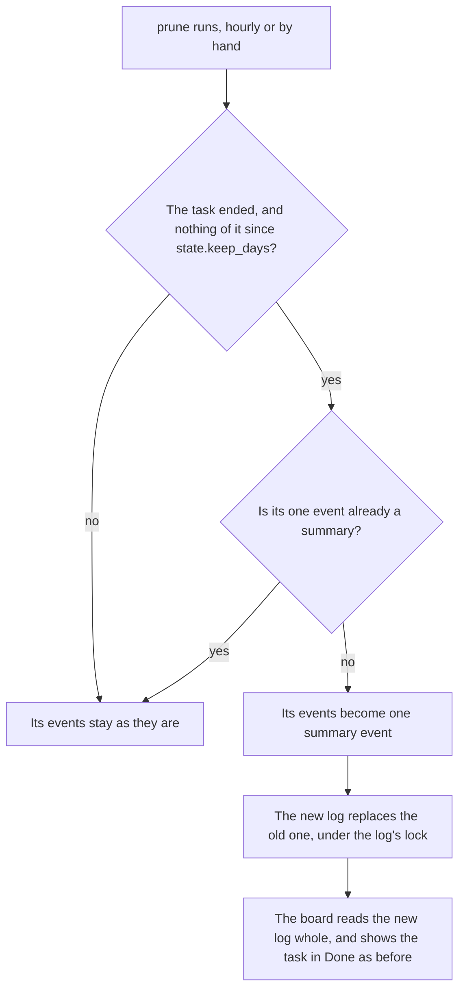

# An old ended task's events become one summary event

careful: yes, because task 1 rewrites `.lem/state/events.jsonl`, the record of every task, and reaches the owner's topic "A task's record is lost or wrong: its state, its decisions and its approved criteria, which nothing rebuilds and the pull request reads": a defect there drops an event of a task that still runs, or the board and `prune` read an ended task wrong.

## Acceptance criteria

Size: full, because `prune` rewrites the event log that five scripts read and two write, the board and `lem project resume` learn a new event, and the change is careful.

1. Past `state.keep_days`, `lem project prune` replaces all the events of an ended task with one summary event, and leaves every other event of the log as it was:
   1. `state.keep_days` is 30. The task `report-dates` landed on 2026-10-01 with pull request 12, and has 60 events in the log. The task `invoice-fix` landed on 2026-11-01. The task `gift-note` is building.
   2. On 2026-11-05 `lem project prune` runs.
   3. The log holds one summary event of `report-dates` in place of its 60 events. It keeps the task's status, its end, its first day, its last line, its type, green or not green, its pull request, and the time of its newest event.
   4. Every event of `invoice-fix` and of `gift-note` is in the log as it was, in the same order.
   5. A second `lem project prune` leaves the log as it is.
   6. The task `old-idea`, parked on 2026-09-01, keeps all its events: a parked task, and every task that has not ended, stays whole however old it is. The log is in Lem's state folder, which git never sees: no file in git and no branch changes.
2. The board and `lem project tasks` show an old ended task the same before its summary and after it:
   1. Before the prune of criterion 1, the card of `report-dates` in Done shows "landed", the time of its end, its last line, its type, "green" and the pull request 12.
   2. After the prune, its card shows the same six things, and its board says the same status, end and pull request.
   3. `lem project tasks` gives `report-dates` the same status, the same `since` and the same pull request as before.
3. A task that waits for an old task still starts, and a new task cannot take an old task's name:
   1. After the prune of criterion 1, the task `report-dates-in-export` is queued with the line `after: report-dates`.
   2. `lem project may-start report-dates-in-export` lets it start, as it did before the prune.
   3. `lem project task-dir report-dates --ask "..."` refuses the name, as it did before the prune.
4. No event is lost and none is read twice while `prune` writes the log:
   1. The board is open, and has read the 60 events of `report-dates` and the events of `gift-note`.
   2. `prune` writes the new log. At the same moment, the session of `gift-note` writes the state `ready`, and its Claude Code session logs its transcript.
   3. The new log holds both events of `gift-note`, after its older ones.
   4. At its next look, the open board shows `gift-note` as `ready`, `report-dates` once in Done, and no event twice.
5. `lem project prune --dry-run` names each ended task whose events it would replace with a summary, with the count of its events, and changes no file: after it, the log of criterion 1 still holds the 60 events of `report-dates`.
6. A dropped task whose events became a summary is not resumed, and Lem says why and what to do instead:
   1. The task `card-foot` was dropped on 2026-10-01. On 2026-11-05 `prune` replaced its events with a summary.
   2. `lem project resume card-foot` refuses. Its message says that the events of `card-foot` (its approved criteria, the personas' read, its decisions' events) became one summary event past `state.keep_days`, so a resumed task would start with none of them, and that a new task with its ask is the way on. It ends with the line to type, `/lem` followed by the text of `ask.txt` of the dropped task.
   3. A dropped task whose events are whole resumes as before.

## How it works

## Tasks

1. **The summary in `prune`, under one lock of the log.** Serves criteria 1, 3, 4, 5 and 6.
   - `skills/lem/scripts/project.py`: one lock of the event log, a file `events.lock` beside it in the state folder, taken with `fcntl.flock` by `append_event` for its append, and by `prune` from its read of the log through the `os.replace` of the new one. The new log is written whole to a temporary file in the state folder and put in place with `os.replace`, so it has a new inode: `Reader.read_log` in `lem_board_model.py` and `Look.count` in `serve.py` read a log with a new inode from its start, and need no change for it.
   - `skills/lem/scripts/session_hook.py`: `keep_transcript` appends under the same lock. It is the one other writer of the log (every other event goes through `append_event`; a sweep for `open("a"` over `skills/*/scripts/*.py` on 2026-11-21 found no third).
   - `cmd_prune`: for each task that `task_calls` calls `old`, the task's events become one `task.summary` event (its form under "The decisions"), in the place of the task's newest event; every other line of the log stays byte for byte, in its order. A task whose events are already its one summary is left alone, so a second prune writes nothing (no rewrite at all when no task changes). The answer names each task it summarized with the count of its events, in its JSON, and gives the totals in `said`; `--dry-run` names the same and writes nothing. `serve.py`'s `prune_line` names the events when there were any.
   - `task_calls`: reads a `task.summary` as the task's stated status and its `ts` as the task's newest event, so an old task stays `old` and its dating does not move.
   - `read_tasks`: the first and newest state of a task, and its night's mark, read from its summary when the task has one, so `lem project tasks` gives the same as before.
   - `cmd_resume`: refuses a dropped task whose log holds its `task.summary`, with the message of criterion 6, which ends with `/lem` and the text of the dropped task's `ask.txt`, before it makes any folder or branch.
   - Tests: unit cases in `tests/unit/test_task.py` for the summary of one task among others, a second prune, the dry run, `task_calls` on a summary, the resume refusal and a resume of a whole task; the lock and the race of criterion 4 as a case that holds the lock and shows that an append waits for it, and one that appends from a second process while `prune` writes; one check in `tests/lem-state.sh` that runs `lem project prune` on a throwaway state folder and then `lem project may-start` and `lem project task-dir` (criterion 3).
2. **The board reads a summary.** Serves criteria 2 and 4.
   - `skills/lem/scripts/lem_board_model.py`: `fold` takes a `task.summary` as the task's whole past: its end block, its first day, its type, its lead, its careful call, its proposal and its night's mark, so that `settle`, the card, `pr_of`, `after_ended` and `after_dropped` read the task as before. The summary's facts are the ones the model's own fold gives for the task's events, so task 1 computes them with this module's `fold` and `settle` and cannot disagree with it.
   - Tests: a case in `tests/unit/test_board_model.py` that builds the model of a log with the 60 events of an ended task, summarizes the log as task 1 does, and compares the card's facts of criterion 2 before and after; a case of the `Reader` that reads a log, sees it replaced by a summarized one, and has each event once (criterion 4).
3. **The documents.** Serves no criterion.
   - `docs/settings.md`: the row of `keep_days` says that past that number of days an ended task's events become one summary event as well as its working files going, and that a dropped task past it is not resumed.
   - `skills/lem/scripts/project.py`: the module docstring's lines on `prune` (near "`state.keep_days` days") and on the event log (near "`events.jsonl` in the state folder is the record") say the same.
   - `AGENTS.md`: the `.lem/` line of "Layout" ("`lem project prune` removes from it what is older than `state.keep_days`") names the summary of the events.
   - `skills/lem/stages/learn.md`: where the retro reads the events "since the last retro", one sentence that past `state.keep_days` an ended task's events are its summary, so a retro reads only the newer ones.
   - `docs/backlog/an-ended-task-s-events-and-records-stay-on-the-machine-for-ever.md`: rewritten to what is left, the records of option (b), with its title, its `where:` and its options to match; the events part leaves it.

## The decisions

- **The form of the summary event.** One line, `{"ts": NEWEST, "event": "task.summary", "task": SLUG, "status": ..., "text": ..., "lines": [...], "ended": ..., "first": ..., "ask": ..., "branch": ..., "type": ..., "lead": ..., "careful": ..., "proposal": ..., "night": ..., "events": N}`: `ts` is the time of the task's newest event, which `prune` dates the task by (the item); `status`, `text` and `lines` are the task's newest state block, whose lines hold the pull request's address (`pr_of` reads it there); `ended` and `first` are the times of its newest and first `task.state`; `type`, `lead`, `careful`, `proposal` and `night` are what the board's card and `lem project tasks` read from the other events; `events` is how many events it stands for. It rests on the item's option (a) and the owner's "OK" to one summary event in place of the events of a task past the time (the item, 2026-11-21).
- **One lock of the log.** It prevents a lost event: an append that comes between `prune`'s read of the log and its `os.replace` goes into the old file, which the replace throws away. The input is the board server's hourly prune while any task's session writes a state or a hook logs a transcript; both run all day on this machine, so it is realistic, though the window is short. Without the lock, the lost event is a task's state (its `task.state`: the log and `state.md` then disagree, and `prune` and the board read the task wrong) or a landing's `proposed`, which the owner's topic on a task's record covers. The cost on a small task is one `flock` around each append, held for one write.
- **The records stay.** The task directory of an old task keeps what `prune` keeps today: option (b) of the item is a later task (decision 1 of the record).
- **A resume refuses on the summary, not on the age.** A dropped task past `state.keep_days` whose events are still whole (no prune ran yet) resumes as before: the refusal follows what is lost, not a date.
- **The retro's horizon.** The retro reads `review`, `proposed` and `careful.missed` "since the last retro" (`stages/learn.md`). Past `state.keep_days` (30 days unless the settings say otherwise) those of an ended task are gone; a retro more than that apart from the one before reads fewer. Task 3 says so in `learn.md`; no code keeps them.
- **The check times.** `land.py`'s `gate_ends` reads the `gate.end` of every task for the time of the last run of the checks; an old task's leave with its summary, and the newest runs, which it reads, stay.

## What it will not verify

- The time of `derive` over 1,003 ended tasks after the summary: the item measured the log before (47 MB, 149 ms against 3 ms, 2026-11-21); the tests show the log's lines, one for each old task, and do not time the board again.
- A real run of the hourly prune in the board server over this repository's own log: the tests run `prune` on throwaway state folders, and the landing does not prune the owner's real log.
