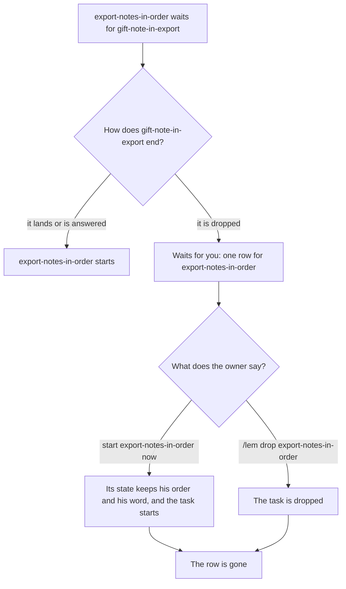

# What pull request 13 left open of the owner's task order

careful: yes, because task 2 changes what a queued task's state keeps of the owner's order and of his word, and task 3 changes what `lem project state` refuses, which reach the owner's topics "A task's record is lost or wrong: its state, its decisions and its approved criteria" and "A decision that is the owner's is taken without him": a defect there drops his order from a state block, starts or queues a task against his word, or refuses a state block that is right.

## Acceptance criteria

Size: full, because five promises of pull request 13 change in the scripts and in the stage texts, and the change is careful.

1. A task that waits behind a dropped task is in the list of what waits for the owner, with the two things he can say:
   1. The task `export-notes-in-order` is queued after `gift-note-in-export`, by his order or by a need.
   2. He drops `gift-note-in-export`. The session where he drops it says in the same line that `export-notes-in-order` now waits for his word.
   3. "Waits for you" on the board and `lem project waiting` each show one row for `export-notes-in-order`. The row says that `gift-note-in-export` was dropped, that "start export-notes-in-order now" starts the task, that `/lem drop export-notes-in-order` ends it, and that he types either one in any Lem session of this repository.
   4. After his word, either one, the row is gone.
   A task queued after a task that still runs has no such row.
2. His "start it" for a task that waits behind a dropped task starts it, and the task's record keeps his order and his word:
   1. `export-notes-in-order` is queued with the lines `the owner's order: "After gift-note-in-export"`, `after: gift-note-in-export`, its type line and `then: the interview`. The task `gift-note-in-export` was dropped.
   2. `lem project may-start export-notes-in-order` refuses, and prints for the agent the two commands of his "start it" whole, with the block's own lines: the one that logs his words, and the one that writes the queued block again with each of its lines but `after: gift-note-in-export` and with the line `the owner's order was removed: "HIS WORDS"`. Its text says that the agent runs them on his word.
   3. He says "start it". The agent runs the two commands as printed, with his words in them; he types nothing more and reads no command.
   4. The task's state still shows his order, its type and `then: the interview`, and says that his word removed the order. `lem decisions list export-notes-in-order` holds his word. `lem project may-start export-notes-in-order` passes, and the task goes on with its interview.
   A task that was queued by a need gets one command: its block again, with each of its lines but the `after:` line.
3. A task that was held because Lem could not tell which task his order names gets its first line when his answer comes:
   1. He is away, and his request is `/lem After the gift note: the export keeps the notes in their order`. Two open tasks fit "the gift note": `gift-note-in-export` and `gift-note-on-invoice`.
   2. The task `export-notes-in-order` is held with `the order waits for the owner: "After the gift note"`, and is in the list of what waits for him. No first line is said.
   3. He is back, and the row sends him to the task's session. Its one question names each open task that fits and "no order": "Queue this after gift-note-in-export, after gift-note-on-invoice, or no order?". He answers "after gift-note-in-export". The task's session writes the queued block, and that command prints the task's first line: its type, his words, the branch, then `It waits for gift-note-in-export, as you said; "start export-notes-in-order now" starts it before that.`, then the track with its steps.
   4. With the answer "no order" instead, the block of the task's path prints the first line of a task that starts at once: its type, his words, the branch and the track with its steps.
   The first line is said one time.
4. The text of `/lem build` names only commands that run: for "start export-notes-in-order now" typed in another session than the task's, it names no `lem session open` with `--focus`, a flag that the command refuses.
5. A state line that the first line is read from is refused in another form, so that no first line leaves out his order because of how a line was typed:
   1. A session writes `lem project state export-notes-in-order queued "the owner's order: After gift-note-in-export" "after: gift-note-in-export" "type: feat, because a new order" "then: the interview"`, with no quotes around his words.
   2. The command exits 1, writes no block, and names the form: `the owner's order: "HIS WORDS"`.
   3. The same command with `then: an interview` in the place of `then: the interview` exits 1, and names the three paths: `the interview`, `the fast track`, `the lead`.
   4. The same command with the line `the one open task that fit his words` exits 1, and names the line as it is written: `the one open task that fits his words`.
   5. A line that does not start as one of these three is a free line, as today, and it cannot hide the wait: with the first line `the owners order: "After gift-note-in-export"`, with no apostrophe, the first line of the task still says `It waits for gift-note-in-export, and starts when that task lands or is answered.` Only "as you said" and "start export-notes-in-order now" need the order line in its form.
   6. His words with a double quote of his own are taken whole: `the owner's order: "After the "gift note" task"` is in the form.

## How it works

A task that waits for another task, when that task is dropped (criteria 1 and 2).

## Tasks

1. **The row of a task queued behind a dropped task** (criterion 1). `waits_of` in `skills/lem/scripts/lem_board_model.py` gets a row of a kind of its own for a task that `after_dropped` names, with its place in `WAIT_ORDER` beside `held`, and `wait_say` gives its words: the dropped task by its name, "start SLUG now" and `/lem drop SLUG`. `cmd_waiting` in `skills/lem/scripts/project.py` gives the kind a key of its own, whose entries carry beside the brief the dropped task (`after`) and the row's own words from `wait_say` (the two words he types and where), so that the terminal says what the board says, also for a need whose first line names neither; and each reader of a row's kind or of the keys of `lem project waiting` takes it: `skills/lem/scripts/lem_board_pages.py`, `skills/lem/scripts/picker.py`, and `skills/lem/scripts/lem_push.py` if it reads a kind. The documents that list the kinds say the new one: `skills/lem/stages/status.md` (the numbered list of keys), the row of bare `/lem` in `skills/lem/SKILL.md`, and the list of `docs/when-lem-needs-you.md`, which stays in its STE and under 800 words. Tests: unit cases in `tests/unit/test_board_model.py` (the row, its words, no row behind a task that runs, no row after his word), and a check of `lem project waiting` and of the page in the block that holds the board's rows. One picture of the row for the pull request, from a throwaway state folder, never from the demo afternoon, whose six committed pictures stay as they are.
2. **His "start it", and the text of `/lem build`** (criteria 2 and 4, and step 2 of criterion 1). The refusal of `cmd_may_start` in `skills/lem/scripts/project.py` for a task queued behind a dropped task says that the agent runs what follows on the owner's word, and prints the commands of his "start it" whole, composed from the task's own block: for a block whose first line is his order, `lem decisions log SLUG --by owner ... --words "HIS WORDS"` first, then `lem project state SLUG queued` with each line of the block but the `after:` line and with `the owner's order was removed: "HIS WORDS"`; for a need, the one `lem project state` command with each line but the `after:` line. On his word the agent runs `lem project may-start SLUG` once more and runs the commands that it prints then, never ones printed before his word, so that they copy the newest block: a `/lem standard-track SLUG` between the two changed its `then:` line. `cmd_may_start` reads the `after:` line from every line of the newest block, its first line too, as `after_of` in `lem_board_model.py` does: today it skips the first line, so a block whose first line is `after: SLUG` starts past a dropped task while the board would show its row. Every argument of the printed commands is quoted for the shell (`shlex.quote`), each line of the block as it stands, and `HIS WORDS` stands inside single quotes, with the refusal's text saying that a single quote of his is written `'\''` there. The stage texts say the same steps in the same words: step 7 of "The request" in `skills/lem/stages/new.md`, step 1 and "`/lem build`" of `skills/lem/stages/start.md`, "A queued task" of `skills/lem/prompts/session.md` and the paragraph of `skills/lem/stages/correct.md` that names "start it", which also has the line that tells him a task is dropped name each task queued after it as one that now waits for his word. A dropped task is no task to queue behind again: his "start it" starts the task without that task's result (step 7 of "The request": "the owner says whether it starts without that result or is dropped too"), so the rule that queues a need names a task that has not ended (not landed, answered or dropped) in the first paragraph of `skills/lem/stages/plan.md` ("that task is not landed"), in step 1 of `skills/lem/stages/start.md` and in step 1 of "A queued task" of `skills/lem/prompts/session.md` ("another open task"), and each says that what a task started past a dropped task still needs is planned inside it. "`/lem build`" covers "start SLUG now" for a task behind a dropped task too, by order or by need, since the row of task 1 names those words; and its last sentence names no `--focus`: read `cmd_wake` and `cmd_open` in `skills/lem/scripts/session.py` first, and name only what they take and print. Tests: the unit cases of the refusal in `tests/unit/test_task.py`, one of them for a block whose first line is `after: SLUG`, and in `tests/lem-decisions.sh` the check of a task behind a dropped task, whose order is `the owner's order: "After the "gift note" task"` and whose reply holds a double quote and an apostrophe of his, runs each printed command as printed through the shell, with his words put in as the refusal says, then shows the order line, the type line, the `then:` line and the removed line in the state, his word in `lem decisions list`, and a `may-start` that passes.
3. **The first line after a hold, and the form of the three lines** (criteria 3 and 5). In `skills/lem/scripts/project.py`, a held block whose first line starts with `the order waits for the owner`, in whatever form the rest of it has, names no path, so it does not count as the block that said the first line: the first block after it that names the task's path prints `say` and `say_named`, also when that block carries no type line of its own because the hold has it (`stages/start.md`, step 3, writes the type line only "when no block before it has one"). `cmd_state` refuses, as it refuses a type line in another form, a line that starts as `the owner's order:`, `then:` or `the one open task` and is not in its form, and no other line: criterion 5, step 5, keeps every other line free, the hold's own line and `the owner's order was removed: "HIS WORDS"` among them. `compose_opening_line` names the wait of a queued block with an `after:` line on every path, the interview's too, which leaves it out today when the order line is not in its form, and the words that follow a wait follow the `after:` line, not the order line: no "now" after the interview, and "Then the standard track", "Then the fast track" or "Then an investigator"; only "as you said", "the one open task that fits" and "start SLUG now" follow the order line. A greedy match keeps a double quote inside his words. `first_line_end` in `skills/lem/scripts/session.py` ends the wait of the session where he typed the request at the hold, with no line and a reason that names the hold. The documents say what is true: the list of state lines with a fixed form in `skills/lem/SKILL.md` and the comment of the state lines in `project.py` name the new ones and who reads them; steps 1, 7 and 8 of "The request" in `skills/lem/stages/new.md` say when a held task's first line comes, and step 1 has the one question on the order name each open task that fits; `docs/plans/2026-11-21-owner-task-order-stays.md` gets a status line under its title, in the form of `docs/plans/2026-11-20-a-session-for-each-task.md`, with its commit `74bd242` and what this plan changed in it (its decisions 1 and 7 say that no script reads the order's lines, and its task text names `--focus`); and `.lem/decisions/the-first-line-of-a-task-is-composed-by-lem-project-state-and-its-session-says-it-as-it-is.md` where it lists what the line is read from. Tests: unit cases in `tests/unit/test_task.py` (the first line after the hold for an order and for "no order", once; each refused form with its message; a free line that passes) and in `tests/unit/test_session.py` (the wait's end at the hold), and the refusals with their exit status in the block that holds a task's state, `tests/lem-settings.sh`.

## Plan talk

Who argued the plan: the reviewer, Codex, GPT 6.2 Sol at high effort, as its pane's status line
showed it; the defender, Claude, Opus 5.5 at high effort, as the `defender:` line of the task's
state gives it. Two families. 7 turns over 8 questions, within the bound of 34. Agreement carries no
authority: the review before the pull request reads each settled position as a claim.

The list, numbered as the reviewer gave it:

1. **What keeps a need from putting the task back behind the same dropped task?** After his "start
   it", the lead's rule in `stages/plan.md` ("that task is not landed") queued a need again behind
   the dropped task. Repaired at the cause, in task 2: the rule that queues a need names a task that
   has not ended, in `stages/plan.md`, `stages/start.md` step 1 and `prompts/session.md`, "A queued
   task", and a need a dropped task would have met is planned inside the task. It held: the rule
   also lets a lead build past a task dropped before its need came, with no word of his. Refuted
   with the ruling "The build asks him nothing, and the ladder always decides": a queue behind a
   dropped task is a wait that only his word ends, and the owner's decision behind a dropped task
   is the session's design of pull request 13 ("A task order in his words stays": "everything else
   is the session's design"), which rules on his order, not on a need. Closed, at the cause.
   Settled by the two, not checked by the review.
2. **Which block do the printed commands copy when the track changes before his "start it"?** The
   refusal copied a block with `then: the fast track`; a `/lem standard-track` in another session,
   then his word, put the fast track back. Repaired in task 2: on his word the agent runs
   `may-start` once more and runs what it prints then. It held, a layer over task 2's decision to
   print a copy of the block: a correction can still land between that print and the run. Refuted
   with criterion 2, steps 2 and 3 (the printed commands, run as printed) and with the input's
   realism (one person typing in two sessions in the seconds between two tool calls). It held a
   second time: `stages/correct.md` lets another session write at once, and `cmd_state` takes a
   queued block over a queued block. A design choice: the copy printed on his word with that
   interval left, against the copy printed with the first refusal. `stages/plan.md`, step 5, takes
   it (below).
3. **Do the row and the refusal read the same `after:` line?** `after_of` reads every line of the
   newest block, its first too; `cmd_may_start` skipped the first, so a block whose first line is
   `after: SLUG` started past a dropped task while the board showed its row. Repaired at the cause,
   in task 2: `cmd_may_start` reads as `after_of` does. It held: a block whose only line is `after:
   SLUG` gives a rewrite with no line, which `state` refuses (`nargs="+"`). Refuted: no stage writes
   that block (step 7 of "The request", the first paragraph of `stages/plan.md`), `AGENTS.md` keeps
   no reading of the form before, and the refusal is loud and writes nothing. Closed, at the cause.
   Settled by the two, not checked by the review.
4. **How do the printed commands carry each line and his reply through the shell?** Repaired at
   the cause, in task 2: each argument quoted with `shlex.quote`, `HIS WORDS` inside single quotes
   with `'\''` for his own, and a test with criterion 5's double quote and a reply with a double
   quote and an apostrophe. The reviewer ran a shell check of the quoted forms. Closed. Settled by
   the two, not checked by the review.
5. **Which row stays when the queued task has a live session with an unanswered wake-up?** Refuted:
   no wake-up reaches such a task (`serve.py` wakes a queued task only when `after_ended`; the
   owner's wake follows the block without `after:`), and where a session row meets a status row
   today, a held task's, `waits_of` gives both, as two things to do. Closed. Settled by the two, not
   checked by the review.
6. **What does the entry of `lem project waiting` carry?** Repaired at the cause, in task 1: the
   dropped task (`after`) and the row's own words from `wait_say`. Closed. Settled by the two, not
   checked by the review.
7. **What does the first line say of the interview when the order line is free?** "an interview
   here now" came with the wait. Repaired at the cause, in task 3: the words after a wait follow the
   `after:` line, and only "as you said", "the one open task that fits" and "start SLUG now" follow
   the order line. Closed. Settled by the two, not checked by the review.
8. **Where does the check of the hold's line apply?** Repaired at the cause, in task 3: no check of
   the hold's line, since criterion 5, step 5, keeps every line outside the three prefixes free; the
   hold is a `held` block whose first line starts with `the order waits for the owner`. Closed.
   Settled by the two, not checked by the review.

The design choice, decided by the ladder after the talk (the decisions log has it):

- **A. Where the commands of his "start it" are composed** (question 2). The kept decision, which
  criterion 2 cites: `may-start` prints the commands, and the agent runs `may-start` again on his
  word and runs what it prints then, with the seconds between the print and the run left open to a
  correction from another session. The other position: the copy printed with the first refusal,
  which leaves the whole wait open to it. The decision of the ladder is under "Decisions of the
  plan".

Each mechanism a repair added: none of a guard, a lock, a flag or a retry. The second read of
`may-start` on his word (question 2) is a layer over task 2's printed copy, which cites criterion 2;
it held, and closed as a design choice. Questions 7 and 8 both named Decision 3; both closed at the
cause, and neither was a layer.

Raised after the first turn, not argued: none in the talk. After it, the check of the panel's
brief for design choice A found one, not argued here: when the race of question 2 happens, the
rewrite puts `then: the fast track` back while `/lem standard-track` already wrote the lead's
brief over the fast track's (`stages/correct.md`, "standard-track"), so `stages/start.md`, step 3,
starts a lead with no interview from a record that names two tracks (`track_of` gives
`standard`). Its place: task 2, the rewrite of the queued block, and `prompts/session.md`, "A
queued task", step 3. The review before the pull request checks it as a claim. Additions refused
as unpriced: none.

What changed in the plan, by question and by task: task 1, the entry of `lem project waiting` (6);
task 2, the queue rule in `stages/plan.md`, `stages/start.md` and `prompts/session.md` (1), the
second `may-start` on his word (2), the read of the `after:` line (3), the quoting and its test (4);
task 3, the words after a wait (7) and no check of the hold's line (8).

## Decisions of the plan

1. **The row names "start SLUG now" and `/lem drop SLUG`, not "start it" and "drop it".** No session runs for a task that waits behind a dropped task (`session_need` and `opens_session` in `lem_board_model.py` give it none), so he types his word in another session, where "it" names nothing. Both forms exist today: `stages/start.md`, "`/lem build`", and `stages/correct.md`.
2. **The first line of a held task comes with his answer, not at the hold.** The hold is written while he is away (`stages/new.md`, step 1), so a line said then reaches nobody; its row in "Waits for you" tells him that it waits. The branch, the track and "start SLUG now" are said when he is there to correct them.
3. **The three lines get a fixed form in `lem project state`; the script does not stop reading them.** The first line that pull request 13 promises ("It waits for X, as you said") can be composed only from the order's words and the path, and the block is their one place. The act of Lem's that does harm without the check: a session writes the order line without its quotes, and the first line then tells the owner nothing of the wait or of the word that starts the task. Its cost on a small task: none, since only a line that starts as one of the three is checked.
4. **His word is logged for his order, and not for a need**, as step 7 of "The request" has it today. The change keeps that rule and makes the refusal print it.
5. **No button on the board for "start it".** The ask names the row; an act of the board is a new part, and he has the two words.

## What the plan will not verify

- That a real session follows the changed stage texts: a stage file's test is a real task (`AGENTS.md`, "Checks"). The commits of task 2 and task 3 name this task as the one that showed the need.
- A misspelled line that does not start as one of the three checked forms: it is a free line, and no script can tell it from one.
