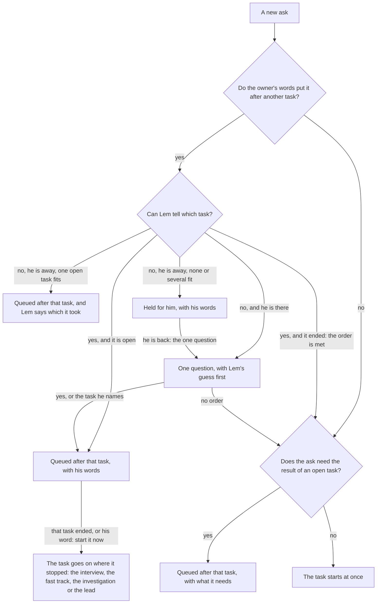

# A task order in the owner's words stays

careful: yes, because task 1 edits the rule of who decides the order of the owner's tasks, which reaches the owner's topic "A decision that is the owner's is taken without him, or one taken for him is missing from the pull request he reads": a wrong sentence there lets a lead remove his order again, or holds a task that he wanted started.

## Acceptance criteria

Size: full, because the rule has two readers, the task's session and the lead, and the change is careful.

1. A task that the owner's words put after another task waits for that task:
   1. The task `one-lem-parallel-landings` is open.
   2. The owner types `/lem After one-lem-parallel-landings: unit cases for the functions that are pure today`.
   3. Lem's first line for the new task, `tests-at-the-unit-level`, says that it waits for `one-lem-parallel-landings`, as he said, and that "start tests-at-the-unit-level now" starts it before that.
   4. The task is `queued`, with his words and the line `after: one-lem-parallel-landings`, and no lead starts.
   5. When `one-lem-parallel-landings` is landed or answered, the task's session opens and the task starts.
   6. When `one-lem-parallel-landings` is dropped, the task starts too, and its first state on the board says that it starts without the result of `one-lem-parallel-landings`, which was dropped.
2. Only the owner's word removes his order. An agent that sees no need for the order keeps it, and says so where the owner sees it:
   1. The task `tests-at-the-unit-level` waits after `one-lem-parallel-landings`, by his words.
   2. An agent of the task finds that the task needs no code of `one-lem-parallel-landings`.
   3. The task still waits. Its state on the board says that the agent sees no need for the order, why, and that "start tests-at-the-unit-level now" starts it. The agent's report says the same.
   4. The owner says "start tests-at-the-unit-level now". His words go into the task's record, the order is removed, and the task starts.
3. A lead that finds his order in the ask of a task that already started queues the task, before it writes a plan or any code:
   1. The ask of `tests-at-the-unit-level` begins "After one-lem-parallel-landings:", and its lead started all the same.
   2. `one-lem-parallel-landings` is still open.
   3. The lead writes no plan and no code. The task is `queued` with the line `after: one-lem-parallel-landings`, and its state on the board says that it waits by his words, with his words: `the owner's order: "After one-lem-parallel-landings"`. Its report names his words.
4. Without such an order nothing new waits, and Lem never starts a task against an order that it cannot read. The words that make a task wait are those that put the whole task after another task, named by its name or in the owner's own words; capital letters and a colon do not matter ("After one-lem-parallel-landings: ...", "when the parallel landings task lands, ..."). `/lem after a refund the invoice shows 0` starts at once: its "after" orders no tasks. `/lem the card of tests-at-the-unit-level cuts its title` starts at once: it only names a task. `/lem After picker-test-holds-at-a-minute-edge: the picker shows seconds` starts at once: that task is landed, so his order is met. `/lem After one-lem-paralel-landings: unit cases` names no task, by a typo: Lem asks once, in one line with its guess first: "Queue this after one-lem-parallel-landings, after another task (name it), or no order?". While he is away it asks nothing: when exactly one open task fits his words, the task is queued after that one, and its first line and its state say which task Lem took; when none fits, or more than one, the task is held for him with his words, shows in the list of what waits for him, and nothing of it starts.

## How it works

A task waits for another task by the owner's order or by its own need, and starts at once in every other case. An order that Lem cannot read never starts the task.

A queued task goes on where it stopped, not at the build: a task queued at step 7 of "The request"
has not started its path yet, so it takes step 8, the path its queued block names; a task that its
lead queued takes the start of the build.

## What is there today

Read in the code at `7971845`:

- `skills/lem/stages/new.md`, "The request", step 7, opens with "Only when the later ask needs what the
  earlier one changes". An ask that begins "After X:" and needs nothing of X starts at once.
- `skills/lem/stages/plan.md`, before its step 1, has a lead queue its task only "when the code you
  read shows that this task builds on what another task changes". `skills/lem/prompts/lead.md`, step
  3, says the same in one sentence.
- A `queued` block is free lines plus `after: SLUG`. Three scripts read the `after:` line and nothing
  else of the block: `cmd_may_start` in `project.py`, `queued_behind` in `session.py`, and
  `needs_task` and `after_ended` in `lem_board_model.py`. The board's server opens the task's session
  when the named task is landed, answered or dropped (`serve.py`). None of that changes.
- The refusal of `lem project may-start` for a queued task ends "when it no longer needs that, write
  its state `queued` again without the `after:` line". It is the one text that tells an agent how to
  remove a wait, and it knows no order of the owner's.
- The board says "Waits for the task it needs" on the large card (`now_head`) and "Queued: it waits
  for the task it needs" in the timeline (`lem_board_model.py`). For an order of the owner's the task
  needs nothing of the other one.
- A queued task resumes at the build. `prompts/session.md`, "What comes next" and its wake-up
  paragraph, send a `queued` task whose `after:` task ended to `stages/start.md`, and `phase_of` in
  `session.py` gives `queued` the phase `build`. That fits a task its lead queued. A task queued at
  step 7 of "The request" has not taken step 8 yet: on the interview's path its lead would start with
  no interview, and at the interview's end `lem session next` would refuse, since the phase did not
  change (`cmd_next`). The fast track writes no state block and no brief before its own steps, so
  nothing in the files names its path (`stages/new.md`, step 4). An investigation already carries its
  path, the line `investigation: bug` (`stages/investigate.md`, step 1).
- `skills/lem/stages/new.md`, step 5, the first line, comes before step 7: a task that waits is told
  "Nothing waits for you" on the fast track. `stages/correct.md`, `standard-track`, writes `held`
  over a task, which drops its `after:` line.
- `skills/lem/SKILL.md`, the status table: `queued` means "it needs the result of the task its
  `after:` line names". `docs/flow.md`, "Many tasks at once": "A request that needs the result of
  another task waits".
- `AGENTS.md` records the rule as a decision of the maintaining session: "An ask waits for another
  task only when it needs that task's result" (2026-11-17).

## Tasks

1. **The rule, in the texts an agent follows.** Serves criteria 1, 2, 3 and 4. Files:
   `skills/lem/stages/new.md`, `skills/lem/prompts/session.md`, `skills/lem/stages/plan.md`,
   `skills/lem/prompts/lead.md`, `skills/lem/stages/start.md`, `skills/lem/stages/correct.md`,
   `skills/lem/SKILL.md`.
   - `new.md`, step 1: in the same look as the track and the type, the session reads whether the
     owner's words put the whole task after another task ("after X", "when X lands", "once X is
     merged"), whether or not it needs anything of X. The task is named by its name or in his own
     words, and capital letters and a colon do not matter. The order is an order of tasks: X is a
     task `lem project tasks` lists. Words with "after" that order no tasks ("after a refund the
     invoice shows 0") are no order. A task that has ended meets his order already: the order adds
     no wait, and the need of step 7 is still read, as for an ask with no order. When the session
     cannot tell which task his words name (a typo, words that fit no task or more than one), it
     never starts the task against the order: the order is a read of step 1's one question, in one line
     with its guess first and its three answers named ("Queue this after SLUG, after another task (name
     it), or no order?"), so that no answer has two readings. When the track, the type or careful is
     unclear too, the one line holds that guess beside it, and the order keeps its three answers ("Fast
     track, and queued after SLUG, after another task (name it), or no order?"). His yes queues it after
     SLUG; a task he names queues it after that task; his "no order" is his word that no order holds,
     logged with `lem decisions log SLUG --by owner --words`, and the need of step 7 is still read. An
     answer that still names no task Lem can tell holds the task for him, as below, with his words
     (decision 10 of the record, design choice B).
     While he is away it asks nothing: when exactly one open task fits his words, it queues the task
     after that one, says in its first line and in the state which task it took, and logs the read
     (`lem decisions log SLUG --by lem`); when none fits, or more than one, it writes the state
     `held` with the first line `the order waits for the owner: "HIS WORDS"`, which puts the task
     into the list of what waits for him, and starts nothing.
   - `new.md`, step 5: the first line of a task that waits by his order says so on every track, in
     place of "Nothing waits for you" on the fast track: that it waits for X, as he said, and that
     "start SLUG now" starts it before that.
   - `new.md`, step 7: a task waits in two cases. The one of today, word for word in its meaning:
     the ask needs what the earlier task changes. The new one: the order that step 1 read. The
     session then writes `queued` with the first line `the owner's order: "HIS WORDS"`, his words as
     he typed them on one line (a line break becomes a space), and `after: SLUG`. Every `queued`
     block of this step, of an order or of a need, also carries one line `then: PATH`, the path that
     step 8 would take: `then: the interview`, `then: the fast track` or `then: the lead`; the
     investigation keeps its line `investigation: bug` or `investigation: question`. The sentences on
     two asks that only name the same thing, and on not reading the code for an overlap, stay.
   - `prompts/session.md`, "What comes next" and the wake-up paragraph: a `queued` task whose wait
     ended (its `after:` task ended, or its block has no `after:` line) goes on where it stopped. A
     task no lead started (no block of its state has a `lead:` line) takes step 8 of "The request"
     in `stages/new.md`, by its `then:` or `investigation:` line; a task its lead queued takes
     `stages/start.md`. Before step 8 it does three things (the issues the plan talk raised, design
     choice A). It reads step 7's need again, and the need only, since the order ended with its task
     or his word: a need for another open task queues it again behind that task, before a scout or
     an investigator reads the code. On `then: the interview` it writes the first block of step 4
     again, `held` with `the interview waits for the owner` and the type line, so that the interview
     finds the block it expects and the board and "Waits for you" show it. On `then: the fast
     track`, whose criterion and brief were written before step 7 ("The fast track", step 2), it
     takes `stages/start.md`, which starts its one builder, and never the fast track's step 1 or step
     7 again. When the task of its `after:` line was dropped, the first state block it
     writes says so in one line: it starts without the result of that task, which was dropped. A
     task `held` with `the order waits for the owner` takes step 1 of "The request" for its one
     question while he is there, and waits for him while he is away; at his back it asks it.
   - `plan.md`, before step 1: an order that the owner gave stays. A lead whose task holds his order
     (the first line of its `queued` block, or his words in the ask of `task.md`) never removes it,
     also when the code shows that the task needs nothing of the other one, unless his own record
     removed it (a decision `--by owner` on the order in `lem decisions list SLUG`, decision 2
     below). It writes the `queued` block again with one more line, that it sees no need for the
     order, why, and that "start SLUG now" starts the task, so that the board shows it while the
     task waits; its report says the same. A lead that finds his order in the ask of a task that
     started all the same, while the task he named has not ended, writes no plan and no code and
     queues the task as the paragraph above it does, with `the owner's order: "HIS WORDS"` as the
     first line, and names his words in its report.
   - `prompts/lead.md`, step 3: the one sentence on a queue names both cases.
   - `start.md`, step 1: one clause, that a task which stays `queued` by the owner's order stays so
     until that task ends or his word removes the order. "`/lem build`": one paragraph for his
     "start SLUG now" on a task queued by his order, in any session. It logs his words (`lem
     decisions log SLUG --by owner --words`) and writes the `queued` block again with its lines but
     the `after:` line, and the line `the owner's order was removed: "HIS WORDS"`. Typed in the
     task's own session, that session goes on as `prompts/session.md` says for a queued task whose
     wait ended; typed elsewhere, `lem session open SLUG --why owner --focus` takes him there, as for
     a planned task.
   - `correct.md`, `standard-track`: a task that is `queued` stays queued. The correction changes
     only the path its wait ends in: write the `queued` block again with each of its lines, and
     `then: the interview` in place of `then: the fast track`, and write the lead's brief of step 6
     of "The request" over the fast track's, as the correction does today. The interview starts when
     the wait ends.
   - `SKILL.md`: the row `queued` of the status table, it needs the result of the task its `after:`
     line names, or the owner's words put it after that task; and the row `build [<task>]` of the
     subcommands, his "start SLUG now" for a task queued by his order (`stages/start.md`,
     "`/lem build`").
   The commit says which task showed the need: `tests-at-the-unit-level`, 2026-11-20.
2. **What Lem prints, and the phase of a queued task.** Serves criterion 1, its step 5, and
   criterion 2, its last step. Files: `skills/lem/scripts/project.py`,
   `skills/lem/scripts/lem_board_model.py`, `skills/lem/scripts/session.py`, `skills/lem/scripts/serve.py`, and their tests in
   `tests/unit/` (or the may-start checks of `tests/lem-settings.sh`, where the builder finds that
   the rule needs a repository).
   - `phase_of` in `session.py`: a `queued` task that no lead started (no block of its state has a
     `lead:` line, the form `LEAD_LINE` in `project.py` reads) is in the phase `shape`, since its
     session takes step 8 of "The request"; one that its lead queued stays in `build`. Its caller
     gives it the task's whole state. One unit case for each.
   - `duties` in `serve.py`: a `queued` task whose `after:` task ended and whose session still lives
     (`live_of`) gets `wake SLUG --why queue`, once, when no session was woken or opened since its
     queued block (`run_start`), where today it gets nothing until that session closes. It prevents
     a task that stays queued after its wait ended; the input is a session the owner keeps selected,
     so that `lem session close --when-unselected` never closes it, while the task it waits for
     ends; that is realistic, since the ask is typed in that session and it opens with focus;
     without it the task starts only when he selects another session. It sits on the duty's rule
     "no live session" (`open … queue`), which rests on existing code; the wake-up's route is there
     already (`prompts/session.md`, `lem: SLUG queue`; `WAKES` in `session.py`). One unit case.
   - `cmd_close` in `session.py`, with `--when-unselected`: it ends with no close, and says so, when
     the event log holds a `session.wake` of that session newer than the close's own start, since
     a woken session has work again; the next close is the one its next change of phase or its end
     runs. Without it the step-7 close that still waits ends the woken session mid-work once the
     owner selects another session (the plan talk's question 6). One check in the block that holds
     `lem session close`, with a stand-in for agtermctl (`tests/lem-session.sh`). This is the pick
     of design choice C (decision 9 of the record, by the gate).
   - The refusal of `lem project may-start` for a task queued after one that has not ended names both
     ways out: a task that waited because it needed the other one's result and no longer does has its
     state `queued` written again without the `after:` line; an order of the owner's (the block's
     first line says `the owner's order`) is removed by his word only, with his words logged first
     (`lem decisions log SLUG --by owner --words ...`). The script reads no line for it and refuses as
     today. The comments on `queued` in `project.py` (the usage text, the list of states, the comment
     over the check) say both cases.
   - The board's two texts for a queued task with an `after:` line say "Waits for another task" and
     "Queued: it waits for another task", which is true in both cases. One unit case holds each text.
3. **The documents.** Serves no criterion. Files: `docs/flow.md`, `AGENTS.md`.
   - `docs/flow.md`, "Many tasks at once", in its STE: a request that you put after another task in
     your words waits for that task too.
   - `AGENTS.md`: under "His rulings of 2026-11-20 and 2026-11-21", one ruling, "A task order in his
     words stays" (2026-11-21): his yes to the retro's proposal, given as "im dnd, go alone -
     register tasks via /lem"; the case of `tests-at-the-unit-level` on 2026-11-20, with his "it
     waits" as the retro carried it; the form as the session's (the first line of the `queued` block,
     no script that reads an ask). It names what it replaces: the word "only" in the maintaining
     session's decision "An ask waits for another task only when it needs that task's result"
     (2026-11-17), whose other half stays (two asks that only name the same file each start at once).

Tasks 1 and 2 share no file and run at the same time. Task 3 comes after both.

## Plan talk

Who argued the plan: the reviewer, Codex, GPT 6.2 Sol at high effort, as its pane's status line
showed it; the defender, Claude, Opus 5.5 at high effort, as the `defender:` line of the task's
state gives it. Two families. 7 turns over 8 questions, within the bound of 34. Agreement carries no
authority: the review before the pull request reads each settled position as a claim.

The list, numbered as the reviewer gave it:

1. **Where does the task resume after its wait?** A task queued at step 7 of "The request" resumed
   at the build (`prompts/session.md`, "What comes next"; `phase_of` in `session.py`), so on the
   interview's path a lead started with no interview. Repaired at the cause (Decision 7): it goes on
   at step 8 by a line `then: PATH`, in the phase `shape`. It held on the repair's own text: the
   interview assumes the `held` block of step 4 (`stages/interview.md`, its first paragraph), so the
   board shows `queued` through the interview and "Waits for you" has no row
   (`lem_board_model.py`, `settle`, `waits_of`). A design choice, design choice A below. The
   defender added one issue to its facts: on `then: the fast track` the route passes "The fast
   track" step 1 again, where `lem criteria approve --small` refuses a second approval.
2. **What carries "start SLUG now" through to work?** Repaired: Decision 2 names the route, the
   `/lem build` row of `SKILL.md` and its section of `stages/start.md`, and the lead keeps his
   release record. It held: from another session, `cmd_open` selects a live session and returns
   `already: true` with no wake (refuted: `stages/start.md`, "`/lem build`", already tells him to
   type in that session); and "The fast track" step 2 ends "Then step 7 of The request", so a resumed
   fast-track task reads step 7 again, and only the lead knows his release (not refuted). The same
   decision as 1: design choice A.
3. **When does Lem check a separate need?** Repaired: an order that is met falls to the need check
   (the chart). It held: after the wait the route goes straight to step 8. Refuted with
   `stages/plan.md`'s opening and "The fast track" step 2, which read the need again; it held a
   second time: an interview's scout and an investigation run before either check, so a question
   ("After X: what does the new duty of Y do ...") can end `answered` from the old code while Y is
   open (`stages/investigate.md`, steps 1 and 4). The same decision as 1: design choice A.
4. **How does Lem resolve a held order?** Repaired: the hold has the fixed first line `the order
   waits for the owner`, which `prompts/session.md` routes, and his "n" is his word that no order
   holds. It held: a bare "n" to "Queue this after X?" also means "not that task", which then starts
   the task against Decision 3. A design choice, design choice B.
5. **How does step 7 affect the first line and the one question?** Repaired at the cause (Decision
   8): the order is read in step 1, the first line says the wait on every track, and one line holds
   both guesses. It held: "Fast track, and queued after SLUG? (y/n)" mixes two choices, and its "n"
   reads as in 4. The same decision as 4: design choice B.
6. **What starts the task while its queued session stays selected?** Refuted first: the close
   `--when-unselected` and the duty `open … queue` start it once he leaves the session. It held:
   criterion 1 asks for the start when the predecessor ends. Repaired, a layer over the duty's rule
   "no live session" (existing code): the server wakes a live session once. It held a second time:
   the wake resumes the session while its background close still waits, and `cmd_close` closes it
   once it is not selected and reads no state (checked by the defender in `session.py`), so the
   resumed build is closed mid-work. A design choice, design choice C.
7. **What keeps the order when the owner changes only the track?** Repaired at the cause: the
   correction keeps the task queued and changes only its `then:` line. It held: the fast track's
   brief (`prompts/small.md`) stays, and the build after the interview reads `brief.md` as the lead's
   (`prompts/session.md`, "The build"; `stages/correct.md`, `standard-track`, writes the lead's brief).
   The same decision as 1: design choice A.
8. **A two-line order in a one-line state line.** Repaired: a line break becomes a space (Decision
   1). Closed. Settled by the two, not checked by the review.

The design choices, each decided by the ladder after the talk (the decisions log has each):

- **A. Decision 7, where a queued task goes on** (questions 1, 2, 3, 7). The kept decision: a queued
  task resumes at the build (`prompts/session.md`, `phase_of`), which fits a lead's queue and skips
  the interview of a task queued at step 7. The changed one: it goes on at step 8 by its `then:`
  line in the phase `shape`, with the issues raised against it: the stale `queued` block through the
  interview, the second pass through "The fast track" steps 1 and 2 and step 7, the correction's
  fast-track brief, and a scout or an investigation that runs before any need check. The gate's
  judge added a third option: the shape runs at once and only the build waits. Decided: the changed
  decision with its issues fixed in the route's text, decision 11, by the lead, unsettled (gate held;
  personas both for the third option; the dialectic confirmed a break of it; the experts split).
- **B. The one question and its "n"** (questions 4, 5). The plan: his "n" is his word that no order
  holds, and one line holds every unclear read. Against it: a bare "n" is ambiguous, so it starts a
  task he may have wanted queued after another task. Decided: a question that names its three
  answers (this task, another task by name, no order), decision 10, by the dialectic, with the
  change of criterion 4's example recorded (gate held; personas both for it; no break).
- **C. The queue duty for a live session** (question 6). The kept rule: no live session, so the task
  starts when he leaves its session. The layer: a wake of the live session, which the pending close
  then ends mid-work. Decided: the wake, and a close that gives up on a session woken after it
  started, decision 9, by the gate (checkable: criterion 1, step 5, and the server's ruling in
  `AGENTS.md`).

Each mechanism a repair added: the `then:` line and the phase `shape` of a queued task (on Decision
7, at the cause, held); the release route through `/lem build` (on Decision 2, held); the fixed line
`the order waits for the owner` (on Decision 3, held); the read of the order in step 1 (Decision 8,
at the cause, held); the wake of a live queued session (a layer over the duty's rule "no live
session" in `serve.py`, held); the queued block that a correction keeps (on Decision 7, at the
cause, held).

Raised after the first turn, not argued: none. Additions refused as unpriced: none.

What changed in the plan, by question and by task: the chart and "What is there today" (1, 3, 4,
5); Task 1 rewritten: the order read in step 1 and the first line of step 5 (5), the `then:` line
and one-line words of step 7 (1, 8), the route of `prompts/session.md` and the drop note there (1,
4), the release in `plan.md`, `start.md` and `SKILL.md` (2), the correction in `correct.md` (7);
Task 2: `phase_of` (1) and the server's wake of a live queued session (6); Decisions 1, 2 and 3
widened, 7 and 8 new.

## Decisions

1. **How a reader tells his order from a need: the first line of the `queued` block.** `the owner's
   order: "HIS WORDS"`, where a need has what the task needs from the other one. It assumes that a
   free line is enough, and it rests on `lem project state`, which takes any first line, and on the
   three scripts above, which read only `after:`. No new fixed form of a state line and no script
   that reads it: no act of Lem's does harm without one, since the agent that would remove the line
   reads the block first. His words go on one line: `lem project state` takes one argument for each
   line, so a line break in his words becomes a space.
2. **His word removes his order, and nothing else does.** The agent that hears "start X now" logs his
   words (`lem decisions log X --by owner --words`), writes the state `queued` again without the
   `after:` line and with `the owner's order was removed: "HIS WORDS"`, and the task goes on as any
   queued task whose wait ended. It is the way a wait is removed today, with his word as its one
   condition. His words reach that agent through the `/lem build` row of `SKILL.md` and its section
   of `stages/start.md`, which already take a waiting task to its session at his word: no new
   command of his. A lead reads his record before the ask, so the words in `task.md` do not bring
   the order back.
3. **An order that Lem cannot read never starts the task** (decision 7 of the task's record, which
   no level of the ladder settled; the lead's pick stands). A task that ended meets an order. For
   words that name no task Lem can tell, the session asks once with its guess; while the owner is
   away it queues the task after the one open task that fits, or holds it for him when none or
   several fit, with the fixed first line `the order waits for the owner`, which `prompts/session.md`
   routes to that one question, also in a fresh session. The question names its three answers (this
   task, another task by name, no order), so a bare "n" has no reading to take (design choice B).
   The plan's first form started such a task while he is away; the dialectic found that this removes
   his order without his word.
4. **The board's two texts lose "it needs".** "Another task" is true for a need and for an order, so
   the board needs no read of the block's first line.
5. **No script reads an ask for an order** (decision 3 of the task's record, taken before the lead).
7. **A queued task goes on where it stopped.** A task queued at step 7 of "The request" takes step
   8, by the line `then: PATH` its block carries, and its session is in the shape (`phase_of`); a
   task its lead queued takes the start of the build, as today. It rests on the existing text: the
   investigation already carries its path in its queued block (`stages/investigate.md`, step 1),
   and `cmd_next` already needs a change of phase at the interview's end. The same holds for a task
   queued by a need, which met the same route before this plan; the plan widens that route's use,
   since an order comes on any ask. `then:` is a free line, read by the agent: no script reads it.
   The note of a start after a drop goes with the route, since an investigation and an interview
   never reach step 3 of `stages/start.md`. This is design choice A of the plan talk, decision 11 of
   the record: no level of the ladder settled it, so the lead's pick stands, the plan as the talk
   left it, with the route's own issues fixed in its text (the need read again before step 8, step
   4's block written again for the interview, the fast track resumed at its builder, the lead's
   brief in the correction). The personas and one expert (Fable) wanted the interview to run at once
   and only the build to wait; the dialectic confirmed a break of that option (the owner's yes went
   to a proposal that queues at step 7), and the other expert (Astra) picked this one. The pull
   request is not green for it.
8. **The order is read with the track and the type** (step 1 of "The request"), so that the first
   line can say the wait and the one question holds every unclear read at once.
6. **Criteria 1 to 3 are as the personas expected them** (decisions 4, 5 and 6 of the record, by the
   dialectic, which found no break): the words that start a waiting task early stand in Lem's first
   line and in the state; a start after a drop says so; what an agent has to say about an order goes
   into the state the board shows, and into its report.

The owner was away for the criteria. Lem approved them without him, so the pull request is not green.

## Not verified

- No task ran step 7 with an order of the owner's: a stage file's test is a real task, and the
  sessions of this machine read the installed plugin, which gets the text with the next release.
- Whether a session reads "when X lands" in the middle of a long ask as an order. The text gives it
  three examples and the one question; nothing measures the read.
