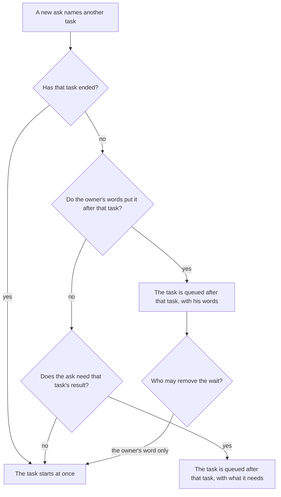

# A task order in the owner's words stays

careful: yes, because task 1 edits the rule of who decides the order of the owner's tasks, which reaches the owner's topic "A decision that is the owner's is taken without him, or one taken for him is missing from the pull request he reads": a wrong sentence there lets a lead remove his order again, or holds a task that he wanted started.

## Acceptance criteria

Size: full, because the rule has two readers, the task's session and the lead, and the change is careful.

1. A task that the owner's words put after another task waits for that task:
   1. The task `one-lem-parallel-landings` is open.
   2. The owner types `/lem After one-lem-parallel-landings: unit cases for the functions that are pure today`.
   3. Lem's first line for the new task, `tests-at-the-unit-level`, says that it waits for `one-lem-parallel-landings`, as he said.
   4. The task is `queued`, with his words and the line `after: one-lem-parallel-landings`, and no lead starts.
   5. When `one-lem-parallel-landings` is landed, answered or dropped, the task's session opens and the task starts.
2. Only the owner's word removes his order. An agent that sees no need for the order keeps it, and says so in its report:
   1. The task `tests-at-the-unit-level` waits after `one-lem-parallel-landings`, by his words.
   2. An agent of the task finds that the task needs no code of `one-lem-parallel-landings`.
   3. The task still waits, and the agent's report says that it sees no need for the order, and why.
   4. The owner says "start tests-at-the-unit-level now". His words go into the task's record, the order is removed, and the task starts.
3. A lead that finds his order in the ask of a task that already started queues the task:
   1. The ask of `tests-at-the-unit-level` begins "After one-lem-parallel-landings:", and its lead started all the same.
   2. `one-lem-parallel-landings` is still open.
   3. The lead writes no plan. The task is `queued` with his words and `after: one-lem-parallel-landings`, and its report names his words.
4. Without such an order nothing new waits. `/lem after a refund the invoice shows 0` starts at once: its "after" orders no tasks. `/lem the card of tests-at-the-unit-level cuts its title` starts at once: it only names a task. `/lem After picker-test-holds-at-a-minute-edge: the picker shows seconds` starts at once: that task is landed, so his order is met.

## How it works

A task waits for another task in two cases, and starts at once in every other.

## What is there today

Read in the code at `7971845`:

- `skills/lem/stages/new.md`, "The request", step 7, opens with "Only when the later ask needs what the
  earlier one changes". An ask that begins "After X:" and needs nothing of X starts at once.
- `skills/lem/stages/plan.md`, before its step 1, has a lead queue its task only "when the code you
  read shows that this task builds on what another task changes". `skills/lem/prompts/lead.md`, step
  3, says the same in one sentence.
- A `queued` block is free lines plus `after: SLUG`. Three scripts read the `after:` line and nothing
  else of the block: `cmd_may_start` in `project.py`, `queued_behind` in `session.py`, and
  `needs_task` and `after_ended` in `lem_board_model.py`. The board's server opens the task's session
  when the named task is landed, answered or dropped (`serve.py`). None of that changes.
- The refusal of `lem project may-start` for a queued task ends "when it no longer needs that, write
  its state `queued` again without the `after:` line". It is the one text that tells an agent how to
  remove a wait, and it knows no order of the owner's.
- The board says "Waits for the task it needs" on the large card (`now_head`) and "Queued: it waits
  for the task it needs" in the timeline (`lem_board_model.py`). For an order of the owner's the task
  needs nothing of the other one.
- `skills/lem/SKILL.md`, the status table: `queued` means "it needs the result of the task its
  `after:` line names". `docs/flow.md`, "Many tasks at once": "A request that needs the result of
  another task waits".
- `AGENTS.md` records the rule as a decision of the maintaining session: "An ask waits for another
  task only when it needs that task's result" (2026-11-17).

## Tasks

1. **The rule, in the texts an agent follows.** Serves criteria 1, 2, 3 and 4. Files:
   `skills/lem/stages/new.md`, `skills/lem/stages/plan.md`, `skills/lem/prompts/lead.md`,
   `skills/lem/stages/start.md`, `skills/lem/SKILL.md`.
   - `new.md`, step 7: a task waits in two cases. The one of today, word for word in its meaning: the
     ask needs what the earlier task changes. The new one: the owner's words put the task after
     another task ("after X", "when X lands", "once X is merged"), whether or not it needs anything
     of X. The session then writes `queued` with the first line `the owner's order: "HIS WORDS"`, his
     words as he typed them, and `after: SLUG`; and it tells him in one line that the task waits for
     X, as he said. The order is an order of tasks: X is a task `lem project tasks` lists. A task that
     has ended meets his order already, and the new task starts. Words with "after" that order no
     tasks ("after a refund the invoice shows 0") are no order. When the session cannot tell which
     task his words name, that is the unclear read of step 1: its one question, in one line with the
     guess first; while he is away it asks nothing, starts the task, and says in its first line that
     it found no open task for his words. Only his word removes his order (decision 2 below says
     how). The sentences on two asks that only name the same thing, and on not reading the code for
     an overlap, stay.
   - `plan.md`, before step 1: an order that the owner gave stays. A lead whose task holds his order
     (the first line of its `queued` block, or his words in the ask of `task.md`) never removes it,
     also when the code shows that the task needs nothing of the other one: it says in its report
     that it sees no need for the order, and why. A lead that finds his order in the ask of a task
     that started all the same, while the task he named has not ended, writes no plan and queues the
     task as the paragraph above it does, with `the owner's order: "HIS WORDS"` as the first line.
   - `prompts/lead.md`, step 3: the one sentence on a queue names both cases.
   - `start.md`, step 1: one clause, that a task which stays `queued` by the owner's order stays so
     until that task ends or his word removes the order.
   - `SKILL.md`, the row `queued` of the status table: it needs the result of the task its `after:`
     line names, or the owner's words put it after that task.
   The commit says which task showed the need: `tests-at-the-unit-level`, 2026-11-20.
2. **What Lem prints says the same.** Serves criterion 2, its last step. Files:
   `skills/lem/scripts/project.py`, `skills/lem/scripts/lem_board_model.py`, and their tests in
   `tests/unit/` (or the may-start checks of `tests/lem-settings.sh`, where the builder finds that
   the rule needs a repository).
   - The refusal of `lem project may-start` for a task queued after one that has not ended names both
     ways out: a task that waited because it needed the other one's result and no longer does has its
     state `queued` written again without the `after:` line; an order of the owner's (the block's
     first line says `the owner's order`) is removed by his word only, with his words logged first
     (`lem decisions log SLUG --by owner --words ...`). The script reads no line for it and refuses as
     today. The comments on `queued` in `project.py` (the usage text, the list of states, the comment
     over the check) say both cases.
   - The board's two texts for a queued task with an `after:` line say "Waits for another task" and
     "Queued: it waits for another task", which is true in both cases. One unit case holds each text.
3. **The documents.** Serves no criterion. Files: `docs/flow.md`, `AGENTS.md`.
   - `docs/flow.md`, "Many tasks at once", in its STE: a request that you put after another task in
     your words waits for that task too.
   - `AGENTS.md`: under "His rulings of 2026-11-20 and 2026-11-21", one ruling, "A task order in his
     words stays" (2026-11-21): his yes to the retro's proposal, given as "im dnd, go alone -
     register tasks via /lem"; the case of `tests-at-the-unit-level` on 2026-11-20, with his "it
     waits" as the retro carried it; the form as the session's (the first line of the `queued` block,
     no script that reads an ask). It names what it replaces: the word "only" in the maintaining
     session's decision "An ask waits for another task only when it needs that task's result"
     (2026-11-17), whose other half stays (two asks that only name the same file each start at once).

Tasks 1 and 2 share no file and run at the same time. Task 3 comes after both.

## Decisions

1. **How a reader tells his order from a need: the first line of the `queued` block.** `the owner's
   order: "HIS WORDS"`, where a need has what the task needs from the other one. It assumes that a
   free line is enough, and it rests on `lem project state`, which takes any first line, and on the
   three scripts above, which read only `after:`. No new fixed form of a state line and no script
   that reads it: no act of Lem's does harm without one, since the agent that would remove the line
   reads the block first.
2. **His word removes his order, and nothing else does.** The agent that hears "start X now" logs his
   words (`lem decisions log X --by owner --words`), writes the state `queued` again without the
   `after:` line, and the task starts as any queued task whose wait ended. It is the way a wait is
   removed today, with his word as its one condition. No new command of his.
3. **An order names a task Lem has.** A task that ended meets it. Words that name no task Lem can
   tell take the one question of step 1 of "The request"; while he is away the task starts and Lem's
   first line says why. It assumes that a start he can park costs him less than a task that waits for
   nothing; `/lem park` and `/lem drop` undo it.
4. **The board's two texts lose "it needs".** "Another task" is true for a need and for an order, so
   the board needs no read of the block's first line.
5. **No script reads an ask for an order** (decision 3 of the task's record, taken before the lead).

## Not verified

- No task ran step 7 with an order of the owner's: a stage file's test is a real task, and the
  sessions of this machine read the installed plugin, which gets the text with the next release.
- Whether a session reads "when X lands" in the middle of a long ask as an order. The text gives it
  three examples and the one question; nothing measures the read.
