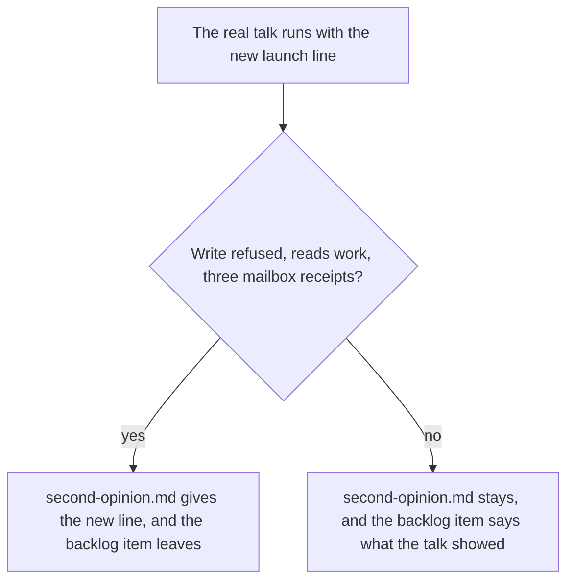

# The plan talk's Codex reviewer can read and cannot write

careful: yes, because the change sets what the plan talk's reviewer may write, which reaches the owner's topic "A builder or a lead works outside its brief: it edits the main checkout, another task's worktree or a branch it does not own": the reviewer's pane stands in the main checkout, and a wrong launch line leaves it free to edit there or stops the talk.

## Acceptance criteria

Size: full, because the change is careful and rests on one real talk in agterm before any file changes.

1. A plan talk's Codex reviewer reads the repository and cannot change a file of it:
   1. A talk opens in a throwaway repository on this Mac, with the owner's own Codex settings and the reviewer `codex/gpt-6.2-sol:high`.
   2. The reviewer reads `plan.md` and runs `git log` there.
   3. The reviewer tries to write a line into `plan.md`.
   4. Codex refuses the write, and `git status` in the repository shows no change.
   - no test: one real talk in agterm shows it; its screens and `git status` go into the builder's report, since no suite starts agterm and Codex
2. The reviewer still answers through the mailbox:
   1. In the same talk, the reviewer writes its answer to its reply file, `/tmp/mailbox-chat-<pane>.txt`, outside the repository.
   2. It sends the file with `mailbox-chat.py say --file`, and the send prints `sent`.
   3. The answer reaches the defender's pane.
   - no test: the same real talk shows it, with the three receipts in the builder's report
3. `skills/lem/harness/claude-code/second-opinion.md` gives the launch line that the talk showed, and only that one: its Codex line starts Codex with the seat's model and effort and a permission profile that reads everything and writes only the reply file. The profile is only on the launch line: Lem writes no file in the developer's Codex settings and none in the repository. When the talk did not show criteria 1 and 2, the harness file stays as it is, the backlog item in Lem's own `docs/backlog/` says what the talk showed, and the pull request says that the reviewer can still write.
   - no test: a sentence of the harness file

## How it works

## Tasks

1. **The real talk.** In a throwaway git repository under the task directory, open a pair in agterm:
   a Claude Code agent as the defender in one pane, and the Codex reviewer in the other, started
   with the new launch line (decisions 1 to 4 and 6) and `skills/lem/prompts/reviewer.md` as its first
   prompt. The defender sends a short plan with one wrong path through the mailbox and asks the
   reviewer to read it, run `git log`, and to try to fix the path itself in the file; after the
   refusal, to ask for approval of the same write. Record the
   reviewer's screen, `git status`, the reply file's write, the `sent` receipt and the defender's
   receipt, that no approval request reached anyone (decision 6), the allow rules of
   `~/.codex/rules/` at the time of the run, and the model and effort the reviewer's status line
   shows. Close every session and
   pane the task opened. Serves criteria 1 and 2. Touches no file of the repository; its record
   goes into the task directory.
2. **The harness file, by what task 1 showed.** When task 1 showed criteria 1 and 2:
   `skills/lem/harness/claude-code/second-opinion.md`, step 2, gives the Codex line that ran, with
   one sentence on why it writes one file, its source and day (the talk of this task), and one on
   what the profile does not hold: a command that the developer's own Codex rules allow (an
   `allow` prefix rule in `~/.codex/rules/`) runs outside the sandbox, by Codex's design and by his
   word for every Codex session; `git rm` of
   `docs/backlog/the-plan-talks-codex-reviewer-starts-with-the-users-default-sandbox.md`. Otherwise:
   `second-opinion.md` stays, and the backlog item is rewritten with what the talk showed. Serves
   criterion 3.

## Decisions

1. **The permission profile goes on the launch line as `-c` overrides**, the item's first option: it
   changes no file of the user's. It rests on the ruling "Another program's settings stay where that
   program keeps them" and on the maintaining session's settlement in the backlog item (2026-11-22).
2. **The line keeps `-m "MODEL" -c "model_reasoning_effort=EFFORT"`.** The item's example leaves both
   out; the seat names them, and `second-opinion.md` reads them back from the status line.
3. **No `-C`.** The reviewer's brief says it works in the directory the message names, and the
   profile reads `:root`; the pane starts where it starts today.
4. **The writable path is the reply file of the Codex mailbox recipe**,
   `/tmp/mailbox-chat-<pane>.txt`, with the pane's id from `AGTERM_PANE_ID`, which the pane's own
   shell expands. Whether the profile must name `/tmp` or `/private/tmp` is what task 1 finds; the
   harness gets the form that ran. The line must run in the pane's login shell, which may be fish or
   zsh: no `${VAR:?}` form.
5. **A Claude Code reviewer seat is out of this task.** Its launch line has no read-only guard
   either, but the item names Codex, and Claude Code's guard needs its own probe. The polish pass
   files it as a backlog item.
6. **The line adds `-a never`.** The failure it prevents: the reviewer's write is refused, Codex
   asks for approval to run it with more permissions, and the request goes to the automatic
   reviewer, which may approve it, so the write lands in the main checkout. The input: a
   developer's configuration with `approvals_reviewer = "auto_review"` and a trusted repository,
   whose default asks on request; the owner's `~/.codex/config.toml` sets both today (its line 9,
   and lines 265–266 for Lem's checkout). Realistic here: yes, on the one machine the talk runs on.
   Without it, criterion 1 holds or fails by what the automatic reviewer decides, and the harness
   would publish a line that does not hold. It sits on decision 1, the profile on the launch line,
   which rests on the ruling and on the item's settlement; it reaches one flag of one line. With
   `never`, a refused command returns its failure to the model (`codex --help`, 0.169.0); a command
   an `allow` rule matches, such as the recipe's `mailbox-chat.py say --file`, asks no approval,
   and task 1's receipts show that the send still runs.

## What it will not verify

- The whole plan talk of Lem (`stages/talk.md`, its events and its record): task 1 runs the launch
  line, the reviewer's brief and the mailbox, which are what the change touches.
- Another Codex version than the installed `codex-cli 0.169.0`, and a reviewer started in a folder
  Codex does not trust yet: the trust question is the owner's (`second-opinion.md`, step 2).
- A command that the developer's own Codex rules allow, which runs outside the sandbox: on the
  owner's machine `git fetch` (it writes `.git/FETCH_HEAD`, which `git status` does not show),
  `pytest` and others in `~/.codex/rules/default.rules`. Those rules are his word for every Codex
  session, and the ruling "Another program's settings stay where that program keeps them" keeps
  Lem out of them; task 2's sentence says so.
