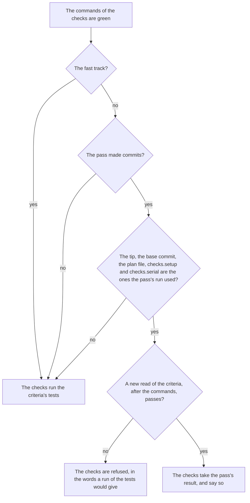

# The rules of nine pure functions at the unit level, and the criteria's tests once in a landing

careful: yes, because "A criterion's test is taken as its proof when it is not" is in reach: task 3 lets the checks take the polish pass's run of the criteria's tests in place of their own, and a wrong condition there counts a run on another tip or another contract as the proof.

## Acceptance criteria

Size: full, because two parts change: the tests of nine rules of `project.py` move to the unit level, and the landing's checks take the polish pass's result of the criteria's tests.

1. Each of the nine rules of `project.py` (`type_line`, `ticket_owed`, `braces`, `glob_regex`, `investigation_form`, `read_form`, `start_form`, `talk_start_form`, `talk_form`) is checked by unit cases that call the function: the line `type: fix` with no reason is refused with "names the type without its reason" by a call of `type_line`, with no `lem project` process.
2. A shell check of one of the nine rules leaves `tests/lem-settings.sh` only when a unit case holds the same rule, and each command that reads such a rule keeps one journey through the real command: the refusals of an investigation's record become unit cases, and the block keeps one `lem project log` of an investigation that is written and one that is refused with exit 1 and writes nothing.
3. When the checks start on the commit the polish pass ended on, they take the pass's result of the criteria's tests and run them no second time:
   1. The polish pass of a task commits one fix, and ends on commit `a1b2c3d`.
   2. `lem land polish SLUG --done` runs the criteria's tests: each passes on `a1b2c3d` and fails on the base commit.
   3. `lem land checks SLUG` starts on `a1b2c3d`, and its commands are green.
   4. The checks run no criteria's test, and their record says that they took the result of the polish pass at `a1b2c3d`.
   5. The pull request says that the criteria's tests were taken from the polish pass at `a1b2c3d`, and not run again.
4. The checks run the criteria's tests themselves in every other case: when a commit came after the one the pass ended on (a builder's repair of a failed check), when the pass made no commits, and on the fast track, which has no pass. A task whose pass ended on `a1b2c3d` and whose branch is now at `e4f5a6b` gets its criteria's tests run by the checks. A main branch that moved on while the branch stayed at `a1b2c3d` changes nothing: the base commit of the tests is the commit the branch started from, the same for the pass and the checks.
5. The polish pass keeps its own run of the criteria's tests and its own message: a commit of the pass that breaks a criterion's test is refused by `lem land polish SLUG --done` with "after the polish pass the tests of the criteria do not hold", as before this change.
6. The pull request of this task gives the checks, and the seconds of each suite it changed, on the base commit and on the branch.

## How it works

The checks decide where the result of the criteria's tests comes from.

## Tasks

1. **The rules of the task and of the log at the unit level.** Unit cases for `type_line`, `ticket_owed`, `investigation_form`, `read_form`, `start_form`, `talk_start_form` and `talk_form`, each a call of the function, in the unit file of `project.py` that holds a task's rules (`tests/unit/test_task.py`, or a file beside it when that one says it holds other things). Each refusal the shell checks of these rules hold today gets its case, with the words of its message. Then the shell checks in `tests/lem-settings.sh` that only test such a rule go, and each command keeps one journey: `lem project state` with one type line written and one refused, `lem project log` with one record of each form written and one refused with exit 1 and nothing appended, `lem project tasks` with what it gives of a type, a talk, an investigation and a ticket. A shell check that also holds a fact only the real command shows (the event log not growing, the exit status, `tasks` reading the newest record) keeps that fact in the journey. Serves criteria 1 and 2. Files: `tests/unit/test_task.py` (or its neighbor), `tests/lem-settings.sh`.
2. **The rule picker's two rules at the unit level.** Unit cases for `braces` and `glob_regex`: a brace inside a brace, a brace with no comma, `**` as a whole segment and inside a name, `*` and `?` inside one segment, a dot file, a class in brackets and its `!`. The rule picker's shell checks in `tests/lem-settings.sh` that only test a glob's match go; `lem project rules` keeps one journey through the real command, with a rule file found through a link and one in a subfolder, which only the file system shows. Serves criteria 1 and 2. Files: `tests/unit/test_settings.py` (or a unit file of the rules beside it), `tests/lem-settings.sh`.
3. **The checks take the polish pass's result.** One function of `criteria.py` gives the inputs of a run of the criteria's tests: the tip, the base commit (the merge-base of the tip and origin's base branch, as `cmd_red` takes it now), the plan file it reads (the path its read of the criteria gives as `plan`, which `paths.plans` and `paths.plan_file` choose), and `checks.setup` and `checks.serial` of the settings; `cmd_red` takes them from it and reports them whole in its result, and `lem criteria inputs SLUG` prints them without a run. `cmd_polish` keeps in the landing's record, with `after` and `commits`, the result of its run of `lem criteria red`. Before it takes that result, after the commands of the checks are green, `checks_body` reads the criteria again (`criteria_of`, not the read `checks_ready` made before the load wait), and a read that refuses refuses the checks, in the words a run of `lem criteria red` would give. A pure function of `land.py` decides, from the polish record, the inputs the pass's run reported, the inputs `lem criteria inputs` gives now and the fast track, whether the checks take that result; `polish.after`, which a rebase by `base` renames (`through_rebase`), decides nothing there; `cmd_checks` calls it, and either keeps the taken result in `checks.criteria` with a field that names the pass and its commit, or runs `criteria_red` as today. Where the pull request's text gives the check of the criteria, it says for a taken result that the tests were taken from the polish pass at its commit, and not run again. The polish pass's own run and its refusal stay as they are. Unit cases in `tests/unit/test_land.py` for each branch of the chart, a rebased tip, a moved merge-base, another plan file and another `checks.serial` among them, and in `tests/unit/test_land_text.py` for the line of the pull request in both forms (taken from the pass at its commit; passed on the branch and failed on the base commit). In `tests/lem-land-review.sh`, the journey that already runs the pass with commits and then the checks counts the `task.red` events of each run of the checks between that run's `gate.start` and its `gate.end`, never over the whole task, whose log holds the refused pass's event too: none for the checks on the pass's tip, with the record's field that names the pass and its commit; one, with the new tip, for the checks after the fix on top; one, with the rebased tip, for the checks after the rebase by `base`. A `propose` whose last checks took the pass's result shows, through the real command, the line in `pr.md` that says so; the journey proposes once at that point, or a block whose landing reaches `propose` on a taken result holds it. Serves criteria 3, 4 and 5. Files: `skills/lem/scripts/land.py`, `skills/lem/scripts/criteria.py`, `tests/unit/test_land.py`, `tests/unit/test_land_text.py`, `tests/unit/test_criteria.py`, `tests/lem-land-review.sh`.
4. **The documents.** Each text the change makes false: the polish pass's step (`skills/lem/stages/polish.md`), the checks' step of the landing (`skills/lem/stages/land.md`, step 4, "Each criterion's tests pass on the branch and fail on the base commit"), what green means (`docs/pull-request.md`, where it names the check of the criteria), the docstring of `cmd_checks`, and the top comment of each block whose checks moved (`tests/lem-settings.sh` says which rules are unit cases). `python3 tests/pick.py --check` passes with any new unit file. Serves no criterion.
5. **The seconds before and after.** On the branch's last commit, run each suite the change edited (`lem-settings`, `lem-land-review`, `unit`) once on the base commit and once on the tip, back to back on this machine, each in a throwaway worktree of its commit. A suite's seconds are those of the whole suite, as `run` in `tests/all.sh` takes them (the shell's seconds around the one suite's command): `LEM_TEST_TIMES` gives the seconds of each check of a block only, and the unit runner (`tests/unit/__main__.py`) writes none. Write the table of the suite, its `collected N` and its seconds before and after into the lead's `report.md`, under a heading of its own, `## Seconds before and after`, and say there that it is for the pull request: the landing writes `notes.md` from `report.md` (`stages/land.md`, step 6), and `propose` refuses notes that lack one of its headings but never one more heading (`wanted` in `cmd_propose`), so the landing copies the table into `notes.md` under that heading. Serves criterion 6. Files: `report.md` in the task directory only.

## Plan talk

Who argued the plan: the reviewer was Codex, `GPT 6.2 Sol high` as its pane's status line showed (the seat `codex/gpt-6.2-sol:high`); the defender was Claude Code, Opus 5.5 at high, as the `defender:` line of the task's state gives. Two model families. Five turns, 2026-11-21.

The reviewer's list, as it came:

1. **Task 3, "The tip alone says that the code is the same."** `cmd_base` renames `polish.after` through `through_rebase` while the pass's result still names the old tip and base; a base branch that took in a commit of the branch moves the merge-base under the same tip; an edit of `checks.setup` in the main checkout changes the run with no commit. Ended: a design choice. The defender changed the decision at the cause (be20dc0): the checks take the result only when the run's own inputs, the tip, the base commit and `checks.setup`, are the same now; `polish.after` decides nothing. The reviewer held it at the cause: `checks.serial` is an input too, since `cmd_red` chooses the wrapper by `needs_serial`, and a test that reads the lock record `cmd_serial` writes (`tests/lem-serial.sh`) went from exit 0 to exit 3 with the same tip, base and setup. The defender had no refutation: `criteria_red` in `land.py` runs `criteria.py` with `--repo` set to the main checkout, whose settings `Task` reads. The two positions: the inputs as the plan held them (tip, base, `checks.setup`), against the same inputs with `checks.serial`. Where it went: `stages/plan.md`, step 5, whose ladder logged decision 6: the gate judged it checkable by `needs_serial` and `cmd_serial`, and took the inputs with `checks.serial`.
2. **Task 3, "the criteria's record is the one the pass read."** `cmd_polish` reads the criteria before `cmd_red` reads them again, and `cmd_red` reports no approval number, so an approval during the pass's tests could label one approval's proof with another's number; `checks_ready` reads the criteria before the load wait and the commands. Ended: a design choice. The defender changed the decision at the cause (882d6c3): no approval number or count of changes is kept, and the checks read the criteria again after their commands, where `against` in `criteria.py` refuses a contract that no longer matches the plan. The reviewer held it at the cause: the same read takes `paths.plans` and `paths.plan_file` from the main checkout, so an edit there can choose another committed plan file at the same tip, with the same approved words and other test lines, which `against` accepts. The defender had no refutation, for the same cite as question 1. The two positions: the new read with `against` as the plan held it, against that read with the plan file the run read added to the inputs. Where it went: `stages/plan.md`, step 5, whose ladder logged decision 7: the gate judged it checkable by `Task` in `criteria.py`, which picks the plan file by the main checkout's `paths`, and took the plan file among the inputs.
3. **Task 3, the proof of criteria 3 and 4 through the real commands.** The journey of `tests/lem-land-review.sh` checked the check after a repair only by its exit, would pass with no line of the taken result in `pr_text`, and a count of `task.red` over the whole task holds the refused pass's event. Settled (0e4b39a): each run of the checks counts its `task.red` events between its `gate.start` and `gate.end`, after the fix and after the rebase too; a `propose` on a taken result shows its line in `pr.md`; the line's function has unit cases in both forms. Closed by the reviewer with the cite of `checks_run`'s events and `cmd_red`'s tip in `task.red`; settled by the two, not checked by the review.
4. **Task 5, how the seconds reach the pull request.** `LEM_TEST_TIMES` times the checks of a block, the unit runner writes none, and a table alone in `notes.md` is refused by `propose`, while the landing writes the notes from `report.md`. Settled (e64c63b): the seconds of each whole suite, as `run` in `tests/all.sh` takes them, go into the lead's `report.md` under `## Seconds before and after`, which the landing copies into the notes; `propose` refuses a missing heading, never an extra one (`wanted` in `cmd_propose`). Closed by the reviewer with those cites; settled by the two, not checked by the review.

Mechanisms the repairs added: none sits as a layer over a kept decision. Question 1's repair changed the decision on what makes a run the same (root) and added one function of `criteria.py`, with `lem criteria inputs SLUG`, that gives a run's inputs to `cmd_red` and to the checks; question 2's repair changed the decision on the criteria's record (root) and removed a comparison, putting the existing `against` at the point of the decision.

Raised after the first turn: none. Additions refused as unpriced: none.

What changed in the plan: question 1, the chart's node D, task 3 (the inputs' function, `lem criteria inputs`, `criteria.py` and `tests/unit/test_criteria.py` among its files) and the decision on the inputs; question 2, the chart's node E, which now ends in a refusal, task 3 (the new read after the commands; no approval number) and its decision; question 3, task 3's tests and `tests/unit/test_land_text.py` among its files; question 4, task 5.

## Decisions

- **A new read of the criteria at the decision, and no record of the approval's number** (task 3, the last node of the chart; changed in the plan talk, question 2). The tip fixes the plan's text, so the pass's run tested the criteria the plan holds at that tip. Whether those are still the contract is what `against` in `criteria.py` checks on every read of the criteria: the approved criteria with each recorded change, word for word. So the checks read the criteria again when they decide, after their commands, and not the read `checks_ready` made before the load wait and the commands. An approval with other words, or a recorded change whose plan commit has not come yet (`stages/build.md`, "A choice in the build", records the change first), refuses that read, as it would refuse a new run of `lem criteria red`; an approval of the same words leaves the run as valid as it was. A number kept beside the result could name an approval that came while the pass's tests ran, so none is kept, and the comparison of approval numbers and counts of changes goes.
- **The run's own inputs say that the run is the same** (task 3; changed in the plan talk, question 1). A run of `lem criteria red` depends on five inputs: the tip; the base commit, the merge-base of the tip and origin's base branch at the time of the run (`cmd_red` in `criteria.py`); the plan file, which `paths.plans` and `paths.plan_file` choose; `checks.setup`, which it runs in both of its worktrees; and `checks.serial`, by which `needs_serial` runs a test under `project.py serial`, whose lock record a test can read. `criteria_red` in `land.py` runs `criteria.py` with `--repo` set to the main checkout, so the last three come from the main checkout's settings. Each can change while the tip the pass ended on looks the same: a rebase by `lem land base` gives `polish.after` the rebased commit's name (`through_rebase` in `land.py`); a base branch that took in a commit of the branch moves the merge-base under the same tip; an edit of the main checkout's settings changes the run with no commit: another `checks.setup`, another `checks.serial` (a test of `tests/lem-serial.sh` went from exit 0 to exit 3), or another `paths.plan_file` that picks another committed plan file with the same approved words. So one function gives the five, `cmd_red` uses it and reports them whole, and the checks take the pass's result only when that function gives the same five now. `checks.serial` and the plan file were added by the ladder after the plan talk, decisions 6 and 7, each taken by the gate as checkable.
- **Criteria 1, 2 and 5 are held by the suite**, not by a test of their own: a unit case of a rule that exists on the base commit passes there too, and so does the polish pass's refusal, which this change keeps, so `lem criteria red` would refuse either as no proof. Their lines say `- no test: the change keeps behavior; the suite holds it`, and the review reads the moved checks against the unit cases.
- **Criterion 6 is the pull request's evidence**, with `- no test:`: it is a fact of this task's pull request, not a rule of Lem.
- **The seconds are measured back to back** (task 5): a time from another day's run on another load says nothing about this change. The rule of `AGENTS.md` that a block is never run to count it is about counts; the counts before are the base's `collected N`, read in the same run.
- **The old plan of `tests-at-the-unit-level` is not read**: its task directory is another task's, and the backlog item gives what was approved.

## What it will not verify

- The seconds the checks save in a real landing of another project: task 5 measures this repository's suites only, and a landing's time depends on the project's tests.
