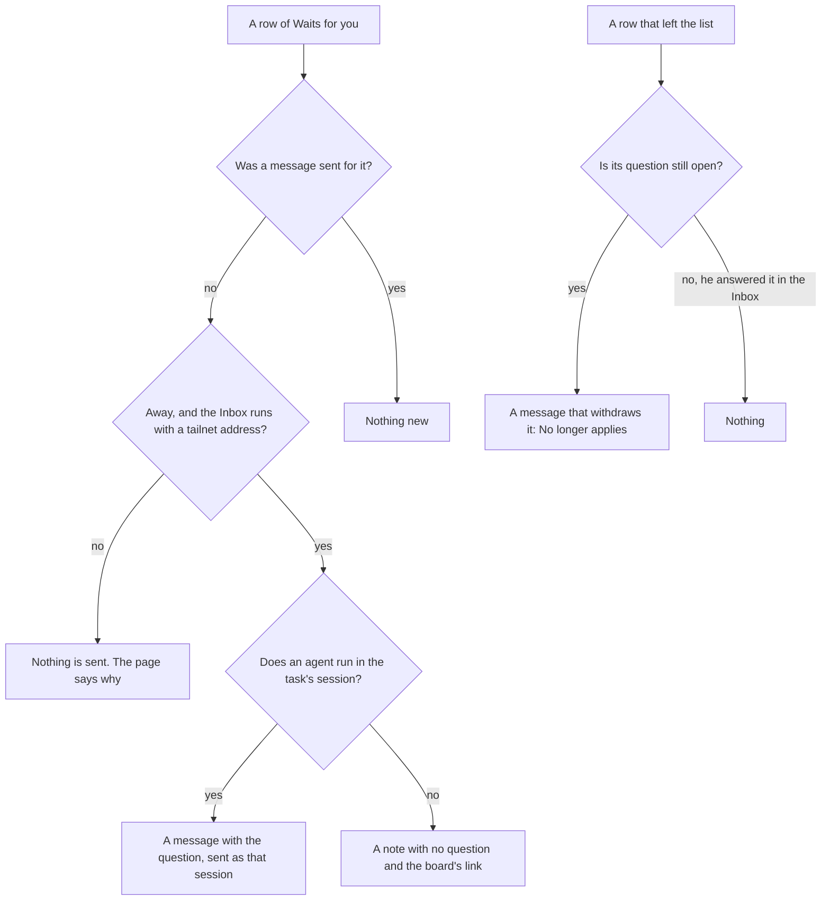

# What waits for the owner reaches his Inbox while he is away

careful: yes, because an answer the owner gives in the Inbox becomes his decision on a breaker or a merge in the task's session, and a reply that reached the wrong session, or a question left open after its answer, would take or ask a decision in his name: the topic "A decision that is the owner's is taken without him, or one taken for him is missing from the pull request he reads" (tasks 1 and 3). The ruling "He says whether he is there, and Lem assumes nothing" is kept: away is his `/lem im-away` mark only, and no task reads silence or idle time.

## Acceptance criteria

Size: full, because a task's sessions, the board's task page and the harness change, and a second channel answers the same question.

1. While the owner is away, each thing that waits for him also reaches the Plannotator Inbox, once, in the task's own thread, with the same case and options as in the task's session:
   1. The owner types `/lem im-away`.
   2. The task report-dates trips breaker 1.
   3. Its session shows the breaker's document, as today.
   4. The Inbox gets one message in the thread "report-dates" with the breaker's case and its three answers: help, park, drop.
2. The things that reach the Inbox are those of "Waits for you" while he is away: a breaker, a merge the merge agent gives to him, a blocked task, an order of his that names no task, a task that waits for a dropped task, and a task with no session.
3. A thing that already waits when he types `/lem im-away` reaches the Inbox at that moment:
   1. Breaker 1 of report-dates waits in its session.
   2. The owner types `/lem im-away` an hour later.
   3. The Inbox gets the breaker's message then.
4. While the owner is there, nothing goes to the Inbox: with no away mark, breaker 1 of report-dates waits in its session and on the board only.
5. The first answer counts, and the other place no longer asks:
   1. Breaker 1 of report-dates waits in its session and in the Inbox.
   2. The owner answers "park" on his phone.
   3. The session parks the task and closes its card in agterm.
   4. Had he answered at the Mac first, the session withdraws the Inbox question, and the phone shows it as "No longer applies".
6. While he is away, the phone's page of a task that waits for him names both places, and links to the Inbox thread through the Inbox's tailnet address: "Answer in the task's session on the Mac, or in the Inbox", where "Inbox" opens the thread "report-dates" at `https://HOST.ts.net:PORT/`.
7. When the Inbox does not run, or has no tailnet address, Lem sends nothing there and no step of a task fails: the page shows today's line, "The task's session, “report-dates”, is in agterm on the Mac.", and one line that says why there is no Inbox link.
8. A task with no session gets a note in the Inbox with no question, since no session can take a reply: "report-dates has no session; open it on the board", with a link to the task's page on the board.
9. At `/lem im-back`, an Inbox question that waits stays open: he answers it in the Inbox or in the task's session, and the first answer counts as in criterion 5.

## How it works

The board server already looks at each workspace's "Waits for you" every few seconds for the phone's push (`lem_push.Watcher`). A second thread of the same server looks at the same rows for the Inbox. It sends a row's message while the owner's mark says away, and it withdraws a message whose row left the list. It sends each message as the task's own Claude Code session, so the owner's reply in the Inbox comes back into that session, which acts on it as on words he typed there.

1. The owner types `/lem im-away`. His mark says away.
2. report-dates trips breaker 1. "Waits for you" gains the row `breaker:report-dates:1`.
3. The server's next look finds the row, the mark, and the Inbox running with a tailnet address.
4. It sends one message in the thread "report-dates": the breaker's document, and a question with help, park and drop. It sends it as the newest Claude Code session of report-dates.
5. The phone's page of report-dates says "Answer in the task's session on the Mac, or in the Inbox", and "Inbox" opens that thread.
6. He answers "park" in the Inbox. The reply arrives in the session of report-dates, which parks the task as on his typed `/lem park report-dates`, and closes.
7. Had he typed his answer at the Mac first, the row leaves the list, and the server's next look sends, as the same session, a message that withdraws the open question: the phone shows "No longer applies".

## Tasks

1. **The board server sends to the Inbox and withdraws from it.** A new module, `skills/lem/scripts/lem_inbox.py`, and a thread of `lem serve` beside the push watcher, started and stopped the way `serve.py` starts and stops `lem_push.Watcher`.
   - Serves criteria 1, 2, 3, 4, 5 (the withdrawal, its step 4), 7 (nothing sent), 8 and 9.
   - Expected files: `skills/lem/scripts/lem_inbox.py` (new), `skills/lem/scripts/serve.py`, `tests/unit/test_inbox.py` (new), a stand-in `plannotator` on `PATH`, written in `tests/lib.sh` beside its stand-ins for `gh` and `agtermctl`, that keeps each call and answers `status` and `call` as the tests set, one check of the server's duties in `tests/lem-board-act.sh`, and `tests/pick.py`'s map.
   - The door: `plannotator inbox status --json` (found on the server's `PATH`), read at each look while the mark says away or a sent message waits for its withdrawal. It answers running with a `url` and a `tailnet_url` (Plannotator 0.29.0, read 2026-11-22). Not found, exit not 0, not running, or no `tailnet_url`: send nothing, and keep the reason for the page in one line. Lem never starts the Inbox: `status` only reads, and no `call` runs while it is not running.
   - The rule, a pure function and its unit cases: from the rows of `lem_board_model.waits_of`, the owner's mark, the door and the record of what was sent, the messages to send and the messages to withdraw. A row is sent once while the mark says away and the door is open. A thing is a row as the server sent it: its row key, its form (a question, or a note when no session can take a reply), the session it went as and, for a merge, its tip. A row that comes with another form (a blocked task whose session opened, or ended), another session or another tip is a new thing: the old one is withdrawn when it was a question, and the new one is sent. A thing withdrawn or answered leaves the record, so a row that comes back after it (a breaker resumed after a park) is a new thing too. Every row of the list is a thing (`breaker`, `held`, `criteria`, `after_dropped`, `blocked`, `plan`, `session`, and the merge), and the merge review and the merge of one task (`review:SLUG`, `merge:SLUG`) are one thing, with one message. A demo workspace sends nothing. No mark (criterion 4): nothing is sent. At `/lem im-back` nothing is withdrawn (criterion 9). A row that left the list, with the mark either way, has its message withdrawn when its question is still open or picked in the thread (`read_thread`); a question he answered there (`sent`) gets nothing.
   - The message: in the thread named by the task's slug (`thread`), with an `idempotency_key` that the server makes once for each thing (the workspace, the row's key and a random part) and writes into the record before the call: a restart sends that thing again with the same key and never posts twice, and a new thing of the same row, whose row time can be the old one's (a breaker resumed after a park keeps its key and its time), never gets the key of a withdrawn one, for which Plannotator returns the withdrawn message, or refuses another body (`plannotator inbox --help`, "send_message"). Its body says the same case as the task's session, by the row's kind: a breaker's document (`breaker-N.md`) whole, then a `:::question` with help, park and drop and `Stopped:`; the merge with the merge review's first card (`merge-review.md`) and a question merge or not now that names the pull request and the whole commit it is for (`proposed` of `landing.json`), which the record keeps as the thing's `tip`, so that the answer is bound to the commit he read, as the board's confirm step binds its merge (`act_merge` in `serve.py`): a new proposal is a new thing, its old question withdrawn and a new one sent for the new tip; a blocked task with the state's line and a `:::question-text`; a held task with its state line and `answer_of`'s words as a `:::question-text`, except the order that names no task (its held line `the order waits for the owner: "HIS WORDS"`, `stages/new.md`, step 6), which gets his words and the answers that step gives him, a text answer that names the task to queue it after and "no order"; a plan with the plan's file in `attachments` (its path in the task's worktree, the settings' `plans`), so that he reads and marks it in the Inbox before he answers, and a question build or drop; each with the link to the task's page on the board at the server's tailnet address when its door is open, else its local address. A task whose session is not live, or does not answer (`deaf`), and a task queued after a dropped task, whose session is closed, gets a note with no question (criterion 8): "SLUG has no session; open it on the board", with that link; for `after_dropped` the two lines he types, as `answer_of` gives them.
   - Who sends: the task's newest Claude Code session, `plannotator inbox call --session claude-code:ID send_message JSON`, ID the `claude` of the task's newest `session.transcript` event after its newest `session.open` whose `source` is not `fork`: a fork is another Claude Code session started from the task's (the `fork` subagent, `--fork-session`), which logs under the same task because it inherits `LEM_TASK`, while the task's own agent goes on in the session it forked from (board-card-search: a `startup` and then a `fork` record at 10:45:56Z, the main checkout's `events.jsonl`, 2026-11-22). The record keeps the session each thing was sent as, and that session is part of the thing: when the task's session changes while the row stays (a handoff, a session the owner opens on the board, a `/clear`), the question sent as the old session is withdrawn as that session and the thing is sent again as the new one, so that his reply reaches the agent that runs the task now. Plannotator files such a message under that session, and the owner's reply comes back into it (`plannotator inbox --help`, "Where replies go" and "Scripting the Inbox"; `callerOfFlag` in its 0.29.0 binary turns `claude-code:ID` into the author `{host: claude-code, session: ID}`, the author of the messages Lem's task sessions sent on 2026-11-21). A note goes with no `--session`. Each call runs with a clean environment: `HOME`, `PATH`, and `PLANNOTATOR_DATA_DIR` when set, and none of the variables Plannotator reads for a session (`PLANNOTATOR_SESSION_TAG`, `CODEX_THREAD_ID`, `PI_SESSION_ID`, `DSH_SESSION_ID`, `CLAUDECODE` and the others of its `SESSION_VARIABLES` and `SESSIONLESS_HOSTS`), since the server inherits the environment of the session whose hook started it, and a call would then write as that session or be refused as `session_ambiguous`. `project_path` is the workspace's main checkout. The withdrawal is sent as the same session as the message, so in the Inbox the session withdraws it (criterion 5, step 4): a message with `reply_to` the sent message, `supersedes` its id and no question, "This no longer waits: it was answered in the task's session on the Mac."
   - The record: `.lem/state/inbox.json` of each workspace, written whole under a lock by this thread only: the door's last look (`looked`, `running`, `tailnet_url`, `why`) and each thing sent (its row key, the task, `thread_id`, `message_id`, the question's key, the session, when), with a withdrawn or answered thing removed. The model reads it as it reads `forge.json` (task 2).
   - A failure of a call (exit 1 with `<code>: <message>` on stderr, exit 2, a time limit) is one line in `serve.log` and the reason kept in the record, and the next look tries again; no step of a task waits for it (criterion 7).
   - Before the code, send one probe from a clean environment with `--session claude-code:ID` of this session to the project of this repository, in a thread named `lem-inbox-probe`, read its record with `read_thread` (`format: "full"`) for `author.host` and `author.session`, and archive the thread at once with `resolve_message`; write what it showed in the report.

2. **The phone's page names both places and links to the thread.** The model reads `.lem/state/inbox.json` (a pure function, as `forge_look`), and the task's page uses it where it says where the owner answers.
   - Serves criteria 6 and 7 (the page).
   - Expected files: `skills/lem/scripts/lem_board_model.py`, `skills/lem/scripts/lem_board_task.py`, `tests/unit/test_board_model.py`, `tests/unit/test_board_task.py`, and the words of the page in `tests/lem-serve.sh` and `tests/board-showcase.py` where its afternoon needs a task with a sent message.
   - Where `session_action` today says "The task's session, “NAME”, is in agterm on the Mac." (a page that cannot jump to the session, the phone's), while the mark says away: with a sent message of the task in the record and a `tailnet_url`, "Answer in the task's session on the Mac, or in the Inbox", with "Inbox" a link to `TAILNET_URL#thread=THREAD_ID` (the thread's address form `URL#thread=ID` is the one `send_message` returned to Lem's task sessions on 2026-11-21); with the door closed, today's line and one line that says why, from the record's `why` ("The Inbox does not run on this Mac, so no question went there.", "The Inbox has no tailnet address, so the phone cannot open it."). Without the mark, today's line alone. The text goes through `h()`, and the link only to the `tailnet_url` the record holds.

3. **A task's session takes the owner's answer from the Inbox.** The harness says what an Inbox reply is in a task's session and that the session sends no copy of its own; the stages that wait for him name the capability. The machine check gets a row for the Inbox.
   - Serves criterion 5 (steps 2 and 3) and criterion 1 (no second message).
   - Expected files: `skills/lem/harness/README.md` (a row for the capability `inbox-reply`: an answer of the owner's that reaches a task's session from his inbox while he is away), `skills/lem/harness/claude-code/ask-owner.md` (its paragraph "When the owner is away" replaced: the board server sends what waits to the Plannotator Inbox as the task's session; his reply arrives as a message that starts `Plannotator Inbox:`; it is his answer, as typed in the session, logged with his words as `--by owner`; his "merge" from the Inbox is `lem land merge SLUG --by owner --tip TIP`, TIP the commit the question named, so that `land.py` refuses a merge of any other proposal (`expected_refusal`) and nothing is merged that he did not read; a reply counts only as his answer to the one thing its message named (breaker N, the merge of TIP, the plan, the blocked task), and only while that thing still waits: before it acts, the session reads `lem project tasks` and acts on nothing when the task left that wait (a board park or a word at the Mac came first, `parked`, a newer state block, another proposal), and answers in the thread, as itself, that the question no longer applies and what took effect, as the board refuses a park whose breaker no longer waits (`act_park`); a message from the Inbox that answers no such question (a tag, a reaction, a new thread of his) is his words in the session's conversation, never an answer to a thing that waits; the session sends no message of its own for a thing the server sent; when a card of the same question is up in the session, it closes it and clears its waiting mark), `skills/lem/prompts/session.md` ("While the owner is needed": one line that names `inbox-reply`), `skills/lem/stages/breaker.md` ("After it": help, park and drop may come from the inbox as well), `skills/lem/stages/away.md` (one line: what still waits for him while away also reaches his inbox), `skills/lem/scripts/doctor.py` (a `plannotator` row, recommended, "the Inbox carries what waits for the owner while he is away", checked with `plannotator --version`), `tests/lem-machine.sh` (its two checks of the tool list), `tests/unit/test_doctor.py`.
   - How a card is closed: `lem-ask --help` names no close today (read 2026-11-22); the builder reads `lem-ask` and the agterm overlay commands and writes the way it finds, or says in the harness text that the session stops the card's background command and why that closes it.
   - Criterion 5's steps 2 and 3 are behavior of a session's agent, which no script holds: a real task while the owner is away is its test.

4. **The documents say it.** The change makes these false or incomplete:
   - `docs/when-lem-needs-you.md`: where the owner answers while away, and that the Inbox gets what waits, with its link from the phone.
   - `docs/board.md`: the phone's page of a task that waits, with the Inbox link and the line when there is none.
   - `README.md` and `site/index.html`, where they say how the owner answers from the phone: the same sentence in both.
   - `AGENTS.md`, "Layout": `lem_inbox.py` among the server's parts, and `inbox.json` among the state folder's files.
   - `docs/install.md`, its table of the tools the machine check recommends (Codex, agdoc): a row for Plannotator.
   - Serves no criterion.

## Decisions

- **The board server sends, not the task's session** (task 1). It already looks at "Waits for you" for the push, it alone sees the mark come for a thing that already waits (criterion 3), and it is the one place for a task with no session (criterion 8). It rests on Plannotator's `--session`, read in its help and its binary: the reply goes to the session named there. The other way, a wake-up that asks each session to send its own message, costs each task a turn of its agent for each thing and still needs the server for criterion 3 and 8.
- **Every row of "Waits for you" is a thing, and the merge review and the merge are one** (task 1). Criterion 2 names the list; a plan that waits for him and criteria held for his yes are rows of it too, and while he is away the interview's rows go on without him (`goes_on_of`), so they never reach the list.
- **The withdrawal is the server's, sent as the session** (task 1). The row leaves the list when the answer at the Mac took effect; the server sees that, and its message carries the session's name, so the Inbox shows the session withdrawing it, as criterion 5 says.
- **Lem never starts the Inbox and keeps no setting for it** (task 1). Its tailnet address is the Inbox's own (`tailnet_url` of its status), read at each look; Lem writes nothing into Plannotator's settings ("Another program's settings stay where that program keeps them").
- **The machine check recommends Plannotator** (task 3). AGENTS.md says a tool with its own life is checked for by `doctor.py`; a recommended row asks nothing of a developer who does not want it, and Lem without it sends nothing (criterion 7).

## Not verified

- That the owner's reply reaches a session that did not send the message itself but was named by `--session`: read in Plannotator's help and code, not run. The first away run with a breaker or a merge shows it; its failure leaves the reply unread in the Inbox and the task waiting in its session, as today.
- That `TAILNET_URL#thread=ID` opens the thread over the tailnet door: the form is the local address's, and the door serves the same app.
- Two machines under one address: each machine's server sends its own tasks, and a peer's page shows the link of its own machine's record only.
