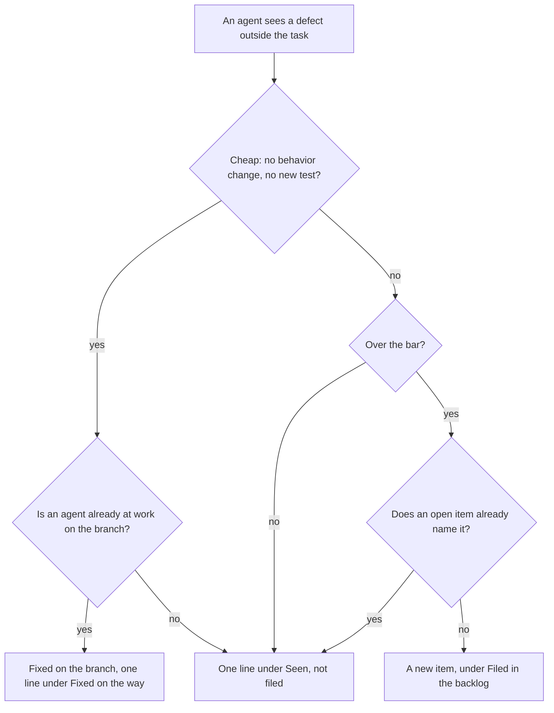

# A bar before a backlog item

careful: yes, because the change reaches "A change bends a ruling of the owner" (it replaces the bullet of 2026-11-14 on a defect outside the task, by his word in the interview) and "The landing lets through a change that should not land" (task 2 changes the guard of `lem land propose` that stops a request while a defect outside the change has no item).

## Acceptance criteria

Size: full, because the change reaches the briefs of three agents that file items, the merge agent's brief, the guard of `lem land propose`, the backlog itself and one of the owner's rulings.

1. An item is filed only for a defect over the bar: it confuses a user, breaks a contract, damages data or costs money, and it happens today; or the owner said it is worth an item. The bar is written in one place, and the polish pass, the fast-track builder and the review read it there. The bar is for Lem's agents only: an item a person writes, or asks an agent to file, is filed whatever the bar, and the docs say where the bar is written. Example: the polish pass sees that `lem board` shows a wrong count of the backlog, and files an item; it sees an old TODO in `land.py`, and files none.
2. A defect under the bar makes no file in `docs/backlog/` and no `worth: no` item; the pull request names it on one line under "Seen, not filed", with its place and why it is under the bar:
   1. The review of a task finds that two test classes come after the main guard in `tests/unit/test_board_model.py`.
   2. No file is written for it.
   3. The pull request says, under "Seen, not filed": "`tests/unit/test_board_model.py`: two test classes come after the main guard; only a reader of the code meets it".
3. `lem land propose` opens the pull request when each defect outside the change that a review found has an item or a line under "Seen, not filed", and still stops for a defect that has neither. Example: a review finds two defects outside the change, the landing files one and writes one line for the other, and the pull request opens.
4. A defect over the bar that an open item on the base already names gets no second file; its line under "Seen, not filed" names that item. Example: a task finds again that the first line quotes a bold outcome from its middle, and the line names `docs/backlog/the-first-line-skips-a-bold-outcome.md`.
5. A cheap defect, one whose fix changes no behavior and needs no new test, is fixed on the task's branch by the agent already at work there: the polish pass on the standard track, and on the fast track its builder, in a commit of its own apart from the criterion's commit. The pull request names each such fix on one line under "Fixed on the way": the file, the commit and what was wrong; the review reads those commits as a part of the diff. Example: the fast-track builder sees a docstring in `land.py` that says the opposite of what the function does, and corrects it in its own commit.
6. A cheap defect that the review finds is fixed only when a builder already fixes a must-fix finding of that review; otherwise it is one line under "Seen, not filed". A cheap defect alone never starts a builder or a new run of the checks:
   1. The review of a task finds one cheap defect, an outdated lint suppression, and no must-fix.
   2. No builder starts, and the checks do not run again.
   3. The pull request names the suppression under "Seen, not filed".
7. The merge agent reads "Filed in the backlog" and "Seen, not filed", and calls the owner when a filed item does not meet the bar. Example: a pull request files an item for a typo in a comment, and the merge agent calls the owner with that item named, in place of merging.
8. A task started from a backlog item, from the board's "Start a task" or from `/lem night`, removes that item on its own branch, and `lem land propose` stops while the item is still on the branch:
   1. The owner presses "Start a task" on `two-guides-are-over-the-800-words-agents-md-allows.md`.
   2. The builder shortens the two guides, and the item is still on the branch.
   3. `lem land propose` stops and names the item; the landing's builder removes it with `git rm`, and nothing waits for the owner.
   4. After the merge, the item is gone from `main` and from the board.
9. This task sorts the items on `main` by the bar once: items that name one defect become one item, an item under the bar is removed and named in the pull request with its reason, and an item over the bar stays as it is. An item that the owner wrote or asked for stays, whatever the bar, and the pull request groups the removed items by the folder of their `where:` line. Example: the four items on `project.py:outcome_of` become one, and `two-test-classes-of-the-board-model-come-after-its-main-guard.md` is removed with the reason "only a reader of the code meets it".
10. `docs/rulings/rulings.md` says the new rule in place of the bullet of 2026-11-14 on a defect outside the task, with the day 2026-11-22.

## How it works

Every agent that sees a defect outside its task (the polish pass, the fast track's builder, the
review) takes the same three questions, in the order of the chart, by the bar of rule 6 of
`agents/lem-builder.md`.

For the review, "an agent already at work" is a builder that fixes a must-fix of the same round.
The polish pass and the fast track's builder are always at work on the branch.

## Tasks

The tasks run one after another in the one worktree, but task 5, which touches only
`docs/backlog/`, may run beside any other.

1. **The bar in one place, and the briefs of the agents that find defects read it.** Criteria 1,
   2, 4, 5 and 6, the agents' part. Rule 6 of `agents/lem-builder.md` holds the bar, word for word
   as criterion 1 gives it, with its limit (Lem's agents only; an item a person writes or asks for
   is filed whatever the bar), what "cheap" means (no behavior change, no new test), and the three
   outcomes: a fix in a commit of its own with one line under "Fixed on the way", one line under
   "Seen, not filed" with the place and why, or an item in the format rule 6 already gives. Before
   an item, the agent looks in the backlog folder of the base for an open item that names the same
   defect, and when one does, its line names that item. Rule 6's first sentence ("listed, not fixed
   and not filed") stays for a builder of a plan's task, which only lists. Then:
   - `skills/lem/prompts/landing.md`, the polish pass's item 5: it takes the bar of rule 6 in place
     of "cheap and small ... Each of the others you file", fixes each cheap defect in a commit of
     its own, and brings `report.md` up with three lists: "Fixed on the way" (file, commit, what was
     wrong), "Seen, not filed" (place, why), and the items filed.
   - `skills/lem/prompts/landing.md`, "The fix of a review's findings", step 3: a defect under
     "Outside this change" that the review marks cheap is fixed by this builder, each in a commit of
     its own, and named in its reply; the rest it neither fixes nor files.
   - `skills/lem/prompts/small.md`, step 7: the fast track's builder takes the bar; a cheap defect
     it fixes in a commit of its own after the criterion's commit, and its reply's line of items
     becomes three short lists (fixed, seen, filed). Its reply stays six lines at most.
   - `skills/lem/stages/polish.md`, `skills/lem/stages/build.md` (the line near 163 on what the
     polish pass does), and `skills/lem/SKILL.md` (its sentences on the fast track's builder that
     "files in the backlog what it saw outside it" and the polish pass's "fixed when cheap or
     filed"): each says the bar of rule 6 in a few words and names it.
   - A unit test in `tests/unit/` holds "written in one place": the bar's sentence is in
     `agents/lem-builder.md` once, and `landing.md`, `small.md`, `review.md` and `merge.md` each
     name rule 6 of `agents/lem-builder.md` and copy no sentence of the bar.
   Files: `agents/lem-builder.md`, `skills/lem/prompts/landing.md`, `skills/lem/prompts/small.md`,
   `skills/lem/stages/polish.md`, `skills/lem/stages/build.md`, `skills/lem/SKILL.md`, a new
   `tests/unit/test_the_bar.py` (or a case in an existing test file of the prompts).

2. **The review judges each defect outside the change, and `lem land` files only what is over the
   bar.** Criteria 2, 3, 4 and 6, the script's part. The record of a review (`land.py`'s module
   text, "The record of a review"; `prompts/review.md`, steps 5 and 8) gives each entry of
   `outside` a `bar`: `"over"`, `"under"` or `"cheap"`, with `why` (one line, why it is under the
   bar or why it is cheap) for `under` and `cheap`, and for any entry an optional `open`: the path
   of an open item of the base's backlog folder that names the same defect. A defect that an item
   the branch adds already names stays out of `outside`, as `prompts/review.md` step 5 says today
   (`filed` in the reviewer's inputs). `read --record` refuses
   an entry with no `bar`, a `bar` of another word, `under` or `cheap` with no `why`, and an `open`
   that is no file of the backlog folder at the base. `read` gives the reviewer the base's items
   (`backlog`: each item's path, `where` and title) beside `filed`, so it can name `open`.
   - `to_file` and `cmd_file` take only an entry with `bar: over` whose `open` is not a file of the
     tip: none, or one that the base removed or joined after the review while a rebase kept that
     review (`cmd_base`, `covers_one`). An entry whose `open` is in the tip is that item: nothing is
     written, and `landing.json` keeps it with that path.
   - `cmd_file` no longer gives a defect the item of the branch whose `where` is the same (`match`
     in `cmd_file`, and `named`, go): the review leaves out a defect that such an item names, so a
     defect it lists is one of its own, and a match by place alone gives two defects of one place
     one item, which loses the second. This is the decision on the base's items below, held for
     the branch's items too.
   - `propose` still refuses while an over-the-bar entry with no `open` in the tip has no item, or
     its item is gone from the tip (today's guard). The text of the pull request gets the lines
     under `## Seen, not filed` by itself, as "`WHERE`: TITLE; WHY": one for each `under` entry,
     each `open` entry (its line names the item), and each `cheap` entry that the notes do not
     name under `## Fixed on the way` by its `where` and its title, both word for word. So a cheap
     defect that nobody fixed, in a round with or without a must-fix, a second round whose fix
     builder never starts among them, is a line by default, and no notes can lose one: a fix line
     that names another title at the same `where` leaves this entry's line in place. `propose` has
     no refusal of its own for the cheap entries.
   - `NOTES`, the headings the notes must have, stays as it is. `## Fixed on the way` and
     `## Seen, not filed` are the text's own, after `## Filed in the backlog`, each written only
     when the notes or the record give it a line, so a task with nothing outside its change keeps
     its text as today (the notes of `tests/lib.sh`, the heading order that `tests/lem-land-shop.sh`
     asserts). The lines the record gives join what the notes hold under the same heading (a lone
     `none` there gives way to them).
   - `pr_text` and `small_text` read an entry's `item` only where it has one: the review's line
     says "filed as" for the entries with an item, and "N seen, not filed" for the others. The
     review's items join the notes' lines under `## Filed in the backlog` on the standard track. On
     the fast track, whose notes have no fixed headings, `small_text` writes `## Filed in the
     backlog` (the builder's items, from `builder_filed`, and the review's), `## Fixed on the way`
     and `## Seen, not filed` when each has a line, in place of the line "filed in the backlog by the
     builder" under `## Checks`.
   - `stages/land.md`, steps 5 and 6: the step after a record files only over the bar; a fix
     builder's brief names the round's `cheap` entries, each by its `where` and title; the notes get
     `## Fixed on the way` from `report.md` (the polish pass's list) and from the fix builder's
     reply, a fix of a review's entry with that entry's `where` and title word for word, and
     `## Seen, not filed` from `report.md`; `## Filed in the backlog` takes the polish pass's items
     as today. Its sentence "An item the owner does not want stays, with `worth: no` ... never
     deleted" stays.
   - The module text of `land.py` ("No defect outside the change gets lost") says the new rule: no
     defect a review saw outside the change gets lost, since each one is an item, or one line of the
     pull request with its reason.
   - Tests: unit cases for the record's refusals and for `to_file` (in `tests/unit/`, the file of
     `land.py`'s rules), and checks in `tests/lem-land-backlog.sh` for the journey: a review with
     one `over` and one `under` defect files one item, and the pull request opens with the other
     on one line under `## Seen, not filed`; an `open` entry files nothing and names its item, and
     one whose item the tip lacks is filed; a `cheap` entry that the notes do not name under
     `## Fixed on the way` gets its line under `## Seen, not filed`, also when a fix line names
     another title at its `where`; a defect the review lists at the `where` of an item the builder
     filed gets an item of its own. The existing checks that pin "every defect is an item", and the
     check of `named` (the builder's item at the same `where`), change to the new form, since each
     one tests the record's old form; none is weakened to pass.
   Files: `skills/lem/scripts/land.py`, `skills/lem/prompts/review.md`, `skills/lem/stages/land.md`,
   `tests/lem-land-backlog.sh`, the unit file of `land.py`'s rules, each other suite whose
   review records carry `outside` (`grep -rn '"outside"' tests/` names them), and each check that
   asserts the text of a pull request with a review's defect in it (`grep -rn 'filed as\|filed in
   the backlog by the builder' tests/` names them, `tests/lem-land-small.sh` among them).

3. **A task started from a backlog item removes the item on its branch.** Criterion 8. The task's
   item is its ask: the whole of `ask.txt`, stripped, is one path, as the board's "Start a task"
   and the night write it (`serve.py:act_start`; `stages/night.md`, step 3), and that path is a
   file of the backlog folder at the base. An ask with any other word beside the path has no item,
   whatever path it quotes. An ask that is the path alone, from the board, the night, a ticket's
   text or the owner's own line, asks for the work of that item and for nothing else, so the task
   that lands it did that item; its deletion is in the diff that the review and the merge agent
   read. `propose` refuses while that path is in the tip,
   names it, and gives the next step: a builder of the landing removes it with `git rm` in a commit
   of its own. That commit asks for a new run of the checks, as any commit does: a command of the
   project may read the file (a check that the paths a document names exist, as
   `docs/rulings/rulings.md` names `docs/backlog/add-ons-after-the-core.md`), so `gate_holds` takes
   no exemption for it. It asks for no new review: `covers_one` takes a change whose one difference
   from the reviewed one is the deletion of the task's own item, as it takes the items `file` adds,
   since the review reads code and the item holds none. The briefs remove it first, before the
   checks run, so the refusal and its new run of the checks are the rare case: the fast
   track's builder (`prompts/small.md`) and the polish pass (`prompts/landing.md`) each remove the
   task's item in a commit of their own when `ask.txt` names one; `stages/land.md` names the
   refusal and the builder's job (a short job of its own in `prompts/landing.md`, "The removal of
   the task's item"). A night's task is the same, with nothing more.
   Tests: a unit case for the rule that finds the task's item from its ask and the base (a path
   outside the backlog folder, one the base lacks, or an ask with a word beside the path, is no
   item), and checks in
   `tests/lem-land-backlog.sh` (or `tests/lem-land-small.sh` for the fast track) that `propose`
   stops while the item is on the branch and opens after its `git rm` and a new run of the checks,
   with no new review.
   Files: `skills/lem/scripts/land.py`, `skills/lem/prompts/small.md`,
   `skills/lem/prompts/landing.md`, `skills/lem/stages/land.md`, the tests above.

4. **The merge agent reads what was filed and what was not.** Criterion 7. `prompts/merge.md`,
   "Decide": a call when an item the branch files does not meet the bar of rule 6 in
   the file the brief names as `bar`, with that item named in the review's first lines. The merge brief that
   `lem land merge-review` writes lists each item the branch adds to the backlog folder, by its
   path and title, so the agent reads each one, and names the file that holds the bar for this
   project (`bar`): the project's own `.claude/agents/lem-builder.md` when it is there, as
   `spawn-builder` picks it for the polish pass, the fast track's builder and the review, else
   Lem's `agents/lem-builder.md`. So the merge agent judges by the rule 6 the builders read. The
   pull request's text carries `## Filed in the backlog` and `## Seen, not filed` (task 2). A line
   under "Seen, not filed" whose defect the agent finds over the bar is a call too, unless the line
   names an open item that holds that same defect: that is criterion 4's case, and it merges.
   Tests: a check that the merge brief lists the branch's items and names the bar's file, Lem's
   and a project's own (in the suite that holds `merge-review`, `tests/lem-land-shop.sh` or its
   unit file).
   Files: `skills/lem/prompts/merge.md`, `skills/lem/scripts/land.py` (the merge brief), its test.

5. **The backlog on `main` is sorted by the bar once.** Criterion 9. The builder reads each item
   that `git ls-files docs/backlog` lists at the branch's base, against the bar of rule 6:
   - items that name one defect become one: the clearest stays, the runs of the others that add a
     fact join it, and the others leave with `git rm`;
   - an item under the bar leaves with `git rm`;
   - an item over the bar stays as it is;
   - an item the owner wrote or asked for stays whatever the bar: its text or the commit that added
     it shows his word (`git log --format='%h %s' -- PATH`, and the session or the ruling that
     names it). An item that a ruling, a plan or a document names stays, or the builder corrects
     that sentence in the same commit. In doubt, it stays.
   The builder commits the joins and the removals as `docs(backlog):` commits, one for each kind,
   and its report holds the list for the pull request: each removed item by its path and reason,
   grouped by the folder of its `where:` line, and each join with the items it took in. The lead
   copies that list into `report.md`, and the landing's notes carry it under `## Worth a look`.
   The 3 items of the main checkout that nobody committed are out of reach: they are not in the
   worktree.
   Files: `docs/backlog/*.md`.

6. **The documents say the new rule.** Criteria 1 (the docs say where the bar is written) and 10.
   - `docs/rulings/rulings.md`, group "The review, the pull request and the merge": the bullet "A
     small defect outside the task is fixed at the end ... (2026-11-14)" gives its place to the new
     rule, in the bullet form of `AGENTS.md` ("A new ruling of the owner is one bullet"): an item is
     a real issue (it confuses a user, breaks a contract, damages data or costs money, and happens
     today) or one the owner said is worth an item; a cheap defect is fixed on the branch by the
     agent already at work there (the polish pass, the fast track's builder, or a builder that
     fixes a must-fix of the same review); everything else, a cheap defect that no such agent fixes
     among it, is one line "Seen, not filed" of the pull request; and the day (2026-11-22). The bar
     binds Lem's agents only. The words follow criteria 5 and 6, so the bullet never says a cheap
     defect is always fixed.
   - `docs/rulings/history.md`, the line "A small change never gets a polish pass": its second part
     ("its builder files such a defect and never fixes it") changes to the rule of criterion 5,
     with `skills/lem/prompts/small.md` (step 7) as its place: the builder fixes a cheap defect in a
     commit of its own and files only one over the bar. Its test, `tests/lem-land-small.sh: "a
     small change whose builder filed a defect outside it in its own commit has no polish pass"`,
     still holds the first part, and its name stays, since `tests/unit/test_agents_md.py` finds it
     by that name.
   - `docs/pull-request.md`: the two new parts of the pull request's text ("Fixed on the way",
     "Seen, not filed"), that the merge agent calls the owner for a filed item under the bar, and
     where the bar is written (rule 6 of `agents/lem-builder.md`, or of a project's own
     `.claude/agents/lem-builder.md`, which every agent of that project then reads).
   - `docs/flow.md`, `README.md` and `site/index.html`: each sentence that says a defect outside a
     task is filed (search "backlog", "outside", "filed"), corrected to the new rule; the site in
     the same commit as the README or the guide it follows.
   - `AGENTS.md`: a sentence that the change makes false (search "backlog", "filed").
   Files: the documents above.

## Decisions of the plan

- **The bar is written in rule 6 of `agents/lem-builder.md`.** The polish pass, the fast track's
  builder and the review are each a `lem-builder` and read that file whole, with no extra read; the
  item format is already there. The merge agent is no builder: the merge brief names the file
  (`bar`) as `spawn-builder` picks it, the project's own `.claude/agents/lem-builder.md` when it is
  there, else Lem's, so the builders and the merge agent of one project read one rule 6. A project
  with its own file writes its own rule 6; that is the price, and the override already takes over
  every other standing rule.
- **The review makes the call for its own defects, in its record.** No separate judge agent
  (directions, Q4). The record's `bar` makes each defect one of three, and `lem land` writes the
  "Seen, not filed" line from the record, so a defect the review saw is in the pull request by
  construction, as an item or as a line. A `cheap` defect is a line by default; only a line of
  the notes under "Fixed on the way" with its `where` and title word for word takes it out, so a
  fix that never came, or a note that was not written, leaves the line and loses nothing.
- **An open item is named by the agent, and no script matches it.** The same `where` is no proof
  of the same defect (four items on `project.py:outcome_of` are one defect, but a `where` such as
  `skills/lem/scripts/land.py` holds many), so a match by `where` would lose real defects. The
  reviewer gets the base's items with their `where` and title and names one in `open`, and it
  leaves out a defect that an item of the branch names, as it does today; `cmd_file`'s match of a
  defect to a branch item by `where` goes for the same reason. An `open` item that the tip no
  longer holds names nothing, and its defect is filed.
- **The task's item is found from `ask.txt`, when the whole ask is its path.** The board and the
  night already write the item's path there, so no new record is needed. An ask that is the path
  alone asks for that item's work and nothing else; an ask with his own words about an item has no
  item, and its builder removes the item only when the plan says so.
- **The removal of the task's item asks for no new review, and for the checks as any commit
  does.** It deletes one file of the backlog folder that holds no code, which a review does not
  read; a command of the project may read that file, so the checks run again in the rare case
  where the removal comes after them.
- **Task 5's removals use `git rm`, while `stages/land.md` keeps "never deleted" for an item a
  review filed in this landing.** The owner's "not wanted" on a filed item is still `worth: no`;
  the sort is his own word of this interview (Q5, "yes").

## What this plan will not verify

- That an agent applies the bar well: the bar is a sentence, and only real tasks show how agents
  read it. The merge agent's call on an item under the bar is the check after the fact.
- The sort of task 5 item by item: its list in the pull request is for the owner to read, and he
  merges this careful change himself.
