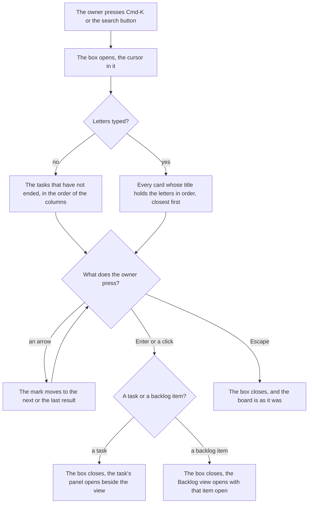

# A search over every card of the board

careful: no, because no topic of `flow.topics` is in reach: the change draws a list the board's model already holds and filters it in the browser, and it adds no route, no act and no write (the scout's section 4 read the same).

## Acceptance criteria

Size: full, because the board gets a search box with its own key, a list of every card of the workspace, a match rule and a row for each result.

1. `Cmd-K` (`Ctrl-K` off the Mac) opens a search box over the board on every view, with the cursor in it, and a search button in the board's header opens the same box, also on a phone; `/` stays the key of the backlog's filter: on "Activity", the owner presses `Cmd-K` and the box opens over the page.
2. The search finds every card of the workspace on the screen and of no other workspace or joined machine: every task, also a parked task and an ended task that the Done column does not show, and every backlog item.
   1. The workspace has the open task "board-card-search", the parked task "old-export-fix" and the backlog item "The board's done column has no limit".
   2. The owner types "export": "Old export fix" is in the list.
   3. He types "done col": "The board's done column has no limit" is in the list.
3. The match is fuzzy on the title alone: the typed letters must stand in the title in that order, with any letters between them, no matter the case and with the spaces he types ignored, and a title where they stand closer together comes first: "crdsrch" finds "Board card search", and "card" lists "Board card search" above "Clear a reported deadline".
4. With nothing typed, the box lists the tasks that have not ended, in the order of the board's columns.
5. Each result shows its title and, beside it, a chip in the color of its column with its place and its state: "Board card search · Waits for you · held", "The board's done column has no limit · Backlog · worth: yes", "Old export fix · parked", and "Agents md read on demand · landed 2026-11-21".
6. The arrow keys move through the results, and Enter or a click picks one; the box then closes, and a task opens in its panel beside the view as a click on its card does, also a parked or an old ended task, and a backlog item opens as it opens from the backlog view; Escape closes the box with no pick and leaves the board as it was.
   1. The owner types "crdsrch".
   2. "Board card search" is the first result, and it is marked.
   3. He presses Enter.
   4. The box is gone, and the panel of "board-card-search" is open beside the view.
7. The box stays open with what the owner typed while the board updates itself: a new event of the workspace neither closes the box nor clears his letters.

## How it works

The server draws the whole list into every page of the board, hidden, and the browser filters and
orders it as the owner types, with no request: the backlog's filter does the same for 200 items
(`tools/board-kit/controllers/backlog.js`, its head comment).

## Tasks

1. **Every page of the board draws the search list, hidden, and a search button in its header.**
   A pure function of the model in `skills/lem/scripts/lem_board_model.py`, for example
   `search_rows(m, backlog)`, gives one row for each card of the workspace in this order: the tasks
   of the columns `you`, `build` and `checks`, each column in the order the kanban draws it
   (`m.lane[KEY]`); the parked tasks; the ended tasks of `m.lane["done"]`, all of them and not only
   the `DONE_SHOWN` that Done draws, the newest first; then the backlog items in the order of
   `BY_WORTH`. Each row holds the title (`t.title` for a task, the item's `title` for a backlog
   item), whether the task has not ended, its color (the `actor` of its column; `quiet` for a parked
   task, `done` for an ended one, the `BY_WORTH` group's actor for an item), and its chip text, in
   the forms of criterion 5: `COLUMN TITLE · STATUS` for a task in a column (`Waits for you · held`),
   `parked`, `STATUS DAY` for an ended task (`landed 2026-11-21`, the day it ended, from `t.since`,
   in the day the board's `stamp` uses), and `Backlog · worth: WORTH` for an item (`worth_of` in
   `lem_board_pages.py` gives the word; move it to the model if the function needs it there). The
   model function reads only the workspace's own model and backlog, so no other workspace or joined
   machine comes in (criterion 2). Unit cases in `tests/unit/test_board_model.py`: the order, a
   parked task, an ended task past `DONE_SHOWN`, a backlog item, and each chip form of criterion 5.
   `layout()` in `skills/lem/scripts/lem_board_pages.py` draws the box once on every view it draws
   (the six callers of `layout(` in `lem_board_pages.py` and `lem_board_task.py`), hidden until the
   browser opens it: a search field and one row for each entry, each row a link with the title and
   its chip (the `a-ACTOR` classes give the column's color, as the cards and the sidebar use them).
   A task's row links with `task_link(ctx, slug)`, the attributes a card's title has, so a pick opens
   the panel the same way, also for a parked or an old ended task. A backlog item's row links to the
   Backlog view with the item named, `ctx.href("backlog")` and `#item-SLUG`, the id `backlog_item()`
   gives it. The rows carry what the browser needs as `data-` attributes (the title to match, and
   whether the task has not ended). The search button, with the icon `magnifying-glass` (already in
   `board-icons.json`), goes in `topbar()` (`header.bar`) and in the phone's bar (`header.mbar` in
   `layout()`), each with `title` and `aria-label` that name `Cmd-K`. Its look goes in
   `skills/lem/assets/board.css` with the board's own variables and no style of its own beside it
   (the ruling "A page for the owner has the board's look"), on a large screen and a phone (the
   phone's bar rules near `.mbar` in `board.css`). Checks in `tests/lem-serve.sh` on the served
   afternoon: the box and the button are in the HTML of the Tasks view and of "Activity", and the
   rows hold a task, an ended task Done does not draw and a backlog item, each with its chip. Add to
   the demo's state only what a check needs, inside the check: do not change
   `tests/board-showcase.py`, since `lem criteria red` runs the checks on the base commit, which lacks
   such a change. Serves criteria 1 (the button), 2, 4 (the order) and 5.
   Files: `skills/lem/scripts/lem_board_model.py`, `skills/lem/scripts/lem_board_pages.py`,
   `skills/lem/assets/board.css`, `tests/unit/test_board_model.py`, `tests/unit/test_board_pages.py`,
   `tests/lem-serve.sh`.
2. **The browser opens the box, filters it, and picks a result.** A Stimulus controller of its own,
   for example `tools/board-kit/controllers/search.js`, named in `controllers/index.js`, on the box
   that task 1 draws, with its key on `keydown@window`. `Cmd-K`, or `Ctrl-K` off the Mac (by
   `KeyboardEvent.code` `KeyK` with `metaKey` or `ctrlKey`, also while the focus is in another
   field), opens the box with the cursor in its field and calls `preventDefault`, so Firefox does not
   take the key for its own search; `hotkeys.js` ignores keys with a modifier, so it does not need a
   change for this. The header buttons open it too. With nothing typed the box shows the rows whose
   task has not ended, in the drawn order (criterion 4). With letters typed it shows each row whose
   title holds them in order, case folded and the typed spaces taken out, ordered by the length of
   the shortest stretch of the title that holds them, shorter first, and the drawn order between two
   of the same length: "card" puts "Board card search" (a stretch of 4) above "Clear a reported
   deadline" (a stretch of 16, "clear a reported"). Keep the match rule a small pure function the controller calls. The
   first result is marked; `↑` and `↓` move the mark; `Enter` or a click picks a row: the box
   closes and the row's link is clicked, so a task opens in its panel as a card does. On the Backlog
   view, the `backlog` controller opens, marks and scrolls to the item that the address's
   `#item-SLUG` names, also after a Turbo visit, so a backlog item opens as it does from that view.
   `Escape` with the focus in the box closes it with no pick, gives the focus back to where it was,
   and stops the key there (`preventDefault` and `stopImmediatePropagation`, as `drawer.js` does),
   so the panel and the drawer stay as they were. The open box and the letters stay through a morph
   of the page (criterion 7): the browser's state is a `data-js-*` attribute, which `app.js` keeps,
   the field takes `data-turbo-permanent` as the backlog's field does, and the controller filters
   again on `turbo:morph` (`backlog.js` does both). Then `npm --prefix tools/board-kit ci` and
   `npm --prefix tools/board-kit run build`, and commit `skills/lem/assets/vendor/board-app.js` with
   the source; `board-icons.json` must come out of the build unchanged. Checks in
   `tests/lem-board-keys.sh`, through `node tests/board-cdp.mjs` (extend the driver for a key with
   `Meta` or `Control` held where it cannot press one), each with its own `SKIP` line without Node or
   Chrome: `Cmd-K` on "Activity" opens the box with the focus in it, and `/` on the Backlog still
   goes to the backlog's field; "crdsrch" lists "Board card search" first, marked; "card" lists
   "Board card search" above "Clear a reported deadline"; "export" finds a parked "Old export fix";
   "done col" finds the backlog item; `Enter` closes the box and opens the task's panel; a click on a
   backlog item's row shows the Backlog view with that item open; `Escape` closes the box and an open
   panel stays open; a new event while the box is open keeps it open with the letters. The checks add
   the tasks they name to the demo's log in the check, as the block's `event.py` does. Serves
   criteria 1, 3, 6 and 7.
   Files: `tools/board-kit/controllers/search.js`, `tools/board-kit/controllers/index.js`,
   `tools/board-kit/controllers/backlog.js`, `skills/lem/assets/vendor/board-app.js`,
   `skills/lem/assets/board.css`, `skills/lem/scripts/lem_board_pages.py`, `tests/lem-board-keys.sh`,
   `tests/board-cdp.mjs`.
3. **The documents say the new key and the button.** `docs/board.md`: `Cmd-K` (`Ctrl-K` off the
   Mac), or the search button, opens a search over every card of the workspace by its title, in the
   guide's STE and in as few words as the table allows (the guide aims at under 800 words). Read
   `README.md` and `site/index.html` for a list of the board's keys that the change makes false,
   and correct it where it is there, the site in the same commit as the README. The search button
   changes the board's header, so make the board's pictures again with `tests/board-showcase.py` as
   `AGENTS.md`, "Layout", says, and commit those of `assets/screens/` that changed. No criterion
   names a document.
   Files: `docs/board.md`, `assets/screens/`, and `README.md` or `site/index.html` only where one
   lists the keys.

## Decisions

- **A parked task is in the list with nothing typed, after the columns.** Criterion 4 says the
  tasks that have not ended, in the order of the columns. A parked task has not ended
  (`ENDED` in `lem_board_model.py` is landed, dropped and answered) and has no column, so it comes
  after the last column with a task that has not ended.
- **The list is drawn by the server and filtered in the browser, with no new route.** The backlog's
  filter works this way for 200 items, the ruling of 2026-11-20 makes the board a served Hotwire
  app, and a route per letter would add a request to each key the owner presses.
- **"Closer together" is the length of the shortest stretch of the title that holds the letters in
  order.** It is the one measure that gives criterion 3's example its order; two titles of the same
  stretch keep the drawn order, so a task that waits for the owner comes before a backlog item.
- **`Cmd-K` acts also while the focus is in a field.** It is a chord no field uses for text, and
  the owner may be in the backlog's filter or a new task's text when he wants another card.
- **A backlog item opens on the Backlog view by the address's `#item-SLUG`.** The Backlog view opens
  an item in place (a `
`), and has no address for one item today.

## Not verified

- Whether agterm takes `Cmd-K` for itself when the board shows as a page beside a session: the
  tests press the key in headless Chrome, which has no agterm around it. The header button opens
  the box there in any case.
- Firefox: the tests run Chrome only. The controller calls `preventDefault` on the key, which is
  how a page keeps `Cmd-K` from Firefox's own search.
