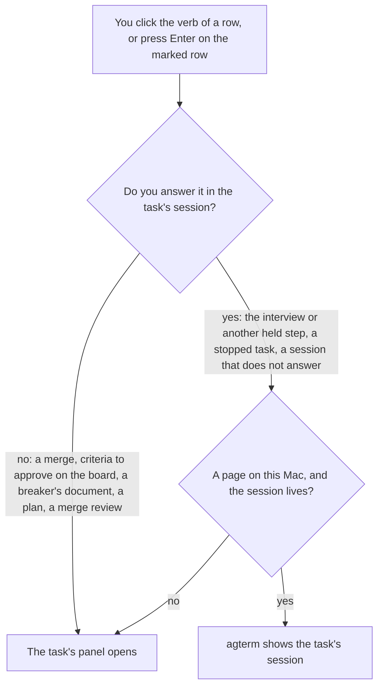

# The board's cards and rows by the keyboard

careful: no, because the change is the board's browser script, the HTML of two views and one guide: it writes no task state, decision or criterion, pushes, merges and lands nothing, and touches no hook or plugin load (the scout's section 4, read again against `flow.topics`); no key starts an act, and the one new jump selects a session the owner chose with his own key, as his click does.

## Acceptance criteria

Size: full, because two views of the board get keys of their own, each with a hint line, and the board's guide names them.

1. On the Tasks view, `J` or `↓` moves a mark to the next card of its column, and `K` or `↑` to the card before it:
   1. The column "Building" holds the cards export-notes, gift-note and report-dates, in that order.
   2. No card has the mark, and you press `J`.
   3. export-notes gets the mark; `J` again moves it to gift-note, and `K` moves it back to export-notes.
   - test: `bash tests/lem-board-keys.sh` in `tests/lem-board-keys.sh`, `tests/lib.sh`, `tests/checks.sh`, `tests/board-cdp.mjs`, `tests/board-showcase.py`
2. On the Tasks view, `H` or `←` and `L` or `→` move the mark to the nearest card of the next column with cards that you can see, at the height of the marked card or the closest to it; a folded column and an empty column are passed over:
   1. The mark is on gift-note, the second card of "Building".
   2. The next column to the right is folded, and the one after it, "Ready", holds two cards.
   3. You press `L`, and the second card of "Ready" gets the mark.
   - test: `bash tests/lem-board-keys.sh` in `tests/lem-board-keys.sh`, `tests/lib.sh`, `tests/checks.sh`, `tests/board-cdp.mjs`, `tests/board-showcase.py`
3. `Enter` opens the panel of the marked card, as a click on the card does, and `Esc` closes the panel with the mark still on that card: with the mark on gift-note, `Enter` opens the panel of gift-note, and after `Esc` gift-note keeps the mark.
   - test: `bash tests/lem-board-keys.sh` in `tests/lem-board-keys.sh`, `tests/lib.sh`, `tests/checks.sh`, `tests/board-cdp.mjs`, `tests/board-showcase.py`
4. On "Waits for you", `J` or `↓` and `K` or `↑` move the mark from row to row, and `Enter` does what a click on the row's main link does, and never presses one of its buttons (Approve, Merge, Park, Open a session):
   1. The mark is on the row "board-card-search: the interview waits for you".
   2. You press `Enter`.
   3. agterm shows the session of board-card-search, as a click on that row's link does.
   - test: `bash tests/lem-board-keys.sh` in `tests/lem-board-keys.sh`, `tests/lib.sh`, `tests/checks.sh`, `tests/board-cdp.mjs`, `tests/board-showcase.py`
   - test: `python3 -B -m unittest tests.unit.test_board_model.AnsweredInSession` in `tests/unit/test_board_model.py`
   - test: `python3 -B -m unittest tests.unit.test_board_pages.WaitsVerb.test_a_held_row_on_a_page_for_this_mac_with_a_live_session_jumps_to_it_and_keeps_its_address` in `tests/unit/test_board_pages.py`
5. The mark stays on its task when the board updates by itself, and goes away when its card or its row leaves the view: with the mark on gift-note, a new task's card that comes into "Building" leaves the mark on gift-note; when gift-note moves to "Ready", no card has the mark until the next key.
   - test: `bash tests/lem-board-keys.sh` in `tests/lem-board-keys.sh`, `tests/lib.sh`, `tests/checks.sh`, `tests/board-cdp.mjs`, `tests/board-showcase.py`
6. The keys do nothing while the focus is in a text field, or while you hold `Cmd`, `Ctrl` or `Alt`: in the box of a new task, `J` types the letter j and moves no mark.
   - test: `bash tests/lem-board-keys.sh` in `tests/lem-board-keys.sh`, `tests/lib.sh`, `tests/checks.sh`, `tests/board-cdp.mjs`, `tests/board-showcase.py`
7. The Tasks view and "Waits for you" each show one hint line of their keys, in the look of the Backlog view's hint line and hidden on a phone, as the Backlog's is: Tasks shows "J K ↑ ↓ move · H L ← → column · Enter open · Esc close", and "Waits for you" shows "J K ↑ ↓ move · Enter go".
   - test: `bash tests/lem-board-keys.sh` in `tests/lem-board-keys.sh`, `tests/lib.sh`, `tests/checks.sh`, `tests/board-cdp.mjs`, `tests/board-showcase.py`
   - test: `python3 -B -m unittest tests.unit.test_board_pages.Keys.test_the_kanban_carries_the_cursor_over_its_cards_and_one_line_of_its_keys` in `tests/unit/test_board_pages.py`
   - test: `python3 -B -m unittest tests.unit.test_board_pages.WaitsVerb.test_the_list_carries_the_cursor_over_its_rows_and_one_line_of_its_keys` in `tests/unit/test_board_pages.py`
8. `docs/board.md` names the keys of the Tasks view and of "Waits for you": its part on the views lists `J`, `K`, `H`, `L`, the arrows, `Enter` and `Esc` with what each does there.
   - no test: the criterion is a paragraph of `docs/board.md`.

## How it works

A row of "Waits for you" has two links: its verb ("The interview waits for you") and the task's
title. The verb is the row's main link, and it goes where the owner acts; `Enter` on a marked row
does what a click on the verb does. The title always opens the panel (decision 4).

## Tasks

1. **The Tasks view moves a mark by the keys.** A Stimulus controller of its own,
   `tools/board-kit/controllers/cursor.js`, named in `controllers/index.js`, on the kanban
   (`kanban()` in `skills/lem/scripts/lem_board_pages.py`) with `keydown@window->cursor#key`. The
   mark is the attribute `data-js-cur` on a card (`article.tc`), which a morph keeps (`app.js`); the
   controller also keeps the column of the marked card, and after a morph (`turbo:morph`) a marked
   card that is now in another column loses the mark, as criterion 5 says. Its look is the
   backlog's cursor ring (`board.css`, `.app .bl-item[data-js-cur]`) on a card. The hint line of
   criterion 7 is a `.keys` line on the Tasks view, the Backlog's class, so a phone hides it the
   same way. Then `npm --prefix tools/board-kit ci` and `npm --prefix tools/board-kit run build`,
   and commit `skills/lem/assets/vendor/board-app.js` with the source; `board-icons.json` must come
   out of the build unchanged. The keys are tested in a browser in a new block,
   `tests/lem-board-keys.sh`: it sources `tests/lib.sh`, makes the demo of
   `tests/board-showcase.py` in a throwaway folder and adds to that demo's state only what a check
   needs (do not change `board-showcase.py`: `lem criteria red` runs the block on the base commit,
   which lacks such a change), serves it as `tests/lem-serve.sh` does, and presses keys through
   `node tests/board-cdp.mjs` (its `key`, `print` and `eval` steps; extend the driver for a
   modifier key when criterion 6 needs it). A check that cannot run for want of Node or Chrome
   prints a `SKIP` line of its own. Register the block where `tests/all.sh`, `tests/suites.sh`,
   `tests/test-lem.sh` and the map of `tests/pick.py` need it (`python3 tests/pick.py --check`
   passes). Serves criteria 1, 2, 3, 5 (the cards), 6, and 7 for the Tasks view.
   Files: `tools/board-kit/controllers/cursor.js`, `tools/board-kit/controllers/index.js`,
   `skills/lem/scripts/lem_board_pages.py`, `skills/lem/assets/board.css`,
   `skills/lem/assets/vendor/board-app.js`, `tests/lem-board-keys.sh`, `tests/board-cdp.mjs`,
   `tests/unit/test_board_pages.py`, `tests/all.sh`, `tests/suites.sh`, `tests/pick.py`.
2. **"Waits for you" moves a mark by the keys, and its verb goes where the owner acts.** The same
   controller on the list of `waits_page()` (give that list an id), one column of rows
   (`article.wrow`), with the mark on a row in the same look. The verb link of a row
   (`a.wr-verb`) carries the jump of `agterm.js` (`data-action="agterm#jump"` and
   `data-agterm-session-param`, as `jump()` in `lem_board_task.py` does) when the page is for this
   Mac (`ctx.local`), the task's session lives (`bm.live_of`), and the row is one the owner answers
   in the session: `held` with no approval on the board (`"approve"` not in `bm.acts_of`),
   `blocked`, and `session` with `deaf`. The rule that picks such a row is a pure function of the
   model with a unit case for each kind. The link keeps its `href` to the panel, so a page with no
   agterm opens the panel as today; the title link (`a.wr-task`) and the sidebar's rows (`a.wi`)
   do not change. `Enter` on a marked row does what a click on its verb does, and no key reaches
   the row's buttons (`row_acts`). The hint line "J K ↑ ↓ move · Enter go". Rebuild
   `board-app.js` as in task 1. Browser checks in `tests/lem-board-keys.sh`: J, K and the arrows
   over the rows, `Enter` on a held row with a live session records the stand-in agtermctl's
   `session select --target SESSION` (the stand-in of `tests/lem-serve.sh`), `Enter` on a merge
   row opens the panel and presses no button, and the mark of a row through a morph. Serves
   criteria 4, 5 (the rows), and 7 for "Waits for you".
   Files: `tools/board-kit/controllers/cursor.js`, `skills/lem/scripts/lem_board_pages.py`,
   `skills/lem/scripts/lem_board_model.py`, `skills/lem/assets/board.css`,
   `skills/lem/assets/vendor/board-app.js`, `tests/lem-board-keys.sh`,
   `tests/unit/test_board_pages.py`, `tests/unit/test_board_model.py`.
3. **The documents say the new keys and the new block.** `docs/board.md`, "The views": the keys of
   the Tasks view (`J`, `K`, `↑`, `↓` in a column, `H`, `L`, `←`, `→` to the next column, `Enter`
   opens the panel, `Esc` closes it) and of "Waits for you" (`J`, `K`, `↑`, `↓`, and `Enter` goes
   where you act), in the guide's STE and as few words as the table allows (the guide is near its
   limit of 800 words). `AGENTS.md`, "Checks": one line for `tests/lem-board-keys.sh` in the order
   of `tests/all.sh`. Read `README.md` and `site/index.html` for a list of the board's keys that
   the change makes false, and correct one where it is there. Serves criterion 8.
   Files: `docs/board.md`, `AGENTS.md`, and `README.md` or `site/index.html` only where one lists
   the keys.

## Decisions

- **The verb of a row of "Waits for you" goes where the owner acts** (decision 4 in `lem
  decisions list board-cards-keyboard`): the one reading that keeps criterion 4's rule and its case
  word for word, and his pick "Go where you act". It rests on today's code: a row's two links both
  open the panel (`waits_page()`), and the panel's "Go to the task's session" is `agterm#jump`.
- **With no mark, the first move key marks the first card of the first column with cards that you
  can see**, and on "Waits for you" the first row. It rests on the outcome's story of `task.md`
  ("You press `J`: the first card of the first column gets the mark").
- **Moving the mark moves the focus to the card's link or the row's verb**, without a scroll of
  the page beyond what brings it into view, so `Enter` is the browser's own press of a focused
  link, the same as its click, and `Tab` goes on from the mark. With the focus on no link, `Enter`
  clicks the marked one; with the focus on another link or a button, `Enter` stays the browser's.
- **A click that opens a card's or a row's panel moves the mark there**, so that `Esc` after a
  click leaves the mark on the card that was open (criterion 3 for a click as for `Enter`).
- **While the focus is in the open panel, the arrows scroll the panel**, and `J`, `K`, `H`, `L`
  still move the mark, so `J` then `Enter` opens the next card's panel. The keys of an open menu
  (`details[data-menu]`) and of a field stay theirs.

## Not verified

- A phone: the hint lines hide by the Backlog's rule, which no check of this plan draws; the keys
  are for a keyboard.
- The jump in a real agterm: the checks see the stand-in agtermctl's `session select`, as
  `tests/lem-serve.sh` does.
- A conflict with the tasks board-keys-without-shift and board-card-search, which change the same
  files at the same time: the landing brings the branch onto the base.
