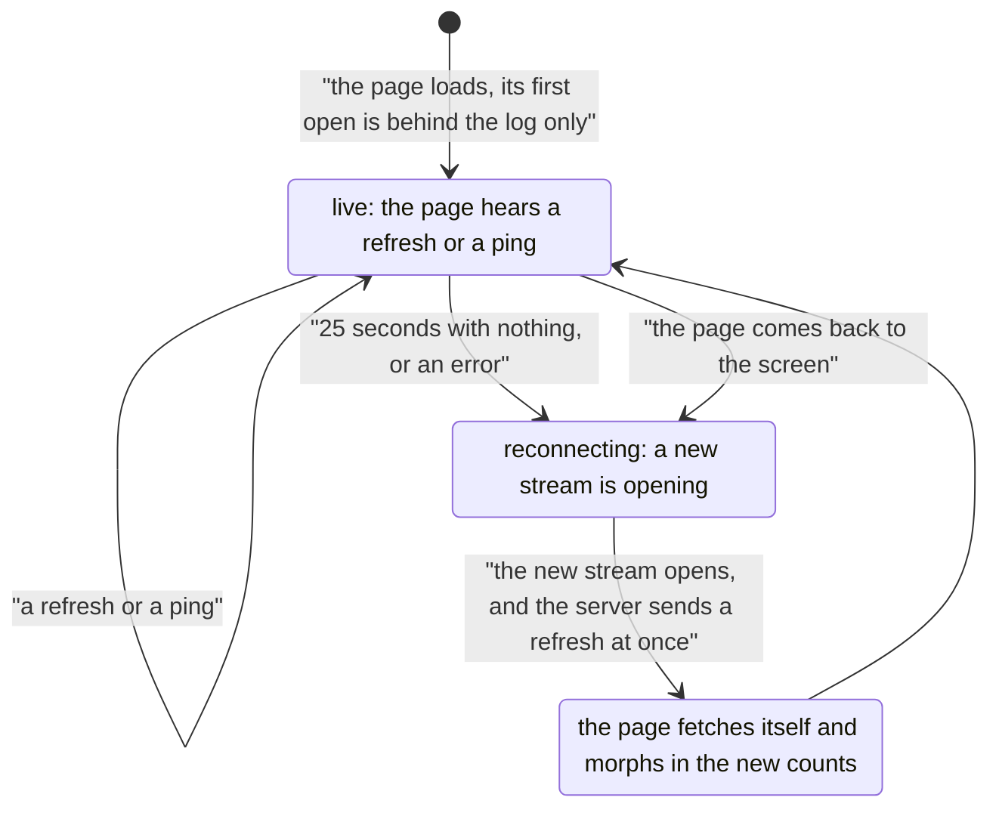

# The board's counts stay in sync on every page

careful: no, because the change is in how a board page learns of a change (the stream, the page's head and the board's script), and no topic is reached: no act of the board, no record, no landing rule and no setting changes.

## Acceptance criteria

Size: full, because the fix closes three ways a board page keeps old counts, in the server and in the board's script, which `tools/board-kit` builds again.

1. A refresh of the board always shows the whole page of the address it is at now, never an answer that Turbo fetched earlier for a link or for the task's panel:
   1. On the phone, the owner taps the card of project-rulings-one-list, and its panel opens.
   2. 3 seconds later Lem refuses his merge because the base moved, and the board refreshes.
   3. The page still has its sidebar, its inbox icon and its status bar, and the inbox icon and the sidebar's "Waits for you" both show the new number.
   - test: `bash tests/lem-serve.sh` in `tests/lem-serve.sh`, `tests/lib.sh`, `tests/checks.sh`, `tests/board-showcase.py`, `tests/board-cdp.mjs` (the check of a refresh soon after a finger opened a task's panel, `tapped_checks`)
2. A page that comes back to the screen, or connects again, gets each change it missed, also a change that adds no line to the event log:
   1. The phone shows 5 on the inbox icon and goes off the screen.
   2. On the Mac the owner types `/lem im-away`, and the criteria that waited for his yes go on without him: 4 things wait now.
   3. The phone comes back to the screen.
   4. In its first update, the inbox icon and the sidebar's "Waits for you" both show 4.
   - test: `bash tests/lem-serve.sh` in `tests/lem-serve.sh`, `tests/lib.sh`, `tests/checks.sh`, `tests/board-showcase.py`, `tests/board-cdp.mjs` (a stream opened again after a change outside the log gets a refresh; a first open gets none, and a quiet stream pings)
   - test: `python3 -B -m unittest discover -s tests/unit -p test_serve.py` in `tests/unit/test_serve.py` (`StreamOpen`)
3. A page on the screen whose connection stops without an error knows it within 30 seconds, says "reconnecting" in its status bar in place of "live", and gets the new counts as soon as the connection works again:
   1. The phone shows 5 on the inbox icon.
   2. The network stops forwarding but keeps the connection open.
   3. A task stops waiting for the owner.
   4. 30 seconds after the network stopped at the latest, the status bar says "reconnecting".
   5. The network forwards again, and both counts show 4 in the next update.
   - test: `bash tests/lem-serve.sh` in `tests/lem-serve.sh`, `tests/lib.sh`, `tests/checks.sh`, `tests/board-showcase.py`, `tests/board-cdp.mjs` (a phone page through a relay that stops, `relay_checks`)
4. On one page, the inbox icon and the sidebar's "Waits for you" show the same number after every update: when the owner confirms a merge in a task's panel on the phone, and the merge goes through or Lem refuses it, the two counts change in the same update.
   - test: `bash tests/lem-serve.sh` in `tests/lem-serve.sh`, `tests/lib.sh`, `tests/checks.sh`, `tests/board-showcase.py`, `tests/board-cdp.mjs` (the owner's merge from a task's panel on a phone, refused or gone through, `merge_checks`)

## How it works

A page's stream is live while it hears from the server, at least a ping every 10 seconds. After 25 seconds of silence the page takes it for dead, says "reconnecting" and opens a new stream; a stream that the page opens again always gets a refresh at once.

## Tasks

1. **A refresh renders the page of the address, never a prefetched answer** (criteria 1 and 4). The board's pages turn Turbo's link prefetch off (`<meta name="turbo-prefetch" content="false">` in `head()`), so that the stream's refresh can never take the panel-only answer of a tap's prefetch. The second investigator's check in `tests/lem-serve.sh` (commit ee7f461) then passes. A new check in the same block holds criterion 4 as a stand-in for the owner's phone: a phone page in headless Chrome (`tests/board-cdp.mjs`) opens a task's panel with a tap, logs the inbox icon's and the sidebar's numbers at every change of the page (a `MutationObserver`), and Lem's merge events are written as they come for a merge that goes through and for one that Lem refuses (the base moved). Each logged pair is equal, and the last one is the server's count. Files: `skills/lem/scripts/lem_board_pages.py`, `tests/lem-serve.sh`, and `tests/board-cdp.mjs` if a step it lacks is needed.
2. **A stream that opens again catches up, and a silent stream is noticed** (criteria 2 and 3). In the server (`skills/lem/scripts/serve.py`): a page's first open of its stream names the id it was rendered with in a parameter of its own, and gets a refresh at once only when the log grew past it, as today; any other open (`?since=N` from a page that opens again, or the browser's `Last-Event-ID`) gets a refresh at once, whatever the log. The quiet stream's sign of life becomes an event the page sees (`event: ping`, which Turbo does not render), every PING_SECONDS, now 10. In the board's script (`tools/board-kit/controllers/stream.js`): the first open sends the first parameter and every later open sends `since`; a page that heard nothing (no message and no ping) for 25 seconds closes its stream, takes it as down and opens a new one; a new stream that does not open within that time is opened again; the light request of a down page gives up after a few seconds; and a down page says "reconnecting" in its status bar, with the detail in its title. `npm --prefix tools/board-kit ci` and `npm --prefix tools/board-kit run build` write `skills/lem/assets/vendor/board-app.js` again, committed with the change. The first investigator's check (commit 7eb9e22) then passes. New checks: a first open at the log's count gets `: open` and no refresh, and a quiet stream sends a ping event within PING_SECONDS; for criterion 3, a phone page in headless Chrome reaches the board through a relay that the check stops (`kill -STOP`, so every socket stays open) and lets go again (`kill -CONT`), and the check reads "reconnecting" within 30 seconds of the stop and both counts at the server's new number after the relay goes on. Files: `skills/lem/scripts/serve.py` (the handler and its module docstring on the stream), `tools/board-kit/controllers/stream.js` (its head comment too), `skills/lem/assets/vendor/board-app.js`, `tests/lem-serve.sh`, `tests/unit/test_serve.py` where a rule of the open is a pure function.

No guide names the stream or its words in the status bar (`docs/board.md`, `README.md` and `site/index.html` say only that the board updates by itself), so the plan has no documentation task.

## Decisions

- **Prefetch off, not a refresh that skips Turbo's prefetch cache.** One meta line, which the investigator tried by hand and saw keep the whole page (`investigation.md`). Skipping the cache would reach into Turbo 8's private `LinkPrefetchObserver`, which a later Turbo may change. What it costs: a hover on a desktop no longer loads a link before the click. Undo: remove the meta line.
- **A page that opens its stream again always gets a refresh, and its first open does not.** The reopen is where a page may have missed a change outside the log (the owner's mark, the settings, the backlog, a task's files, the server's own acts), and one fetch on a page that comes back to the screen costs little. A version id that covers every watched file would need the page's render to read what each stream watches; this rule needs one parameter. The first open keeps today's rule, so a page that just loaded is not fetched twice. Undo: the server's open rule back to `since < count`.
- **A ping every 10 seconds and a silence of 25 seconds.** The page must say "reconnecting" within 30 seconds of a stop (criterion 3). The worst case is a stop just after a ping: the page says it 25 seconds later, plus at most one second of its tick. 10 and 25 are unmeasured estimates that keep a late ping from looking like a death. Undo: the two numbers.
- **"reconnecting" for every down state, with the detail in the title.** While the network is silent the light request also fails, and today's "lem serve does not answer" would then take the place of "reconnecting" that criterion 3 asks for. Undo: the two texts of `say()`.

## Not verified

- The owner's own split, the inbox icon behind the sidebar on one phone page, was not seen in Chrome, and Safari on iOS is not tried: no iPhone here. Criterion 4's check is its stand-in: it holds that the two counts never differ after any change of one page in Chrome at a phone's size, with the merge's two ends. A try on his phone after the merge is the next step for his exact case.
- A page passed through a joined machine (`lem_peers.forward`) takes the same stream; it is not tried.
