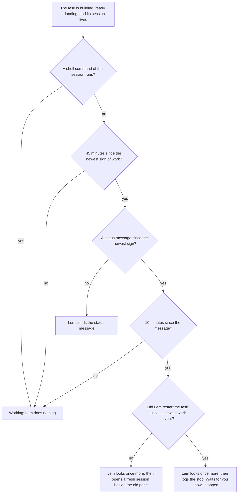

# A task whose session stopped gets a status message, one restart, then a row for the owner

careful: yes, because task 2 opens a fresh session of a task beside a pane that still shows its agent, so a wrong read of the signs puts two agents on one task's state and branch: the topics "A task's record is lost or wrong" and "A builder or a lead works outside its brief" are in reach.

## Acceptance criteria

Size: full, because the board server gets a new duty in three steps, a task's session gets a status message it answers, and "Waits for you" gets a new row.

1. A task in `building`, `ready` or `landing` whose session shows no sign of work for 45 minutes gets one message that asks for its status. No sign of work means all four: no new event of the task, no new line from the session's main thread, no subagent of the session that writes, and no shell command of the session that still runs.
   1. merge-leaves-board-lock is in `landing`. Its last event, the end of the checks, is at 10:54.
   2. After that, its session writes nothing, and no subagent or shell command of it runs.
   3. At 11:39 the board server sends the session a message that asks where the task stands and tells it to go on with its next step.
2. A session with any sign of work in the last 45 minutes gets no message: a landing whose checks run for 50 minutes with no event gets none, because the shell command of its checks still runs.
3. The status message restarts nothing. When the session shows a sign of work in the 10 minutes after the message, Lem does nothing more for that stop.
4. When the 10 minutes pass with no sign of work, Lem looks once more, and only when there is still none does it open a fresh session for the task, from its state and its handoff. The old pane stays open, since the board server closes no session; when it wakes later, it sees the newer session and closes itself.
   1. 11:49. merge-leaves-board-lock still shows no sign of work.
   2. Lem looks again, and there is still none.
   3. Lem opens a fresh session for the task. That session reads the state, `landing` after the checks passed, and runs `lem land propose`.
5. Lem restarts a task once for one stop. When the fresh session also gets the message and shows no sign of work in the 10 minutes after it, Lem opens no third session: the task shows in "Waits for you" as "stopped", with a button that opens a fresh session.
6. The task's timeline shows each act of Lem's: the status message, the restart and the stop, each with its time.
7. A task that waits for the owner (`held`), a queued task, a planned task, a blocked task, a task whose pull request is open, a parked task and an ended task get no message, whatever the time since their last event.

## How it works

The board server already asks `lem session list` at each look (`FORGE_TICK`, 20 seconds) and then
runs its duties (`serve.py:forge_loop`). The list gets the session's own signs of work; the model
adds the task's newest event; the duties take the three steps from the event log alone, so that a
pause of the server loses nothing. Each step that acts reads the signs once more inside the task's
lock first.

## Tasks

1. **`lem session list` says when each live task session last showed a sign of its own work.**
   Criteria 1 and 2.
   - `skills/lem/scripts/session.py`, `cmd_list`: each entry whose session is live gets `sign`
     (the ISO time of the newest line of the session's main thread or of any subagent's
     transcript, or null), `shell` (true while a shell command of the session runs) and `signs`
     (true when the session's signs could be read at all). The reading is one pure function over
     facts a unit case can give (the files' times, the process table's text), and one thin
     function that gathers those facts; put both in a new module `skills/lem/scripts/lem_signs.py`
     when that reads better than more of `session.py`, since the facts are Claude Code's files.
   - Where the facts are, as read on this Mac with Claude Code 2.1.330 on 2026-11-22 (each a
     fact to check again before it is coded, and to cite with its day in the code):
     - The task's Claude Code sessions are its `session.transcript` events (`claude`, the id, and
       `transcript`, the path), which `session_hook.py` logs at each SessionStart; take the ones
       logged at or after the task's newest `session.open`. The main thread's newest line is the
       transcript file's modification time.
     - A subagent writes `<transcript without .jsonl>/subagents/agent-*.jsonl`.
     - `~/.claude/sessions/<pid>.json` (under `CLAUDE_CONFIG_DIR` when it is set) holds `pid` and
       `sessionId`. A command of the Bash tool is a direct child of that pid whose command line
       sources `shell-snapshots/snapshot-` (`ps -A -o pid=,ppid=,command=`); a background command
       (`run_in_background`) has the same form. Other children (a hook's process, `caffeinate`)
       are no shell command. Check with a real subagent whether its Bash commands are children of
       the same pid, and say what was seen in the report.
   - With no transcript record since the newest open (a Codex seat, a hook that did not run),
     `signs` is false. With a record but no process file for its id, `shell` is false and the
     files still give `sign`.
   - `skills/lem/scripts/lem_board_model.py`, `session_entries`: carry `sign`, `shell` and
     `signs` into `Model.sessions`.
   - Tests: unit cases in `tests/unit/test_session.py` (or a `test_signs.py`) for the pure
     function: a transcript only, a newer subagent file, a Bash shell child, a hook child that is
     not one, no record, a record with no process file. No new block journey.
2. **The board server sends the status message, restarts once, then logs the stop.** Criteria 1,
   2, 3, 4, 5 and 7.
   - `skills/lem/scripts/lem_board_model.py`: a pure rule of the stop over the task and the model
     (`m.now`, `Model.sessions`): the task is `building`, `ready` or `landing`, not parked, its
     session lives (`live_of`), its `signs` read, no `shell`; its newest sign of work is the newest
     of `sign` and of the task's newest event other than Lem's own acts of this guard (the status
     wake and `session.stopped`). It gives the step that is due: `status` at 45 minutes with no
     status wake since that sign; `restart` 10 minutes after that wake when no `session.open
     why=stopped` came after the task's newest work event (any event but `session.*`); `stopped`
     10 minutes after the wake when one did; or nothing. The 45 and the 10 are constants with
     their source, the owner's words of 2026-11-22 in `directions.md`.
   - `skills/lem/scripts/serve.py`, `duties`: three duties from that rule, `wake … status`,
     `open … stopped` and `stopped … stopped` (`lem session stopped SLUG`), and its docstring
     names each. Never for a demo workspace, and never while `Model.sessions` is None.
   - `skills/lem/scripts/session.py`:
     - `wake --why status` sends a line that asks where the task stands and tells the session to
       go on with its next step, and logs `session.wake why=status`. `status` joins `WAKES`.
     - `open --why stopped` reads the signs once more in the task's lock, and when there is still
       none since the newest status wake, opens a fresh session beside the live one (the
       `replacing` path of `cmd_open`) and logs `session.open why=stopped`; when a sign came, it
       opens nothing and prints `working: true`. `stopped` joins `WHYS`.
     - `stopped SLUG` reads the signs once more the same way, and logs `session.stopped` with the
       session's id, or prints `working: true`. `session.stopped` joins `EVENTS`.
   - Fit the investigator's cases of 0d8b44ed (`tests.unit.test_serve.StoppedSession`,
     `tests.unit.test_board_model.StoppedSession`) to these criteria: they were written for the
     owner's first pick (wake, then show).
   - Tests: unit cases in `tests/unit/test_serve.py` and `tests/unit/test_board_model.py` for each
     step on the events of #37 (10:54, 11:39, 11:49, and the fresh session's own stop), one for a
     shell that runs for 50 minutes, one for a sign in the 10 minutes, and one for each status of
     criterion 7. One check in `tests/lem-session.sh` that `open --why stopped` opens beside a live
     session with the stand-in for agtermctl, and refuses with a sign, only when it costs no new
     journey of its own.
3. **The board shows the stop and each act.** Criteria 5 and 6.
   - `skills/lem/scripts/lem_board_model.py`: a row `stopped` of `waits_of` while the task's
     newest `session.stopped` has no work event after it, with its `wait_say` ("Its session
     stopped" and where he acts) and its place in `WAIT_ORDER`; `opens_session` is true for it,
     although the pane lives. The timeline's words for `session.wake why=status` (the status
     message), `session.open why=stopped` (the restart) and `session.stopped` (the stop), each with
     its time, beside the ones of `session.wake` and `session.open` around line 1581.
   - `skills/lem/scripts/serve.py`, `act_session`: the button of a stopped task runs `lem session
     open SLUG --why stopped`.
   - `skills/lem/scripts/project.py`, `cmd_waiting`: the row is in the list as the board has it.
   - Tests: unit cases in `tests/unit/test_board_model.py` (the row, its words, the timeline's three
     words) and, when it costs no new journey, one check of the button in
     `tests/lem-board-act.sh`.
4. **A task's session answers the status message, and an old pane closes itself.** Criteria 1
   and 4.
   - `skills/lem/prompts/session.md`: `opened because:` names `stopped` (Lem's guard opened it
     after the session before it stopped); "A wake-up" takes `lem: SLUG status`: read the files,
     say in one line where the task stands, and go on with the next step, as for any wake-up.
     Before acting on any wake-up, the session checks that it is still the task's newest
     (`lem session list`), and closes itself as "First" says when it is not.
   - No test: a stage text, whose test is a real task.
5. **The documents say what Lem does with a stopped session.** No criterion.
   - The texts that list what the board server does or the rows of "Waits for you":
     `skills/lem/SKILL.md` ("The board's server"), `skills/lem/stages/status.md`,
     `docs/board.md`, `docs/when-lem-needs-you.md`, and `site/index.html` where it says the same,
     and the module docstrings of `serve.py` and `session.py`. Find each with a search for
     "no session", "deaf" and "does not answer", and change only a sentence the change makes false.

Task 1 comes first. Tasks 2, 3 and 4 follow in that order, since 3 reads the events 2 names. Task
5 comes last.

## Decisions

- **The signs come from `lem session list`, which the server already runs at each look.** One
  place reads Claude Code's files, and `lem project waiting` and the board read the same entries.
  It rests on `look_sessions` running before `run_duties` at each `FORGE_TICK`.
- **A session whose signs cannot be read gets no message.** The owner's words: a task counts as
  stopped "only on plain evidence". A Codex seat or a session with no transcript record shows no
  evidence either way, and a restart beside it could put two agents on one branch.
- **Each act reads the signs once more in the task's lock** (criterion 4's "looks once more"):
  `open --why stopped` and `stopped` refuse when a sign came, so a list read 20 seconds before
  cannot start a second agent.
- **"One stop" ends with a work event of the task.** A restart is spent until the task logs an
  event that is not `session.*`; a fresh session's own transcript lines do not end the stop, since
  else a fresh session that reads its files and stops would be restarted each hour.
- **A session that waits at a prompt on its screen counts as stopped.** A build asks the owner
  nothing and Lem assumes auto mode (the rulings), so such a prompt is itself a stop; the old pane
  stays open for him, and criterion 4 says when it wakes it closes itself. This is the decision
  the plan talk should test first.
- **The owner's button uses the same `open --why stopped`**, so it opens beside the live pane, and
  its fresh session is not restarted again by the guard (it is the newest `why=stopped` open).

## What it will not verify

- A real stop: the guard's test is the next task whose session stops. The unit cases replay the
  events of #37.
- That a subagent's shell is a child of the session's process is checked once by hand in task 1,
  not by a test, since it needs a real Claude Code.
- The forked transcript that `session_hook.py` logs on the wrong task (`outside.md`): it can make a
  task look quiet while a forked job works on it. The polish pass fixes or files it.
