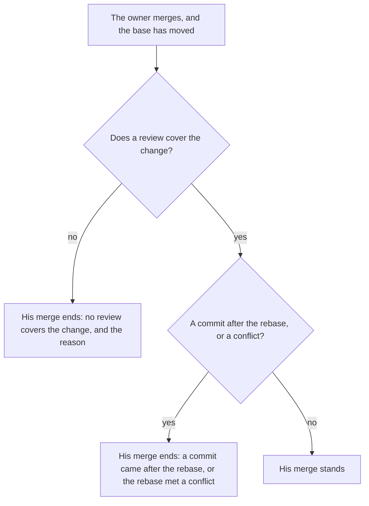

# An ended merge of the owner names its cause

careful: no, because the change gives the `owner_merge` line of `lem land propose` a true reason where it already ends the owner's merge, and touches neither the rule that says whether a review covers the change (`covered` in `cmd_base`) nor the path where his merge stands (`carried_over`, the stand branch of `tap_after`): checked against each of the thirteen topics of `.lem/project.toml`; the nearest, "The landing lets through a change that should not land", is not reached, since every merge that ends today still ends and none that ends today stands after it.

## Acceptance criteria

Size: full, because the fast track's one criterion named a cause the code does not have, and the line's true cause, a review that does not cover the change, needs its own rule beside the two causes the line names today.

1. When `lem land propose` ends the owner's merge after a moved base because no review covers the change, its `owner_merge` line says that no review covers the change and gives the reason, and says nothing of a commit after the rebase or a conflict:
   1. Review round 2 of a task, at tip 6c5055c2d, leaves 1 must-fix.
   2. A builder fixes it, and no review reads the fix.
   3. The base moves, and the owner merges the task's pull request.
   4. The rebase meets no conflict, and no commit comes after it.
   5. `lem land propose` ends his merge, and its `owner_merge` line says that no review covers the change: round 2 left 1 must-fix, and no review read the change after it.
   - test: `python3 -B -m unittest tests.unit.test_land.MovedBase.test_why_no_review_covers_the_change_names_the_newest_reviews_reason` in `tests/unit/test_land.py`
   - test: `python3 -B -m unittest tests.unit.test_land.MovedBase.test_an_ended_merge_says_that_no_review_covers_the_change` in `tests/unit/test_land.py`
2. When `lem land propose` ends the owner's merge after a moved base while a review covers the change, because a commit came after the rebase or the rebase met a conflict, its `owner_merge` line still says that a commit came after the rebase or that the rebase met a conflict: the rebase of a task whose review found nothing to fix meets a conflict in `README.md`, and the line names the rebase and the conflict, as it does today.
   - test: `python3 -B -m unittest tests.unit.test_land.MovedBase.test_an_ended_merge_after_a_covering_review_keeps_its_line` in `tests/unit/test_land.py`

## How it works

Today, in `skills/lem/scripts/land.py`:

1. `cmd_base` decides `covered` before the rebase: the newest review that answered left no
   must-fix, and `covers` it the change.
2. Only a rebase with no conflict while `covered` keeps `rebase_carried = {"from": origin, "to": tip}`.
3. `propose` calls `carry_merge`, whose `tap_after` keeps the owner's merge only when
   `carried_over` finds that record from the proposed tip to the new one.
4. Every other case ends his merge with one line: "the change is not the one the owner merged: a
   commit came after the rebase, or the rebase met a conflict". A review that does not cover the
   change takes that line too, and its cause is lost: `cmd_base` keeps no reason for `covered` false.

After: `cmd_base` keeps why no review covers the change, from the tip before the rebase to the one
after it, and `tap_after` names that reason where it ends the merge today.

## Tasks

1. **The reason no review covers the change reaches the `owner_merge` line.** Serves criteria 1 and 2.
   - `skills/lem/scripts/land.py`: one pure function, beside `covered`, that takes the reviews that
     answered (`read["answered"]` true, in order), the backlog folder and the change as it is now
     (`change(task)`), and gives why no review covers the change, or None when the newest one
     covers it. Its words, each from the newest review that answered (`last`):
     - no review answered: `no review answered for the change`;
     - `last["must_fix"]` is N > 0: `round R left N must-fix, and no review read the change after it`
       (R is `last["round"]`);
     - `covered(folder, last, now)` is false: `no review read what changed after round R`.
     It is None exactly when the `covered` of `cmd_base` is true; a unit case holds that for each
     of the three causes and for a review that covers the change.
   - `cmd_base`: **the line that sets `covered` stays as it is.** Beside it, the new function gives
     the reason. The conflict record (`task.keep(conflict=...)`) keeps it beside `covered`, as
     `uncovered`, so a rebase after a builder's resolution finds the reason of the change before the
     conflict, as it finds `covered`. After the rebase, when `tip != origin` and the change is not
     covered, keep `rebase_uncovered = {"from": origin, "to": tip, "why": REASON}`; reset
     `rebase_uncovered` to None wherever `rebase_carried` is reset (the `updates` of `cmd_base` and
     the `task.keep` of an open task's new landing in `start_locked`).
   - `tap_after` and `carry_merge`: `tap_after` takes the kept `rebase_uncovered`. In its branch
     that ends the merge for `not carried_over` (and only there), when `tap["tip"] == old` and
     `rebase_uncovered` is from `old` to `new`, the reason is
     `no review covers the change: WHY`; every other case of that branch keeps today's words. The
     branch where his merge stands, and the one for changed reasons of not green, stay as they are.
     `carry_merge` passes `kept.get("rebase_uncovered")`. `propose` then prints
     `"owner_merge": "ended: no review covers the change: round 2 left 1 must-fix, and no review read the change after it; the owner merges it again"`.
   - `tests/unit/test_land.py`, class `MovedBase`: the criterion tests (criterion 1: the reason
     function's three causes and None for a covering review, and `tap_after` with a
     `rebase_uncovered` from `aaa` to `bbb` whose line says `no review covers the change`, gives the
     must-fix reason, and holds neither "a commit came after the rebase" nor "conflict"; criterion
     2: `tap_after` with no `rebase_uncovered`, for a commit after the rebase and for a conflict, still
     gives today's line). Each calls the new function or the new parameter, so it fails on the base
     commit, as `lem criteria red` asks.
   - one journey check, in the block that already lands an open task again after the owner's merge
     was refused on a moved base (`tests/lem-land-github.sh` near its pass line "after a merge an
     open task with no conflict waits as it is ..." or `tests/lem-land-shop.sh` near "a base that
     moved by a document is refused too ..."; the builder picks the one where a review that left a
     must-fix fits with the fewest new steps). It shows that a real rebase keeps `rebase_uncovered`
     with the reason and that `propose` prints the new `owner_merge` line. Add no new journey, and
     keep every existing pass line's words: `docs/rulings/history.md` may name it.
2. **The documents say the third cause.** Serves no criterion.
   - `skills/lem/scripts/land.py`, the module docstring (the text of `lem land --help`), the
     paragraph that ends "A commit after the rebase, a conflict or other reasons end it, and
     `propose` says why (`owner_merge`)": a review that does not cover the change ends it too, and
     `propose` names the review's reason (`rebase_uncovered`).
   - `skills/lem/stages/land.md`, step 8, `--by owner`: the parenthesis after `"owner_merge":
     "ended: WHY"` gets "no review covers the change" beside a commit after the rebase, a conflict
     and changed reasons for not green.
   - `docs/pull-request.md` and `site/index.html` name no reason of an ended merge today (grep for
     `owner_merge`, "merge stands" and "owner's merge" found none): no change there.

## Decisions

- The rule of `covered` and the path where the owner's merge stands are not touched: the reason is
  computed beside them, and read only where his merge already ends. So a defect in the new code can
  give wrong words, and never a merge that stands when it should end. This keeps the task out of the
  topic "The landing lets through a change that should not land" (the `careful: no` above).
- The reason is kept in the landing's record at the rebase (`rebase_uncovered`), not computed again
  at `propose`: at `propose` the reads and the change may be newer than at the rebase, and the cause
  is what held when the rebase ran. Lem is not released, so the record takes the new key with no
  reading of a form before it (`AGENTS.md`).
- The words follow the review's own words of `read`'s `unmet` ("the last one left N must-fix",
  "nobody reviewed what changed after it") with the round named, since the owner reads this line
  alone, without the review's record beside it.
- Decision 1 of the task stands: whether a rebase that only drops commits the base holds should
  still end the owner's merge is out of scope.

## What it will not verify

- The line in a real task: only a real merge of the owner on a moved base with an uncovered review
  shows it on the board. The journey check runs the same steps on a throwaway repository.
