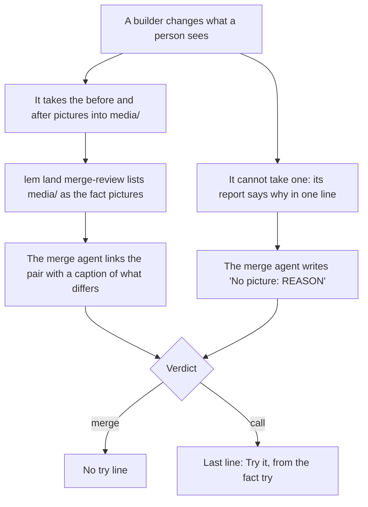

# A visual change's merge review shows its screenshots

careful: no, because criterion 6 keeps the verdict rule: no task edits "## Decide" of `merge.md`, `verdict_of`, `merger_refusal` or the `calls` line of `cmd_merge_review`, so the topic "The landing lets through a change that should not land, one a person should merge" is not reached; the pictures and the try line are text of the review and two facts of its brief, which no rule of the merge reads.

## Acceptance criteria

Size: full, because the merge agent's brief, the fast-track builder's brief and the merge brief's facts each change, and the board must show what they link.

1. The merge review of a change to what a person sees shows the task's screenshots, and the board's Overview draws them in its merge review card:
   1. The task hero-logo-animated-background has `media/hero-before-dark.png` and `media/hero-after-dark.png`.
   2. The merge agent writes `merge-review.md`.
   3. The review links both pictures, side by side or one under the other, with a caption that says what differs.
   4. The owner opens the task on the board, and its merge review card shows the two pictures.
2. A change on the fast track that changes what a person sees gets its before and after pictures from its one builder, and its merge review shows them: a fix of a button's color on the board has `media/button-before.png` and `media/button-after.png`, and its review shows both beside its words, which stay at 60 at most.
3. A change to what a person sees whose task has no picture says so in one line of its review, with the reason its builder gave: "No picture: the page needs a login this machine does not have."
4. A change that shows nothing on a screen has no picture and no line about pictures in its review: a fix of the order of the checks in `land.py` has a review with words only.
5. A review that calls the owner for a change to what a person sees ends with one line on how he tries the branch himself: "Try it: the branch is in `.lem/worktrees/board-colors`, or `gh pr checkout 41`." A review whose verdict is merge has no such line.
6. A picture, or the lack of one, never turns a merge into a call or a call into a merge: a green fast-track change of the board's colors with no picture still gets `Verdict: merge.`, with the line of criterion 3.

## How it works

The merge agent cannot take a picture: it changes nothing. So the builders take the pictures while
they build, and the merge agent links the ones they made. Its brief gets two new facts from
`lem land merge-review`: `pictures`, each picture of the task's `media/` folder by its path from
the task directory (`media/hero-before-dark.png`), and `try`, the two ways the owner gets the
branch (the worktree's folder from the main checkout, and the forge's checkout command with the
pull request's number). `merge-review.md` lives in the task directory, so a `media/NAME` link in
it is the task's picture, and the board's markdown reader already draws it in the merge review
card, a `-before`/`-after` pair side by side.

## Tasks

1. **The merge agent shows the pictures, and says how to try the branch when it calls.**
   Criteria 1, 3, 4, 5 and 6.
   - `skills/lem/scripts/land.py`, `cmd_merge_review`: two new facts of the brief, each from a
     pure function a unit case calls. `pictures`: the files of the task directory's `media/`
     whose suffix the board's media route serves (PNG, JPEG, GIF, WebP), as `media/NAME` paths,
     sorted, `[]` when there is no such folder. `try`: `{"worktree": ..., "checkout": "gh pr
     checkout N"}`, the worktree's path relative to the main checkout when it is under it
     (`.lem/worktrees/SLUG`), else its absolute path, and `N` the number of `kept["pr"]`. No
     other line of the function changes: not the refusal, not `calls`, not `why`.
   - `skills/lem/prompts/merge.md`: the facts paragraph names `pictures` and `try`. Under
     "## Write", a part for a change to what a person sees, told as the merge agent decides it
     from the criteria, the report and the diff: link the builders' before and after pictures
     from `pictures` that the report or a builder's report links (three at most, a pair side by
     side or one under the other, as `prompts/writing.md`, "A screenshot", says), each with a
     caption that says what differs; with none, one line `No picture: REASON`, the reason the
     builder gave, or that it gave none; a change that shows nothing on a screen gets no picture
     and no line about pictures. A review whose verdict is call, of a change to what a person
     sees, ends with the line `Try it: the branch is in WORKTREE, or CHECKOUT.` from `try`; a
     merge verdict has no such line. The bound for a safe fast-track change keeps its 60 words;
     the picture lines, their captions and the no-picture line come after those words and are
     not counted. "## Decide" is not edited, and the new text says in one sentence that a
     picture or its lack is no reason to call or to merge.
   - Tests: unit cases in `tests/unit/test_land.py` for both functions (a folder with pictures,
     a text file and a subfolder; no folder; a worktree under the main checkout and one outside
     it). One added `grep` in the merge brief check of `tests/lem-land-shop.sh` (around line
     133) that the brief holds `"pictures"` and `"try"`, only when it costs no new journey.
2. **The fast track's one builder takes the pictures of a visual change.** Criteria 2 and 3.
   - `skills/lem/prompts/small.md`: its opening says it reads `SKILL_DIR/prompts/writing.md`, "A
     picture" and "A screenshot", for a change to what a person sees, besides its standing rules.
     A new step before "Make the change": for such a change, take the "before" picture of the
     view on the base, then the "after" when the change is made, into the task directory's
     `media/` as a pair (`media/NAME-before.png`, `media/NAME-after.png`) with `take-screenshot`;
     when it cannot take one, the reason in one line. Step 9's reply gets one more line: the
     pictures by their paths, `No picture: REASON`, or `no picture: nothing on a screen changed`.
     The reply's limit grows from five lines to six.
   - `skills/lem/stages/new.md`, "The fast track", step 3: "of five lines at most" follows the
     new limit of six, and the session copies the picture line into `report.md` with each
     picture as a link with its caption, so that the merge agent and the board find it.
   - `skills/lem/stages/build.md`, "## The report", "what the owner gets": beside "the builders'
     pictures of `media/`", a builder's one line of why it took no picture of a change to what a
     person sees, so that the merge agent has the reason of criterion 3 on the standard track too.
   - No test: these are a builder's and a session's briefs, whose test is a real task.
3. **The documentation says what the merge review now holds.** No criterion.
   - `docs/pull-request.md`, "## The merge review": after "For a safe small change, it is the
     verdict and three sentences.", one or two sentences in the guide's STE: a change to what you
     see shows the builders' before and after pictures, or says why there is none, and a review
     that calls you for it ends with how to try the branch.
   - `docs/when-lem-needs-you.md`, "## The merge review", and `site/index.html` (line 106) say
     nothing the change makes false: read them, and change them only if a sentence is false.
   - `README.md` and `site/index.html` change together only when one of them changes.

Tasks 1 and 2 touch no file in common and run at the same time; task 3 comes after both.

## Decisions

- **The try line's two values are facts of the brief, not the agent's own read**: `try` in the
  merge brief. It rests on the rule that a stage names no tool: the forge's command (`gh pr
  checkout`) is written by `land.py`, which already runs `gh`, and the merge agent copies it.
  The worktree's folder and the number are already in `kept`, so the fact costs no new read.
- **The merge agent tells a visual change from the criteria, the report and the diff.** No new
  flag or record: the builders already decide it when they take pictures (`build.md` line 39),
  and the report carries them. A `pictures` list that is not empty is no proof (an interview or
  an investigation may leave pictures of the code before the change), so the agent links only the
  pictures the reports link.
- **The pictures and the no-picture line are outside the 60 words of a safe fast-track review.**
  Criterion 2 says the words "stay at 60 at most" beside the pictures; counting a caption would
  push a review with two pictures over its bound with no word of the story.
- **The board draws the pictures as it is.** `merge_review_card` renders `merge-review.md` with
  `P.md_block(..., slug=t.slug)`, and `tools/board-kit/entry.js` loads a `media/` picture through
  the task's media route and puts a `-before`/`-after` pair side by side. No board code changes.
- **The pull request on GitHub keeps no picture**: decision 1 of the task's record.

## What it will not verify

- The merge agent's and the fast-track builder's behavior: both are text of a brief. Their test
  is the next real task that changes what a person sees, and its merge review.
- The board's draw of the pictures in a browser: the markdown reader is the one every document of
  the task goes through, unchanged here. A unit case of `merge_review_card` with two `media/`
  links passes on the base too, so it cannot hold criterion 1 by the check on the base.
