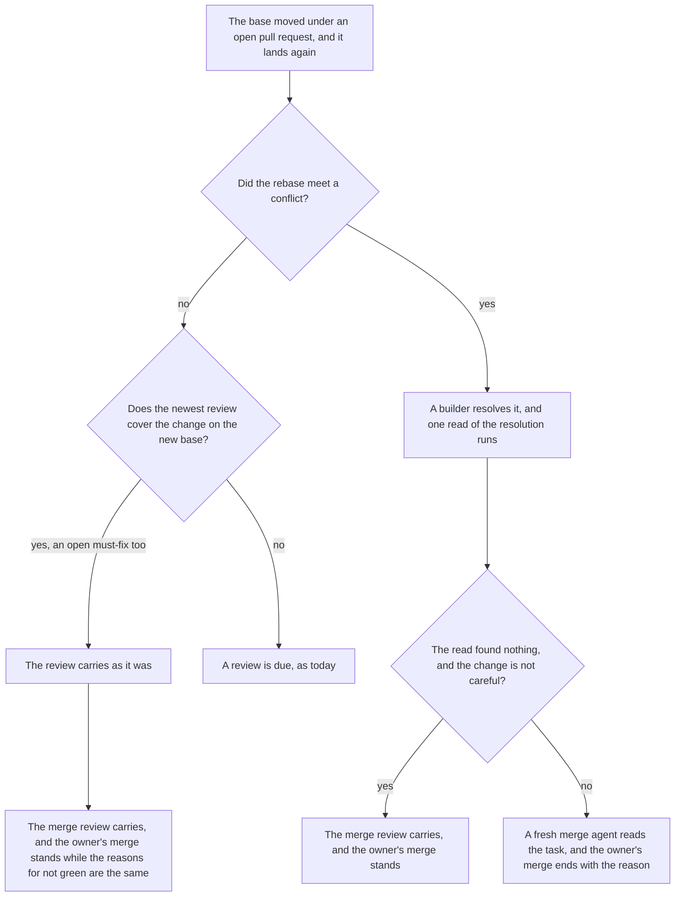

# A clean read of a resolved conflict, and a clean rebase of an open must-fix, keep the merge review

careful: yes, because it changes when a moved base carries a review and a merge review to a new tip, which reaches the owner's topics "A pull request says green when it should not" and "The landing lets through a change that should not land: one the checks or the review did not pass".

## Acceptance criteria

Size: full, because it changes what carries over a moved base in the landing's review, its merge review and the owner's merge, a careful part of Lem.

1. After a conflict with the base, a clean resolution read on a change that is not careful carries the merge review over to the new tip: no fresh merge agent reads the task, and the owner's merge, when he gave one, stands.
   1. Task board-cards-keyboard has pull request 39 open, with the merge agent's verdict "merge".
   2. The base moves, and GitHub calls pull request 39 conflicting.
   3. A builder resolves the conflict, and the resolution read finds nothing.
   4. The merge review of step 1 carries to the new tip, no fresh merge agent starts, and the board server merges pull request 39 by that verdict.
2. After a conflict with the base, a resolution read with a finding, or a careful change, still gets a fresh merge agent's read, and the owner's merge given before the conflict ends as it does today.
   1. Task board-cards-keyboard is careful, and the owner merged its pull request 39.
   2. The base moves, a builder resolves the conflict, and the resolution read finds nothing.
   3. A fresh merge agent reads the task, and the owner's merge ends with the reason that the rebase met a conflict.
3. A clean rebase of a reviewed change whose last review round left a must-fix open carries that review as it was: the must-fix stays open, the pull request stays not green for it, the merge review carries over, and the owner's merge given before stands.
   1. The last review round of task bold-outcome-quoted-whole leaves 1 must-fix open, and pull request 31 is not green for it.
   2. The merge agent calls the owner, and he merges pull request 31.
   3. The base moves, and the rebase meets no conflict.
   4. Pull request 31 is still not green for the same must-fix, no fresh merge agent starts, and the owner's merge stands: the board server merges pull request 31 when its checks are green on the new tip.
4. At each moved base, the pull request's text and the event log say whether the review and the merge review carried over, and when a fresh merge agent read the task, the reason: a resolution read with a finding, or a careful change. Example: pull request 39 says "the merge review carried over the resolved conflict: the resolution read found nothing".

## How it works

What a new landing of an open task keeps of what was said at its merge, after its base moved:

## Tasks

1. **A clean rebase carries a review that left a must-fix open** (criteria 3 and 4). In `skills/lem/scripts/land.py`:
   - `cmd_base` decides two things where it now decides one. Whether the newest review that answered still covers the change (`covers`, whatever its must-fix count) decides the carry of a rebase with no conflict: the new patch joins that review's `carried`, and `rebase_carried` is set, so `carry_merge` and `tap_after` find it as today. Whether it also left no must-fix stays the `covered` of a conflict's record, which decides between one read of the resolution and the rules of the change (`due_of`): a conflict on a change with an open must-fix gets a round, as today.
   - `why_uncovered` is None whenever the newest review covers the change, also with its open must-fix, so `rebase_uncovered` is set only when the carry did not happen; its words for a must-fix that a builder fixed after the review stay.
   - `due_of` needs no change: the open must-fix stays a reason for not green (`the last one left 1 must-fix`) on the new tip, in the same words, so `tap_after` sees the same reasons and the owner's merge stands.
   - The pull request's text and the `proposed` event of a landing that started from `open` say that the review carried over the rebase, with its open must-fix when it left one (the shared line of task 2).
   - Tests: unit cases for `why_uncovered` and for the carry rule of `cmd_base`, taken out as a pure function of the reviews that answered and the change (`tests/unit/test_land.py`, class `MovedBase`, whose `assert_why` today holds the old rule). One journey in the block that holds the owner's merge on a moved base (`tests/lem-board-act.sh`, beside "second-move"): two rounds leave 1 must-fix, the merge agent calls the owner, his merge is refused for a moved base, a read says another round, the rebase meets no conflict; `propose` prints `"merge_review": "carried"` and an `owner_merge` that stands, the request is not green for the same must-fix, and the server merges it with `--standing`.
2. **A clean read of a resolved conflict carries the merge review, and every moved base says what carried** (criteria 1, 2 and 4). In `skills/lem/scripts/land.py`:
   - One pure rule says whether what was said of the proposed tip at its merge carries onto the new tip, and why, from the kept record (the proposed tip, `rebase_carried`, `resolution` and the read it names), the new tip, and why the request is careful. It carries for the tip a rebase with no conflict made (today's `carried_over`), and for the tip of a builder's resolution when the resolution's `before` is the proposed tip, its `after` is the new tip, its read answered with 0 must-fix, 0 should and 0 nit, and the request is not careful. Otherwise it gives the reason: the read's counts when it found something, the first reason the request is careful, a commit after the rebase, or the reason no review covers the change (`rebase_uncovered`).
   - `carry_merge` and `tap_after` take that rule: the merge review carries onto the resolution's tip (`merge.review` with `carried`, its `calls` worked out again from the rules as today), and the owner's merge stands; when it does not carry, his merge ends with the rule's reason, and `propose` prints `"merge_review": null` with that reason, so the session starts a fresh merge agent (step 7 of `stages/land.md`).
   - The rule runs before the pull request's text is written, so one result gives the text and the log. `synced`'s line gains what carried: "the review carried over the rebase" (with "and its open must-fix" from task 1), or "one read of the resolution", and "the merge review carried over the resolved conflict: the resolution read found nothing", "the merge review carried over the rebase", or "a fresh merge agent reads it: REASON". The `proposed` event of a landing that started from `open` gains the same facts as fields (`review`, `merge_review`, `why`), so the log needs no new event.
   - The module's docstring says the new rule where it says that a resolved conflict is read again.
   - Tests: unit cases of the rule for each branch (a clean rebase; a resolution read with nothing; with a should; with a must-fix; a careful change; a commit after the resolution) and of `synced`'s line (`tests/unit/test_land.py`). The conflict journey in `tests/lem-land-github.sh` ("a conflict after a merge") goes on to the merge review: one recorded before the conflict carries to the resolution's tip, the text and `proposed` say it, and with the owner's merge before the conflict it stands; one check there for a careful change, where nothing carries and the reason is the careful one. The server's merge by a carried review is today's path, which `tests/lem-board-act.sh` holds.
3. **The texts say the new carry** (criteria 1, 2 and 3). Each says today that a resolved conflict always gets a fresh merge agent, or that only a review with no must-fix carries:
   - `skills/lem/stages/land.md`, step 7, the paragraph on a proposal made again: a resolved conflict whose one read found nothing, on a change that is not careful, keeps the merge review like a rebase with no conflict; a read with a finding, or a careful change, prints `"merge_review": null` with its reason, and a fresh merge agent reads it.
   - `skills/lem/stages/conflict.md`, its last step: step 7 runs only when `propose` did not carry the merge review.
   - `docs/pull-request.md`, "A conflict": the merge agent reads the pull request again only when the read found something or the change is careful. `site/index.html` says nothing of a conflict (`grep -i conflict`), so it stays.
   - Every other text that says a review carries only when it left no must-fix, or that a resolved conflict is always read again (`grep` for "conflict", "carr" and "must-fix" over `skills/`, `docs/`, `README.md`, `AGENTS.md` and `site/`).

## Decisions of the plan

- **"Finds nothing" is an answered read with 0 must-fix, 0 should and 0 nit.** Criterion 1 says "finds nothing" and criterion 2 "a finding"; a should or a nit is a finding a merge agent may want to weigh. Rests on: the two criteria's words. The cost is one merge agent's read where a resolution read found a nit.
- **A conflict on a change with an open must-fix keeps today's path.** Its `covered` stays false, so it gets the rules of the change, a round, and no carry. No criterion names that case, and a resolution on top of an open must-fix is new code no review saw whole.
- **A careful change never carries over a resolved conflict, also after the full set read the resolution clean.** Criterion 2 says so in its words.
- **Criterion 4 reaches each moved base that lands the task again** (a landing that starts from `open`). A move that the merge agent's read calls safe merges with no new landing, and the task `moved-base-merge-agent-call` already writes its line into the pull request's text and the merge commit.
- **No new event.** The `proposed` event of the new landing carries the facts; it is the one event each new landing logs at its end.

## What this will not verify

- A real conflict on GitHub with real agents: the journeys use the stand-in for `gh` and a test in the place of the builder and the reviewer, as the conflict journey does today.
- Whether a resolution read that found nothing is often wrong: the review keeps its counts and the merge review its reason, for the retro.
