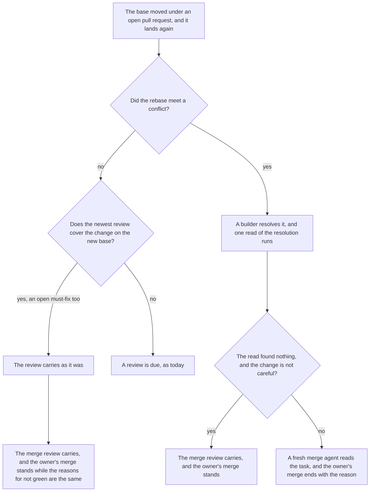

# A clean read of a resolved conflict, and a clean rebase of an open must-fix, keep the merge review

careful: yes, because it changes when a moved base carries a review and a merge review to a new tip, which reaches the owner's topics "A pull request says green when it should not" and "The landing lets through a change that should not land: one the checks or the review did not pass".

## Acceptance criteria

Size: full, because it changes what carries over a moved base in the landing's review, its merge review and the owner's merge, a careful part of Lem.

1. After a conflict with the base, a clean resolution read on a change that is not careful carries the merge review over to the new tip: no fresh merge agent reads the task, and the owner's merge, when he gave one, stands.
   1. Task board-cards-keyboard has pull request 39 open, with the merge agent's verdict "merge".
   2. The base moves, and GitHub calls pull request 39 conflicting.
   3. A builder resolves the conflict, and the resolution read finds nothing.
   4. The merge review of step 1 carries to the new tip, no fresh merge agent starts, and the board server merges pull request 39 by that verdict.
2. After a conflict with the base, a resolution read with a finding, or a careful change, still gets a fresh merge agent's read, and the owner's merge given before the conflict ends as it does today.
   1. Task board-cards-keyboard is careful, and the owner merged its pull request 39.
   2. The base moves, a builder resolves the conflict, and the resolution read finds nothing.
   3. A fresh merge agent reads the task, and the owner's merge ends with the reason that the rebase met a conflict.
3. A clean rebase of a reviewed change whose last review round left a must-fix open carries that review as it was: the must-fix stays open, the pull request stays not green for it, the merge review carries over, and the owner's merge given before stands.
   1. The last review round of task bold-outcome-quoted-whole leaves 1 must-fix open, and pull request 31 is not green for it.
   2. The merge agent calls the owner, and he merges pull request 31.
   3. The base moves, and the rebase meets no conflict.
   4. Pull request 31 is still not green for the same must-fix, no fresh merge agent starts, and the owner's merge stands: the board server merges pull request 31 when its checks are green on the new tip.
4. At each moved base, the pull request's text and the event log say whether the review and the merge review carried over, and when a fresh merge agent read the task, the reason: a resolution read with a finding, or a careful change. Example: pull request 39 says "the merge review carried over the resolved conflict: the resolution read found nothing".

## How it works

What a new landing of an open task keeps of what was said at its merge, after its base moved:

## Tasks

1. **A clean rebase carries a review that left a must-fix open** (criteria 3 and 4). In `skills/lem/scripts/land.py`:
   - `cmd_base` decides two things where it now decides one. Whether the newest review that answered still covers the change (`covers`, whatever its must-fix count) decides the carry of a rebase with no conflict: the new patch joins that review's `carried`, and `rebase_carried` is set, so `carry_merge` and `tap_after` find it as today. Whether it also left no must-fix stays the `covered` of a conflict's record, which decides between one read of the resolution and the rules of the change (`due_of`): a conflict on a change with an open must-fix takes the rules of the change, as today (the decision on an open must-fix below).
   - `why_uncovered` keeps today's rule and words: the reason no review covers the change with nothing left to fix, None exactly when the `covered` of a conflict's record is true (the invariant `assert_why` holds today). A conflict on a change with an open must-fix still keeps that reason in its record (`round 2 left 1 must-fix, and no review read the change after it`), and `cmd_base` writes it into `rebase_uncovered` for the resolved tip, as today. A rebase with no conflict that carried the review sets no `rebase_uncovered`; one that did not carry sets it with that reason.
   - `due_of` needs no change: the open must-fix stays a reason for not green (`the last one left 1 must-fix`) on the new tip, in the same words, so `tap_after` sees the same reasons and the owner's merge stands.
   - The pull request's text and the `proposed` event of a landing that started from `open` say that the review carried over the rebase, with its open must-fix when it left one (the shared line of task 2).
   - Tests: unit cases for the carry rule of `cmd_base`, taken out as a pure function of the reviews that answered and the change, and one more case of `why_uncovered` for a covered change with an open must-fix, whose reason stays (`tests/unit/test_land.py`, class `MovedBase`, whose `assert_why` invariant stays). One journey in the block that holds the owner's merge on a moved base (`tests/lem-board-act.sh`, beside "second-move"): two rounds leave 1 must-fix, the merge agent calls the owner, his merge is refused for a moved base, a read says another round, the rebase meets no conflict; `propose` prints `"merge_review": "carried"` and an `owner_merge` that stands, the request is not green for the same must-fix, and the server merges it with `--standing`.
2. **A clean read of a resolved conflict carries the merge review, and every moved base says what carried** (criteria 1, 2 and 4). In `skills/lem/scripts/land.py`:
   - One pure rule says whether what was said of the proposed tip at its merge carries onto the new tip, and why, from the kept record (the proposed tip, `rebase_carried`, `resolution` and the read it names, the reviews that answered, the merge agent's review and the owner's merge that are kept), the new tip, and why the request is careful. Its first fact is the tip: it carries for the tip a rebase with no conflict made (today's `carried_over`), and for the tip of a builder's resolution when the resolution's `before` is the proposed tip, its `after` is the new tip, its read answered with 0 must-fix, 0 should and 0 nit, and no call makes the request careful: neither a reason of `careful` now nor the careful call of the newest review of the change that is no read of a resolution. Careful in doubt (the ruling "Whether a change is careful is inferred from what the owner said must not go wrong"): for the carry, a resolution read's call never takes back a round's call, though both are calls of the whole diff (`prompts/review.md`, step 1). Who may merge after a fresh merge agent's read stays today's rule, the newest call (`review_call`). Otherwise the tip carries nothing, with the reason: the read's counts when it found something; that the read of the resolution did not answer, or did not run; the first reason the request is careful; a commit after the rebase or the resolution; or the reason no review covers the change (`rebase_uncovered`, which `cmd_base` sets on a resolved tip too when no review covered the change before the conflict).
   - The rule's result then names each act on its own, since each has its own facts: the merge review carries when the tip carries and a merge agent's review of the proposed tip with a verdict is on record (else the reason is "no merge review of the earlier tip was on record", and the session starts the first one); the owner's merge stands when the tip carries, his merge is on record, and the reasons the request is not green are the ones he saw (today's `tap_after` comparison, kept). So a resolution read that words a lowered bar in its own words carries the merge review, with its call of the owner since the request is not green, and ends his merge with that reason: his merge was given for the reasons he read, and nothing here gives it for other ones.
   - `carry_merge` and `tap_after` take that result: the merge review carries onto the resolution's tip (`merge.review` with `carried`, its `calls` worked out again from the rules as today), and the owner's merge stands; when one does not, it ends with the result's reason, and when the merge review does not carry, `propose` prints `"merge_review": null` with that reason, so the session starts a fresh merge agent (step 7 of `stages/land.md`).
   - The rule runs before the pull request's text is written, so one result gives the text and the log, and both say only the acts the result gives. `synced`'s line gains what carried: "the review carried over the rebase" (with "and its open must-fix" from task 1), or "one read of the resolution", and "the merge review carried over the resolved conflict: the resolution read found nothing", "the merge review carried over the rebase", or "a fresh merge agent reads it: REASON". The `proposed` event of a landing that started from `open` gains the same facts as fields (`review`, `merge_review`, `owner_merge`, `why`), so the log needs no new event.
   - The module's docstring says the new rule where it says that a resolved conflict is read again.
   - Tests: unit cases of the rule for each branch (a clean rebase; a resolution read with nothing; with a should; with a must-fix; a read that did not answer; a careful change; a round that called it careful and a resolution read that did not; a commit after the resolution; a carrying tip with no merge review on record; a carrying tip whose reasons for not green changed words) and of `synced`'s line (`tests/unit/test_land.py`). The conflict journey in `tests/lem-land-github.sh` ("a conflict after a merge") goes on to the merge review: one recorded before the conflict carries to the resolution's tip, the text and `proposed` say it, and with the owner's merge before the conflict it stands; one check there for a careful change, where nothing carries and the reason is the careful one. The server's merge by a carried review is today's path, which `tests/lem-board-act.sh` holds.
3. **The texts say the new carry** (criteria 1, 2 and 3). Each says today that a resolved conflict always gets a fresh merge agent, or that only a review with no must-fix carries:
   - `skills/lem/stages/land.md`, step 7, the paragraph on a proposal made again: a resolved conflict whose one read found nothing, on a change that is not careful, keeps the merge review like a rebase with no conflict; a read with a finding, or a careful change, prints `"merge_review": null` with its reason, and a fresh merge agent reads it.
   - `skills/lem/prompts/review.md`, step 1, the read of a resolution: it reads the whole of `resolution.range_diff`, every file in which the task's commits after the rebase differ from the same commits before it, and starts from the files `resolution.files` names. A builder that resolved a conflict in one file may change another one so that both sides hold (`prompts/landing.md`, "The repair of a conflict with the base", step 2), and a clean read now carries the merge review, so no edit of the resolution goes unread. The range-diff the record gives has no path limit today.
   - `skills/lem/stages/conflict.md`, its read and its last step: a read of the resolution with a finding is a review's finding like any other, so its fix and the round `due` then asks for are steps 5 and 6 of `stages/land.md`, before `propose`; a `due` of `owner` proposes the request not green, as at step 5. Step 7 runs only when `propose` did not carry the merge review.
   - `docs/pull-request.md`, "A conflict": the merge agent reads the pull request again only when the read found something or the change is careful. `site/index.html` says nothing of a conflict (`grep -i conflict`), so it stays.
   - Every other text that says a review carries only when it left no must-fix, or that a resolved conflict is always read again (`grep` for "conflict", "carr" and "must-fix" over `skills/`, `docs/`, `README.md`, `AGENTS.md` and `site/`).

## Decisions of the plan

- **"Finds nothing" is an answered read with 0 must-fix, 0 should and 0 nit.** Criterion 1 says "finds nothing" and criterion 2 "a finding"; a should or a nit is a finding a merge agent may want to weigh. Rests on: the two criteria's words. The cost is one merge agent's read where a resolution read found a nit.
- **A conflict on a change with an open must-fix keeps today's path.** Its `covered` stays false, so it gets no read of the resolution alone: `due_of` gives it the rules of the change, a round after one round, or `owner` after two rounds, which proposes it not green with the must-fix and `rebase_uncovered`'s reason, and nothing carries. No criterion names that case, and a resolution on top of an open must-fix is new code no review saw whole.
- **A careful change never carries over a resolved conflict, also after the full set read the resolution clean.** Criterion 2 says so in its words. Careful is any call that says so: a reason of `careful` now, or the careful call of the newest round of the change, which the resolution read's own call does not take back. Rests on: criterion 2 and the ruling "careful in doubt".
- **The read of a resolution reads every file its range-diff shows**, not only the files git named in conflict. Rests on: the carry of criterion 1, which takes that read as the last look at the resolution, and the builder's brief, which lets the resolution change other files.
- **The merge review and the owner's merge carry by one tip rule, each with its own last fact.** The merge review needs a verdict on record for the proposed tip; the owner's merge needs the same reasons for not green that he saw. Rests on: `carry_merge` and `tap_after` as `moved-base-merge-agent-call` left them.
- **Criterion 4 reaches each moved base that lands the task again** (a landing that starts from `open`). A move that the merge agent's read calls safe merges with no new landing, and the task `moved-base-merge-agent-call` already writes its line into the pull request's text and the merge commit.
- **No new event.** The `proposed` event of the new landing carries the facts; it is the one event each new landing logs at its end.

## What this will not verify

- A real conflict on GitHub with real agents: the journeys use the stand-in for `gh` and a test in the place of the builder and the reviewer, as the conflict journey does today.
- Whether a resolution read that found nothing is often wrong: the review keeps its counts and the merge review its reason, for the retro.

## Plan talk

Who argued the plan: the reviewer, Codex, GPT 6.2 Sol at high (its pane's status line); the defender, Claude Code, Opus 5.5 at high (the `defender:` line of the task's state). Different model families. Six turns, within the bound of 22 (4 × 5 questions + 2). The list closed with the reviewer's first turn, with five questions.

1. **The resolution read did not cover every edit of the builder.** `prompts/review.md` step 1 limited the read to the files git named in conflict, while `prompts/landing.md` step 2 lets the builder change another file so that both sides hold; a clean read could carry the merge review over an unread edit. Settled by a repair at the cause: the read of a resolution reads the whole `resolution.range_diff`, which has no path limit (Task 3, and the decision "The read of a resolution reads every file its range-diff shows"). Settled by the two, not checked by the review.
2. **Which careful call governs the carry.** A resolution read that says `careful: false` takes back a round's careful call in `careful()` (`review_call`, the newest call). Repaired at the cause: for the carry, any call that says careful governs, a reason of `careful` now or the newest round's call (criterion 2, the ruling "careful in doubt"). The hold on the repair, that a fresh merge agent and `may_merge` then follow the newest call, was refuted: that is today's code on main, which the plan does not change, and the carry is stricter than the merge right, never looser. Settled by the two, not checked by the review.
3. **A carried merge review and an ended owner's merge from one result.** A resolution read must word a lowered bar (`record_review`, `unsaid`), and `not_green` shows the newest words, so the reasons can change with no finding. Repaired with no mechanism: the result names each act with its own last fact; the merge review needs a verdict on record, the owner's merge the same reasons he saw (`tap_after`'s comparison, kept). Settled by the two, not checked by the review.
4. **The conflict route after a finding, and the reason of a conflict on an open must-fix.** A read with a finding makes a round due and `propose` refuses; and Task 1 made `why_uncovered` None for a covered change with an open must-fix, so a resolved conflict on it lost its reason. The first half was repaired in `stages/conflict.md` (a finding takes steps 5 and 6 of `stages/land.md`); the second half was first refuted, held, and then repaired at the cause: `why_uncovered` keeps today's rule, the carry of a clean rebase uses `covers` alone, and the decision on an open must-fix says what `due_of` gives (a round after one round, `owner` after two). Settled by the two, not checked by the review.
5. **A tip that carries with no verdict to carry, and a read with no answer.** The text was written from the tip rule alone, and two silent reads had no counts to give. Repaired with no mechanism: the rule's inputs include the kept merge review and the owner's merge, the text and the log say only the acts the result gives, and "the read of the resolution did not answer" is a reason. Settled by the two, not checked by the review.

Mechanisms the repairs added: none. Each repair changed a decision or the words of one (questions 1, 2 and 4, at the cause) or named the facts of a rule (3 and 5).

Raised, not argued: Task 3's sentence in `docs/pull-request.md`, "A conflict", says a fresh merge agent reads again only for a finding or a careful change; a read of the resolution started twice with no answer starts one too (`due_of`, the `silent >= 2` branch of the resolution). The review before the pull request checks it as a claim.

Refused as unpriced: none.

What changed, by task: Task 1, `why_uncovered` keeps its rule and the carry of a clean rebase uses `covers` alone (question 4). Task 2, the careful call of the carry (2), each act with its own last fact (3), the rule's inputs and reasons and the text that says only what happened (5). Task 3, `prompts/review.md` step 1 (1) and `stages/conflict.md`'s route after a finding (4). The decisions gain three bullets (1, 2, 3) and the one on an open must-fix is corrected (4).
