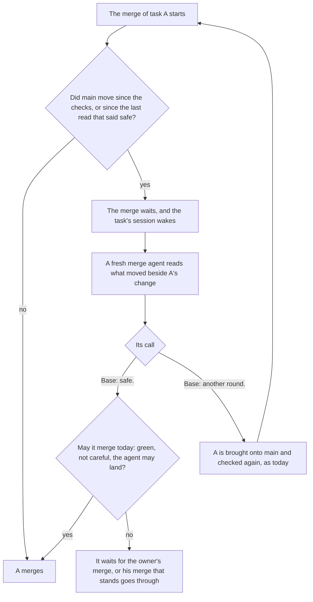

# A moved base gets the merge agent's read, not a new run of the checks

careful: yes, because it changes when a pull request merges on a base its checks did not run on, which is the owner's topic "The landing lets through a change that should not land: one the checks or the review did not pass".

## Acceptance criteria

Size: full, because the landing's merge, the merge agent's brief and answer, the board server's merge duty and the landing's stage text all change.

1. When the base moved after a task's checks ran, a fresh merge agent reads what moved, and a move it calls safe merges with no new run of the checks:
   1. Task A's checks pass on main at commit m1, and its pull request opens.
   2. Task B merges first; main is now m2, and B changed only `docs/board.md`.
   3. The merge of A meets m2. A fresh merge agent gets B's commits and files beside A's change, and answers "Base: safe." with one sentence of why.
   4. A merges on m2, and no command of the checks runs again.
   5. The pull request on GitHub and the merge commit say that the checks ran on m1, that A merged on m2 after the merge agent's read, and the read's one sentence of why.
2. A move that the merge agent calls unsafe gets another round of the checks before any merge:
   1. Task A's checks pass on m1. Task B merges and changes `skills/lem/scripts/land.py`, a file A's change also edits.
   2. The merge agent answers "Base: another round." with one sentence of why.
   3. A is brought onto m2 and checked again, as a moved base is today, and only then can it merge.
   4. The same holds when B renames a function that A's change calls, in a file A does not edit: the merge agent reads what A's code uses, not only the files both edit.
3. A read covers the base it read, and no later one: after a read of m2 says safe, task C merges and main is m3 before A's merge runs; A's merge meets m3, and nothing merges until a new read of what moved since A's checks says safe.
4. The owner's merge that meets a moved base is read the same way, and he is not asked again:
   1. The owner presses Merge on task A's board; main moved since A's checks.
   2. A fresh merge agent reads what moved.
   3. On "safe", his merge goes through on the new base. On "another round", A is checked again: when the checks pass, A merges with no new press of his; when they fail, Lem repairs the branch as for any red check, the board shows it, and the merge waits for his press again, since the change is no longer the one he merged.
5. A read of a moved base never lets the merge agent merge what it may not merge today: a careful change, a request that is not green, and a project whose settings say the owner merges still wait for the owner's merge when the read says safe.
6. The record says that a merge went through on a moved base and why: after A merges on m2, the pull request's text and the merge commit name the base the checks ran on, the base it merged on and the merge agent's one sentence of why, and A's board shows the same read.

## How it works

The merge of an open task, whoever runs it, when it meets its base:

## Tasks

1. **The landing reads a moved base with the merge agent** (criteria 1, 2, 3, 4, 5, 6). In `skills/lem/scripts/land.py`:
   - `merge-review`'s facts gain `moved`: null when origin's base is the one the checks ran on (`kept["base"]`); otherwise the base the checks ran on, the base now, the commits between them (short id and subject), the files they changed, and which of those files the task's own change touches. Always from the checks' base, never from an earlier read, so that a read sees every move since the checks.
   - The brief is bound to the base it names, as it is to its tip: the step prints `base`, origin's base when it wrote the brief (the checks' base when `moved` is null), the answer file is named by the tip and that base (`merge-answer-TIP-BASE.md`), and the record takes it back: `lem land merge-review SLUG --file ANSWER --tip TIP --base BASE`. The read covers BASE, never the base at the time of the record, so an answer of a read of m2 that comes after main moved to m3 covers m2 alone, and the merge on m3 is refused for a new read (criterion 3). (The plan talk's question 2.)
   - The answer of a brief whose `moved` is not null carries a second line, `Base: safe.` or `Base: another round.`, with one sentence of why; one with no such line is refused as a first line with no verdict is, and the agent is asked again. A second answer with no base line on a moved base is recorded as `another round`, with "the merge agent gave no base call" as its why; a merge agent that does not answer twice on a moved base (`ask-merger`) records nothing, and the session lands the task again (task 3). Either way the checks decide, as today, and the owner is not asked (in doubt, another round). (The plan talk's question 5.) `merge_review` in `landing.json`, and the `merge.review` event, keep the base the read covered, its call and its sentence of why (`base`, `base_call`, `base_why`), one event for each read, so that the event log keeps the why of every base call after `merge-review.md` is written over by a later read. (The plan talk's question 8.)
   - `merge` refuses `kind: base` unless origin's base has the same tree as the checks' base (`changed` gives no file, as today), or the same tree as the base a read of the proposed tip with `Base: safe.` covered. The refusal's line names the next step as the merge agent's read, not a new landing.
   - A read with `Base: safe.` written after Lem refused a merge of that tip for a moved base (`merge_refused` with `kind: base`) answers that refusal: the record clears `merge_refused`, so that `landing.json`, `lem project waiting` and the board agree. No read answers any other refusal (GitHub's, a rule's, a tip's): those stay until a new proposal, as today. (The plan talk's question 6.) When the owner's merge was the one refused (`owner_tap` of that tip), the safe read logs `merge.stands` for that tip, so that the board's server runs his merge with `--standing`; with `another round` his merge stands through the new landing as today.
   - A read with `Base: another round.` merges nothing: its record's `next` says to land the task again, and `start`, `base`, the checks, the review that is due and `propose` run as today. A kept refusal stays kept. (The plan talk's question 3.)
   - `carry_merge` carries the verdict of the review onto the new tip as today, and drops its `base`, `base_call` and `base_why`: the new landing's checks ran on the new base, so a read of an older base says nothing of it. (The plan talk's question 3.)
   - `merged_by` and `merge.start` record a merge on a moved base with `after: a read of the moved base` and the base it read.
   - A merge on a moved base leaves its record in git, and only once GitHub took the merge: with `branch.history = "squash"` the line is the body of the merge commit, in the same `gh pr merge` call (`--body`), and after GitHub says the pull request is merged `merge` adds the same line to the pull request's text (`gh pr edit`). A merge GitHub refuses writes no line anywhere. The line names the base the checks ran on, the base it merged on, and the merge agent's one sentence of why from the `Base:` line. With `branch.history = "keep"` the pull request's text alone holds it. A merge on the base the checks ran on writes no such line. (The plan talk's question 7.)
   - The module's docstring says the new rule where it says the old one.
   - Tests: the unit level for the pure parts (the base line of an answer, which base a read covers, the record's line, what `carry_merge` keeps), and the journeys in the block that holds the merge agent and the merge (`tests/lem-land-shop.sh`), on the stand-in for `gh`: a safe read merges with no new `gate.start`, and the pull request's text and the merge commit's body carry the line; an another-round read refuses until a new landing; a read of m2 does not cover m3, also when its answer is recorded after main moved to m3; the owner's merge after a safe read; a careful change with a safe read still calls him; a merge GitHub refuses leaves the pull request's text as it was.
2. **The board's server and the board follow the read** (criteria 1, 4, 6). In `skills/lem/scripts/serve.py` and `skills/lem/scripts/lem_board_model.py`:
   - A `merge.review` of the proposed tip whose `base_call` is `safe`, after Lem's `merge.refused` of that tip with `kind: base`, answers that refusal: `merge_due` and `stands_due` take it, and the board's model no longer reads the task as refused. No other review answers a refusal, and a review whose `base_call` is `another round` makes neither `merge_due` nor `stands_due` true, also with no refusal before it, so the server starts no merge while the session lands the task again. (The plan talk's questions 3 and 6.)
   - A merge's duty is keyed by the proposed tip and the newest merge review of it (its `at` in `landing.json`), so that a refused merge waits `DUTY_RETRY` for that read only, and the merge after a new safe read runs at the server's next look. (The plan talk's question 9.)
   - `merge_wait` says "reads" (the merge agent reads what moved) after a base refusal, not "relands"; "relands" stays for a read that said another round, until the next proposal.
   - The timeline shows the read of a moved base with its call, from the `merge.review` event's `base_call`.
   - Tests: the unit level for `merge_due`, `stands_due`, `merge_wait` and `duty_key` on the events of each case (a safe read after a base refusal, an another-round read with and without a refusal before it, a read after GitHub's refusal), and the journey of the server's merge after a safe read in the block that holds the server's duties (`tests/lem-board-act.sh`).
3. **The texts say the new way** (criteria 1, 2, 4). The landing's stage, the merge agent's brief and the guide:
   - `skills/lem/prompts/merge.md`: a section on `moved`: what to read (the commits and files that moved, the overlap with the change, and what the change's code and tests use from files it does not edit: a function, a setting, a fixture that a moved commit renamed or changed), when a move is safe and when it needs another round (in doubt, another round), and the second line of the answer, whose sentence of why goes into the pull request and the merge commit.
   - `skills/lem/stages/land.md`, steps 7 and 8: the refusal "the base moved after the checks ran" now starts step 7 again, a fresh merge agent with the moved facts; the record names the `base` printed with the brief (`--base`); on `Base: another round.` the steps of a new landing run as they do today, and so they do when the agent gave no base call twice; the owner's merge that a moved base refused goes the same way.
   - `skills/lem/harness/claude-code/ask-merger.md`: after a merge agent that did not answer twice on a moved base, the session lands the task again (`stages/land.md`, "the base moved"), and the owner is not told that the task waits for his read; the record line gains `--base BASE`. (The plan talk's question 5.)
   - `docs/pull-request.md`, "Merge it": the line on a moved base says that the merge agent reads what moved and Lem runs the checks again only when it says so.
   - Every other text that says a moved base always runs the checks again (`grep` for "moved" and "base moved" over `skills/`, `docs/`, `README.md`, `AGENTS.md` and `site/`).

## Plan talk

Argued on 2026-11-22 by the reviewer, Codex, GPT 6.2 Sol at high effort as its pane's status line showed them, and the defender, Claude Code, Opus 5.5 at high effort (the `defender:` line of the task's state). Two model families. Six turns (the list, two answers of each side, the close), within the bound of 4 × 9 + 2. Agreement carries no authority: the review before the pull request reads each settled position as a claim.

The reviewer's list, numbered as it came, and how each ended:

1. **Which base GitHub merges on** (`merge_locked`, `changed`). A design choice. The plan: the base check compares trees under Lem's merge lock, an empty commit has the same tree, and the seconds between the fetch and `gh pr merge` are today's window, which no flag of `gh pr merge` can close (it binds only the head, `--match-head-commit`); GitHub's up-to-date rule is the guard for a merge outside Lem (the plan's last section). The reviewer: a merge on GitHub outside Lem in that window lands A on m3 while its record names m2, against criterion 3. It goes to `stages/plan.md`, step 5.
2. **Which brief an answer belongs to** (`cmd_merge_review`, `answer_file`). A design choice, after a repair. The repair: the brief's base is printed, the answer file is named by tip and base, and the record takes `--base BASE`. The reviewer's hold of the repair: `merge-brief.md` stays one file for the task, so a brief for m3 can replace the brief for m2 before the m2 agent opens it, and the answer is then labelled m2; with a later exact revert of the commit that made the move safe, a safe read of m3 can allow a merge on m2. The plan: the input needs the owner's press in the seconds after the agent starts, and the label is conservative but for that revert case. It goes to step 5.
3. **What stops a merge after `Base: another round.`** (`merge_due`, `stands_due`, `carry_merge`). A design choice, after a repair. The repair, at the cause, changed task 2's rule: only a read with `Base: safe.` answers Lem's base refusal of its tip; a read with `another round` answers nothing and makes neither `merge_due` nor `stands_due` true; `carry_merge` drops the base call; the merge is allowed on the checks' tree or on the tree a safe read covered. The reviewer's hold: a session gone after it recorded `another round` and before `start` leaves A `open` with no refusal, the owner's press then makes a base refusal, `lem session wake` opens a session, and the new step 8 sends it to a fresh read, where the old path went straight to the checks. The plan: the same session-gone gap exists today after a base refusal's one wake (`session_need` gives "relands" no need). It goes to step 5.
4. **Whether the owner's standing merge covers a new finding** (`tap_after`, `may_merge`). Settled, by refutation: criterion 4, case 3, lets his merge go through on a safe read and says he is not asked again; `tap_after` ends his merge only for another change or other reasons for not green. Settled by the two, not checked by the review.
5. **A read that gives no usable base call** (`ask-merger.md`, `verdict_of`). A design choice, after a repair. The repair, at the cause: a second answer with no base line on a moved base is recorded as `another round`, and a merge agent that does not answer twice on a moved base makes the session land the task again. The reviewer's hold: an answer with a base line and no valid verdict line, twice, is not in that path; today it went to the checks through step 8, and the new step 8 sends the refusal back to a read. The plan: the verdict line and its second failure are today's case, unchanged. It goes to step 5.
6. **Which refusals a read answers** (`refusal_of`, `merge_wait`, `proposal`). Settled, by the repair of question 3 (only a safe read answers Lem's base refusal, and no other refusal) and its own: a safe read that answers the refusal clears `merge_refused` in `landing.json`, so `lem project waiting`, land.py and the board agree. The reviewer: closed, same decision as 3. Settled by the two, not checked by the review.
7. **When the pull request says the merge happened** (`merge_locked`, `forge_done`). A design choice, after a repair. The repair, at the cause: the line goes into the merge commit's body in the same `gh pr merge` call, and into the pull request's text with `gh pr edit` once GitHub says it is merged; a refused merge writes nothing. The reviewer's hold, which the defender did not refute: when `gh pr edit` fails after the merge, the already-merged path (`forge_done`, `cmd_merged`) lands the task with no note, and with `branch.history = "keep"` the pull request is the one place in GitHub. It goes to step 5.
8. **Where the reason of each base call stays** (`cmd_merge_review`, the timeline). Settled, by repair at the cause: each `merge.review` event carries `base`, `base_call` and `base_why`, so the event log keeps every read's why. Settled by the two, not checked by the review.
9. **The retry wait of the old refusal** (`duty_key`, `run_duties`). Settled, by repair at the cause: a merge's duty is keyed by the tip and the newest merge review's `at`. The reviewer's hold (two records in one second) was refuted: the merge and the wake come on two passes of `forge_loop`, `FORGE_TICK` (20 seconds) apart. Settled by the two, not checked by the review.

Mechanisms the repairs added, each at the cause by the reviewer's word, none a layer: the `--base` of the record and the answer file named by tip and base (2, on criterion 3); the base call that gates `merge_due` and `stands_due`, and the base call `carry_merge` drops (3, changing task 2's rule); the record of `another round` after a second answer with no base line (5); the cleared `merge_refused` (6); the line written after GitHub took the merge (7); `base_why` in each event (8); the merge duty keyed by its read (9).

Raised after the first turn and not argued: none. Additions refused as unpriced: none.

What changed in the plan, by question and by task: task 1 gained the brief's base and `--base` (2), the base line's second failure (5), `base_why` and one event for each read (8), the merge rule by tree (1's words, within 3), what a safe read answers and clears (3, 6), what `another round` and `carry_merge` do (3), and the line after GitHub's merge (7), with tests for each; task 2 narrowed what answers a refusal (3, 6) and keyed the merge duty by its read (9), with unit cases; task 3 gained `--base` and the second failure in `land.md` and `ask-merger.md` (2, 5).

## Decisions of the plan

- **The refusal stays as the trigger, and its answer changes.** The board's server has no agent and decides nothing (the ruling "What reaches across tasks is the board server's"), so something must wake the task's session, which starts the merge agent. The refusal of `kind: base` already does that, for the merge agent's merge and for the owner's (`serve.py`, `duties`, `wake … refused`). Rests on: the server's duties as they are, read 2026-11-22.
- **The first read sees the move too.** When the base moved between the checks and step 7, the brief already carries `moved`, so one read answers both questions and no refusal comes first.
- **The base call is a second line, not a third verdict.** A careful change or one that is not green always gets `Verdict: call.` (`prompts/merge.md`, "Decide"), so a third verdict could not say "safe" for those; a second line can, and the owner's merge that stands needs exactly that.
- **"Another round" lands the task again with no question.** The owner's words: "needs another round"; the new landing is the one a moved base takes today.
- **A read always covers the move from the checks' base, not from the last read.** It costs a slightly longer list for the agent and leaves no move unread between two reads.
- **No mechanical rule of files decides "safe".** The owner asked for the agent's opinion ("Agent should give it's opinion"); the overlap of files is a fact in the brief, not the decision.

## What this will not verify

- Whether the merge agent's calls are right on real moves: the tests use a stand-in agent answer. The first nights after the merge show it; the merge review of each read keeps its reason for the retro.
- GitHub's own rule that a branch be up to date before it merges: where a project sets it, GitHub refuses the merge as it refuses any other, and "Waits for you" shows GitHub's line as today.
