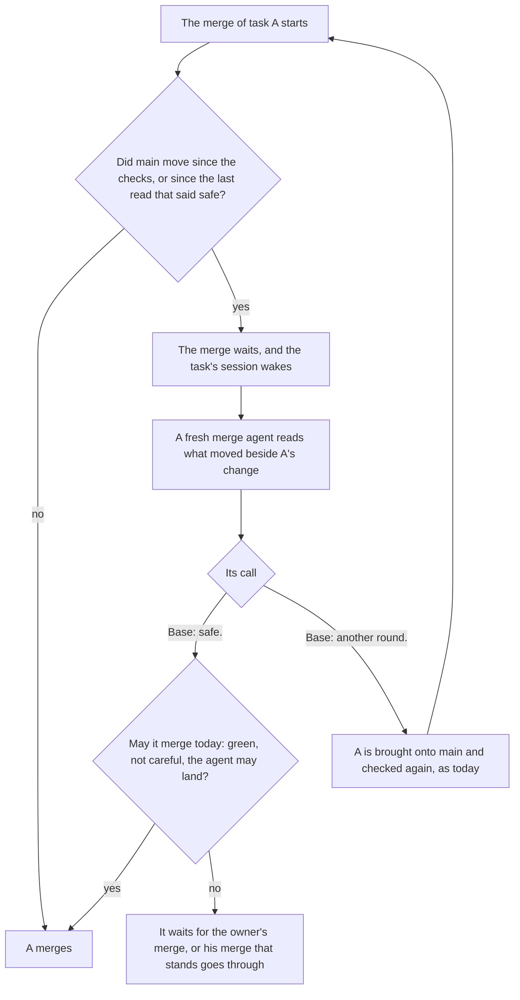

# A moved base gets the merge agent's read, not a new run of the checks

careful: yes, because it changes when a pull request merges on a base its checks did not run on, which is the owner's topic "The landing lets through a change that should not land: one the checks or the review did not pass".

## Acceptance criteria

Size: full, because the landing's merge, the merge agent's brief and answer, the board server's merge duty and the landing's stage text all change.

1. When the base moved after a task's checks ran, a fresh merge agent reads what moved, and a move it calls safe merges with no new run of the checks:
   1. Task A's checks pass on main at commit m1, and its pull request opens.
   2. Task B merges first; main is now m2, and B changed only `docs/board.md`.
   3. The merge of A meets m2. A fresh merge agent gets B's commits and files beside A's change, and answers "Base: safe." with one sentence of why.
   4. A merges on m2, and no command of the checks runs again.
   5. The pull request on GitHub and the merge commit say that the checks ran on m1, that A merged on m2 after the merge agent's read, and the read's one sentence of why.
2. A move that the merge agent calls unsafe gets another round of the checks before any merge:
   1. Task A's checks pass on m1. Task B merges and changes `skills/lem/scripts/land.py`, a file A's change also edits.
   2. The merge agent answers "Base: another round." with one sentence of why.
   3. A is brought onto m2 and checked again, as a moved base is today, and only then can it merge.
   4. The same holds when B renames a function that A's change calls, in a file A does not edit: the merge agent reads what A's code uses, not only the files both edit.
3. A read covers the base it read, and no later one: after a read of m2 says safe, task C merges and main is m3 before A's merge runs; A's merge meets m3, and nothing merges until a new read of what moved since A's checks says safe.
4. The owner's merge that meets a moved base is read the same way, and he is not asked again:
   1. The owner presses Merge on task A's board; main moved since A's checks.
   2. A fresh merge agent reads what moved.
   3. On "safe", his merge goes through on the new base. On "another round", A is checked again: when the checks pass, A merges with no new press of his; when they fail, Lem repairs the branch as for any red check, the board shows it, and the merge waits for his press again, since the change is no longer the one he merged.
5. A read of a moved base never lets the merge agent merge what it may not merge today: a careful change, a request that is not green, and a project whose settings say the owner merges still wait for the owner's merge when the read says safe.
6. The record says that a merge went through on a moved base and why: after A merges on m2, the pull request's text and the merge commit name the base the checks ran on, the base it merged on and the merge agent's one sentence of why, and A's board shows the same read.

## How it works

The merge of an open task, whoever runs it, when it meets its base:

## Tasks

1. **The landing reads a moved base with the merge agent** (criteria 1, 2, 3, 4, 5, 6). In `skills/lem/scripts/land.py`:
   - `merge-review`'s facts gain `moved`: null when origin's base is the one the checks ran on (`kept["base"]`); otherwise the base the checks ran on, the base now, the commits between them (short id and subject), the files they changed, and which of those files the task's own change touches. Always from the checks' base, never from an earlier read, so that a read sees every move since the checks.
   - The answer of a brief whose `moved` is not null carries a second line, `Base: safe.` or `Base: another round.`, with one sentence of why; one with no such line is refused as a first line with no verdict is, and the agent is asked again. `merge_review` in `landing.json`, and the `merge.review` event, keep the base the read covered and its call (`base`, `base_call`).
   - `merge` refuses `kind: base` only when origin's base differs by files from the base a `safe` read of the proposed tip covered, or from the checks' base when no such read exists. The refusal's line names the next step as the merge agent's read, not a new landing.
   - A read whose call is `safe`, written after Lem refused the owner's merge for a moved base (`owner_tap` of that tip), logs `merge.stands` for that tip, so that the board's server runs his merge with `--standing`; with `another round` his merge stands through the new landing as today.
   - A read with `another round` changes nothing in `merge`: the session lands the task again, and `start`, `base`, the checks, the review that is due and `propose` run as today, with the merge review carried as today.
   - `merged_by` and `merge.start` record a merge on a moved base with `after: a read of the moved base` and the base it read.
   - A merge on a moved base leaves its record in git: before the merge, `merge` adds one line to the pull request's text on GitHub (the task's own pull request, which `propose` already writes), and with `branch.history = "squash"` the same line is the body of the merge commit (`gh pr merge --body`). The line names the base the checks ran on, the base it merges on, and the merge agent's one sentence of why from the `Base:` line. With `branch.history = "keep"` the pull request's text alone holds it. A merge on the base the checks ran on writes no such line.
   - The module's docstring says the new rule where it says the old one.
   - Tests: the unit level for the pure parts (the base line of an answer, which base a read covers, the record's line), and the journeys in the block that holds the merge agent and the merge (`tests/lem-land-shop.sh`), on the stand-in for `gh`: a safe read merges with no new `gate.start`, and the pull request's text and the merge commit's body carry the line; an another-round read refuses until a new landing; a read of m2 does not cover m3; the owner's merge after a safe read; a careful change with a safe read still calls him.
2. **The board's server and the board follow the read** (criteria 1, 4, 6). In `skills/lem/scripts/serve.py` and `skills/lem/scripts/lem_board_model.py`:
   - A `merge.review` of the proposed tip that comes after a `merge.refused` of that tip answers the refusal: `merge_due` and `stands_due` take it, and the board's model no longer reads the task as refused.
   - `merge_wait` says "reads" (the merge agent reads what moved) after a base refusal, not "relands"; "relands" stays for a read that said another round, until the next proposal.
   - The timeline shows the read of a moved base with its call, from the `merge.review` event's `base_call`.
   - Tests: the unit level for `merge_due`, `stands_due` and `merge_wait` on the events of each case, and the journey of the server's merge after a safe read in the block that holds the server's duties (`tests/lem-board-act.sh`).
3. **The texts say the new way** (criteria 1, 2, 4). The landing's stage, the merge agent's brief and the guide:
   - `skills/lem/prompts/merge.md`: a section on `moved`: what to read (the commits and files that moved, the overlap with the change, and what the change's code and tests use from files it does not edit: a function, a setting, a fixture that a moved commit renamed or changed), when a move is safe and when it needs another round (in doubt, another round), and the second line of the answer, whose sentence of why goes into the pull request and the merge commit.
   - `skills/lem/stages/land.md`, steps 7 and 8: the refusal "the base moved after the checks ran" now starts step 7 again, a fresh merge agent with the moved facts; on `Base: another round.` the steps of a new landing run as they do today; the owner's merge that a moved base refused goes the same way.
   - `docs/pull-request.md`, "Merge it": the line on a moved base says that the merge agent reads what moved and Lem runs the checks again only when it says so.
   - Every other text that says a moved base always runs the checks again (`grep` for "moved" and "base moved" over `skills/`, `docs/`, `README.md`, `AGENTS.md` and `site/`).

## Decisions of the plan

- **The refusal stays as the trigger, and its answer changes.** The board's server has no agent and decides nothing (the ruling "What reaches across tasks is the board server's"), so something must wake the task's session, which starts the merge agent. The refusal of `kind: base` already does that, for the merge agent's merge and for the owner's (`serve.py`, `duties`, `wake … refused`). Rests on: the server's duties as they are, read 2026-11-22.
- **The first read sees the move too.** When the base moved between the checks and step 7, the brief already carries `moved`, so one read answers both questions and no refusal comes first.
- **The base call is a second line, not a third verdict.** A careful change or one that is not green always gets `Verdict: call.` (`prompts/merge.md`, "Decide"), so a third verdict could not say "safe" for those; a second line can, and the owner's merge that stands needs exactly that.
- **"Another round" lands the task again with no question.** The owner's words: "needs another round"; the new landing is the one a moved base takes today.
- **A read always covers the move from the checks' base, not from the last read.** It costs a slightly longer list for the agent and leaves no move unread between two reads.
- **No mechanical rule of files decides "safe".** The owner asked for the agent's opinion ("Agent should give it's opinion"); the overlap of files is a fact in the brief, not the decision.

## What this will not verify

- Whether the merge agent's calls are right on real moves: the tests use a stand-in agent answer. The first nights after the merge show it; the merge review of each read keeps its reason for the retro.
- GitHub's own rule that a branch be up to date before it merges: where a project sets it, GitHub refuses the merge as it refuses any other, and "Waits for you" shows GitHub's line as today.
