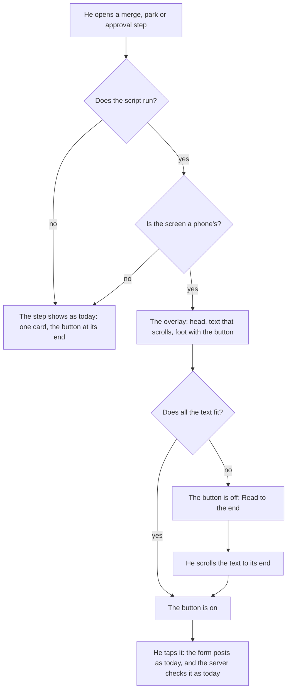

# On the phone, a step that asks the owner to confirm keeps its button in view

careful: yes, because the change reaches the topic "Lem changes a developer's repository without his word: … a merge": task 1 changes the confirm step that stands before the owner's merge on the board, and a defect there (a button that comes on before the text is read, a form that loses `confirm=yes` or the commit) makes a mistaken merge easier.

## Acceptance criteria

Size: full, because three act steps of the board change on the phone, one of them the confirmation of the owner's merge, which is careful.

1. On a phone, the merge confirm step opens as an overlay whose button is in view from the first look:
   1. On a screen of 390 × 844, pull request 31 waits for his merge; it is not green for four reasons and it is careful.
   2. He taps "Merge…" in "Waits for you".
   3. The overlay shows the head "Merge #31 · confirm" at its top, the text in a middle part that scrolls by itself, and a foot with the button and "Back" at its bottom, all inside the screen.
2. The text of the merge step keeps its order: green or not green, the reasons, the "Careful:" line, the facts (pull request, commit, branch, into, lands as), and the note that a merge cannot be undone; the button is after all of them, in the foot.
3. While text is still below the screen, the button is off and says "Read to the end ↓"; it comes on when he has scrolled the text to its end:
   1. Pull request 31 opens with its facts and its note below the screen.
   2. The button reads "Read to the end ↓", and a tap on it sends nothing.
   3. He scrolls the text to the note at its end.
   4. The button reads "Merge pull request #31" and is on.
4. When the whole text fits on the screen, the button is on at once: green pull request 32 with no reasons shows "Merge pull request #32" on from the first look.
5. The park step and the approval of the criteria open the same overlay on a phone, each with its own text and its own button, under rules 3 and 4: "Park…" on task gift-note-in-export shows its text and a button that is off until he has read to the end of it.
6. The guard of a merge is the same as today: the server merges only from the confirm form with `confirm=yes` and the commit the page showed, and refuses a merge whose commit moved since, with "Read the confirm step again".
7. On a desktop's screen each of the three steps shows as it does today, with no fixed foot and the button on at once: pull request 31 at 1440 × 900 shows its text and the button below it in the page.
8. With no script the three steps work as they do today: the page scrolls as one, the button is on at the end of the text, and the merge runs.

## How it works

The server renders each of the three steps in the same three parts: a head, a body with the text,
and a foot with the form and "Back". With no script the three parts are one card that scrolls with
the page, as today. With the script, a controller marks the step; on a phone's screen the CSS then
makes it an overlay over the panel, with the body that scrolls by itself, and the controller turns
the button off until the body was scrolled to its end.

## Tasks

1. **The merge confirm step is the overlay on a phone.** In `merge_step()`
   (`skills/lem/scripts/lem_board_task.py`) the card gets three parts in the order of today: a head
   (the eyebrow, which reads "Merge #N · confirm" when the pull request has a number, else
   "Merge · confirm"), a body (green or not green, the reasons, the "Careful:" line, the facts and
   the note, in that order), and a foot (today's `act-row` with the form of `P.act_form()` and
   `act_back()`, whose link reads "Back" on every screen, the word of criterion 1). The form, its
   hidden fields `confirm=yes` and `tip`, and `serve.py` do not change. Outside the overlay the three
   wrappers are `display: contents`, so the card's flex column and its gap reach the same children as
   today, and each rule of `board.css` that names `.confirm > p` names `.confirm .cf-body > p` beside
   it (criterion 7).
   A new Stimulus controller of one job in `tools/board-kit/controllers/` (named in
   `controllers/index.js`, as `tools/board-kit/README.md` says) goes on the card only when the step
   has its button (`ctx.can_act` and a tip), and with it the server renders the class `cf-sheet` and
   the key of the read, `data-…-key-value`: the first 12 hex digits of the sha256 of the body's own
   HTML as the server rendered it, so that any change of what the body says (another commit, a new
   review's "Careful:" line, another reason) is another key. On connect the controller sets a
   `data-js-*` attribute on the card, which a morph keeps (`app.js`). The phone's CSS in
   `skills/lem/assets/board.css`, inside its `@media (max-width: 700px)` and only under
   `.cf-sheet[data-js-…]`, makes the card a fixed overlay over the panel (above its head and its
   sticky `.ptabs`), the head and the foot fixed, the body the one part that scrolls, with room for
   the phone's bottom edge (`env(safe-area-inset-bottom)`). A morph to a page with no button (the
   `not_now()` card that keeps the id `confirm`, a park whose breaker ended) renders no `cf-sheet`,
   so the attribute a morph keeps has no rule to match, and the card is inline again.
   The controller gates the button only while the body scrolls by itself, which it reads from the
   body's computed style, so the 700 px of the CSS is the one place that tells a phone. It never
   writes `disabled`, which stays Turbo's while a request runs (`act_form()`'s
   `data-turbo-submits-with`): while text is below the body's end it sets `aria-disabled="true"` on
   the button, shows "Read to the end ↓" in its label's `span` in place of the label, and cancels the
   form's `submit` event (`preventDefault()` in a listener on the form, which runs before Turbo's
   listener on the document, so neither Turbo nor the browser sends it); at the end of the body (a
   few pixels of slack), and at once when the body fits, it puts the label back and takes
   `aria-disabled` away. A `ResizeObserver` on the body and on its content takes the place of a
   window's resize event: when the content grows (a reason's fold opened, a picture loaded, a
   narrower screen) and the end is no longer in view, the button is off again until the end is
   reached again. The controller keeps the key the body showed last in a `data-js-*` attribute, and
   the read with it, so a morph keeps both; after each `turbo:morph`, which renders the button on and
   with its label, the controller applies its state again, and a key other than the one the body
   showed last scrolls the body back to its top and turns the button off, whether a read was
   complete or not, so that a scroll position left from the text before never counts as the read
   of the new one; a morph that leaves the body's HTML the same (another task changed) leaves the
   scroll and the button as they were (decision 8 of the task, the ladder's pick of the talk's
   question 1). It applies its state again on `turbo:submit-end` too, which Turbo fires after it
   restored the button's content when a request ends without a new page, so the label reads "Read
   to the end ↓" at once when the gate is off then (decision 7, question 6). When the overlay shows, the controller moves the focus to its head
   (`tabindex="-1"`), one animation frame after `panel.js`, which focuses the task's title behind it;
   the parts behind the overlay carry no act on a step (`head_acts()` returns None for `ACT_TABS`).
   Then `npm --prefix tools/board-kit ci` and `npm --prefix tools/board-kit run build`, and commit
   `skills/lem/assets/vendor/board-app.js` with the source; `board-icons.json` and `mermaid.min.js`
   must come out of the build unchanged.
   Unit cases in `tests/unit/test_board_task.py` for the HTML of `merge_step()`: the three parts, the
   six items in their order in the body, the form with `confirm=yes` and the tip in the foot, "Back",
   the controller, `cf-sheet` and the key only on a step with its button, the key changed by another
   tip and by another careful call on the same tip, and the head with the number. Browser checks in
   `tests/lem-board-keys.sh`, on the demo of `tests/board-showcase.py` as that block serves it,
   through `tests/board-cdp.mjs` (extend the driver where a check needs it, as a script turned off
   with `Emulation.setScriptExecutionDisabled`). The demo writes no `landing.json`, so its merge step
   has no button today (`merge_step()` shows the form only with a proposed tip): the check writes that
   record into the demo's task directory itself, with the proposed tip and the pull request, as
   `land.py` writes it for an open task. Each case the approved criteria name is made the same way,
   by the viewport's size or by what the check adds to the demo's state, as the block's other checks
   do, never by a change of the demo in `board-showcase.py`: `lem criteria red` runs the block on
   the base commit.
   - `refund-line-on-receipt`, pull request 44, not green for four reasons: the check adds a review
     event with a careful call (`careful:=true` and its why, as `land.py` logs a review's call), so
     the body holds all six items. At 390 × 844 the head, the button and "Back" are inside the screen,
     the six items are in their order in the body, the button has `aria-disabled="true"` and reads
     "Read to the end ↓", a click on it posts nothing (no `board.act` event, the page stays), and
     after the body is scrolled to its end it reads "Merge pull request #44" and is on. Then the check
     adds a `proposed` event with another tip and its `landing.json`, and after the morph the body is
     at its top and the button is off again. A second morph case: the body scrolled to just above
     its end, a `proposed` event brings a shorter body that still does not fit, and the body is at
     its top with the button off.
   - a green open task the check adds itself, since the demo ends its green pull requests 41 and 38
     as landed (`board-showcase.py`, `afternoon`) and a merge step has its button only for an open
     task (`acts_of`): its events (a green `proposed` event with no reasons and an open state) at the
     end of the demo's log and its `landing.json`, as the block's `held.py` adds a task of its own;
     at 390 × 844 the button is on at once (decision 6, question 9).
   - pull request 44 at 1440 × 900: the card has no fixed part, and the button is on.
   - pull request 44 with the script turned off at 390 × 844, open and with no merge running: the
     page scrolls as one, the button is on at the end of the text, and a click on it posts the form,
     which the guard takes: a `merge.start` event with the page's tip follows (`act_merge` returns
     the token of a merge already running before it reads `confirm` and `tip`, so the absence of the
     guard's two refusals proves nothing alone) (decision 6, question 9).
   In `tests/lem-board-act.sh` the confirm page's words follow the new head ("Merge #1 · confirm
   Green"), and one check posts the form with a tip other than the page's and sees "Read the confirm
   step again" with nothing merged. Each check that needs Chrome prints a `SKIP` line of its own
   where Node or Chrome is missing.
   The test lines under the criteria: criteria 1 to 5 name the block that holds their checks, which
   fails on the base commit because the overlay is not there. Criteria 6, 7 and 8 keep today's
   behavior, so a check of each passes on the base commit by design, and `lem criteria red` would
   take a failure of the same block for another reason as their proof; each takes
   `- no test: the change keeps behavior; the suite holds it` (`stages/build.md`), with the checks
   that hold it named after it: the stale-tip check of `tests/lem-board-act.sh` for criterion 6, the
   checks at 1440 × 900 for criterion 7, and the checks with the script turned off for criterion 8.
   Serves criteria 1, 2, 3, 4, 6, 7 and 8 for the merge step.
   Files: `skills/lem/scripts/lem_board_task.py`, `skills/lem/assets/board.css`,
   `tools/board-kit/controllers/` (the new controller and `index.js`),
   `skills/lem/assets/vendor/board-app.js`, `tests/unit/test_board_task.py`, `tests/lem-board-keys.sh`,
   `tests/board-cdp.mjs`, `tests/lem-board-act.sh`.
2. **The park step and the approval of the criteria take the same overlay.** `park_step()` gets the
   same three parts: the head (its eyebrow "Park · breaker N"), the body (what stopped the build and
   what a park keeps), and the foot (the form with its field "Why, in one line", and "Back").
   `approve_card()` gets them too, only when it holds the form: the head (its `card-head`), the body
   (the criteria's text), and the foot (the form with its line under the button, and "Back" to the
   task's Overview through `act_back()`, which shows only in the overlay, so the desktop keeps the
   card of today). With no script the criteria's text shows nowhere today, since `P.md_block()` puts
   it in a `<template>` that only the `markdown` controller renders; so the body holds, after the
   markdown block, a `<noscript>` with the same text as plain text in a `pre` (wrapped, in the
   board's mono face), which a browser with the script never draws (criterion 8: the button is at
   the end of the text). The approval's form posts back to the criteria tab, where `note_card()` puts the
   act's note first in the tab, above the card, and a refused approval (the criteria changed since
   the page showed them, `serve.py` `act_approve`) shows the new criteria with their form again: so
   when the approval card holds the form, `criteria_tab()` gives the note to `approve_card()`, which
   puts it first in the card's body, and not above the card. On a desktop the note is then the first
   line inside the card. The same controller and CSS as task 1, with no new rule: the key of the read
   is the digest of the body's own HTML for these two steps too. Rebuild `board-app.js` when the
   controller changes. Unit cases for the HTML of both, as in task 1, and the note inside the
   approval card. Browser checks in `tests/lem-board-keys.sh`: "Park…" on `gift-note-in-export` and
   the approval on `stock-on-product-page`, each at a phone's size where its text is below the body's
   end (the button off), after the scroll (on), at a phone's width with a height where its whole body
   fits (on at once), at 1440 × 900 as today, and with the script turned off at 390 × 844, where the
   criteria's text is above the approval's button. Serves criterion 5, and criteria 7 and 8 for these
   two steps.
   Files: `skills/lem/scripts/lem_board_task.py`, `skills/lem/assets/board.css`, the controller,
   `skills/lem/assets/vendor/board-app.js`, `tests/unit/test_board_task.py`, `tests/lem-board-keys.sh`.
3. **The pictures of the merge overlay, and the documents.** `shots()` in `tests/board-showcase.py`
   makes four more pictures at `PHONE`, light and dark: `phone-merge-off-*` (the merge step of
   `refund-line-on-receipt` as it opens) and `phone-merge-on-*` (its body scrolled to the end), with
   an `eval` step as `story` has one. So that the step has its button, the demo's
   `refund-line-on-receipt` gets the `landing.json` that every open task has (the tip of its
   `proposed` event and pull request 44, in `land.py`'s form); when that changes a committed picture
   of `assets/screens/` (the task's header on `task-*`), make that picture again and commit it. The
   four new pictures go into the output folder with the others and are not committed: no page shows
   them, as no page shows `waits-*`. `docs/board.md`, "Act from the board":
   the line of **Merge** says that on a phone the step opens over the panel and its button comes on
   when you have read to the end; one sentence says the same for **Park it** and **Approve the
   criteria**, in the guide's STE. `AGENTS.md`, "Checks": the line of `tests/lem-board-keys.sh` says
   it also holds the confirm overlay on a phone; and the docstring at the top of
   `tests/board-showcase.py` names the new pictures. Read `README.md` and `site/index.html` for a
   sentence on the merge step that the change makes false, and correct it there and in the other in
   the same commit. Serves no criterion.
   Files: `tests/board-showcase.py`, `assets/screens/` only where a picture changed, `docs/board.md`, `AGENTS.md`, and `README.md` or
   `site/index.html` only where one says how the merge step looks.

## Plan talk

Who argued the plan: the reviewer, Codex, GPT 6.2 Sol, high (its pane's status line); the defender,
Claude Code, Opus 5.5, high (the `defender:` line of the task's state). Two model families. 7 turns, 10
questions, within the bound of 4 × 10 + 2. Agreement carries no authority: the review before the pull
request reads each settled position as a claim.

The reviewer's list, as it came:

1. **The read keyed on the tip** (task 1, "The read belongs to the text it read"): after a morph to
   another commit the body keeps its scroll position, and a new review changes the "Careful:" line
   on the same tip. Repaired at the cause: the key is the digest of the body's own HTML, and a new
   key scrolls the body to its top. It held on the case of a body with no completed read, which the
   text then left where it was (`merge_step()`, `serve.py` `Handler.refreshes`); the refutation (no
   kept key, nothing to compare) did not close it: the owner stops just before the end of commit A,
   a refresh to B shortens the body, and the old position reaches B's end. **A design choice**: the
   kept decision (compare against the key of a completed read) against the reversed one (compare
   against the key the body last showed). The gate took the reversed one, B, as checkable by criterion 3: decision 8.
2. **The read stays on when the body grows** (tasks 1 and 2): a fold opened or a picture loaded
   after the first fit. Repaired at the cause: a `ResizeObserver` turns the button off when the
   content grows and the end is out of view (criteria 3 and 5). Settled, `lem_board_pages.py`
   `reason_list`, `entry.js`; settled by the two, not checked by the review.
3. **The approval with no script** (task 2, criterion 8): `P.md_block()` puts the criteria in a
   `<template>`, so no text is above the button. First refuted (criterion 8 says "as they do today"),
   it held: criterion 8 also puts the button at the end of the text. Repaired at the cause: a
   `<noscript>` with the criteria as plain text after the markdown block, and a script-off check.
   Settled; settled by the two, not checked by the review.
4. **The refusal note under the approval overlay** (task 2): a refused approval comes back to the
   criteria tab with its note above the card (`note_card()`, `serve.py` `Handler.board_act`).
   Repaired at the cause: the note goes first into the approval card's body while the card holds the
   form. Settled; settled by the two, not checked by the review.
5. **The overlay after a morph takes the form away** (tasks 1 and 2): `not_now()` keeps the id
   `confirm`, and `app.js` keeps every `data-js-*` attribute. Repaired at the cause: the CSS also
   needs the class `cf-sheet`, which the server renders only with the form. Settled; settled by the
   two, not checked by the review.
6. **A resize during a request** (task 1): the controller took `disabled` away from a button Turbo
   had turned off. Repaired at the cause: the gate never writes `disabled`; it sets `aria-disabled`
   and cancels the form's `submit`. It held on the label: after a fetch that fails on the network,
   Turbo's `resetSubmitterText` puts back "Merge pull request" while the gate is off, until the next
   scroll; the refutation (safe side, rare) did not close it, since criterion 3 asks for "Read to the
   end ↓" in that state. **A design choice**: kept (the label right at the next scroll) against reversed (the state applied again on `turbo:submit-end`). The gate took the reversed one, as checkable by criterion 3: decision 7.
7. **The focus behind the overlay** (tasks 1 and 2): `panel.js` focuses the task's title behind it.
   Repaired as a layer over the fixed overlay of criteria 1 and 5: the focus moves to the overlay's
   head. It held: Shift+Tab reaches the covered tabs, and on the criteria tab of a task with no
   session the covered "Open a session" (`head_acts()`, `serve.py` `act_session`), which starts a
   session and logs a `board.act`. The refutation (nothing behind merges, parks or approves) did not
   close it. **A design choice**: kept (the focus in the overlay, nothing inert) against reversed (the panel's head and tab bar `inert` while the overlay shows). The gate judged it cheap, and the kept one stands: decision 9.
8. **The desktop layout under the new wrappers** (criterion 7): `.confirm > p` and the gaps of the
   card and of `.approve-body`, and "Cancel" against criterion 1's "Back". Repaired: the wrappers are
   `display: contents` outside the overlay, the `.confirm > p` rules also name `.cf-body > p`, and
   the link reads "Back" on every screen. It held on the approval's 12 px gap; refuted: the foot
   can be the last child of `.approve-body`, which keeps it, and a fixed foot leaves the flow
   whatever its parent (a headless Chrome probe of a fixed child in a scroller with
   `container-type: inline-size`). Settled; settled by the two, not checked by the review.
9. **The browser cases for the approved examples** (tasks 1 and 2): no careful call on #44, no green
   pull request with no reasons, no fit case for park and approval, and a script-off case that stops
   at the button. Repaired: a careful review event, a green case, fit cases, and a script-off click
   that posts. It held: #41 and #38 end landed (`tests/board-showcase.py` `afternoon`), and a merge
   token alone does not prove the fields passed (`act_merge` returns a running merge's token before
   it reads them). The refutation (the plan's rule to add what a check needs) did not close it.
   **A design choice**: kept (the plan's rule, the example of #41 or #38, any note but the two refusals) against reversed (a green open task of the check's own, and a `merge.start` with the page's tip). The gate took the reversed one, as checkable from the code: decision 6.
10. **Criterion 6's proof on the base commit**: the whole `tests/lem-board-act.sh` fails on the base
    for the new head words, not for the guard. Repaired: criteria 6, 7 and 8 take
    `- no test: the change keeps behavior; the suite holds it`, with the checks that hold each named.
    Settled; settled by the two, not checked by the review.

Mechanisms the repairs added, with what they sit on and the reviewer's word:

- the body's digest as the read's key, and the scroll to the top on a new key (question 1): at the
  cause, on "The read belongs to the text it read", which rests on criteria 3 and 5;
- the `ResizeObserver` (question 2): at the cause, on the same decision, criteria 3 and 5;
- the `<noscript>` text of the approval (question 3): at the cause, on criterion 8;
- the note inside the approval card (question 4): at the cause, on the overlay of criterion 5;
- the class `cf-sheet` (question 5): at the cause, on "The overlay comes only on a step that has
  its button";
- the gate by `aria-disabled` and a cancelled `submit` (question 6): at the cause, on criterion 3;
- the focus move to the overlay's head (question 7): a layer over the fixed overlay of criteria 1
  and 5.

Raised, not argued: task 1 says the criterion 8 checks pass on the base commit by design, but task
2's script-off check of the approval's text fails there, since the base's `P.md_block()` shows no
text (task 1, the test lines; task 2, the browser checks).

Refused as unpriced: none.

What changed in the plan, by question and by task: task 1 took questions 1, 2, 5, 6, 7, 8, 9 and 10
(the key, the observer, the class, the gate, the focus, the wrappers and "Back", the browser cases,
the test lines); task 2 took questions 3, 4, 8 and 9 (the `<noscript>`, the note in the card, the
foot inside `.approve-body`, the fit and script-off cases); the decisions took each of them; "Outside
the change" holds the other markdown blocks of the board.

## Decisions

- **The head of the merge step reads "Merge #N · confirm", and the foot's link reads "Back", on
  every screen**, the words of criterion 1; on a desktop only these words change (today the link
  reads "Cancel"), and the layout is as today (criterion 7). A pull request with no number keeps
  "Merge · confirm".
- **The overlay comes only with the script, only where the phone's CSS makes the body scroll, and
  only on a card the server marks as a step with its button.** Criterion 8 asks for today's page with
  no script, so the CSS keys on an attribute that only the controller sets, and on the class
  `cf-sheet`, which the server renders only with the form; the controller gates the button only when
  the body's computed style scrolls, so the breakpoint has one place, `board.css`. The class is what
  ends the overlay when a morph takes the form away, since a morph keeps every `data-js-*` attribute
  (`app.js`).
- **The read belongs to the text it read**: its key is the digest of the body's own HTML, so another
  commit, another careful call or other criteria are another key, which scrolls the body to its top
  and turns the button off. Without it, a morph after his read would leave the button on over a
  text he did not read, and the server's guard would take it, since the morph also brings the new
  commit into the form. The key compared is the one the body showed last, whether a read was
  complete or not (decision 8): a body that changed under a read that was not complete starts at
  its top too. It rests on criteria 3 and 5 (the button is off while text is below the screen).
  Its cost is one attribute compared on each morph.
- **The button is off again when the body's content grows and its end is out of view** (a fold
  opened, a picture loaded, a narrower screen), from a `ResizeObserver`, which takes the place of a
  window's resize event. It rests on criteria 3 and 5, word for word.
- **The gate never writes `disabled`**: it sets `aria-disabled` and cancels the form's `submit` event,
  so Turbo stays the one writer of `disabled` while a request runs, and no state of the gate can
  turn on a button that a request has turned off. It applies its state again on `turbo:submit-end`,
  after Turbo restored the button's content, so its label is right after a request that ends with
  no new page (decision 7).
- **The overlay comes only on a step that has its button.** A page that may not act (`ctx.can_act`
  false) shows the line that says where to act, as today, and has nothing to gate.
- **The overlay takes the focus when it shows**, to its head, after `panel.js` gives it to the
  task's title behind the overlay.
- **The approval's overlay gets "Back" to the task's Overview**, as the merge and the park steps
  have, so a phone can leave it without the approval; a desktop does not show it.
- **With no script the approval shows its criteria as plain text**, in a `<noscript>` after its
  markdown block, since criterion 8 puts the button at the end of the text and the markdown block
  draws nothing without the script; the other markdown blocks of the board stay as they are.
- **A note of the approval is inside its card**, first in its body, while the card holds the form,
  so that the overlay does not cover the note of a refused approval; on a desktop it is the card's
  first line.
- **Criteria 6, 7 and 8 take `- no test: the change keeps behavior; the suite holds it`**, with the
  checks that hold each named after it: a check of today's behavior passes on the base commit by
  design, and `lem criteria red` refuses such a test, or takes another check's failure in the same
  block as its proof.
- **The browser checks go into `tests/lem-board-keys.sh`**, which already serves the demo to
  headless Chrome; a new block would start a second server for the same afternoon.
- **The pictures stay out of `assets/screens/`**, since no page of the README, the guides or the
  site shows them.

## Outside the change

- With no script every other markdown block of the board shows no text (`P.md_block()` puts it in a
  `<template>` that only the `markdown` controller renders). Only the approval's text is a step of
  this change, and task 2 gives it its `<noscript>`; the polish pass files the rest in the backlog.

## Not verified

- A real phone, Safari and the Hotwire Native app: the checks run headless Chrome at a phone's size
  with touch on, and the keyboard over a fixed foot (the park step's field) is not drawn.
- A screen reader: the button's `aria-disabled` and its label are read as any other; no check runs one.
- A conflict with `merge-button-after-failed-merge` and `i-want-to-improve-merge`, which may change
  the same step: the landing brings the branch onto the base.
