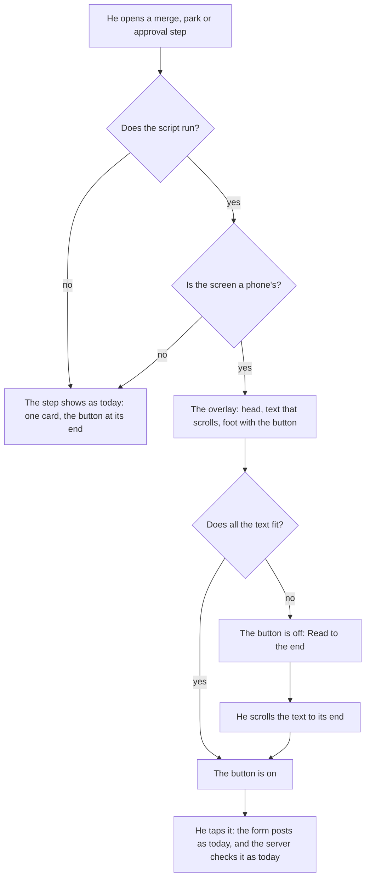

# On the phone, a step that asks the owner to confirm keeps its button in view

careful: yes, because the change reaches the topic "Lem changes a developer's repository without his word: … a merge": task 1 changes the confirm step that stands before the owner's merge on the board, and a defect there (a button that comes on before the text is read, a form that loses `confirm=yes` or the commit) makes a mistaken merge easier.

## Acceptance criteria

Size: full, because three act steps of the board change on the phone, one of them the confirmation of the owner's merge, which is careful.

1. On a phone, the merge confirm step opens as an overlay whose button is in view from the first look:
   1. On a screen of 390 × 844, pull request 31 waits for his merge; it is not green for four reasons and it is careful.
   2. He taps "Merge…" in "Waits for you".
   3. The overlay shows the head "Merge #31 · confirm" at its top, the text in a middle part that scrolls by itself, and a foot with the button and "Back" at its bottom, all inside the screen.
2. The text of the merge step keeps its order: green or not green, the reasons, the "Careful:" line, the facts (pull request, commit, branch, into, lands as), and the note that a merge cannot be undone; the button is after all of them, in the foot.
3. While text is still below the screen, the button is off and says "Read to the end ↓"; it comes on when he has scrolled the text to its end:
   1. Pull request 31 opens with its facts and its note below the screen.
   2. The button reads "Read to the end ↓", and a tap on it sends nothing.
   3. He scrolls the text to the note at its end.
   4. The button reads "Merge pull request #31" and is on.
4. When the whole text fits on the screen, the button is on at once: green pull request 32 with no reasons shows "Merge pull request #32" on from the first look.
5. The park step and the approval of the criteria open the same overlay on a phone, each with its own text and its own button, under rules 3 and 4: "Park…" on task gift-note-in-export shows its text and a button that is off until he has read to the end of it.
6. The guard of a merge is the same as today: the server merges only from the confirm form with `confirm=yes` and the commit the page showed, and refuses a merge whose commit moved since, with "Read the confirm step again".
7. On a desktop's screen each of the three steps shows as it does today, with no fixed foot and the button on at once: pull request 31 at 1440 × 900 shows its text and the button below it in the page.
8. With no script the three steps work as they do today: the page scrolls as one, the button is on at the end of the text, and the merge runs.

## How it works

The server renders each of the three steps in the same three parts: a head, a body with the text,
and a foot with the form and "Back". With no script the three parts are one card that scrolls with
the page, as today. With the script, a controller marks the step; on a phone's screen the CSS then
makes it an overlay over the panel, with the body that scrolls by itself, and the controller turns
the button off until the body was scrolled to its end.

## Tasks

1. **The merge confirm step is the overlay on a phone.** In `merge_step()`
   (`skills/lem/scripts/lem_board_task.py`) the card gets three parts in the order of today: a head
   (the eyebrow, which reads "Merge #N · confirm" when the pull request has a number, else
   "Merge · confirm"), a body (green or not green, the reasons, the "Careful:" line, the facts and
   the note, in that order), and a foot (today's `act-row` with the form of `P.act_form()` and
   "Back"). The form, its hidden fields `confirm=yes` and `tip`, and `serve.py` do not change. A new
   Stimulus controller of one job in `tools/board-kit/controllers/` (named in `controllers/index.js`,
   as `tools/board-kit/README.md` says) goes on the card only when the step has its button
   (`ctx.can_act` and a tip). On connect it sets a `data-js-*` attribute on the card, which a morph
   keeps (`app.js`). The phone's CSS in `skills/lem/assets/board.css`, inside its
   `@media (max-width: 700px)` and only under that attribute, makes the card a fixed overlay over the
   panel (above its head and its sticky `.ptabs`), the head and the foot fixed, the body the one part
   that scrolls, with room for the phone's bottom edge (`env(safe-area-inset-bottom)`). The controller
   gates the button only while the body scrolls by itself, which it reads from the body's computed
   style, so the 700 px of the CSS is the one place that tells a phone: while text is below the body's
   end it sets `disabled` on the button and shows "Read to the end ↓" in place of its label; at the
   end of the body (a few pixels of slack), and at once when the body fits, it puts the label back and
   takes `disabled` away. Once on, the button stays on while the step shows the same commit: the
   controller keeps the read in a `data-js-*` attribute with the form's `tip`, so a morph keeps it,
   and a morph that brings another `tip` turns the button off again. After each `turbo:morph`, which
   renders the button on and with its label, the controller applies its state again, and also on a
   resize. Then `npm --prefix tools/board-kit ci` and `npm --prefix tools/board-kit run build`, and
   commit `skills/lem/assets/vendor/board-app.js` with the source; `board-icons.json` and
   `mermaid.min.js` must come out of the build unchanged.
   Unit cases in `tests/unit/test_board_task.py` for the HTML of `merge_step()`: the three parts, the
   six items in their order in the body, the form with `confirm=yes` and the tip in the foot, the
   controller only on a step with its button, and the head with the number. Browser checks in
   `tests/lem-board-keys.sh`, on the demo of `tests/board-showcase.py` as that block serves it
   (`refund-line-on-receipt`, pull request 44, not green for four reasons), through
   `tests/board-cdp.mjs` (extend the driver where a check needs it, as a script turned off with
   `Emulation.setScriptExecutionDisabled`): at 390 × 844 the head, the button and "Back" are inside
   the screen, the button is `disabled` and reads "Read to the end ↓", a click on it posts nothing (no
   `board.act` event), and after the body is scrolled to its end it reads "Merge pull request #44" and
   is on; at a phone's width with a height where the whole body fits, the button is on at once; at
   1440 × 900 the card has no fixed part and the button is on; with the script turned off at
   390 × 844 the page scrolls as one, the button is on at the end of the text. The demo writes no
   `landing.json`, so its merge step has no button today (`merge_step()` shows the form only with a
   proposed tip): the check writes that record into the demo's task directory itself, with the
   proposed tip and pull request 44, as `land.py` writes it for an open task. A case the demo lacks
   is made the same way, by the viewport's size or by what the check adds to the demo's state, as the
   block's other checks do, never by a change of the demo in `board-showcase.py`: `lem criteria red`
   runs the block on the base commit. In `tests/lem-board-act.sh` the confirm page's words follow the new head
   ("Merge #1 · confirm Green"), and one check posts the form with a tip other than the page's and
   sees "Read the confirm step again" with nothing merged. Each check that needs Chrome prints a
   `SKIP` line of its own where Node or Chrome is missing. Serves criteria 1, 2, 3, 4, 6, 7 and 8 for
   the merge step.
   Files: `skills/lem/scripts/lem_board_task.py`, `skills/lem/assets/board.css`,
   `tools/board-kit/controllers/` (the new controller and `index.js`),
   `skills/lem/assets/vendor/board-app.js`, `tests/unit/test_board_task.py`, `tests/lem-board-keys.sh`,
   `tests/board-cdp.mjs`, `tests/lem-board-act.sh`.
2. **The park step and the approval of the criteria take the same overlay.** `park_step()` gets the
   same three parts: the head (its eyebrow "Park · breaker N"), the body (what stopped the build and
   what a park keeps), and the foot (the form with its field "Why, in one line", and "Back").
   `approve_card()` gets them too, only when it holds the form: the head (its `card-head`), the body
   (the criteria's text), and the foot (the form with its line under the button, and "Back" to the
   task's Overview through `act_back()`, which shows only in the overlay, so the desktop keeps the
   card of today). The same controller and CSS as task 1, with no new rule: the controller keeps the
   read with the key of the step's text, the form's `digest` for the approval and the breaker's
   number for the park. Rebuild `board-app.js` when the controller changes. Unit cases for the HTML
   of both, as in task 1. Browser checks in `tests/lem-board-keys.sh`: "Park…" on
   `gift-note-in-export` and the approval on `stock-on-product-page`, each at a phone's size where
   its text is below the body's end (the button off) and after the scroll (on), and each at
   1440 × 900 as today. Serves criterion 5, and criteria 7 and 8 for these two steps.
   Files: `skills/lem/scripts/lem_board_task.py`, `skills/lem/assets/board.css`, the controller,
   `skills/lem/assets/vendor/board-app.js`, `tests/unit/test_board_task.py`, `tests/lem-board-keys.sh`.
3. **The pictures of the merge overlay, and the documents.** `shots()` in `tests/board-showcase.py`
   makes four more pictures at `PHONE`, light and dark: `phone-merge-off-*` (the merge step of
   `refund-line-on-receipt` as it opens) and `phone-merge-on-*` (its body scrolled to the end), with
   an `eval` step as `story` has one. So that the step has its button, the demo's
   `refund-line-on-receipt` gets the `landing.json` that every open task has (the tip of its
   `proposed` event and pull request 44, in `land.py`'s form); when that changes a committed picture
   of `assets/screens/` (the task's header on `task-*`), make that picture again and commit it. The
   four new pictures go into the output folder with the others and are not committed: no page shows
   them, as no page shows `waits-*`. `docs/board.md`, "Act from the board":
   the line of **Merge** says that on a phone the step opens over the panel and its button comes on
   when you have read to the end; one sentence says the same for **Park it** and **Approve the
   criteria**, in the guide's STE. `AGENTS.md`, "Checks": the line of `tests/lem-board-keys.sh` says
   it also holds the confirm overlay on a phone; and the docstring at the top of
   `tests/board-showcase.py` names the new pictures. Read `README.md` and `site/index.html` for a
   sentence on the merge step that the change makes false, and correct it there and in the other in
   the same commit. Serves no criterion.
   Files: `tests/board-showcase.py`, `assets/screens/` only where a picture changed, `docs/board.md`, `AGENTS.md`, and `README.md` or
   `site/index.html` only where one says how the merge step looks.

## Decisions

- **The head of the merge step reads "Merge #N · confirm" on every screen**, the words of
  criterion 1; on a desktop only the eyebrow's words change, and the layout is as today
  (criterion 7). A pull request with no number keeps "Merge · confirm".
- **The overlay comes only with the script, and only where the phone's CSS makes the body scroll.**
  Criterion 8 asks for today's page with no script, so the CSS keys on an attribute that only the
  controller sets; the controller gates the button only when the body's computed style scrolls, so
  the breakpoint has one place, `board.css`.
- **The read belongs to the text it read**: a morph that brings another commit (or other criteria)
  turns the button off again. Without it, a morph after his read would leave the button on over a
  commit whose step he did not read, and the server's guard would take it, since the morph also
  brings the new commit into the form. Its cost is one attribute compared on each morph.
- **The overlay comes only on a step that has its button.** A page that may not act (`ctx.can_act`
  false) shows the line that says where to act, as today, and has nothing to gate.
- **The approval's overlay gets "Back" to the task's Overview**, as the merge and the park steps
  have, so a phone can leave it without the approval; a desktop does not show it.
- **The browser checks go into `tests/lem-board-keys.sh`**, which already serves the demo to
  headless Chrome; a new block would start a second server for the same afternoon.
- **The pictures stay out of `assets/screens/`**, since no page of the README, the guides or the
  site shows them.

## Not verified

- A real phone, Safari and the Hotwire Native app: the checks run headless Chrome at a phone's size
  with touch on, and the keyboard over a fixed foot (the park step's field) is not drawn.
- A screen reader: the button's `disabled` and its label are read as any other; no check runs one.
- A conflict with `merge-button-after-failed-merge` and `i-want-to-improve-merge`, which may change
  the same step: the landing brings the branch onto the base.
