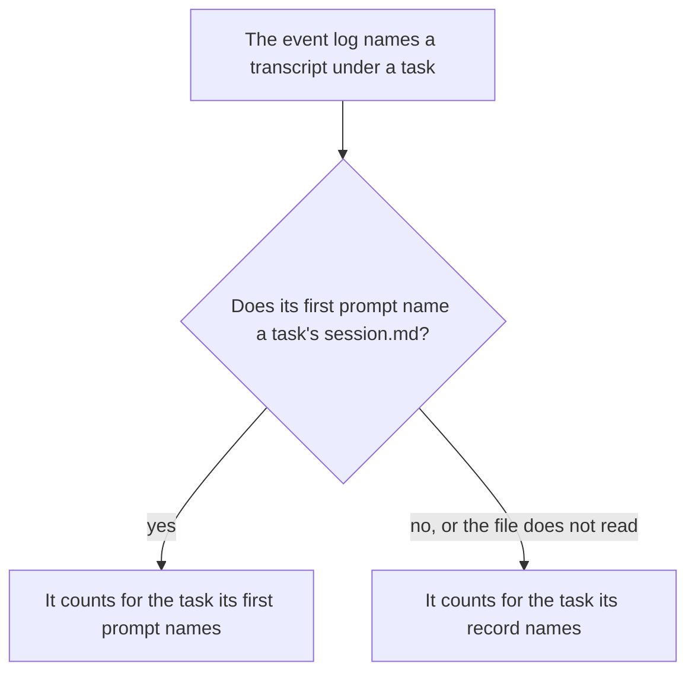

# A Claude Code transcript counts for the task whose session it is

careful: yes, because it changes which Claude Code sessions Lem takes as a task's own, from the `session.transcript` records of the event log, which reaches the topic "A task's record is lost or wrong" (the record of task board-card-search names a transcript of task merge-leaves-board-lock) and the guard of a stopped session, which reads the same records.

## Acceptance criteria

Size: full, because two readers of the task's Claude Code sessions, the token count and the signs of work, change the rule by which a transcript belongs to a task.

1. A Claude Code transcript counts for the task whose session it is, also when Claude Code's background host logged it under another task:
   1. Claude Code's background host started from the pane of task board-card-search, and it keeps `LEM_TASK=board-card-search`.
   2. The session of task merge-leaves-board-lock forks transcript 6fe214ec in that host, and the event log names 6fe214ec as a transcript of board-card-search.
   3. The first prompt of 6fe214ec is "Read .../tasks/merge-leaves-board-lock/session.md and follow it."
   4. The token count of board-card-search does not count 6fe214ec, and the token count of merge-leaves-board-lock counts it once.
2. A transcript whose first prompt names no task counts for the task its record names, as today: the owner types `/clear` in the session of task gift-note, the new transcript starts with his own words, and the token count of gift-note counts it.
3. The signs of work of a task's session come only from that task's transcripts: the transcript of the session of task board-card-search has its newest turn at 10:00, the fork 6fe214ec of merge-leaves-board-lock is logged under the same agterm session and writes a turn at 10:40, and `lem session list` gives board-card-search the sign 10:00.

## How it works

Which task a transcript of the event log counts for, in the token count and in the signs of work:

## Tasks

1. **The token count takes each transcript's task from its first prompt** (criteria 1 and 2). In `skills/lem/scripts/lem_tokens.py`:
   - One pure rule gives the task a first prompt names: the slug of the path `.lem/state/tasks/SLUG/` in the text of the transcript's first `user` record that is not `isMeta`, as `lem session open` writes it (`launch_line` in `session.py`: `Read TASK_DIR/session.md and follow it.`), or None when it names none. One reader gives that first prompt of a transcript file, read from its start until its first such record, and None for a file that does not read.
   - `transcripts_of(state, slug)` reads every `session.transcript` record of the log, not only those whose `task` is the slug, and keeps a transcript when the task its first prompt names is the slug, or when its first prompt names no task and its record's `task` is the slug. Each transcript once, in the order logged, as today.
   - The module's docstring says the rule, with its source: 6fe214ec, a fork (`source: fork`, `sessionKind: bg` in its records) of the session of merge-leaves-board-lock logged under board-card-search on 2026-11-22, and the probe of this task over the 98 records of this repository's log on 2026-11-23 (1 record on another task than its first prompt names, that one).
   - Tests in `tests/unit/test_tokens.py`: a log that names a transcript of task B under task A counts it for B and not for A; a transcript whose first prompt names no task counts for its record's task; a transcript that is gone keeps today's count in `missing` for its record's task.
2. **The signs of work leave out a transcript of another task** (criterion 3). The records that `session.py` gives `lem_signs` (`records` beside `lem_signs.own_records` in `session.py`, the two places that read them for `lem session list` and for the guard) lose each record whose transcript's first prompt names another task than the slug, by the rule of task 1, which `lem_signs` imports from `lem_tokens`. `read_signs` stays a pure function of its facts. The docstring of `lem_signs.py` says that a record of a background host that names another task's transcript counts for none. Tests in `tests/unit/test_signs.py`: a record whose transcript's first prompt names another task gives no signs, beside today's case of the old pane's record.
3. **The hook's docstring says what its record holds** (no criterion). In `skills/lem/scripts/session_hook.py` the module docstring and `transcript_record`'s say that the record's `task` and `session` are the hook's environment's, which Claude Code's background host keeps from the pane that started it, and that the readers take a transcript's task from its first prompt (`lem_tokens`). The hook itself does not change.

## Decisions of the plan

- **The task of a transcript is read when it is counted, from the transcript, and not when the hook logs it.** At the hook of a fork the hook's input names no parent session (Claude Code's `SessionStart` input: `source`, `agent_type`, `model`, `session_title` and the resume fields, read 2026-11-23 through Context7 from `mods/types/claude-code.d.ts`), and its environment is the host's. The first prompt of a fork is the parent's launch line, which the fork's transcript copies (6fe214ec's first `user` record is merge-leaves-board-lock's launch line, with the time of that session's start, 2026-11-22T01:33:27Z). Whether that copy is in the file when the hook runs was not checked, so the hook does not rely on it.
- **A transcript whose first prompt names no task keeps its record's task.** That is a `/clear` in the task's own pane, whose new transcript starts with the owner's words; none was in the log on 2026-11-23 (the probe's 0 records with `source` `clear` or `resume`). It keeps today's count for it; a `/clear` inside a background host of another task is not reached.
- **The board's timeline and the Inbox keep the record as it is.** The board model reads no transcript file (`lem_board_model.py` is pure over the state folder), so its line "Claude Code started in the task's session" for 6fe214ec under board-card-search stays; the Inbox's `claude_of` already passes over a fork (`lem_inbox.py`). No record is rewritten: the event log keeps what the hook saw.
- **The records already logged are read by the new rule, and none is rebuilt** (the decision `out of scope: the records of past tasks that are already wrong` in the task's record): the rule reads each transcript, so board-card-search's count drops 6fe214ec without an edit of the log.

## What it will not verify

- A real fork in Claude Code's background host: the tests give the readers a log and transcripts in the form 6fe214ec has, since no check can start that host on purpose.
